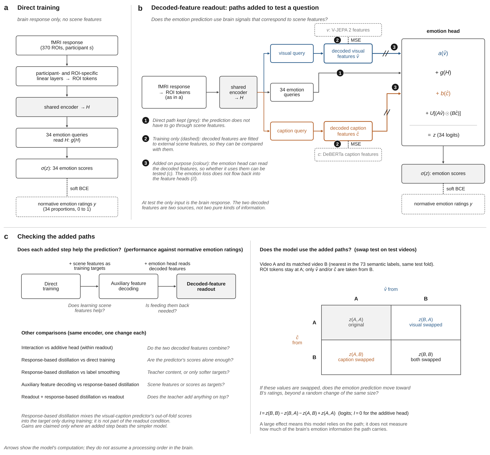

# EmoBrain proposal

- 날짜: 2026-11-03
- 통합문서(2026-11-03판)에서 만든 판이다. 통합문서와 다르면 통합문서를 따른다.
- 결정된 것과 그 이유만 담았다. 해석 규칙, 버린 대안, 한계는 통합문서에 있다.
- 같은 폴더의 다른 문서
    - 01_integrated_document.md: 모든 결정의 기준이 되는 통합문서
    - 03_thesis.md: 영어 학위논문 초안(서론, 방법, 분석 계획과 예상 결과, 논의)
    - 04_claude_code_workorder.md: 레포에서 구현할 내용을 정리한 Claude Code 작업 지시서
- 0~6절의 번호는 통합문서를 따른다. 7절의 괄호 안 영문 번호(ex) H2)는 통합문서 7단계 표의 행 번호다.
- 인용은 저자-연도로 쓰고, 서지는 부록 A에 있다. [미확인]은 원문으로 확인하지 못한 것이다.

# 1부. 질문과 스토리라인

## 0. 고정 사실과 주장 범위

- 이 논문은 모델 논문이 아니다. 정서 신경과학 질문이 질문 1이고, 모델 질문이 질문 2다.
- 정서는 "시각 자극이 일으킨 정서(visually evoked emotion)"다. Horikawa 외(2020)의 제목에서 온 말이다.
- 자료는 Horikawa 외(2020)의 5명, 분석 영상 2,181개다. MC(MindCaptioning, Horikawa, 2025)의 최종 시험 영상 72개는 Horikawa 쪽 개발의 모든 단계에서 뺀다.
- 정서 범주는 Horikawa 외(2020)를 따른 34개다. 값은 그 범주에 "예"라고 답한 평정자의 비율(0~1)이다. 14개 정서 차원(1~9점)은 본 실험 밖에 둔다.
- 정답은 규범 평정이다.
- 시험 때 입력은 뇌 반응뿐이다. 딥러닝으로 답하고, 선형 모델은 기준선이다.
- MC 시청 자료로 HK(Horikawa 자료)에서 학습한 공유 모델의 전이를 평가한다. MC 회상은 필수 실행 범위 밖이고, 하게 되면 탐색적 보조 분석이다.
- 주장 범위: "뇌 반응에는 그 장면이 사람들에게 어떤 정서를 얼마나 일으키는지에 대한 정보가 있다"까지다.
    - 이유: 정답이 참가자 본인의 평정이 아니라 다른 평정자의 규범 평정이다.
- 뇌, 시각 특징, 캡션 특징을 함께 받는 모델은 질문 1의 해석에 쓰지 않는다. 보조 성능 비교 하나만 한다(7-3).
- LLM은 기본 구성에서 뺐다.
- 결정 규칙
    - 모든 결정은 선행 연구의 근거를 갖는다.
    - 우리 결과를 비교해서 설계를 고르지 않는다. 같은 자극에서 선행 논문이 고른 것을 따르는 것은 근거로 인정한다.
    - 결과를 보고 설계를 바꾸는 조건부 규칙을 쓰지 않는다. 결과에 따라 주장 범위만 조정한다.

## 1. 용어, 대전제, 질문

### 1-1. 용어

| 용어 | 영어 | 뜻 |
| --- | --- | --- |
| 시각 정보 | visual information | 장면이 어떻게 보이는지(색, 형태, 움직임). 개념 |
| 의미 정보 | semantic information | 장면에서 무슨 일이 일어나는지(사물, 행위, 사건). 풀어 쓸 때는 "상황". 개념 |
| 시각 특징, 캡션 특징 | visual features, caption features | 시각 모델(V-JEPA 2)이 영상에서 뽑은 표현과, 사람이 쓴 캡션을 언어 모델(DeBERTa)로 바꾼 표현. 출처의 이름인 측정치 |
| 이름표 73개 | 73 semantic labels | Horikawa 외(2020)가 영상마다 매긴 개념 이름표(ex) 고양이, 실내). 값은 평정자 비율. 짝과 내용 구역을 만드는 재료 |
| 규범 평정 | normative emotion ratings | 각 영상에서 그 범주에 "예"라고 답한 평정자의 비율(0~1). fMRI 참가자가 아닌 다른 사람들의 평정 |
| 뇌 모델 | brain-only emotion decoder | 뇌 반응만 입력으로 받는 모델. student를 맡는다 |
| Feature Extractor | Feature Extractor | 시각 특징과 캡션 특징을 뽑는 고정된 모델(V-JEPA 2, DeBERTa). 학습하지 않고 teacher도 아니다 |
| feature decoding, decoded features | feature decoding, decoded features | 뇌 반응에서 Feature Extractor의 특징 값을 맞히는 일과 그 값 |
| 특징 모델(T_VS) | visual-caption emotion predictor | 시각 특징과 캡션 특징을 받아 정서 점수를 내는 모델. teacher를 맡는다 |
| 직접 학습 | Direct training | 정서 정답만으로 학습하는 조건 |
| 출력 distillation | Response-based distillation | teacher의 정서 예측 출력을 따라 학습하는 조건 |
| 특징 맞히기 연습 | Auxiliary feature decoding | feature decoding을 보조 목표로 더하는 조건 |
| 주 조건 | Decoded-feature readout | ROI token을 바로 읽는 경로와 두 decoded features를 읽는 경로로 정서를 내는 조건 |
| 주 조건 + 출력 distillation | Decoded-feature readout + response-based distillation | 주 조건에 출력 distillation을 더한 조건 |
| 바꿔 끼우기 | interchange interventions on decoded features | 모델 안의 decoded features를 짝 영상의 것으로 바꾸는 개입(4-2) |
| 결합 지표 I | interaction contrast (I) | logit 척도의 차이의 차이(4-2) |
| 더하기 head, 상호작용 head | additive head, interaction head | 5-4의 수식으로 정의 |
| 내용 구역 제외 시험 | evaluation on held-out content blocks | 4-3, 6-2 |
| 네트워크 단독 학습, 교란 | network-restricted training, network input perturbation | 6-4. network는 brain network |
| frozen head 비교 | frozen-head distillation | teacher의 중간 표현을 맞히며 고정한 head를 재사용(7-3) |

- 대전제와 질문에는 개념을, 방법과 결과에는 측정치를 쓴다. 영어 이름은 thesis에서 쓰는 이름이고, 이 문서 본문은 한국어 용어를 쓴다.

### 1-2. 대전제

- 대전제: 시각 자극이 일으킨 정서는 장면이 어떻게 보이는지(시각 정보)와 그 장면에서 무슨 일이 일어나는지(의미 정보)를 함께 처리한 결과로 생기며, 그 신경 표상은 고차원적이고 범주적이며 여러 영역에 퍼져 있다.

| 대전제의 부분 | 근거 |
| --- | --- |
| 시각 정보에서 정서로 | Kragel 외(2019) |
| 상황에서 정서로 | Skerry & Saxe(2015), Moors(2017) |
| 두 정보를 함께 처리 | Kragel 외(2019), Satpute & Lindquist(2019), Mobbs 외(2006) |
| 고차원, 범주적, 여러 영역 | Horikawa 외(2020), Cowen & Keltner(2017) |

- 이 연구가 검정하는 것은 대전제 자체가 아니라, 대전제가 뇌 자료에서 갖는 함의(질문 1)다.

### 1-2b. 두 특징으로 나누는 이유

- 결정: 측정을 출처가 다른 두 표현(시각 특징, 캡션 특징)으로 나눈다.
- 이유: 대전제가 정서를 두 정보의 결합으로 보므로, 측정도 나눠야 각각의 연결(질문 1-1)과 결합(질문 1-2)을 물을 수 있다.
- 근거
    - 뇌에서 시각에서 얻은 의미 표상과 언어에서 얻은 의미 표상은 서로 다른 망에 있고 경계에서 정렬된다(Popham 외, 2021).
    - 같은 영상에서 시각 모델 특징과 사람이 쓴 문장 설명을 따로 만들어 뇌와 이었다(Lahner 외, 2024).
    - 같은 자극의 선례: Horikawa 외(2020)는 VGG19와 의미 이름표를, Horikawa(2025)는 TimeSformer와 DeBERTa-large를 따로 뇌와 이었다.
    - 글만으로 학습한 언어 모델의 캡션 표현이 장면을 볼 때의 뇌 활동을 설명했다(Doerig 외, 2025).
    - 뇌에서 두 특징을 따로 decoding해 함께 썼다(Ozcelik & VanRullen, 2023; Takagi & Nishimoto, 2023).

### 1-3. 목표, 질문, 가설

- 목표: 영상과 캡션 없이 뇌 반응만으로, 그 사람이 본 장면의 정보와 그 장면이 사람들에게 일으키는 정서(34개 범주의 규범 평정)를 읽는다.
- 관점: 뇌만 받은 모델이 장면 정보를 거쳐 정서를 읽는 관점(관점 A)을 주로 둔다.
    - 이유: 출처별 경로가 따로 있어야 하나만 바꿔 볼 수 있다. 중간 개념을 두면 개입이 쉬워진다(Koh 외, 2020).
    - 뇌, 시각 특징, 캡션 특징을 함께 받는 관점(관점 B)의 성능 점검(T_BVS 대 T_VS)은 보조이고 필수 실행 범위 밖이다.

#### 질문 1(정서 신경과학)

- 질문 1: 시각 자극을 볼 때 나타나는 정서 관련 뇌 반응은, 장면의 시각적 특성과 의미에 어떻게 연결되어 있는가?
- 중심 가설: 뇌의 정서 정보는 시각 정보, 의미 정보와 결합된 형태로 표상되고, 어느 정보와 어떻게 결합되는지는 정서마다, 영역마다 다르다.

| 하위 질문 | 가설 | 근거 | 분석 |
| --- | --- | --- | --- |
| 1-1. 정서마다 어느 정보와 더 강하게 연결되는가? | 정서마다 시각 특징 경로와 캡션 특징 경로를 바꿨을 때의 효과가 다르다. 어느 경로가 더 클지는 정하지 않는다 | Kragel 외(2019), Skerry & Saxe(2015) | 바꿔 끼우기(4-2). 보조 비교: Kragel 외(2019)에서 정지 프레임 분류 성능이 높았던 정서와 낮았던 정서 |
| 1-2. 두 정보는 따로 보태는가, 서로에 따라 달라지는가? | 일부 정서에서 상호작용이 있다 | Moors(2017), Mobbs 외(2006) | 더하기 head 대 상호작용 head, 결합 지표 I(5-4) |
| 1-3. 그 연결의 정보는 어느 영역에 있는가? | CAB-NP의 1차 시각, 2차 시각, Default 네트워크 각각의 뇌 반응만으로 정서 점수를 예측할 수 있고, 정서별 예측 상관의 평균(6-4의 평가 정서 목록)은 순열 기준보다 높다. 성능 순위와 경로 대응은 예상하지 않는다 | Horikawa 외(2020)의 영역별 decoding을 확장, Satpute & Lindquist(2019), Kragel 외(2019) | 네트워크 단독 학습(6-4a). 일차 확인은 직접 학습 모델 |
| 1-4. 처음 보는 종류의 장면과 떠올리기만 할 때도 연결이 유지되는가? | 처음 보는 장면에서 어느 경로와 연결된 정서가 더 잘 유지될지는 정하지 않는다. 회상은 탐색적 보조로 보류한다 | 회상을 하게 되면 Horikawa(2025), Satpute & Lindquist(2019) | 내용 구역 제외 평가(6-2), MC 시청 전이(6-3) |

#### 질문 2(모델)

- 질문 2: 이러한 장면 정보와의 연결을 학습에 활용하면, 뇌만으로 정서 점수를 예측하는 방식은 어떻게 달라지며, 처음 보는 장면에서는 어떤 정보를 이용해 예측하는가?
- 틀: 학습 때만 있는 장면 정보를 쓰는 learning using privileged information이다(Vapnik & Vashist, 2009; Lopez-Paz 외, 2016).

| 하위 질문 | 가설 | 근거 | 분석 |
| --- | --- | --- | --- |
| 2-1. 학습: 뇌 모델은 뇌 반응에서 장면 정보를 decoding하는가? | decoding한다 | Horikawa(2025), Horikawa & Kamitani(2017) | ridge decoding과 주 조건의 decoded features를 순열 기준과 비교 |
| 2-2. 이용: 정서를 예측할 때 decoding한 장면 정보를 쓰는가? | 쓴다. decoded features만 짝 영상의 것으로 바꾸면 예측이 무작위 변화보다 짝 쪽으로 움직인다 | Koh 외(2020), Geiger 외(2021) | 바꿔 끼우기(4-2) |
| 2-3. 효과와 일반화: 장면 정보를 쓰도록 학습하면 예측이 나아지는가? 처음 보는 장면과 MC 시청 자료에서는? | 특징 맞히기 연습이 직접 학습보다 높다. 처음 보는 장면에서 주 조건이 직접 학습보다 높다. 나머지 조건 비교와 하락폭 차이는 방향을 정하지 않는다 | Horikawa & Kamitani(2017)에 우리 설계 논리를 더한 사전 가설 | 조건 비교(6-1), 6-2, 6-3 |
| 2-4. 영역: 모델은 어느 영역에 기대는가? | 같은 네트워크 입력을 교란했을 때 주 조건과 직접 학습의 하락폭이 다른지 검정한다. 방향은 정하지 않는다 | 선행 연구를 찾지 못해 방향 없음 | 네트워크 입력 교란(6-4b) |

#### 두 질문의 관계

- 모델은 질문 1을 검토하는 도구이고, 질문 2는 그 도구가 실제로 무엇을 읽고 쓰는지 묻는다.
- 질문 1의 답은 세 근거를 이어서 낸다.
    - 평가 영상의 뇌에서 두 특징을 맞힐 수 있는가(질문 2-1)
    - 맞힌 특징을 정서 예측에 쓰며, 함께 쓰는 방식은 어떤가(질문 2-2, 1-2)
    - 그 대응과 사용이 어느 영역에서 읽히고, 처음 보는 장면에서도 유지되는가(질문 1-3, 1-4)
- 결과 순서: 뇌에서 정서 예측(Horikawa 외, 2020의 재현), 뇌에서 장면 특징 decoding(Horikawa, 2025의 재현), 경로 의존과 결합, 처음 보는 장면

### 1-4. 신규성

- 신규성 문장: "본 연구는 영상을 볼 때의 뇌 반응에서 예측되는 34개 정서의 규범 평정이 장면의 시각 특징, 캡션 특징과 어떻게 연결되는지 검사한다. 뇌 반응을 직접 읽는 경로를 유지하면서, 뇌에서 decoding한 두 특징도 정서 예측에 쓰도록 모델을 구성한다. 두 특징을 각각 또는 함께 바꿔 끼우고, 더하기 head와 상호작용 head를 비교해 모델의 경로별 의존과 결합 방식을 검사한다. 학습에서 뺀 내용 구역과 MC 시청 자료에서는 정서 예측의 일반화를 평가한다."
- 신규성으로 주장하지 않는 것(선행 연구에 있음)
    - 세밀한 정서 디코딩: ML-BVAE(Fu 외, 2024)
    - 34차원 연속 회귀: GED(Huang 외, 2022)
    - 정서 학습의 distillation: AESL(Fu 외, 2025)
    - LLM 사용: EmoMind(Mohammed 외, 2026)
    - 시각 특징과 캡션 특징을 함께 쓰는 것 자체
    - 뇌에서 두 특징을 따로 decoding해 함께 쓰는 구조(Ozcelik & VanRullen, 2023; Takagi & Nishimoto, 2023)
    - 뇌에서 decoding한 중간값에 개입하는 것 자체: EmoMind의 SWAP 분석(Mohammed 외, 2026)
    - brain token과 학습하는 query로 특징을 맞히고, 그 출력을 받는 모델까지 학습하는 구조(Beliy 외, 2026)
    - 해석을 위해 뇌와 최종 출력 사이에 중간 층을 두는 것(Cammarota 외, 2025)
    - 같은 자료에서 시각, 의미 모델로 설명되지 않는 정서 정보가 있다는 것(Horikawa 외, 2020)
- "최초"라고 쓰지 않는다. 같은 설계가 없는지는 선행 연구 검색으로 점검한다(3부 확인 목록).

# 2부. 방법

## 2. 자료와 라벨

### 2-0. 자료와 분할

| 항목 | 정한 것 | 이유 |
| --- | --- | --- |
| 영상 집합 | 파일 2,196개, 분석 영상 2,181개(중복 15개 뺌), 개발 영상 약 2,109개(MC 72개 뺌. 목록 파일 위치 [미확인]) | 따로 밝히지 않으면 분석 영상 |
| 중복 영상 | 두 번 제시된 15쌍은 먼저 제시된 반응을 남긴다. 거의 같은 내용인 1349와 1363은 둘 다 남기고, 같은 내용 쌍은 모두 같은 fold에 둔다 | Horikawa 외(2020) Methods, 레포 stimulus_crosswalk.tsv |
| 정답 형태 | 34개 비율(0~1) 그대로. z-score하지 않음 | soft BCE에 0~1이 필요. 정서별 r은 선형 변환에 영향받지 않아 Horikawa 외(2020)와 비교 가능 |
| 제외 자료 | 반응 크기 기준으로는 빼지 않음. 움직임 QC(FD > 0.9 mm)로 빠진 block과 despike만. sub-05는 있는 block(2,085개)만 쓰고 5명 공통 영상 결과도 냄 | 0단계의 튀는 block 기준은 근거가 없고, 표시된 block과 run에 움직임과 신호 급변의 뚜렷한 원인이 없었음 |
| 영상당 뇌 반응 | 신호를 4초 밀어, 영상 제시 구간과 뒤따르는 2초 휴지로 된 블록 안에서 평균. 정규화는 run 안 z | 평균 구간은 Horikawa 외(2020)의 절차. 정규화는 이 설계의 결정이고, 원문과 표준화 범위(영상 전체 대 run 안)가 다르다 |
| 참가자 | 5명을 한 모델로 학습. 참가자마다 입력층만 따로, 나머지 공유. 평가는 참가자별 | MindEye2(Scotti 외, 2024). 같은 영상에 대한 5명의 반응을 함께 배움 |
| 선형 기준선의 참가자 | 참가자마다 따로 학습 | Horikawa 외(2020), Horikawa(2025)와 비교 |
| 분할 | run 묶음 6 fold(horikawa_rungroup6_v1). 한 영상의 5명 행은 같은 쪽 | 이웃 block의 혈류 반응이 섞이지 않게. Horikawa 외(2020)의 6-fold 구조 |
| 세션 조건 | 어느 참가자에서도 한 fold의 시험 run이 한 세션에 몰리지 않게 함. 분할 코드에서 fold별 세션 수와 한 세션의 최대 run 수를 검사 | 세션 묶음이 낙관적 추정을 줌(Varoquaux 외, 2017) |

### 2-1. 출력과 손실

- 출력: 34개 정서 점수를 한 번에 낸다(sigmoid). softmax를 쓰지 않고 합을 1로 맞추지 않는다.
    - 이유: 평정자가 여러 범주를 고를 수 있었고(Cowen & Keltner, 2017의 보충자료), 34개 합은 평균 1.71(1.00~4.27)이다.
- 손실: 영상과 정서에 같은 가중치를 둔 soft BCE
    - 이유: 평정 비율에 대한 soft BCE는 평정자 응답 하나하나에 대한 BCE의 평균과 같다.
    - 영상별 평정자 수를 확인하지 못해(원문은 9~17명 범위) 평정자 수로 가중하지 않는다.
- 선형 기준선: ridge(Horikawa 외, 2020)와 soft BCE 선형 둘 다

### 2-3. 주 평가

- 참가자마다, 정서마다 시험 영상 약 2,100개(6 fold의 시험 결과를 모은 것)에 걸친 Pearson r을 내고 34개를 평균한다. 5명의 값, 평균, 정서별 결과를 보고한다.
    - 근거: Horikawa 외(2020)의 정의와 같다.
    - 정서별로 내는 이유: 질문 1이 정서마다 다른지를 묻는다. 34개를 한데 모으면 정서 사이의 평균 차이만으로 상관이 생긴다.
- 계산할 수 없는 r은 0으로 채우지 않고 빼고 그 수를 보고한다.

### 2-4. 보조 평가와 정서별 보고

- 보조 평가: 평균 예측 대비 오차 감소, 영상별 프로필 상관(GED(Huang 외, 2022)가 보고한 방식, 평균 프로필 기준선과 함께), 정답 0과 0 초과로 나눈 오차, R², MAE
- 영상 식별(Horikawa 외, 2020의 범주 81.9%)은 선행 연구 비교용이다.
- 정서별 보고(2-6): 34개 모두 학습하고 보고한다. 정서마다 0이 아닌 영상 수, 평정의 분산, bootstrap 구간, "계산 불가"를 함께 적는다.

## 3. 특징

| 항목 | 정한 것 | 이유 |
| --- | --- | --- |
| 주 시각 모델 | 동결한 V-JEPA 2 ViT-g(Assran 외, 2025. 체크포인트 facebook/vjepa2-vitg-fpc64-256) | 영상을 입력으로 받는다. 같은 Cowen 영상에서 다가오는 움직임이 각성과 연결됐고(Thieu 외, 2024), 시간 정보가 초기 시각 영역과의 일치에 중요했다(Sartzetaki 외, 2025). 말이나 이름표 없이 학습해 캡션과 출처가 덜 겹친다 |
| baseline 시각 모델 | VideoMAE(ViT-B/16 사전학습 전용), TimeSformer(Bertasius 외, 2021. Horikawa, 2025의 방식), CLIP 이미지(Horikawa, 2025의 판, 확인 못하면 OpenAI ViT-B/16) | 다른 시각 모델로 바꿔도 결론이 유지되는지 본다. TimeSformer와 CLIP은 같은 자극에서 Horikawa(2025)가 쓴 모델. 특징 모델과 주 조건만 다시 돌린다 |
| 시각 학습 목표 | V-JEPA 2 block 10, 20, 30, 40의 token 평균을 이어 붙임(5,632차원) | Horikawa(2025)에서 영역마다 맞는 층 깊이가 달랐다. 네 지점은 깊이를 고르게 나눠 미리 고정했다 |
| baseline의 층 | VideoMAE와 TimeSformer는 block 3, 6, 9, 12. CLIP은 마지막 투영 벡터 | 같은 규칙. CLIP은 Horikawa(2025)와 같음 |
| 층 저장과 층별 분석 | 40개 block 모두 저장. 모든 block에서 ridge decoding(6-fold 안의 5-fold nested CV) | Horikawa(2025)의 층별 decoding 절차. 결과로 목표 층을 다시 고르지 않음 |
| 영상 입력 | 참가자가 본 그대로. 8초 미만은 8초를 넘을 때까지 반복 | 실제 제시 방식(Du 외, 2023b; 레포 events_audited.tsv) |
| 프레임 | 초당 4장, 최대 64프레임(16초)을 한 입력으로. 16초 초과(86개)는 16초 창 평균 | 체크포인트가 64프레임으로 마무리 학습됨(Assran 외, 2025). 16초 안의 사건 순서가 한 입력에 담김 |
| 화면과 pooling | 종횡비 유지 후 가운데 정사각형, 공식 정규화, 증강 없음. 시공간 token 평균, 창 평균 | 모든 모델과 저수준 특징에 같은 화면 범위 |
| baseline 프레임 | VideoMAE는 4초 창(16프레임) 평균. TimeSformer는 Horikawa(2025)대로(32프레임 간격, 세 위치 자르기). CLIP은 초당 4장 프레임 벡터를 L2 정규화 후 평균 | 각 모델의 입력 형식과 선례 |
| 특징 캐시 | 새 규칙으로 다시 뽑고 추출 설정을 manifest에 기록 | 기존 캐시는 16프레임 고르게 뽑기이고 기록이 없음 |
| 주 캡션 encoder | DeBERTa-large 층 6, 12, 18, 24의 token 평균을 이어 붙임(4,096차원). 특수 token 제외, 캡션 20개 평균 | 같은 자극에서 언어 모델 42개를 비교해 고른 모델이다(Horikawa, 2025). 깊은 층일수록 단어 순서 효과가 컸다(Horikawa, 2025) |
| baseline 캡션 encoder | MPNet(all-mpnet-base-v2) | 문장 임베딩 갈래의 대표(Reimers & Gurevych, 2019). 시각 자극 뇌 연구의 근거가 있다(Doerig 외, 2025) |
| 캡션 자료 | MC 사람 캡션 20개 그대로. 20개 특징은 평균. 문장별 벡터도 저장 | 주석자가 시각 내용에 집중하도록 지시받았다(Horikawa, 2025). 평균은 Horikawa(2025)의 방식이고, 제곱 오차에서 무작위 하나를 맞히는 것과 같은 곳을 향함 |
| 정서어 제거판 | 주 조건과 특징 모델의 SI | 사전 분석에서 정서어를 지워도 예측력이 거의 같았음(부록 B) |
| 저수준 시각 특징 | 움직임 에너지 6,555개 + RGB 중앙값 3개 | 같은 자료의 선례(Du 외, 2023b). 색은 Jang & Kragel(2025) |
| 움직임 에너지 설정 | 96 × 96, L*만, Gabor 공간 주파수 0, 2, 4, 8, 16, 32, 시간 주파수 0, 2, 4 Hz, 방향 8개(pymoten, Nunez-Elizalde 외, 2021), 로그 변환, 초당 15장, 영상 전체에 적용 후 시간 평균, 줄이지 않음 | Du 외(2023b)의 설정과 Nishimoto 외(2011)를 따른 공식 예제 |
| 저수준 특징의 쓰임 | 정서 기준선(7-6)과 시각 block의 성격 확인 | |
| Horikawa 외(2020)의 특징 | VGG19와 이름표 73개는 학습 목표로 쓰지 않음. SI에서 닮음(CKA 또는 RSA)과 쓸모(이름표 73개 특징 모델 대 캡션 특징 모델) 비교 | 이름표 73개는 짝과 내용 구역의 재료(4절). 학습 목표로도 쓰면 짝과 구역을 정한 기준을 모델이 직접 배우게 된다 |
| 영상 길이 | 길이만으로 정서를 예측하는 기준선, 길이 구간별 결과는 SI | block 신호 크기와 길이가 상관함(부록 B) |

## 4. 비교 단위

### 4-1. 정서의 비교 방식

- 정서는 영상에 이름을 붙이거나 기준값으로 자르지 않고 연속 점수로 비교한다.
    - 이유: 한 영상에 여러 정서가 섞여 있다. Horikawa 외(2020)도 정서별 연속 점수로 디코딩했다.
- 분석마다: 정서별 r(2-3), 쌍의 점수 차이와 예측 차이의 대응(4-2), 구역 안 정서별 r(6-2)
- "이 정서가 높은 영상"을 그림으로 보일 때만 정서마다 상위 5%를 쓴다(Horikawa 외, 2020).

### 4-2. 영상 짝

- 짝: 같은 시험 fold에서, 의미 이름표 73개의 원래 비율로 낸 동일 가중치 유클리드 거리가 가장 가까운 영상 하나. 거리 상한은 두지 않는다.
    - 이유: 공변량이 비슷한 표본끼리 비교하는 최근접 매칭이다(Stuart, 2010). 이름표 73개는 같은 자료의 선례다(Horikawa 외, 2020; Du 외, 2023b). 이름표가 모두 같은 단위(비율)라 표준화하지 않는다.
    - 짝은 정서 점수와 모델 결과를 보지 않고 정한다. 모든 참가자와 조건에 같은 짝 목록을 쓰고, 짝마다 거리를 기록한다.
- 분석 1, 쌍 비교(보조 점검): 정서마다 쌍의 실제 점수 차이와 예측 차이의 대응을 본다. 이미 얻은 시험 예측으로 계산한다.
- 분석 2, 바꿔 끼우기: 같은 참가자, 같은 시험 fold, 같은 학습된 모델에서 decoded features만 짝 영상의 것으로 바꾼다. 다시 학습하지 않는다.
    - 근거: 예측한 개념에 개입하는 방식(Koh 외, 2020), interchange intervention(Geiger 외, 2021), 잡음 대신 실제 입력의 값을 쓰는 방식(Zhang & Nanda, 2024)
    - 네 조건(ROI token, decoded visual features, decoded caption features): 원래 (A, A, A), 시각만 (A, B, A), 캡션만 (A, A, B), 둘 다 (A, B, B)
    - 대조: 같은 경로에서 같은 크기로 무작위로 바꾼 변화
    - 바뀐 decoded features의 크기를 경로마다 기록한다.
    - 결합 지표: I = z(B, B) − z(B, A) − z(A, B) + z(A, A). z는 sigmoid 전 logit이다. 비선형 함수만으로 확률 척도의 상호작용이 생기기 때문이다(Ai & Norton, 2003).

### 4-3. 내용 구역

- 구역: 이름표 73개 원래 비율에 k-means 5개(scikit-learn KMeans, n_init=10, random_state=0). 크기 제약은 두지 않는다. 구역 배정 파일을 저장한다.
    - 이유: 비슷한 것끼리 묶어 통째로 빼는 block cross-validation이다(Roberts 외, 2017). 구역 수는 blockCV(Valavi 외, 2019)의 기본값이다.
    - 사전 점검: 같은 학습량의 무작위 대조와 비교해 다섯 구역 모두에서 시험 영상과 가장 가까운 학습 영상의 거리가 늘었다(구역별 비율 1.39~1.97). 뇌와 정서 자료는 쓰지 않았다.
    - 이 점검은 MC 72개를 빼지 않은 계산이라 개발 영상으로 다시 한다. 거리가 늘지 않는 구역이 있어도 구역 수는 바꾸지 않는다.
- 시험 범위: 직접 학습과 주 조건을 모든 run fold에서 구역마다 빼고 시험한다. 구역의 모든 영상이 시험 영상이 된다.
- 분할 규칙

| 구분 | 쓰는 영상 |
| --- | --- |
| 시험 | 시험 run fold 안에서 그 구역에 속한 영상 |
| 구역 제외 학습 | 시험 run fold 전체와 그 구역 전체를 뺀 영상 |
| 학습량 대조 | H2의 학습 fold 4개와 검증 fold에서 구역 제외 조건과 같은 수를 각각 무작위로 뽑은 영상. 그 구역을 후보에서 빼지 않는다 |

- 빠진 구역은 표준화, 설정 선택, 보조로 돌리는 특징 모델의 학습에도 쓰지 않는다. 이 시험의 두 조건은 teacher 출력과 frozen head를 쓰지 않는다.
- 정서마다 두 학습 조건에 남은 0이 아닌 학습 영상 수를 보고한다.

## 5. 모델

### 5-0. 학습 조건과 비교

| 조건 | 학습 목표 | emotion head가 읽는 것 |
| --- | --- | --- |
| 직접 학습 | 정답 | ROI token |
| 출력 distillation | 정답 + 특징 모델 점수 | ROI token |
| 특징 맞히기 연습 | 정답 + feature decoding | ROI token |
| 주 조건 | 정답 + feature decoding | ROI token + decoded features |
| 주 조건 + 출력 distillation(보조) | 정답 + feature decoding + 특징 모델 점수 | ROI token + decoded features |

- 모든 조건은 같은 뇌 입력과 encoder 구조를 쓰고, 시험 때는 뇌 반응만 넣는다. 논문의 주 모델은 주 조건이다.
- 한 단계에 하나씩 바꾼 비교
    - 특징 맞히기 연습 대 직접 학습: 특징 목표를 더한 효과
    - 주 조건 대 특징 맞히기 연습: decoded features를 emotion head에 넣은 효과
    - 출력 distillation 대 직접 학습: teacher 점수를 더한 효과
    - 특징 맞히기 연습 대 출력 distillation: 같은 head에서 특징 목표와 출력 목표의 차이
    - 주 조건 + 출력 distillation 대 주 조건: 그 위에 teacher 점수를 더한 효과(보조)
    - 주 조건 안의 상호작용 head 대 더하기 head: 두 decoded features의 결합(질문 1-2)
- ROI token 경로 유지: 두 특징이 정서 정보를 다 담는다는 보장이 없다. 근거는 RGB 경로와 hallucination 경로를 함께 쓴 Hoffman 외(2016), 개념 경로 옆에 residual 경로를 둔 PCBM-h(Yuksekgonul 외, 2023)다.
- stop-gradient(G8): 주 조건에서 decoded features는 값 그대로 emotion head에 들어가지만, 정서 손실의 기울기는 feature head로 흐르지 않게 막는다.
    - 이유: 바꿔 끼우기가 decoded features에 개입하므로, decoded features가 외부 특징과의 대응을 유지해야 한다. 중간값의 학습 방식이 개입 결과에 영향을 준다(Koh 외, 2020; Parisini 외, 2026).
    - 가장 가까운 뇌 decoding 선례와 다른 점: Beliy 외(2026)는 생성 손실을 뇌 모델까지 흘려 출력이 CLIP 공간과 정렬을 유지하지 않아도 되게 했다. 재구성 성능을 위한 선택이다. 우리는 해석을 위해 막는다.
    - 공유 encoder는 ROI token 경로로 정서 손실을 받는다. 기울기를 허용한 판은 후속 분석이다.

### 5-1. feature decoding 경로를 두는 이유

- 결정: 뇌 모델에 시각 특징과 캡션 특징을 각각 decoding하는 출력을 두고, 고정된 Feature Extractor의 특징을 목표로 학습한다.
- 이유: 정서 예측이 뇌의 장면 관련 정보를 썼는지 검사하려면, 외부 특징과 비교하고 교체할 수 있는 명시적인 중간 출력이 필요하다.
    - 정서만 학습한 모델을 사후에 probing하면 장면 특징이 읽혀도 그 정보를 썼는지는 알 수 없다(Belinkov, 2022).
    - 중간 개념을 맞히게 하면 그 값에 개입할 수 있다(Koh 외, 2020).
    - 뇌 decoding에서도 해석을 위해 중간 층을 둔다(Cammarota 외, 2025: fMRI → 이진 개념 214차원 → CLIP 표현). 우리 중간값은 V-JEPA 2와 DeBERTa의 고차원 특징이라, 차원별 뜻이 아니라 출처별 경로에 대한 의존까지 해석한다.
    - 같은 자료에서 뇌로 장면 특징을 decoding할 수 있다(Horikawa, 2025; Horikawa & Kamitani, 2017).
- 특징 손실: decoded features와 Feature Extractor가 미리 뽑은 특징의 차원 평균 MSE에 λ를 곱해 정서 손실에 더한다.
    - 이유: 같은 계보의 feature decoding이 제곱 오차의 선형 회귀였다(Horikawa & Kamitani, 2017; Horikawa, 2025). 경로 평가(7-5)는 decoded features를 실제 특징의 좌표계에서 frozen head에 넣으므로, 값 자체가 실제 특징에 가까워야 한다.
- 출력 distillation은 이 경로를 대신하지 못한다. teacher 점수는 정서 34개로 요약된 값이라, 바꿔 끼울 수 있는 장면 특징 출력이 생기지 않는다.
- 성능 이득은 설계 이유가 아니다. 특징 맞히기 연습 대 직접 학습, 주 조건 대 특징 맞히기 연습으로 따로 검증한다.

### 5-2. teacher와 외부 baseline

- teacher: 시각 특징과 캡션 특징만 받는 특징 모델(T_VS)이다. 뇌는 보지 않는다.
    - 근거: 학습 때만 있는 정보로 teacher를 학습하는 generalized distillation(Lopez-Paz 외, 2016)
    - teacher가 주는 것은 학습 영상마다의 정서 점수 34개(nested OOF)뿐이다. 이 점수는 뇌 모델의 학습 fold 4개 안에서만 만들고, 검증 fold는 쓰지 않는다(E4). 목표 = (1 − α) × 정답 + α × teacher 점수
    - 주 조건에는 teacher가 없다. 그래서 주 방법을 distillation이라고 부르지 않는다.
- frozen head: 다섯 학습 조건에는 쓰지 않는다. 특징 모델의 head는 경로 평가(7-5)에만, 멀티모달 teacher의 head는 보조 비교(7-3)에만 쓴다.
- 외부 baseline: GED(Huang 외, 2022), ML-BVAE(Fu 외, 2024), EmoGrowth(Fu 외, 2025)
    - 규칙: 같은 자료에서 뇌 반응만으로 정서 범주를 decoding하고 코드가 공개된 모델은 모두 넣는다.
    - 과제(run 묶음 분할, 34개 연속 정답, 평가 지표)만 우리 것으로 맞추고, 나머지 설정은 원 논문과 공개 코드 그대로 둔다. 자세한 설명은 SI에 둔다.
    - 최소한으로 바꾸는 것
        - ML-BVAE의 asymmetric focal loss는 이진 라벨용이라 soft BCE로 바꾼다.
        - GED의 정서별 최소~최대 정규화와 정서 관계 그래프는 바깥 학습 fold로만 만들고, 평가 때 원래 비율로 되돌린다.
        - ML-BVAE의 칸 수는 원 논문 후보({8, 27, 64, 125, 216, 343})에서 학습 fold 안 검증으로 고른다. 원 논문의 다른 hyperparameter도 같다.
        - 그들의 27개에 없는 7개 정서도 함께 학습한다.
    - EmoGrowth는 구조(정서 관계 그래프, graph autoencoder, 정서별 특징 분리, 그래프 복원 손실)만 가져온다. 증분 학습 절차와 정서 차원 정렬 loss(RKD)는 넣지 않는다. 이번 비교가 구조 비교이기 때문이다.
    - GED는 370개 지도로 다시 돌린다.

### 5-3. 특징 모델

- 꼴: logit = a(v) + b(c) + U[(Av) ⊙ (Bc)]. v는 시각 목표, c는 캡션 목표, a와 b는 선형이다.
    - 이유: 시각 경로, 캡션 경로, 낮은 랭크 곱을 따로 두면 r = 0일 때 더하기 모델이 되어 같은 모델 안에서 비교할 수 있다. 꼴은 Kim 외(2017)의 식 7이다.
- Feature Extractor는 고정하고 결합부만 학습한다. 특징 모델의 결합 결과는 사전 분석으로만 보고한다.

### 5-4. emotion head

- 꼴: z = g(H) + a(v̂) + b(ĉ) + U[(Av̂) ⊙ (Bĉ)]. z는 sigmoid 전 정서 점수 34개다.
    - g(H): emotion query가 ROI token만 읽어 낸 점수
    - a(v̂), b(ĉ): decoded visual features만, decoded caption features만 읽어 낸 점수
    - 마지막 항: 두 decoded features의 낮은 랭크 곱(상호작용 항)
- 더하기 head는 마지막 항을 빼고, 상호작용 head는 넣는다.
    - 이유: decoded features를 ROI token과 같은 attention에 넣으면 softmax가 경로를 섞어 더하기 head가 될 수 없다. 경로별 점수를 sigmoid 전에 더하면 더하기 head에서 I가 0이 된다(Agarwal 외, 2021의 additive model 원리).
- 주 조건의 기본 head는 상호작용 head다. 바꿔 끼우기, 처음 보는 장면, 네트워크 분석, 경로 평가에 쓴다. 더하기 head는 질문 1-2의 비교 조건이다.
    - 이유: 제한 모델(더하기 head)을 기본으로 두면 질문 1-2가 묻는 가능성을 처음부터 막는다.
- 상호작용 head의 r은 {1, 2, 4, 8}에서 학습 fold 안 검증으로 고른다. r = 0은 더하기 head라는 별도 조건이기 때문이다.
- decoding 목표에 PCA를 쓰지 않는다(D9). 시각 5,632차원, 캡션 4,096차원 그대로 쓰고 차원마다 학습 fold로 표준화한다.
    - 이유: 목표는 외부 특징과 대응을 평가하고 바꿔 끼우는 기준이다. 분산이 큰 방향이 정서에 중요하다는 보장이 없다(Jolliffe, 1982). Horikawa(2025)도 특징 값을 그대로 decoding했다.
    - 메모리나 실행 시간 문제가 실제로 생기면 그때 바꾸고 이유를 기록한다.

### 5-5. 뇌 모델의 입력

| 항목 | 정한 것 | 이유 |
| --- | --- | --- |
| ROI 지도 | 피질 HCP360 360개 + 피질하 10개(편도체, 뇌간, 미상핵, 소뇌, 해마, 시상하부, BA34 기반 ROI, 창백핵, 조가비핵, 시상), 모두 370개 | 같은 자료의 Horikawa 외(2020)와 GED(Huang 외, 2022)가 쓴 지도(Glasser 외, 2016). 5명이 함께 쓰는 공통 단위이자 영역 분석의 단위. 기능 군집 token(Beliy 외, 2026)은 쓰지 않는다. 시각 encoding으로 묶은 단위가 시각 경로와 캡션 경로의 비교에 섞이고, 그 군집은 시각 피질에서만 만들어졌다. 피질은 저자가 공개한 참가자별 ROI를 그대로 쓴다. 피질하는 같은 지도 정의(WFU PickAtlas의 AAL과 Talairach Daemon, 좌우 합침)로 11명 모두 같은 절차로 새로 만든다. 저자 공개 mask가 HK sub-03에서 해부 구조와 크게 어긋났기 때문이고, 정확도 측정의 결론은 아니다. BA34 기반 ROI는 원문이 nucleus accumbens라고 부른 영역이며 측좌핵의 기능으로 해석하지 않는다. QC mask 안에 voxel이 남으면 유효한 ROI로 보고, 그 결과 370개가 남았다 |
| 영역 안 표현 | t(s, r) = W(s, r) x(s, r) + b(s, r) + e(r). 참가자별, ROI별 선형 투영으로 그 ROI의 voxel만으로 d차원 ROI token을 만듦. e(r)는 참가자 공통 영역 embedding | 영역 안 voxel 패턴을 선형으로 읽는 계보(Horikawa 외, 2020; Horikawa & Kamitani, 2017; Horikawa, 2025). 참가자별 선형층 뒤 공유 모델(MindEye2, Scotti 외, 2024) |
| 공통 유효 영역 | HK 5명과 MC 참가자 모두에서 유효한 영역만. 해부학적 mask와 촬영 범위로만 정함 | MC 전이(6-3) 때 빈 token을 만들 수 없음 |
| 모델 폭 d | 바깥 fold마다 검증 fold에서 입력층 weight decay와 함께 고름. 기준은 직접 학습의 정서 r. 고른 d는 그 fold의 모든 조건에 씀. 후보는 실제 mask로 비용을 본 뒤 성능 전에 고정 | nested cross-validation(Varma & Simon, 2006). 후보를 적게 둠(Cawley & Talbot, 2010) |
| 내부 조건과 baseline | 내부 조건은 모두 같은 입력. 외부 baseline은 각자 원래 입력 | |

### 5-6. 구조 그림

- 같은 폴더의 emobrain_fig5-6.png(600 dpi, 벡터판 .pdf와 .svg, 그리는 코드 fig56_v2.py가 따로 있음)
- a. 직접 예측: 뇌 반응 → 참가자별, ROI별 선형층 → ROI token → 공유 encoder → emotion query 34개 → 정서 점수
- b. 주 조건: a의 구조(회색)에 시각 경로(파랑)와 캡션 경로(주황)를 더했다. 점선은 학습 때만 있는 Feature Extractor 특징과 그 MSE, //는 정서 손실의 기울기를 막는 자리다.
- c. 검증: 한 단계에 하나씩 바꾼 조건 비교와, 시험 영상 A와 짝 B의 네 칸 바꿔 끼우기와 I
- 화살표는 모델의 계산이고, 뇌의 처리 순서를 가정하지 않는다.

## 6. 분석

### 6-1. 판정 방법과 비교

- 판정: 참가자 다섯 명 각자의 효과 크기와 95% 구간, 효과가 확인된 사람 수(보정 전후 명시), 5명 평균과 구간을 보고한다. 사람 수에 문턱은 두지 않는다.
- 재표집
    - 주 재표집 단위는 영상이고, 같은 내용 쌍은 묶음으로 뽑는다. 두 조건의 예측과 5명의 예측을 함께 뽑는다.
    - run 단위 bootstrap은 민감도로 둔다.
    - 바꿔 끼우기에서는 한 영상이 여러 쌍에 나오는 구조를 보존한다.
    - 순열은 귀무가설 아래 바꿔도 되는 단위 안에서만 섞는다(Winkler 외, 2014). 정서끼리 비교하는 검정은 영상 단위 순열로 한다.
    - 횟수는 10,000회다.
- 학습 변동: seed 3개의 표준편차로 bootstrap 구간과 따로 보고한다.
- 다중비교
    - [사전] 15개: Holm 보정(Holm, 1979). 5명 평균과 참가자별 검정에 각각 적용한다.
    - 정서별 분석(질문 1-1, 1-2)과 탐색 결과: BH-FDR. 보정 묶음은 참가자마다, 비교마다 34개 정서다.
    - 질문 2-4: 13묶음의 하락폭 차이 검정을 한 묶음으로 Holm 보정
    - 보조 비교(대조군, 7-3)는 [사전] 묶음 밖에서 따로 보고한다.
- 모든 조건 비교는 같은 참가자, 같은 영상 행에서 한다.

| 질문 | 무엇을 무엇과 비교하는가 | 보정 |
| --- | --- | --- |
| 0. 뇌만으로 정서를 읽나(전제) | 직접 학습과 주 조건의 정서별 r 대 순열 기준. 기준선(7-6)과 외부 baseline을 함께 보고 | 보고 |
| 질문 2-1 decoding | ridge로 맞힌 시각 특징, 캡션 특징 대 순열 기준(영상 짝 섞기). 지표는 차원별 r 평균과 같은 fold 안 영상 식별. 주 조건의 decoded features도 보고 | [사전] 2 |
| 질문 2-2 이용 | 시각만, 캡션만, 둘 다 바꿨을 때 예측 변화와 짝과의 정답 차이의 대응(34개 평균) 대 같은 크기 무작위 변화 | [사전] 3 |
| 질문 1-1 정서별 출처 | 정서마다 시각만 바꾼 효과 대 캡션만 바꾼 효과의 차이. 보조: Kragel 외(2019)에서 성능이 높았던 정서 대 낮았던 정서 | BH-FDR |
| 질문 1-2 상호작용 | (가) 정서마다 상호작용 head 대 더하기 head의 성능 (나) I 대 같은 크기 무작위 변화 | BH-FDR |
| 질문 2-3 성능 | (가) 특징 맞히기 연습 대 직접 학습 (나) 주 조건 대 특징 맞히기 연습 (다) 출력 distillation 대 직접 학습 (라) 출력 distillation 대 label smoothing (마) 특징 맞히기 연습 대 출력 distillation (바) 주 조건 + 출력 distillation 대 주 조건 | [사전] 6 |
| 처음 보는 장면 | 구역 제외 학습에서 주 조건 대 직접 학습의 "다섯 내용 구역의 평균 성능"(6-2) | [사전] 1 |
| 질문 1-3 영역 | 1차 시각, 2차 시각, Default 묶음 각각만으로 학습한 직접 학습 모델의 r 평균 대 순열 기준(6-4a) | [사전] 3 |
| 질문 2-4 영역 | 13묶음마다 입력 교란 때 주 조건과 직접 학습의 하락폭 차이(6-4b) | Holm 13 |
| 질문 1-4 일반화 | 6-2와 6-3 | |

### 6-2. 내용 구역 제외 평가

- 비교: 4-3의 다섯 구역에서 직접 학습 대 주 조건. 두 모델과 두 제외 방식(구역 제외, 학습량 대조)은 같은 시험 영상을 쓴다.
- 지표: 구역마다 6개 run fold의 예측을 모아 참가자별, 정서별 r을 내고, 구역마다 평균한 뒤 다섯 구역을 같은 무게로 평균한다("다섯 내용 구역의 평균 성능").
    - 다섯 구역을 섞은 r 하나로 대신하지 않는다. 구역 사이 평균 차이만으로 상관이 생기기 때문이다.
- 평가 정서 목록: 구역 시험 영상에서 정답이 모두 같은 정서만 뺀다. 같은 구역의 네 설정에 같은 목록을 쓴다. 모델 예측이 상수인 정서는 따로 세고 네 설정 모두에서 뺀다.
- 보고: 절대 성능, 학습량 대조 대비 하락폭, 두 모델의 차이, 구역별 결과. "더 높다"와 "덜 떨어진다"는 따로 판정한다.
- 보조: 같은 분할의 ridge, 특징 모델, 주 조건 decoded features의 일치도

### 6-3. MC 시청 자료로의 전이

- 비교: HK에서 학습한 공유 모델을 고정하고 MC 참가자별 입력층만 맞췄을 때, 직접 학습 대 주 조건의 72개 시험 영상 r
- HK 모델: 개발 영상 전체로 학습한 조건별 최종 모델. 설정은 검증 fold 하나 규칙(7-1)으로 고른다. seed 3개를 각각 전이한다.
- 고정: encoder, query head, feature head, emotion head 등 공유 가중치 전부
    - 이유: HK에서 배운 공유 부분이 MC 자료에도 통하는지 보려는 것이다. 공유 부분을 고정하고 참가자별 부분만 학습한 선례는 Beliy 외(2026)다.
- 새로 학습: MC 참가자마다 ROI 입력층 W(s, r), b(s, r)만. 각 조건의 원래 학습 목표를 쓴다.
    - 이유: 입력층은 참가자마다 따로 있고, MC 자료는 다른 장비(도쿄대 3T Prisma)에서 측정해 voxel 배치가 다르다(Horikawa, 2025).
- 입력층 학습 자료: MC 시청 학습 세션 2,180개에서 시험 72개가 든 마지막 두 run을 뺀 2,108개(Horikawa, 2025와 같은 처리). 표준화와 설정 선택도 이 안에서 한다.
- 시험: 72개 영상의 반복 평균 반응(5회, QC로 4회가 남은 네 경우는 남은 반복으로 평균). 72개와 그 중복 영상은 HK와 MC의 모든 학습과 설정 선택에서 뺀다.
- 정답이 상수인 정서는 두 조건 모두에서 빼고 그 수를 보고한다.
- 시점은 일정 결정에서 정한다.
- 회상(탐색적 보조, 필수 실행 범위 밖): 하게 되면 시청으로 맞춘 입력층까지 고정하고 같은 72개 영상에서 시청과 회상을 나란히 본다. 결과는 방향과 상관없이 모두 보고한다(Nosek 외, 2018).

### 6-4. 영역 분석

- 묶음: CAB-NP(Ji 외, 2019)의 피질 기능 네트워크 12개(1차 시각, 2차 시각, 청각, 체성감각운동, cingulo-opercular, dorsal attention, frontoparietal, Default, 언어, posterior multimodal, ventral multimodal, orbito-affective) + 피질하 10개 영역 1묶음, 모두 13묶음
    - 이유: 우리 입력 단위인 HCP360 영역을 단위로, 우리 결과와 독립적인 휴지기 연결성에서 정의한 네트워크다. ROI 370개 입력은 그대로 두고 분석 때만 묶는다.
- 6-4a 네트워크 단독 학습(질문 1-3)
    - 한 묶음의 ROI token만 넣고 직접 학습과 주 조건을 다시 학습한다(13묶음 × 6 fold × seed 3 × 2조건 = 468회).
    - 설정은 그 바깥 fold의 표준 실행에서 고른 값을 그대로 쓴다(L10).
    - 평가 정서 목록은 34개 모두이고, 정답이나 예측이 상수인 정서만 빼고 그 수를 보고한다.
    - 주 조건에서는 decoded features도 함께 채점한다.
    - Horikawa 외(2020)의 영역별 decoding을 네트워크 단위와 딥러닝 모델로 넓힌 것이다.
- 6-4b 네트워크 입력 교란(질문 2-4)
    - 전체 뇌로 학습한 모델을 고정하고, 한 묶음의 입력만 같은 참가자의 다른 영상 값으로 바꾼다. 묶음 안 ROI는 같은 다른 영상에서 함께 가져온다.
    - 교체는 shared self-attention 전에 한다. 그 뒤의 token에는 다른 ROI의 정보가 섞이기 때문이다.
    - 두 모델에 같은 교체를 적용해 하락폭 차이를 직접 비교한다. 다시 학습하지 않는다.
- 참가자 간 일치도는 CAB-NP 13묶음으로 다시 계산해 함께 적는다.

## 7. 구현 설정

### 7-1. 설정 표

| 항목(행) | 값 |
| --- | --- |
| 뇌 모델의 설정 선택(H2) | 학습 fold 5개 중 1개(바깥 fold 번호 다음 fold)를 검증으로. 조기 종료와 d, 입력층 weight decay, λ, α, r을 고르고, 경로 평가의 크기 보정 통계(N8)도 여기서 냄. 고른 모델을 그대로 시험. 안쪽 5겹은 비용이 5배라 쓰지 않음 |
| 설정 선택의 seed(L9) | 후보는 seed 0으로만 학습해 고르고, 고른 설정으로 seed 1, 2를 같은 4개 fold로 더 학습. 세 seed 모두 보고 |
| 6-4a의 설정(L10) | 그 바깥 fold의 표준 실행에서 고른 d, 입력층 weight decay, λ, r을 그대로 |
| 특징 모델과 ridge의 선택(H3) | 특징 모델과 장면 특징 ridge decoding은 안쪽 5겹. 정서 ridge 기준선의 주 비교는 검증 fold 하나(탐색 예산을 맞춤, N15) |
| 표준화(H4, C5, N3) | 학습 fold에서만 맞춤. 뇌는 run 안 z 위에 참가자별 voxel 표준화. 바깥 학습 fold마다 한 번 맞추고 안쪽 fold 밖 값도 같은 좌표에서 만듦 |
| 시험 fold 사용 금지(H5) | 설정 선택, 조기 종료, 표준화, 특징 모델 학습, 군집 수 결정에 쓰지 않음 |
| 손실(G7) | 정답은 가중하지 않은 soft BCE. distillation은 (1 − α) × 정답 + α × 특징 모델 확률에 대한 soft BCE. 특징은 λ × 차원 평균 MSE |
| 특징 손실의 가중(N4) | 시각과 캡션 목표에 같은 가중(목표마다 차원 평균 MSE를 낸 뒤 평균). 34개 정서 손실도 같은 가중 |
| 후보값(G9) | α ∈ {0, 0.25, 0.5}. λ(시각과 캡션 공유)는 특징 맞히기 연습 {0, 0.1, 1.0}, 주 조건과 주 조건 + 출력 distillation {0.1, 1.0}, frozen-head distillation {0.1, 1.0}. 상호작용 head의 r ∈ {1, 2, 4, 8}은 λ와 함께. 주 조건 + 출력 distillation은 주 조건의 λ와 r을 고정하고 α만. 0.1과 1.0은 시험 전에 고정한 관례값(근거 약함) |
| λ = 0 후보의 이유(G9) | 특징 맞히기 연습: 0을 넣어야 같은 탐색 안에서 특징 목표의 효과를 봄. 주 조건: stop-gradient 때문에 λ = 0이면 feature head가 실제 특징을 맞히도록 학습되지 않아 0을 뺌. frozen-head distillation: 이 비교를 teacher의 중간 표현을 따라 배우는 방식으로 정의했기 때문에 0을 뺌 |
| 0이 뽑힌 fold(G10) | 특징 맞히기 연습의 λ = 0, 또는 α = 0이 뽑힌 fold는 "그 fold에서 이득이 확인되지 않음"으로 보고하고 fold별 선택값을 표로 |
| λ 후보별 결과(N24) | 후보별 시험 성능은 저장만 해 민감도 표로. 선택에 쓰지 않음 |
| seed(G14) | 0, 1, 2. 점수는 seed마다 내고 평균과 표준편차 보고. seed 예측을 평균한 앙상블 점수는 쓰지 않음 |
| self-attention block(F3) | 1개, pre-LN, head 4, FFN d → 2d → d(GELU), dropout 0.1. d는 4의 배수(근거 약함) |
| emotion query(F4) | 학습하는 query 34개, cross-attention 1층(head 4), 정서마다 선형층과 sigmoid. 근거는 Query2Label(Liu 외, 2021)과 정서마다 영역 구성이 다르다는 결과(Horikawa 외, 2020) |
| feature head(F5) | 학습하는 query 2개(시각, 캡션)가 ROI token을 cross-attention 1층(head 4)으로 읽고 선형층으로 목표 차원을 decoding. 근거는 brain token 사이 self-attention과 학습하는 query의 cross-attention으로 특징을 맞힌 Beliy 외(2026). 그 구조를 그대로 쓰지 않는 이유: 두 특징을 따로 학습한 두 모델로 맞히면 같은 encoder에서 한 가지만 바꾸는 조건 비교(5-0)가 정의되지 않고, 위치별 query는 영상 전체를 요약한 우리 목표에 맞출 위치가 없다 |
| 평균 pooling판(F7) | ROI 경로만 ROI token 평균 → 선형으로 바꾼 판. 보조와 SI |
| 모델 크기(F8) | 조건마다 학습 가중치 수를 표로 보고 |
| 최적화(G13) | AdamW, lr 1e-3, weight decay 0.01, batch 64, 최대 300 epoch, 검증 정서 soft BCE 기준 patience 30. 첫 fold의 안쪽 검증 자료로만 수렴 확인 후 고정(근거 약함) |
| 특징 모델(E1~E4) | 입력은 시각 5,632차원과 캡션 4,096차원(뇌, PCA 없음). r ∈ {0, 1, 2, 4, 8}, weight decay ∈ {1e-4, 1e-3, 1e-2}. 출력은 바깥 fold마다 안쪽 5겹 중첩으로 만든 fold 밖 값(Lopez-Paz 외, 2016). 0~1로 자르기 전후 값 모두 저장 |
| 재표집(I5) | 10,000회(관례) |
| 실행 시간 측정(N34) | fold 1의 안쪽 자료만 씀. 파일럿 뒤 바꾼 구조와 파일럿 fold는 기록 |

### 7-2. 대조군(G6, G11, G12)

- 필수 실행 범위의 셋(학습 약 72회)
    - label smoothing: 목표 = (1 − α) × 정답 + α × 학습 자료의 정서별 평균. 출력 distillation의 대조
    - 특징 모델 출력 섞기: 학습 영상 사이에서 teacher 출력을 무작위로 바꿈. 출력 distillation에 적용
    - 장면 특징 짝 섞기: 시각과 캡션 목표에 같은 순열을 씀. 특징 맞히기 연습에 적용
- 평균 계산과 섞기는 그 학습 분할 안에서만 한다. 올바른 대응과 섞은 대응을 직접 비교한다(보조 비교).
- 이유: distillation 이득의 일부가 정답을 부드럽게 만든 효과일 수 있다(Yuan 외, 2020).

### 7-3. 멀티모달 teacher의 frozen head 비교(G16)

- 비교: 직접 학습, 주 조건, 이 student 셋. 기본 run 분할에서만 하는 보조 성능 비교다.
- teacher: 뇌 + 시각 특징 + 캡션 특징을 받아 중간 표현과 emotion head를 soft BCE로 학습한 뒤 고정한다.
- student: 뇌만 받는다. 손실 = soft BCE + λ × teacher의 head 직전 중간 표현과의 MSE, λ ∈ {0.1, 1.0}. 고정한 teacher head로 정서를 낸다.
- 자료: teacher와 student 모두 같은 학습 fold 4개로 학습한다. 검증 fold는 설정 선택과 조기 종료에만 쓴다.
- 이유: 장면 정보를 쓰는 두 방식(특징을 각각 decoding해 읽게 하기 대 세 입력으로 배운 표현과 head를 옮기기) 가운데 어느 쪽이 뇌 단독 예측에 유리한지 자료로 본다. 결과와 상관없이 주 조건은 바꾸지 않는다.
- 선례: SimKD(Chen 외, 2022). 우리 안은 정서 정답의 손실을 더한 변경이다.
- 학습은 약 60회다. 핵심 분석 다음 순서로 두고, 실행하지 못하면 미실행으로 기록한다.

### 7-4. 뇌를 받는 teacher와 뇌 없는 사전 분석

- 뇌를 받는 teacher의 성능 점검(E7): 보류, 필수 실행 범위 밖
- 시각만, 캡션만 받는 특징 모델(E5): 출력 distillation-시각과 -캡션의 teacher. SI, 필수 실행 범위 밖
- 뇌 없는 사전 분석(D12): V-JEPA 2의 40개 block 각각이 캡션 특징과 저수준 시각 특징을 얼마나 예측하는지 ridge 교차 R²로 낸다. block의 성격과 두 특징의 겹침을 확인한다.

### 7-5. 경로 평가(K1, K2, N8)

- 보조 분석이다. ridge와 주 조건이 낸 두 decoded features만, 시각과 캡션을 함께 받는 특징 모델의 고정 head(더하기판과 상호작용판)에 넣어 정서를 예측한다. ROI token 경로는 넣지 않고, 뇌 모델을 더 학습하지 않는다.
    - 이유: 실제 특징으로 배운 정서 예측 규칙을 뇌에서 decoding한 두 특징에도 적용할 수 있는지 묻는다. 이 질문에는 두 특징을 함께 받는 head 하나로 충분하다.
- 보고: 직접 학습과 경로 평가 각각의 절대 성능(정서별 Pearson r)과, 같은 시험 영상에서 계산한 두 성능의 차이와 구간
    - 비율은 쓰지 않는다. 직접 학습의 성능이 0에 가깝거나 음수이면 비율이 튀거나 정의되지 않기 때문이다.
- 크기 보정(N8): 보정 전 판과, decoded features의 차원별 평균과 분산을 실제 특징에 맞춘 보정판을 둘 다 보고한다.
    - 보정 통계는 모델을 고른 뒤 H2의 검증 fold에서 decoded features와 실제 특징으로 내고, 표준화한 특징 좌표(D9)에서 맞춘다. 정서 정답과 시험 fold는 쓰지 않는다.
    - 통계를 고정해 시험 영상에 적용하고, 시험 결과를 보고 둘 중 하나를 고르지 않는다.
- 다시 학습한 head 판과 특징만 학습한 모델 판은 SI다. 다시 학습한 head는 바깥 학습 fold 안에서 만든 fold 밖 decoded features로 학습한다.

### 7-6. 기준선(I7, I10, N16, N21)

- 평균 예측(오차 지표용), 영상 길이, 저수준 시각 특징, 뇌 전체 평균과 block 신호 크기, 정서 ridge와 soft BCE 선형, 참가자별 선형 학습, 외부 baseline 셋
- Horikawa 외(2020)의 voxel 선택 ridge는 보충자료로 규칙을 확인한 뒤 넣는다 [미확인].
- 같은 입력, 같은 분할의 ridge를 항상 같이 보고한다.
- 영상 길이를 통제한 편상관을 보조로 낸다.

### 7-7. 저장(M1~M3, M6)

- 실행마다 config, git commit, 특징 파일 체크섬, split manifest, 체크포인트, 안쪽 선택 기록, 시험 예측, decoded features, attention 값을 저장한다. 해석 분석을 다시 학습하지 않고 하기 위해서다.
- 특징 추출 설정(체크포인트 해시, 해상도, 초당 프레임, 클립 길이, 짧은 영상 처리, 층 번호)을 manifest에 남긴다.
- 결과는 git에 올리지 않는 project/output/ 아래에 두고 요약 표만 커밋한다.
- 10월 사전 분석과 11/3 KHBM 초록용 분석의 수치는 논문 결과에 쓰지 않는다.

# 3부. 해야 할 것

## 실행 순서

1. 설계 동결 커밋(아래 레포 반영)
2. 특징 추출(GPU, 연구자가 직접 실행): V-JEPA 2 40개 block, DeBERTa-large 24개 층, baseline 시각 모델과 MPNet, 저수준 시각 특징
3. manifest: 분할과 세션 조건 검사, MC 72개와 중복 목록 대조, 개발 영상으로 다시 만든 내용 구역과 짝, 제외 block, 공통 유효 영역, CAB-NP 묶음 배정
4. 뇌 없는 분석: 특징 모델과 nested OOF 출력, 층별 겹침
5. ridge: 장면 특징 decoding(40개 block, 24개 층)과 정서 기준선
6. 뇌 모델 구현, fold 1의 안쪽 자료로 실행 시간 측정, K 확정, 실행 사양 동결 커밋
7. 다섯 조건(더하기 head 포함)과 필수 대조군 본 실행
8. 저장된 모델로 하는 분석: 바꿔 끼우기와 쌍 비교, 경로 평가, 네트워크 교란
9. 내용 구역 제외 평가(6-2)
10. 네트워크 단독 학습(6-4a)
11. MC 시청 전이(6-3, 시점은 일정 결정에서)
12. 검정, 표, 그림

- 멀티모달 teacher의 frozen head 비교(7-3)는 핵심 분석 다음 순서다.
- 날짜는 일정 결정에서 따로 정한다.

## 실행량

- 아래 수치는 뇌 모델 학습 횟수이고, 아직 실행 시간으로 검증하지 않은 수치다.
- K는 d와 입력층 weight decay의 후보 조합 수이고, 실제 voxel 수를 본 뒤 정한다. 표는 K = 6일 때다.

| 묶음 | 학습 횟수(K = 6) |
| --- | --- |
| 다섯 조건과 더하기 head | 6K + 168 = 204 |
| 필수 대조군 | 72 |
| 내용 구역 제외 평가 | 60K + 720 = 1,080 |
| 네트워크 단독 학습 | 468 |
| MC 시청 전이 | 18 + 입력층 36 |
| 본문 소계 | 약 1,880 |
| baseline 특징(보조) | 240 |
| 정서어 제거판(SI) | 60 |
| 특징만 학습한 모델(필수 밖) | 24 |
| 멀티모달 teacher의 frozen head 비교 | 약 60 |

- 시간이 모자랄 때 줄이는 순서: (1) baseline 특징과 정서어 제거판을 필수 밖으로, (2) 6-4a 주 조건을 seed 1로, (3) 보조 분석의 seed를 2로, (4) 본문 조건의 seed를 2로. [사전] 15개 비교에 필요한 조건은 끝까지 유지한다.

## 실행 전 확인 목록

- [ ] 34개 라벨 열 이름: 알파벳 순으로 붙였고 4개만 확인함. 나머지 30개를 원 자료 순서와 맞춤
- [ ] MC 최종 시험 영상 72개 목록 파일의 위치
- [ ] MC(중복 16개 제외)와 HK(중복 15개 제외) 중복 목록의 차이
- [ ] 거꾸로 센 평정자 수가 17을 넘는 영상과 중복 영상의 관계
- [ ] semantic_features.csv가 Horikawa 공개 자료와 같은지, 캡션 파일 출처와 영상당 캡션 수
- [ ] voxel 원자료 캐시와 참가자별 voxel 수, 실제 mask의 ROI별 voxel 수와 입력층 메모리
- [x] 지도 재료 받기와 대조(저자 공개 ROI, WFU PickAtlas 공식본), 피질하 10개의 좌우 처리(합침)
- [ ] 새 지도로 사전 신뢰도 다시 내기(유효 영역 수는 11명 공통 370개로 확인)
- [ ] 서버 분할 파일로 세션 조건 확인, 세션별 정서 평균 차이 확인
- [ ] 개발 영상으로 k-means 구역과 거리 점검 다시 하기
- [ ] V-JEPA 2 공식 평가 설정과 기존 캐시의 추출 설정, 8초 반복 종료 시점
- [ ] Horikawa(2025)가 평균한 DeBERTa 층 범위(MC 공식 코드)와 CLIP 판
- [ ] baseline 시각 모델의 사전학습 전용 가중치 공개 여부, Du 외(2023b)의 OSF 공개 특징
- [ ] MC 참가자와 HK 참가자의 겹침, MC 시청 실험의 사건 기록
- [ ] Horikawa 외(2020)의 보충자료: voxel 선택 규칙, fold 정의, Yeo 17과 주 경사의 세부
- [ ] Cowen 평정자가 소리를 들었는지, Horikawa 자료 참가자의 국적
- [ ] 신규성 검색: 통합문서 N30과 N39에 적힌 비교 대상(세부 [미확인])
- [ ] GED와 GE-END의 DOI가 같은지, KHBM 초록 마감
- [ ] (회상을 하게 되면) MC 회상의 단서 읽기 구간과 떠올리기 구간을 나눌 수 있는지

## 필수 실행 범위 밖

- 뇌를 받는 teacher의 성능 점검
- encoding 분석
- MC 회상
- 14개 정서 차원 본 분석
- 패턴 발견(단서 수준 분석)
- 기여도 방법(IG 등)
- GLMsingle과 LSS
- 출력 distillation-시각과 -캡션
- 빼고 다시 학습
- 7-3 밖의 중간 표현 distillation 변형
- FiLM, I²MoE, ModDrop
- 두 단계 학습
- 정서 손실의 기울기를 허용한 주 조건(후속)
- 시각 특징으로 나눈 내용 구역판, Yeo 17 분석, 370개 ROI별 decoding 지도(SI)
- 다시 학습한 head 판, 특징만 학습한 모델 판, 시각만 또는 캡션만 decoding(SI)
- 같은 용량의 probe(SI)

## 레포 반영

- GPU 작업은 연구자가 직접 실행한다. Claude Code는 스크립트와 작업 지시서만 만든다.
- 첫 번째 커밋, 설계 동결: 본 실행 전에 통합문서의 결정과 6-1의 비교와 판정 방법을 레포에 커밋하고, commit 해시를 논문 방법 절에 적는다. 사전 등록 원칙을 따른다(Nosek 외, 2018).
- 두 번째 커밋, 실행 사양 동결: fold 1로 실행 시간을 측정한 뒤, 본 실행과 성능 확인 전에 커밋한다. d와 입력층 weight decay의 후보(K), 공통 유효 ROI와 voxel 수, ML-BVAE 칸 수 후보를 줄였다면 그 범위, 개발 영상으로 만든 구역과 짝 파일, 파일럿 뒤 바꾼 구조를 담는다.
- 레포의 docs/current와 04_DECISION_REGISTER를 이 설계로 갱신한다. 프로젝트 지침의 회상 문구와 "뇌까지 받는 teacher" 문구도 이 설계에 맞춘다.

# 부록 A. 선행연구

- 한 행에 한 문헌이다. 서지는 references_verified.md(통합문서 부록 4. 참고문헌)를 따르고, 원문에서 확인하지 못한 칸은 비워 두었다. 괄호 안 이름은 본문에서 쓰는 방법이나 자료 이름이다.

| 저자(연도) | 제목 | 학술지나 학회 | 권(호), 쪽 | 쓰는 절 |
| --- | --- | --- | --- | --- |
| Agarwal 외(2021) | Neural additive models: Interpretable machine learning with neural nets | Advances in Neural Information Processing Systems 34 (NeurIPS 2021) | 4699–4711 | 5-4 |
| Ai & Norton(2003) | Interaction terms in logit and probit models | Economics Letters | 80(1), 123–129 | 4-2 |
| Assran 외(2025) (V-JEPA 2) | V-JEPA 2: Self-supervised video models enable understanding, prediction and planning | arXiv preprint | arXiv:2506.09985 | 3 |
| Belinkov(2022) | Probing classifiers: Promises, shortcomings, and advances | Computational Linguistics | 48(1), 207–219 | 5-1 |
| Beliy 외(2026) (Brain-IT) | Brain-IT: Image reconstruction from fMRI via brain-interaction transformer | International Conference on Learning Representations (ICLR 2026) | 124487–124521 | 1-4, 5-0, 5-5, 6-3, 7-1 |
| Bertasius 외(2021) (TimeSformer) | Is space-time attention all you need for video understanding? | Proceedings of the 38th International Conference on Machine Learning (PMLR 139) | 813–824 | 3 |
| Cammarota 외(2025) | Bridging brains and concepts: Interpretable visual decoding from fMRI with semantic bottlenecks | Advances in Neural Information Processing Systems 38 (NeurIPS 2025) | 86820–86850 | 1-4, 5-1 |
| Cawley & Talbot(2010) | On over-fitting in model selection and subsequent selection bias in performance evaluation | Journal of Machine Learning Research | 11(70), 2079–2107 | 5-5 |
| Chen 외(2022) (SimKD) | Knowledge distillation with the reused teacher classifier | Proceedings of the IEEE/CVF Conference on Computer Vision and Pattern Recognition (CVPR) 2022 | 11933–11942 | 7-3 |
| Cowen & Keltner(2017) | Self-report captures 27 distinct categories of emotion bridged by continuous gradients | Proceedings of the National Academy of Sciences of the United States of America | 114(38), E7900–E7909 | 1-2, 2-1 |
| Doerig 외(2025) | High-level visual representations in the human brain are aligned with large language models | Nature Machine Intelligence | 7(8), 1220–1234 | 1-2b, 3 |
| Du 외(2023b) | Topographic representation of visually evoked emotional experiences in the human cerebral cortex | iScience | 26(9), 107571 | 3, 4-2, 3부 |
| Fu 외(2024) (ML-BVAE) | Multi-view multi-label fine-grained emotion decoding from human brain activity | IEEE Transactions on Neural Networks and Learning Systems | 35(7), 9026–9040 | 1-4, 5-2 |
| Fu 외(2025) (EmoGrowth, AESL) | EmoGrowth: Incremental multi-label emotion decoding with augmented emotional relation graph | Proceedings of the 42nd International Conference on Machine Learning (PMLR 267) | 17746–17763 | 1-4, 5-2 |
| Geiger 외(2021) | Causal abstractions of neural networks | Advances in Neural Information Processing Systems 34 (NeurIPS 2021) | 9574–9586 | 1-3, 4-2 |
| Glasser 외(2016) (HCP360) | A multi-modal parcellation of human cerebral cortex | Nature | 536(7615), 171–178 | 5-5 |
| Hoffman 외(2016) | Learning with side information through modality hallucination | Proceedings of the IEEE Conference on Computer Vision and Pattern Recognition (CVPR) 2016 | 826–834 | 5-0 |
| Holm(1979) | A simple sequentially rejective multiple test procedure | Scandinavian Journal of Statistics | 6, 65–70 | 6-1 |
| Horikawa & Kamitani(2017) | Generic decoding of seen and imagined objects using hierarchical visual features | Nature Communications | 8, 15037 | 1-3, 5-1, 5-5 |
| Horikawa 외(2020) | The neural representation of visually evoked emotion is high-dimensional, categorical, and distributed across transmodal brain regions | iScience | 23(5), 101060 | 0, 1, 2, 3, 4, 5-5, 6-4, 7 |
| Horikawa(2025) (MindCaptioning, MC 자료) | Mind captioning: Evolving descriptive text of mental content from human brain activity | Science Advances | 11(45), eadw1464 | 0, 1, 2-0, 3, 5-1, 5-4, 5-5, 6-3, 3부 |
| Huang 외(2022) (GED) | Graph emotion decoding from visually evoked neural responses | In L. Wang, Q. Dou, P. T. Fletcher, S. Speidel, & S. Li (Eds.), Medical Image Computing and Computer Assisted Intervention – MICCAI 2022, Part VIII (Lecture Notes in Computer Science). Springer | 396–405 | 1-4, 2-4, 5-2, 5-5 |
| Jang & Kragel(2025) | Understanding human amygdala function with artificial neural networks | The Journal of Neuroscience | 45(18), e1436242025 | 3 |
| Ji 외(2019) (CAB-NP) | Mapping the human brain's cortical-subcortical functional network organization | NeuroImage | 185, 35–57 | 6-4 |
| Jolliffe(1982) | A note on the use of principal components in regression | Applied Statistics (Journal of the Royal Statistical Society, Series C) | 31(3), 300–303 | 5-4 |
| Kim 외(2017) | Hadamard product for low-rank bilinear pooling | International Conference on Learning Representations (ICLR 2017) | arXiv:1610.04325 | 5-3 |
| Koh 외(2020) | Concept bottleneck models | Proceedings of the 37th International Conference on Machine Learning (PMLR 119) | 5338–5348 | 1-3, 4-2, 5-0, 5-1 |
| Kragel 외(2019) (EmoNet) | Emotion schemas are embedded in the human visual system | Science Advances | 5(7), eaaw4358 | 1-2, 1-3, 6-1 |
| Lahner 외(2024) (BOLD Moments) | Modeling short visual events through the BOLD moments video fMRI dataset and metadata | Nature Communications | 15(1), 6241 | 1-2b |
| Liu 외(2021) (Query2Label) | Query2Label: A simple transformer way to multi-label classification | arXiv preprint | arXiv:2107.10834 | 7-1 |
| Lopez-Paz 외(2016) | Unifying distillation and privileged information | International Conference on Learning Representations (ICLR 2016) | arXiv:1511.03643 | 1-3, 5-2, 7-1 |
| Mobbs 외(2006) | The Kuleshov effect: The influence of contextual framing on emotional attributions | Social Cognitive and Affective Neuroscience | 1(2), 95–106 | 1-2, 1-3 |
| Mohammed 외(2026) (EmoMind) | EmoMind: Decoding affective captions from human brain fMRI | arXiv preprint | arXiv:2605.16739 | 1-4 |
| Moors(2017) | Appraisal theory of emotion | In V. Zeigler-Hill & T. K. Shackelford (Eds.), Encyclopedia of Personality and Individual Differences. Springer | 1–9 | 1-2, 1-3 |
| Nishimoto 외(2011) | Reconstructing visual experiences from brain activity evoked by natural movies | Current Biology | 21(19), 1641–1646 | 3 |
| Nosek 외(2018) | The preregistration revolution | Proceedings of the National Academy of Sciences of the United States of America | 115(11), 2600–2606 | 6-3, 3부 |
| Nunez-Elizalde 외(2021) | pymoten: Scientific python package for computing motion energy features from video [Computer software] | Zenodo |  | 3 |
| Ozcelik & VanRullen(2023) (Brain-Diffuser) | Natural scene reconstruction from fMRI signals using generative latent diffusion | Scientific Reports | 13(1), 15666 | 1-2b, 1-4 |
| Parisini 외(2026) | Leakage and interpretability in concept-based models | Journal of Machine Learning Research | 27(174), 1–40 | 5-0 |
| Popham 외(2021) | Visual and linguistic semantic representations are aligned at the border of human visual cortex | Nature Neuroscience | 24(11), 1628–1636 | 1-2b |
| Reimers & Gurevych(2019) (Sentence-BERT) | Sentence-BERT: Sentence embeddings using Siamese BERT-networks | Proceedings of the 2019 Conference on Empirical Methods in Natural Language Processing and the 9th International Joint Conference on Natural Language Processing (EMNLP-IJCNLP) | 3982–3992 | 3 |
| Roberts 외(2017) | Cross-validation strategies for data with temporal, spatial, hierarchical, or phylogenetic structure | Ecography | 40(8), 913–929 | 4-3 |
| Sartzetaki 외(2025) | One hundred neural networks and brains watching videos: Lessons from alignment | International Conference on Learning Representations (ICLR 2025) | 43956–43982 | 3 |
| Satpute & Lindquist(2019) | The default mode network's role in discrete emotion | Trends in Cognitive Sciences | 23(10), 851–864 | 1-2, 1-3 |
| Scotti 외(2024) (MindEye2) | MindEye2: Shared-subject models enable fMRI-to-image with 1 hour of data | Proceedings of the 41st International Conference on Machine Learning (PMLR 235) | 44038–44059 | 2-0, 5-5 |
| Skerry & Saxe(2015) | Neural representations of emotion are organized around abstract event features | Current Biology | 25(15), 1945–1954 | 1-2, 1-3 |
| Stuart(2010) | Matching methods for causal inference: A review and a look forward | Statistical Science | 25(1), 1–21 | 4-2 |
| Takagi & Nishimoto(2023) | High-resolution image reconstruction with latent diffusion models from human brain activity | Proceedings of the IEEE/CVF Conference on Computer Vision and Pattern Recognition (CVPR) 2023 | 14453–14463 | 1-2b, 1-4 |
| Thieu 외(2024) (Visual looming) | Visual looming is a primitive for human emotion | iScience | 27(6), 109886 | 3 |
| Valavi 외(2019) (blockCV) | blockCV: An R package for generating spatially or environmentally separated folds for k-fold cross-validation of species distribution models | Methods in Ecology and Evolution | 10(2), 225–232 | 4-3 |
| Vapnik & Vashist(2009) | A new learning paradigm: Learning using privileged information | Neural Networks | 22(5–6), 544–557 | 1-3 |
| Varma & Simon(2006) | Bias in error estimation when using cross-validation for model selection | BMC Bioinformatics | 7, 91 | 5-5 |
| Varoquaux 외(2017) | Assessing and tuning brain decoders: Cross-validation, caveats, and guidelines | NeuroImage | 145(Pt B), 166–179 | 2-0 |
| Winkler 외(2014) | Permutation inference for the general linear model | NeuroImage | 92, 381–397 | 6-1 |
| Yuan 외(2020) | Revisiting knowledge distillation via label smoothing regularization | Proceedings of the IEEE/CVF Conference on Computer Vision and Pattern Recognition (CVPR) 2020 | 3903–3911 | 7-2 |
| Yuksekgonul 외(2023) (PCBM-h) | Post-hoc concept bottleneck models | International Conference on Learning Representations (ICLR 2023) |  | 5-0 |
| Zhang & Nanda(2024) | Towards best practices of activation patching in language models: Metrics and methods | International Conference on Learning Representations (ICLR 2024) | 1651–1678 | 4-2 |

- Du 외(2023b)의 b는 통합문서 부록 4와 같은 인용 키를 쓰려고 붙였다. 같은 해의 Du 외(2023a)는 이 판 본문에서 인용하지 않는다.
- 통합문서 부록 4의 나머지 문헌(버린 대안, 해석 규칙, 한계의 근거)은 이 판에서 쓰지 않아 뺐다.

# 부록 B. 사전 분석 결과

- 10월 사전 분석 결과다. 논문 결과에는 쓰지 않고 새 분할과 새 특징으로 다시 낸다.

| 항목 | 값 |
| --- | --- |
| 34개 합 | 평균 1.71(1.00~4.27) |
| 정답 값 가운데 0 | 74% |
| 정서별 0이 아닌 영상 비율 | 5~64% |
| 0.5를 넘는 영상 수 | amusement 344개부터 disappointment, contempt, envy, guilt 0개까지. 20개 이상인 정서 16개 |
| 거꾸로 센 평정자 수 | 3~32명(원문 9~17명을 벗어나 믿을 수 없음) |
| 라벨 신뢰도 | 0.28(guilt)~0.96(sexual desire), 중앙값 0.71(평정자 수 가정에 의존) |
| 34개 범주로 14개 차원 예측 R² | valence 0.79, safety 0.72, approach 0.70, control 0.68, arousal 0.27 |
| block 신호 크기와 영상 길이 상관 | −0.49~−0.59 |
| 8초 미만 영상 | 분석 영상 1,564개, block 모두 10초 |
| 간단한 화면 통계 33개의 정서 R² 중앙값 | 0.011 |
| 참가자 간 일치도(네트워크 중앙값) | Vis 0.49, DorsAttn 0.46, Default 0.24, Limbic 0.07 |
| 캡션 TF-IDF ridge r | 원 캡션 0.586, 범주어 제거 0.586, 정서어와 평가어와 상태어 제거 0.581 |
| MPNet 캡션 특징 ridge r | 원 캡션 0.605, 정서어 181개 제거 0.604 |
| 장면 특징만으로 예측한 r | 캡션 0.629, V-JEPA 2 0.477, 뇌만으로 약 0.33 |
| 뇌 모델 파일럿 r | ROI 평균 ridge 0.3053, soft BCE 선형 0.3293, MLP 0.347, 특징 모델 출력으로 안내한 MLP 0.365 |
| label smoothing만으로 | ridge +0.007 |
| subroi4 입력 ridge | 0.305 → 0.334(커밋된 결과표 없는 보고값) |
