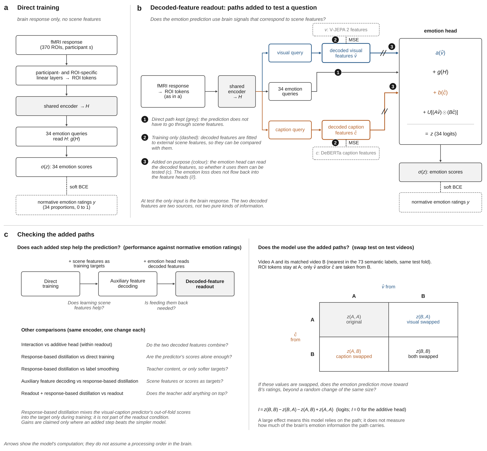

# Scene Information in Brain-Based Decoding of Visually Evoked Emotion: Linking fMRI Responses to the Visual and Caption Features of Scenes

[working title, to be decided]

- Document: English master's thesis draft, EmoBrain
- Date: 2026-11-03
- Generated from the integrated document (2026-11-03). If they differ, the integrated document governs.
- Other files in the same folder
    - 01_integrated_document.md: the integrated document, the single authority for all decisions
    - 02_proposal.md: the Korean proposal (decisions and their reasons)
    - 04_claude_code_workorder.md: the implementation work order for the repository
- Status: written before any results. No results are reported. [unverified] marks facts not yet confirmed against the original source.

---

## 1. Introduction

### 1.1 The question

This thesis studies visually evoked emotion: the emotion that silent videos evoke. The term follows the title of Horikawa et al. (2020), who recorded fMRI from five participants watching 2,181 silent videos and predicted ratings of 34 emotion categories from brain responses, describing a representation that is high-dimensional, categorical, and distributed across transmodal regions. That study and later decoders on the same data ask whether emotion can be read from the brain. They do not ask how the emotion-related information in brain responses is linked to how the viewed scene looks and to what happens in it.

Prior work stresses different sides of this link. Kragel et al. (2019) proposed that emotion schemas are embedded in the visual system. Satpute and Lindquist (2019) proposed that the default network abstracts sensory information into emotion categories. If the link is examined for each of 34 emotions, this difference becomes a question of how the link differs across emotions rather than which view is correct.

This thesis is not a model paper. The affective neuroscience question comes first, and the model is the tool used to answer it.

- Question 1 (affective neuroscience): When people view visual stimuli, how are emotion-related brain responses linked to the visual properties and the meaning of the scene?
- Question 2 (model): If this link with scene information is used during training, how does brain-only prediction of emotion scores change, and what information does the model use when it predicts for scenes it has not seen?

The aim is to read, from brain responses alone and without the video or its captions, information about the scene a person viewed and the emotions that this scene evokes in people. The phrase "emotion-related brain responses" is chosen on purpose. What is observed is the brain response to a video and the emotion scores that other people gave to that video (Section 1.8).

### 1.2 Terms

Concepts and measurements are named separately. The premise and the questions use two concepts. Visual information is how a scene looks: color, form, and motion. Semantic information is what happens in a scene: objects, actions, and events. When it needs to be spelled out, it is called the situation, after Skerry and Saxe (2015), who wrote of "situations" and "abstract situation features". The methods and results use two measurements, each named by its source. Visual features are extracted from the video by a visual model. Caption features are human-written captions encoded by a language model.

MindCaptioning (Horikawa, 2025) called its caption representations "semantic features". This thesis does not, because Horikawa et al. (2020) used that name for 73 human-rated labels and because captions of silent videos also carry visual information. Visual and semantic information overlap widely; the meaning "blood" appears together with the color red. The two features are therefore not read as pure measures of the two kinds of information.

The word "context" is not used as a technical term. In emotion perception research it covers "visual scenes, voices, bodies, other faces, cultural orientation, and even words" (Barrett et al., 2011), so it would overlap with visual information here. The studies on the same videos divided information into "visual" and "semantic" (Horikawa et al., 2020; Horikawa, 2025).

Table 1.1 gives the English names used in this thesis and their definitions at first use. The condition names are descriptive names given in this study. They are not established method names. The citations are precedents for the method, not sources of the name. Model names describe a model's inputs and are kept apart from role names, which describe relations in distillation. The word "reconstruction" is not used for feature decoding. In the same research line it means generating images (Shen et al., 2019), and in ML-BVAE (Fu et al., 2024) it means a VAE reproducing its brain input.

Table 1.1. Terms.

| Term | Definition | Precedent for the method |
| --- | --- | --- |
| normative emotion ratings | For each video and category, the proportion of raters who answered "yes" (0 to 1). The raters are people other than the fMRI participants. | Cowen & Keltner (2017); Kragel et al. (2019) |
| visual features, caption features | Names of the source of each feature. They do not mean that visual and semantic information have been separated. | |
| Feature Extractor | The frozen models that extract the features (V-JEPA 2, DeBERTa-large). Not a teacher. | |
| feature decoding, decoded features | Predicting the Feature Extractor's feature values from brain responses, and the predicted values. | Horikawa & Kamitani (2017); Shen et al. (2019); Horikawa (2025) |
| brain-only emotion decoder | A model whose input at test is the brain response only. | |
| visual-caption emotion predictor | A model that predicts emotion from visual and caption features; named to avoid confusion with "feature-based distillation". | Gou et al. (2021) |
| teacher, student | Roles in distillation: the side that provides targets and the side that learns. | Hinton et al. (2015); Lopez-Paz et al. (2016) |
| Direct training | Training with the emotion ground truth only. | |
| Response-based distillation | Training to follow the teacher's emotion predictions as well as the ground truth. "Response" means the teacher's output, not a brain response. | Hinton et al. (2015); Lopez-Paz et al. (2016); Gou et al. (2021) |
| Auxiliary feature decoding | Adding feature decoding as an auxiliary training objective. | Caruana (1997); Horikawa & Kamitani (2017) |
| Decoded-feature readout | A condition that "predicts normative emotion ratings using both a direct readout of brain representations and readouts of decoded visual and caption features". | |
| Decoded-feature readout + response-based distillation | Decoded-feature readout with response-based distillation added. | |
| additive head, interaction head | Two forms of the emotion head, defined by equations (Section 2.7.3). | Kim et al. (2017) |
| interchange interventions on decoded features | Replacing decoded features inside the model with another video's. An intervention on the model, not the brain, and not a full causal abstraction analysis. | Geiger et al. (2021) |
| interaction contrast (I) | A difference of differences on the logit scale (Section 2.6.2). | |
| evaluation on held-out content blocks | Testing on a block of videos defined by content after removing it from training. | Roberts et al. (2017) |
| 73 semantic labels | The concept labels of Horikawa et al. (2020). Values are rater proportions, not binary labels. Distinct from caption features. | Horikawa et al. (2020) |
| network-restricted training, network input perturbation | Training on one brain network's input only, and perturbing one brain network's input in a trained model. "Network" means a brain network. | |
| frozen-head distillation | A student matches a teacher's intermediate representation and reuses the teacher's frozen head. | Chen et al. (2022) |

### 1.3 Premise

> Visually evoked emotion arises from jointly processing how a scene looks and what is happening in it, and its neural representation is high-dimensional, categorical, and distributed.

Table 1.2. Sources for the premise.

| Part of the premise | Source and wording |
| --- | --- |
| From visual information to emotion | Kragel et al. (2019): "the visual system filters retinal input to represent different types of emotional situations" |
| From the situation to emotion | Skerry & Saxe (2015): inferences about what others feel are based "on the situations they encounter, relying on knowledge of the eliciting conditions for different emotions" (a study of inferring others' emotions from written situations). Moors (2017): some appraisal theories treat appraisal factors as "descriptions of the deep features of the situation". |
| One stimulus does not fix one emotion | Moors (2017): "there are hardly any one-to-one relations between features of stimuli and features of emotions" |
| Joint processing of the two | Kragel et al. (2019): activity "at the interface of sensory representations of the environment and previous knowledge about potential outcomes". Satpute & Lindquist (2019): "drawing on prior experiences and knowledge to make meaning of one's current sensations". Mobbs et al. (2006): the same face is read as different emotions depending on the surrounding scenes. |
| High-dimensional, categorical, distributed | Horikawa et al. (2020), title |
| Categorical and continuous | Cowen & Keltner (2017): "27 distinct categories of emotion bridged by continuous gradients" |

The premise is a theoretical starting point from appraisal theory and constructed emotion theory. The thesis tests what it implies for brain data (Question 1), not the premise itself. The videos were collected so that scenes and emotions vary together, so predicting emotion from scene information is not claimed as a finding, and a predictive relation on unseen videos does not show that the brain uses that information. The thesis also does not ask how much brain emotion information visual and semantic information explain. That question splits emotion into two parts and a remainder, against the premise, and the answer would depend on the chosen features.

### 1.4 Why visual features and caption features

Because the premise treats emotion as the joint product of two kinds of information, the measurement is split into two representations with different sources. Only then can the thesis ask about each link (sub-question 1-1) and their combination (sub-question 1-2).

Three findings support the split. First, the brain separates the two sources. When the same participants watched silent films and heard stories, films engaged networks inside visual cortex, stories engaged networks just anterior to them, and the same semantic categories were aligned across the border (Popham et al., 2021). The split matches a distinction the brain makes, and the alignment means overlap should be expected. Second, separate representations of the same videos have been linked to the brain. For 1,102 short videos, video model features and sentence embeddings of human descriptions were each related to fMRI, and sentence descriptions matched brain representations as well as or better than word-level labels in all ROIs (Lahner et al., 2024). On the present videos, Horikawa et al. (2020) fitted a VGG19 model and a model of the 73 semantic labels separately, and a visual model (TimeSformer) predicted V1 to V3 better while a caption model (DeBERTa-large) predicted higher visual cortex and the language network better (Horikawa, 2025; confirmed in the preprint). Third, text-only language models capture scene meaning: caption embeddings "derived entirely from text" explained brain activity during scene viewing, and whole captions fitted better than nouns or verbs alone (Doerig et al., 2025). DeBERTa-large is trained on text alone and V-JEPA 2 without language, so the two sources are not mixed during model training.

Decoding two such features separately from the brain and using them together has precedents in image reconstruction (Ozcelik & VanRullen, 2023; Takagi & Nishimoto, 2023), not in emotion. The split does not separate information cleanly. Captions carry visual information, visual models learn objects and actions, and caption representations can miss parts of scene-selective cortex responses (Bartnik et al., 2025). The two features are therefore two representations from different sources, separated following Lahner et al. (2024) and Popham et al. (2021), with their overlap assumed in every interpretation.

### 1.5 Prior work and what is already established

Several elements of the design already exist in prior work and are not claimed as novel.

- Fine-grained emotion decoding: ML-BVAE (Fu et al., 2024) decoded 27 categories from the same data, binarized at 0.1.
- Continuous regression of 34 emotions: GED (Huang et al., 2022) predicted 0 to 1 scores with a bipartite graph of 34 emotions and 370 regions.
- Distillation in emotion learning: AESL, the method of EmoGrowth (Fu et al., 2025), used distillation teachers in multi-label class-incremental learning.
- Use of a language model: EmoMind (Mohammed et al., 2026), a preprint on MC videos, decoded caption features and 34 emotions from the brain and generated emotional captions with BART. Its SWAP analysis replaced the decoded emotion vector with another video's and checked whether the caption followed, so intervening on decoded values is not new. As a preprint, it is used only for positioning.
- Joint use of visual and caption features (Lahner et al., 2024; Horikawa, 2025; Ozcelik & VanRullen, 2023; Takagi & Nishimoto, 2023).
- Emotion information not explained by visual and semantic models, on the same data and relative to the feature sets used (Horikawa et al., 2020).
- Two-stage brain decoding, in which predicted features feed a next stage (Horikawa & Kamitani, 2017; Défossez et al., 2023; Doerig et al., 2025; Scotti et al., 2024). In most of these the next stage was untrained or trained on real features. Brain-IT (Beliy et al., 2026) trained the next stage, a diffusion model, jointly with the brain decoder on its outputs, and allowed those outputs to leave the CLIP space during that stage. Training on predicted values while keeping a direct input path follows concept bottleneck models (Koh et al., 2020), modality hallucination (Hoffman et al., 2016), and PCBM-h (Yuksekgonul et al., 2023).
- Brain tokens with self-attention, read by learned queries through cross-attention to predict image features, in a model shared across participants except for participant-specific embeddings (Beliy et al., 2026).
- An intermediate layer placed for interpretability in fMRI decoding: Cammarota et al. (2025) decoded 214 binary concept dimensions from fMRI and mapped them to CLIP embeddings, each step by ridge regression.

A search on 2026-11-03 did not find a study that decodes the two paths separately from the brain for emotion and swaps them to examine how emotion prediction depends on each. This means not found, not nonexistent. Further candidates, including a 2026 study on the same data (He et al., 2026), have not been checked [unverified].

### 1.6 Contribution

> This study tests how normative ratings of 34 emotions, as predicted from brain responses during video viewing, are linked to the visual features and caption features of the scene. The model keeps a path that reads brain responses directly, and it also uses the two features decoded from the brain for emotion prediction. By swapping the two decoded features separately or together, and by comparing an additive head with an interaction head, the study examines the model's dependence on each path and the way the paths are combined. In content blocks held out from training and in the MC viewing data, it evaluates the generalization of emotion prediction.

The architecture is not claimed as novel or as better than prior architectures, since its components have precedents (Section 1.5). The thesis does not write that all predictions pass through decoded features, that the intervention analyses were carried out in the held-out blocks or MC data, or that the work is the "first". The frozen-head comparison (Section 2.7.7) evaluates a design choice and is not part of the contribution.

### 1.7 Sub-questions and hypotheses

#### 1.7.1 Perspective

In perspective A, a model that receives only the brain response reads emotion through scene information. The brain is its only access to the scene, so it must learn the brain-scene correspondence, and one can test whether it uses it. In perspective B, one model receives the brain response and both features. Which input it takes shared information from depends on training (Wang et al., 2020; Peng et al., 2022). When a caption says "food", a model predicting craving may read food from the brain, but it does not have to. The thesis takes perspective A as primary, because sub-questions 1-1 and 1-2 need a separate path per source that can be changed one at a time, as with explicit concepts in concept bottleneck models (Koh et al., 2020). A performance check from perspective B is outside the required scope.

#### 1.7.2 Question 1

The central hypothesis is that emotion information in the brain is represented in a form combined with visual and semantic information, and that which information it combines with, and how, differs across emotions and regions.

- 1-1. Which information is each emotion more strongly linked to? Hypothesis: the effects of swapping the visual-feature path and the caption-feature path differ across emotions, with no direction specified. Kragel et al. (2019) read low still-frame performance as showing that some emotions are "conceptually abstract or depend on temporal dynamics (e.g., confusion or surprise)" (see also Skerry & Saxe, 2015), but did not compare visual and text sources, and craving for a food video can also be predicted from "eating pizza". An auxiliary comparison contrasts emotions with high still-frame classification performance in EmoNet (craving 0.987, sexual desire 0.965, entrancement 0.902, horror 0.876) and low performance (confusion 0.636, awe 0.615, surprise 0.541) (Kragel et al., 2019). They are not called "visual" or "semantic" emotions.
- 1-2. Do the two kinds of information add separately, or does one change the effect of the other? Hypothesis: some emotions show interaction, for example the same visual information leading to different emotions depending on semantic information (Moors, 2017; Mobbs et al., 2006).
- 1-3. In which regions is this information found? Hypothesis: brain responses of each of three CAB-NP networks (Primary Visual, Secondary Visual, Default) predict emotion scores on their own, with a mean per-emotion correlation above the permutation baseline. No ranking of networks and no path correspondence is predicted. This extends region-wise decoding on the same stimuli, which predicted emotion from visual and association areas, with transmodal regions fitting best (Horikawa et al., 2020; see also Satpute & Lindquist, 2019; Kragel et al., 2019).
- 1-4. Is the link maintained for unseen kinds of scenes and during recall? Hypothesis: for held-out content, which path's emotions are better maintained is not specified. Content blocks are defined by semantic labels and may disadvantage the caption path. Recall is kept as a possible exploratory analysis (Section 4.7).

#### 1.7.3 Question 2

That a model predicts emotion scores does not show what it read. Question 2 adds three separate results: whether the scene correspondence can be read from the brain (2-1), whether the model uses it (2-2), and whether such training improves prediction (2-3). A failure of 2-3 does not mean 2-1 fails, since a directly trained model may already use the same information, and a gain may reflect regularization, which controls check. Using information present only during training is learning using privileged information (Vapnik & Vashist, 2009; Lopez-Paz et al., 2016).

- 2-1. Does the brain-only emotion decoder decode scene information? Hypothesis: yes (Horikawa, 2025; Horikawa & Kamitani, 2017).
- 2-2. Does it use the decoded information for emotion prediction? Hypothesis: yes. Replacing only the decoded features with those of another video moves the prediction toward that video.
- 2-3. Does this training improve brain-only prediction, including for unseen scenes and the MC viewing data? Hypothesis: Auxiliary feature decoding outperforms Direct training, and Decoded-feature readout outperforms Direct training on held-out content blocks. Whether the drop is smaller is tested without a direction. The held-out part extends Horikawa and Kamitani (2017), who identified categories absent from decoder training with decoded features, by our design logic.
- 2-4. Which regions does the model depend on, and does learning scene information change this? The thesis tests, without a direction (no prior study was found), whether perturbing the same network input causes different drops for Decoded-feature readout and Direct training. This asks where the trained model reads from; 1-3 asks where the information is.

#### 1.7.4 How the answer to Question 1 is assembled

The answer joins three pieces of evidence: whether the two features can be decoded for evaluation videos (2-1), whether the model uses and combines them (2-2, 1-2), and where this is found and whether it holds for unseen scenes (1-3, 1-4). All claims concern information in brain signals, not computation inside the brain.

### 1.8 Scope of claims

The ground truth is normative emotion ratings from other people, not the scanned participants. The claim is limited to this: brain responses contain information about which emotions a scene evokes in people and how strongly. The participants' own emotional experience is not claimed. A rating of 0 means that no rater chose that category, not that the participant felt nothing. The limit applies equally to Direct training and to the conditions that use scene features. Horikawa et al. (2020) noted it as well.

---

## 2. Methods

### 2.1 Data and labels

The stimuli are the videos of Cowen and Keltner (2017), rated by 853 English-speaking US participants, with 9 to 17 raters per video. Raters could select as many categories as desired. The fMRI data are from Horikawa et al. (2020). Five participants watched the videos without sound, all in the same order, in 61 runs over 8 sessions (4 to 9 runs per session, mostly 8). Session boundaries differ across participants.

Of the 2,196 files, 15 are same-content duplicates; as in Horikawa et al. (2020), the later presentation of each is discarded. A near-identical pair (videos 1349 and 1363) is kept, as in that study, and assigned to one fold. Counts refer to the 2,181 analysis videos unless stated otherwise. The development videos (about 2,109) also exclude the 72 final test videos of MindCaptioning (MC) from every development step; the file listing them has not been located [unverified]. Same-content pairs are placed in the same fold. Video lengths range from 0.15 to 90 s (median 4.5 s), and videos shorter than 8 s were repeated until they exceeded 8 s (Du et al., 2023b), which applies to 1,564 analysis videos (72%). The MC data (Horikawa, 2025), from six native Japanese speakers scanned separately on a 3T Prisma at WPI-IRCN, the University of Tokyo, are used for transfer (Section 3.6), and the MC recall data are not part of the main analyses.

The labels are normative emotion ratings for the 34 categories of Horikawa et al. (2020), not reduced to 27. Each value is a proportion from 0 to 1, not a 1 to 9 scale; the 14 affective dimensions (1 to 9) are outside the main experiment. Values are not z-scored, since soft BCE needs values from 0 to 1 and per-emotion correlation is unaffected by linear transforms. About 73.8% of values are 0, non-zero videos range from 5% to 64% across emotions, and the 34 values of a video sum to 1.71 on average (1.00 to 4.27), so they are not a distribution. Inter-rater reliability cannot be computed from mean ratings, and the number of raters per video is unconfirmed [unverified]. Only 4 of the 34 label columns have been matched to category names; the rest will be matched before any run [unverified].

### 2.2 Brain responses and input regions

The response to each video follows the averaging window of Horikawa et al. (2020). The signal is shifted by 4 s and averaged within each block, defined as the video presentation and the following 2-s rest, and each voxel is z-scored within each run, whereas Horikawa et al. (2020) z-scored each voxel across all videos. Block signal magnitude correlates with video length (−0.49 to −0.59), so both enter as baselines. Blocks are excluded only by the motion criterion already applied in preprocessing (FD above 0.9 mm within two volumes of the response window), and extreme values are clipped at the mean ± 3 SD within each run and voxel, as in the original study; no block or run is excluded for its response magnitude. For sub-05, the available 2,085 blocks are used, and results are also reported on videos common to all five participants.

The input regions are the 360 cortical regions of HCP360 (Glasser et al., 2016) and the 10 subcortical regions of Horikawa et al. (2020): amygdala, brainstem, caudate, cerebellum, hippocampus, hypothalamus, a Brodmann area 34 ROI, pallidum, putamen, and thalamus. Horikawa et al. (2020) and GED (Huang et al., 2022) used these 370 regions. The cortical regions use the participant-specific masks shared by the original authors (Horikawa et al., 2020; Horikawa, 2025). The subcortical regions keep the original atlas definitions, the AAL and Talairach Daemon labels of WFU PickAtlas with both hemispheres combined, but their masks are rebuilt for all eleven participants with one procedure, because the shared subcortical masks of one Horikawa participant (sub-03) were displaced from the anatomy; the step that caused this is unknown. The atlas template is registered directly to each T1w image with ANTs, the labels are transferred to the 1-mm T1w grid, and a 2-mm voxel is included when it contains the center of a labeled 1-mm voxel. This choice was made to apply one reproducible procedure, not because the rebuilt masks were shown to be more accurate; included voxels differ from the shared masks, and the effect on prediction was not measured. The region that the original study called the nucleus accumbens (key nuc_accum) is defined as Brodmann area 34, a label that usually denotes entorhinal cortex. It barely overlaps the FreeSurfer accumbens label, so it is called the BA34 ROI here and its results are not interpreted as accumbens function. A region is kept if at least one of its voxels remains inside the quality-controlled mask of every Horikawa and MC participant, decided by anatomical masks and scan coverage alone; this leaves all 370 regions, some only partly observed in some participants (fewest 14 voxels), which limits interpretation of those tokens. Voxels are standardized with training-fold statistics per participant, and MC participants use their 2,108 adaptation videos. The model works on one response pattern per video, the unit of the scene features and ratings, so functional connectivity is not used.

### 2.3 Participants and split

The five participants share one model. Each has its own input layer, and the rest is shared, as in MindEye2 (Scotti et al., 2024). Each video appears in training once per participant with the same label. This lets the model learn from five responses to each video, but it does not give five times as many independent videos. The design assumes that the input layer absorbs participant differences. Evaluation is computed per participant and then averaged. Linear baselines are trained per participant, as in Horikawa et al. (2020), for comparison with prior work only.

The data are split into six folds by groups of runs (repository split horikawa_rungroup6_v1), with an added session condition. Splitting by runs keeps neighboring hemodynamic responses on one side, and runs with same-content pairs are grouped. Each fold tests about 10 of 61 runs (about 350 videos) and trains on the rest (about 1,750 videos, 8,800 rows). The five rows of a video are always on the same side, so that a test label is never seen through another participant. This matches the six outer folds of Horikawa et al. (2020), although the folds differ: their public code uses consecutive runs and keeps the near-duplicate pair 1349 and 1363 in different folds. The session condition requires that no participant's test runs in a fold concentrate in one session; in the final split, each fold's test runs come from 6 to 8 sessions, with at most 3 runs from one session. The split tests unseen videos of the same participants; predicting a new session is harder (Varoquaux et al., 2017), and new sessions are examined with the MC data.

### 2.4 Outputs and loss

For each video, the model outputs 34 independent scores through sigmoids. No softmax is used and scores are not normalized to sum to 1, because raters could choose any number of categories. The 34 losses are summed to train one shared encoder. The loss is soft binary cross-entropy (soft BCE), with equal weights for videos and emotions:

$$\ell(y, p) = -\left[\, y \log p + (1 - y) \log (1 - p) \,\right],$$

where y is the rating proportion and p the output. It is smallest at p = y. The emotion loss L_emo is its mean over emotions and videos. For one video, soft BCE on the proportion equals the mean BCE over its raters' individual yes or no answers. The number of raters per video is unconfirmed, so videos are weighted equally.

### 2.5 Features

#### 2.5.1 Visual model

The visual model must take video as input, because motion itself is linked to emotion: on the same videos, looming motion was linked to arousal (Thieu et al., 2024), and "temporal modeling is key for alignment to brain regions involved in early visual processing" (Sartzetaki et al., 2025). It must also not be trained to predict words or labels, which would teach the meaning that captions carry; MindCaptioning placed CLIP in a separate "visuo-semantic" class (Horikawa, 2025). Visual features are still not claimed to lack semantic information. Among models meeting both criteria, V-JEPA 2 (Assran et al., 2025) was chosen without using our results. It predicts representations rather than pixels, is trained on a large dataset rich in human activity, and has 40 blocks for fine layer analysis. The main visual model is the frozen V-JEPA 2 ViT-g encoder (checkpoint facebook/vjepa2-vitg-fpc64-256, width 1408).

Three baseline visual models check whether conclusions hold with another visual model: VideoMAE (Tong et al., 2022) with pretraining-only ViT-B/16 weights, which meets both criteria but reconstructs pixels; TimeSformer (Bertasius et al., 2021), trained with action labels and used exactly as in MindCaptioning; and the CLIP image encoder, which overlaps strongly with captions (MindCaptioning's version, or OpenAI ViT-B/16 if unconfirmed [unverified]). They also differ in size, data, and input, so differences are not attributed to one factor. Only the visual-caption emotion predictor and Decoded-feature readout are rerun with them. No prior study used V-JEPA 2 on these stimuli, and classification training was reported to matter for higher-region alignment (Sartzetaki et al., 2025). The TimeSformer baseline and the layer analysis examine this in the data.

#### 2.5.2 Layers and frames

All 40 blocks are stored as token means. The training target concatenates blocks 10, 20, 30, and 40 (depths 25% to 100%; 5,632 dimensions), because the best-fitting depth differs by region (Horikawa, 2025). The four points were fixed in advance by dividing depth evenly, will not be re-chosen after the layer analysis, and are not an optimal set. Information before block 10 may be missing, since Transformers aligned with early visual cortex "around 0.1 of the total depth" (Sartzetaki et al., 2025). Layers are named by number and not mapped onto stages of brain processing (St-Yves et al., 2023).

Videos are fed as participants saw them, with videos under 8 s repeated past 8 s as recorded in the presentation logs. Frames are sampled at 4 per second, the V-JEPA 2 training rate, which keeps real playback speed. Up to 64 frames (16 s) enter one input, matching the final training stage, so the order of events within 16 s is kept. The 86 videos longer than 16 s are split into 16 s windows and averaged. Frames are center-cropped with aspect ratio kept, with official normalization and no augmentation. The baselines use blocks 3, 6, 9, and 12 (VideoMAE, TimeSformer) or the final projected image vector (CLIP), with their own input formats; TimeSformer reproduces MindCaptioning in time and space. Features are extracted anew and all settings are recorded, because existing caches used an undocumented frame rule.

#### 2.5.3 Caption encoder and captions

The main caption encoder is DeBERTa-large, used as in MindCaptioning: token embeddings are averaged per caption and layer without special tokens (following Reimers & Gurevych, 2019), and the 20 captions of a video are averaged. The target concatenates layers 6, 12, 18, and 24 (4,096 dimensions). MindCaptioning selected DeBERTa-large among 42 language models by cross-validated encoding on the same videos and fMRI (Horikawa, 2025), and following a prior choice on the same stimuli satisfies the decision rule of this thesis. Layers 18 and 24 are included because word shuffling damaged generated text more with deeper layers (Horikawa, 2025). DeBERTa representations are sensitive to word order, unlike MPNet, whose embeddings of shuffled sentences correlated 0.91 with the originals, although sensitivity is not taken to mean that relations are captured; MPNet (all-mpnet-base-v2) is the baseline encoder (Reimers & Gurevych, 2019; Doerig et al., 2025). Large language models are not used, because they lack support from brain studies of visual stimuli and may build emotional associations into the features.

The captions are the 20 human captions per video of MC. Annotators were instructed "to focus on visual content rather than subjective aspects such as emotional reactions", and captions were proofread with the assistance of GPT-3.5 (Horikawa, 2025). Under the squared-error feature loss, the mean caption is the same target that random single captions would approach, with less noise. Per-caption vectors are kept, because averaging can weaken an event mentioned by few annotators. A version with emotion words removed is reported in the supplement.

#### 2.5.4 Low-level visual features

Motion energy follows Du et al. (2023b), who used it on the same data to remove chance correlations between ratings and visual information. Frames are made 96 × 96 pixels, reduced to CIE L*a*b* lightness, and passed through 6,555 spatiotemporal Gabor filter pairs (spatial frequencies 0, 2, 4, 8, 16, 32; temporal frequencies 0, 2, 4 Hz; 8 directions; pymoten defaults, Nunez-Elizalde et al., 2021, following Nishimoto et al., 2011), and energy is log-transformed. Frames are sampled at 15 per second so that the 4 Hz filters work, and log values are averaged over the presented video (our choice). The medians of the R, G, and B channels (Jang & Kragel, 2025), averaged over frames, add color, for 6,558 features in total. Motion energy predicts early visual cortex responses to natural movies (Nishimoto et al., 2011), and such features explain early sensory cortex better than higher regions, as summarized by Li (2026), but they can still correlate with meaning and emotion. They serve as a baseline and a check on visual model blocks.

#### 2.5.5 Other feature analyses

Without brain or emotion data, ridge regression predicts caption features and low-level features from each V-JEPA 2 block, and cross-validated R² is reported. This characterizes each block and is the first of three overlap checks (Section 4.4). The VGG19 features and 73 semantic labels of Horikawa et al. (2020) are not targets. The supplement compares their similarity to our features (CKA or RSA) and tests a visual-caption emotion predictor built on the 73 labels against one built on caption features.

### 2.6 Comparison units

Per-emotion correlation can be high even if a model reads only scene type: reading "food" from the brain already predicts craving. This section defines which videos are compared, and how.

#### 2.6.1 Continuous scores

Emotions are compared as continuous scores, not as one label per video or thresholded values, which discard information. With top-category labels on these videos, only 908 of 2,185 videos remained for analysis (Azari et al., 2020). The top 5% per emotion is used only to illustrate high-scoring videos in figures (Horikawa et al., 2020).

#### 2.6.2 Nearest pairs and interchange interventions

Each test video is paired with the video in the same test fold that is nearest in the 73 semantic labels, by equally weighted Euclidean distance on raw proportions. This is nearest-neighbor matching on covariates; the Mahalanobis distance is avoided because it works poorly with many non-normal covariates (Stuart, 2010), and 82% of label values are 0. No caliper is used, because the analysis is defined as a comparison with each video's nearest neighbor and no literature gives a threshold for label distances. The median nearest distance is 0.088 (maximum 0.184), against 0.217 for random pairs, which follows from the selection and does not show that pairs are adequate. Pairs are fixed without emotion scores or model results and shared by all participants and conditions. They are called "pairs of videos close in label content", not "same scenes", and their number is not a sample size.

The same pairs are used for interchange interventions on decoded features, exchanged within one participant, one test fold, and one trained model. With states written as (ROI tokens, decoded visual features, decoded caption features), the four conditions for a video A and its pair B are original (A, A, A), visual swapped (A, B, A), caption swapped (A, A, B), and both swapped (A, B, B). The size of each change is recorded, and a length-matched random-direction change in the same path is the control (Section 3.4). The precedents are interventions on predicted concepts (Koh et al., 2020) and interchange interventions (Geiger et al., 2021). Real values are used instead of noise, which can push a model outside its training distribution (Zhang & Nanda, 2024). Writing z(v-source, c-source) for the pre-sigmoid logit with ROI tokens from A, the interaction contrast is

$$I = z(B, B) - z(B, A) - z(A, B) + z(A, A).$$

It asks whether the effect of a visual swap depends on the caption state. It uses logits, because a sigmoid alone creates interaction on the probability scale (Ai & Norton, 2003). Changes in final scores are also shown.

#### 2.6.3 Content blocks

Content blocks are made by k-means with five clusters on raw proportions of the 73 semantic labels (scikit-learn KMeans, n_init = 10, random_state = 0), without size constraints. This applies block cross-validation (Roberts et al., 2017) with k-means blocks in feature space as in blockCV (Valavi et al., 2019), and follows evaluation on categories absent from training (Horikawa & Kamitani, 2017; Koh et al., 2021). Five is the blockCV default, chosen without brain or emotion data. The gap statistic (Tibshirani et al., 2001) and silhouette (Rousseeuw, 1987) are auxiliary diagnostics only, because they ask how many clusters the data form, not which content can be removed.

A check without brain or emotion data compared, for each test video, the label distance to the nearest training video after block removal and after a size-matched random removal (Table 2.1). For four to eight blocks, removal widened the distance by a factor of 1.5 to 1.7. Five blocks give a larger smallest block than six (255 vs 157 videos) but fewer training videos, and this trade-off is reported; five is not an optimal or natural number. The check will be repeated on development videos, and if a block then shows no increase, its claim is narrowed without changing the number of blocks. Block names list frequent labels only, so the thesis writes "without the block in which animal videos are frequent", not "without animal videos".

Table 2.1. Content blocks (five blocks, 2,181 analysis videos).

| Block (most frequent labels) | Videos | Median distance, removed vs size-matched | Ratio |
| --- | --- | --- | --- |
| People, Indoor scenes, Men | 651 | 0.127 vs 0.074 | 1.72 |
| People, Outdoor scenes, Men | 527 | 0.122 vs 0.088 | 1.39 |
| Art, People, Indoor scenes | 380 | 0.112 vs 0.057 | 1.97 |
| Land animals, Small animals, Outdoor scenes | 368 | 0.125 vs 0.069 | 1.80 |
| Outdoor scenes, Daytime scenes, Nature | 255 | 0.117 vs 0.078 | 1.49 |

Block removal is added on top of the run split. The test set is the block's videos within the test run fold. Training without the block uses all videos except the test run fold and the block, and the size-matched control draws at random, without removing the block, the same number of training videos from the four training folds and the same number of validation videos from the validation fold. Direct training and Decoded-feature readout are tested with every block in every run fold, without teacher outputs or frozen heads. The held-out block is excluded from training, validation, standardization, and any auxiliary predictor. Block statistics recorded after fixing the blocks are not used to change them.

### 2.7 Models

#### 2.7.1 The brain-only emotion decoder

Each region's voxel pattern becomes a token. For participant s and region r, with voxel values x(s, r),

$$t(s, r) = W(s, r)\, x(s, r) + b(s, r) + e(r),$$

where W(s, r) is a participant- and region-specific linear layer, b(s, r) a bias (distinct from the caption path b in Section 2.7.3), and e(r) a region embedding shared across participants. Each token uses only its region's voxels and has the model width d. These ROI tokens carry information from other regions after self-attention, so attention values are not read as regional contributions.

Regions (Glasser et al., 2016) give the model a spatial prior and the analyses a common unit across participants. The linear transform within regions is a separate choice. It reads voxel patterns linearly, as in the emotion decoding of Horikawa et al. (2020) and the feature decoding of Horikawa and Kamitani (2017) and Horikawa (2025), the basis for expecting feature decoding to work. Participant-specific linear layers before a shared model follow MindEye2 (Scotti et al., 2024), restricted here to each region. Bin averaging within regions (GED, ML-BVAE, EmoGrowth) removes voxel differences within a bin before learning. Neither approach has been shown better on these data. On the same data, whole-brain voxel input to a deep model performed worse than bin-averaged input (miF1 0.462 vs 0.505; Fu et al., 2024), which is a caution rather than a reason. At d = 64 the input layer may have about 6.6 to 7.7 million weights per participant against about 1,750 training videos (estimated from EmoGrowth's voxel counts [unverified]), so its weight decay is selected on validation data, and input-layer overfitting will be considered if feature decoding fails on new videos.

The ROI tokens pass through one shared self-attention block (pre-LN, 4 heads, feed-forward d to 2d to d with GELU, dropout 0.1), giving H; the sizes were kept small for about 1,750 training videos per participant, a weak basis. Thirty-four learned emotion queries read H with one cross-attention layer (4 heads) and a per-emotion linear layer, without self-attention among queries, following the finding that emotions draw on different regions (Horikawa et al., 2020) and the design of Query2Label (Liu et al., 2021). This path gives g(H), the pre-sigmoid score per emotion. Two learned feature queries (visual, caption) read the ROI tokens with one cross-attention layer and map to 5,632 and 4,096 dimensions with linear layers (Horikawa & Kamitani, 2017; Horikawa, 2025). Brain tokens with self-attention, read by learned queries through cross-attention to predict features, have a precedent in Brain-IT (Beliy et al., 2026). Its tokens are 128 voxel clusters shared across participants, formed from the voxel embeddings of an image-to-fMRI encoder over mainly visual cortex. The architecture is not adopted as a whole. Grouping inputs by visual encoding would build a visual criterion into the comparison of the visual and caption paths, the input here covers transmodal and subcortical regions where emotion information was found (Horikawa et al., 2020), and the studies on the same stimuli used HCP360. Brain-IT predicts its two feature types with two separately trained models, whereas one shared encoder is needed here so that Auxiliary feature decoding and Decoded-feature readout each change one thing. Its queries correspond to positions in a spatial feature map, while the targets here are video-level vectors. A Brain-IT variant with the same regions, targets, shared encoder, and emotion head remains a reasonable alternative that has not been compared, so the present architecture is not claimed to be better. Parameter counts are reported for every condition.

#### 2.7.2 Training conditions

All conditions share the brain input and encoder. They differ in the objective and in whether the emotion head reads decoded features. At test, each receives the brain response only.

Table 2.2. Training conditions.

| Condition | Objective | Emotion head reads |
| --- | --- | --- |
| Direct training | L_emo(y) | g(H) |
| Response-based distillation | L_emo(ỹ) | g(H) |
| Auxiliary feature decoding | L_emo(y) + λ L_feat | g(H) |
| Decoded-feature readout | L_emo(y) + λ L_feat | g(H) and decoded features |
| Decoded-feature readout + response-based distillation (auxiliary) | L_emo(ỹ) + λ L_feat | g(H) and decoded features |

The distillation target is

$$\tilde{y} = (1 - \alpha)\, y + \alpha\, t,$$

where t is the visual-caption emotion predictor's out-of-fold probability, computed only within the four folds used to train the brain model's weights, so that validation labels never reach the teacher scores. For example, a fear rating of 0.7, a teacher score of 0.5, and α = 0.3 give a target of 0.64. The feature decoding loss is

$$L_{\text{feat}} = \tfrac{1}{2}\left[\operatorname{MSE}(\hat{v}, v) + \operatorname{MSE}(\hat{c}, c)\right],$$

with v and c the standardized targets, v̂ and ĉ the decoded features, and each MSE averaged over dimensions. The two targets have equal weight, and so do the four layers within each target, since they have equal dimensions. The emotions are weighted equally. The squared error follows the linear-regression feature decoding of the same line of work (Horikawa & Kamitani, 2017; Horikawa, 2025). Path evaluation feeds decoded features to a head trained in the standardized coordinates of the real features, so the decoded values themselves must approach the real features. A contrastive loss, such as the InfoNCE that Brain-IT used for VGG features (Beliy et al., 2026), matches relative similarity between videos and does not require this.

The conditions are not a stack. The basic sequence is Direct training, Auxiliary feature decoding, and Decoded-feature readout, while Response-based distillation adds only teacher scores to Direct training. Each comparison changes one thing (Table 3.1). Decoded-feature readout is the main model. The teacher supplies only 34 out-of-fold scores per training video in the distillation conditions, with no head, weights, or features. Decoded-feature readout has no teacher; it receives the Feature Extractor's features as targets, so it is not called distillation.

#### 2.7.3 Emotion head

In Decoded-feature readout, the emotion head computes 34 pre-sigmoid scores as

$$z = g(H) + a(\hat{v}) + b(\hat{c}) + U\left[(A\hat{v}) \odot (B\hat{c})\right],$$

where g(H) is the ROI path, a(v̂) and b(ĉ) are scores from each decoded feature alone, and the last term is a low-rank product with rank r (the interaction term). The additive head omits the last term, and the interaction head includes it. Scores are σ(z). Decoded features are not tokens in the ROI attention, because softmax weights sum to 1, so swapping one feature would change the weight on the other and no head could be additive. No joint layer over the two feature paths precedes the sum. The additive structure would hold even with nonlinear paths (Agarwal et al., 2021), but a and b are linear layers with bias (5,632 to 34 and 4,096 to 34), the same in both heads and of the same form as in the visual-caption emotion predictor, while A, B, and U are linear layers without bias. With ROI tokens fixed, I of the additive head is zero by construction. The form matches equation 7 of Kim et al. (2017), cited for the form only.

The interaction head is the default, used for interchange interventions, held-out blocks, network analyses, and path evaluation. Making the restricted additive head the default would rule out what sub-question 1-2 asks. If the additive head performs better, the default is kept and the result reported.

The decoded features enter the emotion head unchanged, but the gradient of the emotion loss is stopped from flowing back through them into the feature heads, which learn only from the feature decoding loss. The shared encoder still receives the emotion loss through the ROI path, so feature decoding is not independent of emotion training. The stop-gradient limits how decoded features could bend toward emotion labels, so that their correspondence with external features stays interpretable for the interchange interventions; how intermediate values are trained affects intervention results (Koh et al., 2020; Parisini et al., 2026). The closest precedent, Hoffman et al. (2016), passed the task loss into the hallucination path. In brain decoding, Brain-IT passed the generation loss into the brain decoder and stated that its output "does not need to remain aligned with the original CLIP embeddings" (Beliy et al., 2026), a choice made for reconstruction. Here that alignment is what the interventions rely on, so it is kept. The design is described as neither the joint nor the sequential model of Koh et al. (2020). A version allowing the gradient is a follow-up and will not replace Decoded-feature readout.

#### 2.7.4 Why the model decodes scene features

The reason is to create an explicit output that can be compared with and swapped for external scene features, so that it can be tested whether emotion prediction uses scene-related brain information. Probing a model trained only on emotion "does not tell us whether this property is involved in predictions" (Belinkov, 2022), and post hoc removal of properties is another route (Elazar et al., 2021). This thesis instead places outputs that can be intervened on (Koh et al., 2020), which the same data support (Horikawa, 2025; Horikawa & Kamitani, 2017). In fMRI decoding, Cammarota et al. (2025) likewise placed explicit binary concepts between the brain and CLIP embeddings for interpretability. The intermediate values here are high-dimensional features rather than named concepts, so interpretation is limited to the model's dependence on each source path, not the meaning of single dimensions. The 73 semantic labels are not used as such a bottleneck, because they define the pairs and content blocks, and the question concerns source paths rather than concepts. A small dataset is not the reason.

The feature heads make the output slots, and the feature loss decides what they match: the feature vectors that the Feature Extractor computed once per training video, not a teacher's judgment. These targets create no information absent from the brain measurement; they change what the model reads from the brain and how it uses it. Teacher scores cannot replace them. A roller coaster video and a horror trailer with similar teacher scores receive almost the same distillation target, while feature decoding gives them different scene vectors. Response-based distillation also creates no outputs tied to external features, so it allows no interchange intervention.

The design does not assume that routing through scene features is more effective. Many scene differences are irrelevant to emotion, poorly decoded features can interfere, and auxiliary tasks can cause negative transfer (Jiang et al., 2023). The condition comparisons test this. The direct path g(H) is kept, and the concern "it only reads scene type" applies equally to Direct training. The decoding targets are not reduced by PCA, because PCA fixes high-variance directions in advance while small-variance components can matter (Jolliffe, 1982); recent uses of PCA served size matching or computation (Zhou et al., 2024; AboHassan et al., 2026). If memory or runtime problems arise, the design will be changed and the reason recorded.

#### 2.7.5 The teacher

The teacher is the visual-caption emotion predictor, which receives visual and caption features but not the brain. A teacher trained only on information available during training is the setting of generalized distillation (Lopez-Paz et al., 2016). Its form is

$$\operatorname{logit} = a(v) + b(c) + U\left[(Av) \odot (Bc)\right],$$

with a and b linear; with r = 0 it is additive. The rank is chosen from {0, 1, 2, 4, 8} and weight decay from {1e−4, 1e−3, 1e−2} by inner validation, with soft BCE. Its scores for training videos are produced out of fold by an inner five-fold scheme within each outer training set, so they do not memorize labels, and are clipped to 0 to 1. Its additive vs interaction result is a preliminary analysis, not a conclusion about the brain, interpreted only in folds where r > 0 was selected. Visual-only and caption-only teachers are outside the required scope.

#### 2.7.6 Controls

Three controls are required. Label smoothing uses the target

$$\tilde{y} = (1 - \alpha)\, y + \alpha\, \bar{y}_{\text{train}},$$

pulling ratings toward each emotion's training mean. It softens targets without video content, since part of a distillation gain may come from softening (Yuan et al., 2020), and is compared with Response-based distillation as a pre-specified comparison. Shuffled feature pairs (applied to Auxiliary feature decoding) and shuffled teacher outputs (applied to Response-based distillation) remove the video correspondence. For each outer fold and seed, one video-level permutation of the four training folds is drawn in which no video keeps its own target. It is kept for all epochs and shared by all hyperparameter candidates. Visual and caption targets move together, the five rows of a video receive the same target, and validation and test data are not shuffled. Reshuffling every epoch would make the squared-error target approach the mean feature, not a consistent but wrongly paired target. Means are computed within each training split, and correct vs shuffled comparisons are auxiliary.

#### 2.7.7 Frozen-head distillation

One auxiliary comparison uses a teacher that receives the brain response and both features. The teacher has the input layers, encoder, and emotion queries of the brain-only emotion decoder. The real visual and caption features are each mapped by a linear layer to one d-dimensional token, and these tokens are appended to the ROI tokens before the encoder. The intermediate representation is the output of the 34 emotion queries (34 × d), and the head is the per-emotion linear layer with sigmoid. The teacher uses the d and input-layer weight decay selected for Direct training in the same outer fold, and the weight decay of the two feature layers is chosen from {1e−4, 1e−3, 1e−2} by the common validation criterion. It is trained with soft BCE and then frozen. The student is the brain-only emotion decoder of Direct training, with the same d and no connector layer, and it is paired with the teacher of the same seed. Its loss is

$$L = L_{\text{emo}}\big(y,\, h_T(f_S)\big) + \lambda\, \operatorname{MSE}\big(\tilde{f}_S, \tilde{f}_T\big),$$

where f_S and f_T are the 34 × d emotion-query outputs of student and teacher, the tilde marks per-dimension standardization with training statistics, used only inside the MSE, and h_T is the frozen teacher head, which receives f_S in the teacher's original coordinates. Appending feature tokens and omitting a connector are design choices of this comparison, not requirements; SimKD does not forbid a connector (Chen et al., 2022). The teacher may mix the three inputs because it serves only a performance comparison, and its mixing structure is not applied to the separate paths of Decoded-feature readout. The emotion loss flows through the frozen head into the student, unlike the stop-gradient of Decoded-feature readout, and no loss imitates the teacher's outputs. Teacher and student are trained on the same four training folds, so the frozen head never sees validation labels. The precedent is SimKD (Chen et al., 2022), in which the student matches the representation before the teacher's classifier and reuses the frozen classifier; the present version adds a direct emotion loss. Compared with Direct training and Decoded-feature readout on the standard split only, it asks which way of using scene information favors brain-only prediction. It runs after the core analyses, or is recorded as not run. It includes no brain-representation copy control, is not used to interpret Question 1, and does not change the main model.

#### 2.7.8 Baselines

All models that decode emotion categories from brain responses alone on the same data and have public code are external baselines. Only the task is adapted (split, 34 continuous labels, metrics); other settings follow the original code, with details in the supplement. GED (Huang et al., 2022) is rerun with the 370-region map, with its per-emotion min-max normalization (which in the public code includes test stimuli) and emotion relation graph computed on outer training folds only. For ML-BVAE (Fu et al., 2024), the asymmetric focal loss, defined for binary labels, is replaced by soft BCE, and bins per region are chosen from the original candidates {8, 27, 64, 125, 216, 343} within training folds. From EmoGrowth (Fu et al., 2025), the structure is taken (emotion relation graph, graph autoencoder embeddings, semantic-guided feature decoupling, per-emotion classifiers, graph reconstruction loss), without the incremental procedure or the emotion-dimension alignment loss, because this is a structural comparison. The seven emotions absent from their 27 categories (contempt, disappointment, envy, guilt, pride, sympathy, triumph) are trained too.

The other baselines are mean prediction (for error metrics only), video length, low-level visual features, whole-brain mean and block signal magnitude, ridge and soft-BCE linear models per emotion, and per-participant training. The voxel-selection ridge of Horikawa et al. (2020) will be added after its rule is checked [unverified]. Baselines are not pass conditions.

#### 2.7.9 Model figure

Figure 2.1. Design of the brain-only emotion decoder for testing the scene feature paths. (a) Direct training: 34 emotion scores predicted from brain responses alone. (b) Decoded-feature readout. With the direct path kept (grey), a visual feature path (blue) and a caption feature path (orange) are added to test whether brain information corresponding to scene features is used for emotion prediction. During training only, the path outputs are fitted to the frozen Feature Extractor's features (dashed), and the emotion loss gradient is blocked (//). At test, the only input is the brain response. (c) Testing the added paths: condition comparisons that change one step at a time, and interchange interventions on decoded features. Arrows show the model's computation, not a processing order in the brain.

### 2.8 Implementation settings

Hyperparameters of the brain-only emotion decoder are selected on one validation fold: one of the five training folds of each outer fold, by rule the fold after the outer fold number. It is used for early stopping, for selecting d, input-layer weight decay, λ, α, and r, and for the calibration statistics of path evaluation (Section 3.8), and the selected model is tested as it is (Varma & Simon, 2006). This fold is development data, not data independent of model selection, and the procedure is not called inner five-fold cross-validation, which would cost five times as much.

The width d is chosen with input-layer weight decay using the mean per-emotion correlation of Direct training, so that it does not favor the scene feature conditions, and is used for all internal conditions of that outer fold. Its few candidates (Cawley & Talbot, 2010) will be fixed before any performance is seen, after voxel counts and runtime are computed on the real mask, as a compute-budget choice. With four attention heads, d is a multiple of 4. K denotes the number of combinations of d and weight decay.

Candidate values are fixed before testing and are conventions, not literature optima. α is chosen from {0, 0.25, 0.5}. λ, shared by both targets, is chosen from {0, 0.1, 1.0} for Auxiliary feature decoding and from {0.1, 1.0} for Decoded-feature readout, Decoded-feature readout + response-based distillation, and frozen-head distillation. The interaction rank r is chosen from {1, 2, 4, 8} together with λ, since r = 0 is the separate additive condition. Decoded-feature readout + response-based distillation keeps the λ and r of Decoded-feature readout and selects only α. Auxiliary feature decoding includes 0 so that its effect is tested within the search. Decoded-feature readout excludes 0 because, with the stop-gradient, λ = 0 would leave the feature heads untrained to match real features. Frozen-head distillation excludes 0 because it is defined as following the teacher's representation; the same λ does not mean the same supervision strength in both cases.

When λ = 0 is selected for Auxiliary feature decoding, or α = 0 is selected, that fold's condition equals the simpler one. It is reported as "no gain confirmed in that fold", selections are tabulated per fold, and such runs are not read as gains. Test performance per λ candidate is stored only for a sensitivity table.

Three seeds (0, 1, 2) are used, with scores computed per seed and reported as mean and standard deviation, without ensembling. Candidates are trained with seed 0 only and selected on the validation fold, and the chosen setting is then trained with seeds 1 and 2 on the same four folds with the same early stopping. All three seeds are reported, noting that seed 0 was the selected model. Network-restricted training reuses the d, input-layer weight decay, λ, and r chosen in the standard run of the same outer fold, and its results are "performance using only this network under common settings", not network-tuned best performance.

The visual-caption emotion predictor and the ridge decoding of scene features use five inner folds. The emotion ridge baseline uses the one-validation-fold rule in the main comparison, to match search budgets, and a five-fold version for literature comparison. Standardization is fitted on training folds only and refitted without the held-out block in content-block runs. Test folds are never used for selection, early stopping, standardization, teacher training, or the number of clusters, and all comparisons use the same participant and video rows. Optimization uses AdamW (learning rate 1e−3, weight decay 0.01, batch 64, at most 300 epochs, patience 30 on validation soft BCE), values with a weak basis checked for convergence only on fold 1's inner validation data.

Every run saves its configuration, commit, split manifest, checkpoint, selection record, test predictions, decoded features, and attention values, so that interpretation analyses need no retraining. Before the main runs, the decisions, pre-stated predictions, and result sentences are committed to the repository ([commit hash to be inserted]), following preregistration principles (Nosek et al., 2018). Preliminary analyses in October 2026 used all data, including test folds and the 72 MC videos. Their numbers are not results, and design choices made after seeing them are labeled as exposed. A quick analysis for a conference abstract on 3 November 2026 also looked at test folds of the development videos, with a different input, features and model. Its numbers are not results either, and no design choice or candidate value was taken from it. A column-order diagnostic on 4 November 2026 also read unnormalized responses from 240 MC test blocks, used only to compute spatial neighbor correlations of their mean pattern, without ratings; no model or design decision used it, and the code was then restricted to allowed rows.

Table 2.3. Planned training runs of the brain-only emotion decoder (K = 6; runtime not yet measured). Each count is candidates plus two extra seeds per fold.

| Set | Runs |
| --- | --- |
| Five conditions and the additive head | 6K + 168 = 204 |
| Required controls | 72 |
| Held-out content blocks (5 blocks × 6 folds × 2 removal types) | 60K + 720 = 1,080 |
| Network-restricted training (13 groups × 6 folds × 3 seeds × 2 conditions) | 468 |
| MC viewing transfer | 18, plus 36 input-layer runs |
| Main subtotal | about 1,880 |
| Baseline features, captions without emotion words, feature-only model, frozen-head distillation | 240, 60, 24, about 60 |

If time runs short, runs are reduced in this order: baseline features and captions without emotion words move outside the required scope, Decoded-feature readout in network-restricted training uses one seed, auxiliary seeds drop to 2, and main seeds drop to 2. Conditions needed for the 15 pre-specified comparisons are kept, and the order is not changed after seeing results.

---

## 3. Analysis Plan and Expected Results

### 3.1 Ground truth

The ground truth scored at test is the set of 34 normative emotion ratings per video. Feature decoding targets are values produced by the Feature Extractor, and the path dependence of sub-question 1-1 and the interaction contrast I are properties of the model. These have no observed ground truth, so they are compared with permutation or random-change controls. This chapter states each analysis and its expected result before results exist. Chapter 4 states what will be written in each case.

### 3.2 Main and auxiliary evaluation

The main metric follows Horikawa et al. (2020). For each participant and emotion, the Pearson correlation between predictions and ratings is computed over about 2,100 test videos pooled across the six folds, and the 34 correlations are averaged. The five scores, their mean, and per-emotion results are reported. Correlations are per emotion because Question 1 asks whether emotions differ and because a correlation pooled over all 34 values reflects mean differences between emotions; a model that always outputs training means would score positively. They are per participant because predictions differ between participants. Undefined correlations are marked "not computable", excluded rather than set to 0, and counted.

Two auxiliary metrics are required: error reduction relative to always predicting each emotion's training mean, which catches biased scores, and the per-video profile correlation across emotions with a mean-profile baseline, as reported by GED (Huang et al., 2022). Errors split by zero and non-zero labels, R², and absolute errors are also reported, and video identification (81.9% in Horikawa et al., 2020) is kept for comparison. Binarized metrics are not used. All 34 emotions are reported with their non-zero counts, rating variance, and bootstrap intervals. Rare emotions are interpreted cautiously but not excluded, because an emotion varying between 0.02 and 0.25 is still predictable.

### 3.3 Decision rules

For each comparison, the effect and its 95% interval are reported for each participant, with the number of participants in whom the effect was confirmed, before and after correction. No threshold such as "four of five" is used, because that number has no basis. An example sentence is "an improvement was confirmed in three of five participants; in the other two, an improvement was not confirmed". The other two are not said to show no effect, because detection depends on noise and power. The five-participant mean and interval describe these five people only. Population prevalence estimation (Ince et al., 2021) is not used, because the five results come from one shared model and the same videos and are not independent. Equivalence is never claimed, because no smallest effect of interest is justified (Lakens et al., 2018). A difference not found is "not confirmed", with its interval; an interval beyond 0 in the unexpected direction is "decreased".

Intervals come from resampling test videos with models fixed. They are conditional on the trained models and the fixed exchange conditions, omit retraining variance, and can be too narrow (Bates et al., 2024); seed standard deviations are reported separately. The main resampling unit is the video, with same-content pairs drawn together and all conditions and participants for a video drawn together, and run-level bootstrap is a sensitivity analysis. For interchange analyses, connected groups of videos linked by nearest-neighbor pairs (for example A, B, and C when A to B and C to B both occur) are resampled as units together with their pairs and control results, and the distribution of group sizes is recorded. Intervals are basic bootstrap 95% intervals, and p values come from centered two-sided bootstrap tests, which use the distribution of resampled minus observed differences as the null reference (Hall & Wilson, 1991). Resampling uses 10,000 iterations. Permutation baselines shuffle video correspondence only within the original run of the Horikawa data, an exchangeability block (Winkler et al., 2014), and also within content blocks in the held-out evaluation, so that run differences are preserved rather than widened for power. One permutation is applied to all 34 emotions and all five participants, same-content pairs move as one unit, and the 72 MC test videos are permuted among themselves. Comparisons between emotions use video-level permutation.

The 15 pre-specified comparisons (2 for sub-question 2-1, 3 for 2-2, 6 for 2-3, 1 for held-out content, 3 for 1-3) are corrected with the Holm procedure, which does not require independent tests (Holm, 1979). It is applied separately to tests of the five-participant mean and to per-participant tests. Per-emotion analyses (1-1, 1-2) are exploratory and use BH-FDR, with one family per participant and comparison over the 34 emotions. The 13 network tests of 2-4 form their own Holm family. The two premise tests (the mean correlation of Direct training and of Decoded-feature readout, each against permutation) form a separate Holm family of two. MC transfer results are reported without correction. Other exploratory network results use BH-FDR with families stated alongside. Auxiliary comparisons (controls with correct vs shuffled correspondence, and frozen-head distillation) are reported separately, without a predicted direction.

### 3.4 Analyses by sub-question

Table 3.1. Analyses and pre-stated expectations.

| Question | Comparison | Expectation | Correction |
| --- | --- | --- | --- |
| 0. Emotion from the brain alone (premise) | Per-emotion correlation of Direct training and Decoded-feature readout vs permutation; baselines and external baselines reported. | Above permutation (Horikawa et al., 2020) | Holm, 2 (separate family) |
| 2-1 Decoding | Ridge decoding of visual and caption features vs permutation (shuffled video pairing); mean correlation over dimensions and within-fold video identification. Decoded features of Decoded-feature readout also reported. | Both above permutation (Horikawa, 2025; Horikawa & Kamitani, 2017) | Pre-specified, 2 |
| 2-2 Use | Interchange interventions (visual, caption, both): r(Δp, Δy) over pairs (defined below), averaged over emotions, minus the mean of the length-matched random-direction control. | Moves toward the pair more than random change | Pre-specified, 3 |
| 1-1 Source per emotion | Per emotion, visual-only and caption-only swap effects, each reported; their difference tested directly, with the scale stated. Auxiliary: high vs low still-frame emotions (Kragel et al., 2019). | Differs across emotions; no direction | Exploratory, BH-FDR |
| 1-2 Interaction | (a) Per emotion, interaction vs additive head. (b) Mean absolute I vs the same control. | May appear in some emotions; which is not predicted | Exploratory, BH-FDR |
| 2-3 Performance | (a) Auxiliary feature decoding vs Direct training; (b) Decoded-feature readout vs Auxiliary feature decoding; (c) Response-based distillation vs Direct training; (d) Response-based distillation vs label smoothing; (e) Auxiliary feature decoding vs Response-based distillation; (f) Decoded-feature readout + response-based distillation vs Decoded-feature readout | Only (a) directional: Auxiliary feature decoding higher | Pre-specified, 6 |
| Held-out content | Decoded-feature readout vs Direct training on the mean performance of five content blocks | Decoded-feature readout higher | Pre-specified, 1 |
| 1-3 Regions | Direct training on Primary Visual, Secondary Visual, and Default each alone vs permutation; other results reported. | All three above permutation; no ranking or path correspondence predicted | Pre-specified, 3 |
| 2-4 Regions | For each of 13 groups, network input perturbation; difference in drop between Decoded-feature readout and Direct training | No direction | Holm, 13 |
| 1-4 Generalization | Held-out content (per-path maintenance reported without direction) and MC viewing transfer; recall exploratory | | MC: uncorrected |

For 2-1, ridge decoding is also run for each of the 40 V-JEPA 2 blocks and 24 DeBERTa-large layers, with regularization chosen per layer, model, and participant by five folds nested in six, as in MindCaptioning (Horikawa, 2025). The layer pattern is reported only and does not re-select target layers. For 1-1, path effects are compared only with the size of the change and the adequacy of the combination matched, because a larger change would move predictions more for that reason alone. Only (a) of 2-3 is directional, because Decoded-feature readout was introduced for inspectability, not performance; (b) most directly tests whether feeding decoded features back is needed, and (d) whether distillation gains reflect teacher content. The held-out expectation is a prior hypothesis, not an effect shown before. For 1-3, the primary test uses Direct training, concerns the mean over emotions, and names Default rather than "transmodal networks" so that networks are not chosen after results.

The swap effects of 2-2 and 1-1 are computed on the probability scale, the scale of the ratings. The prediction change is Δp, the swapped minus the original probability, and the label difference is Δy = y_B − y_A. For each participant, emotion, and swap condition, the Pearson correlation r(Δp, Δy) is computed over all pairs of the six folds. Pairs with Δy = 0 are kept, emotions with Δy = 0 in every pair are excluded, and emotions with constant Δp are counted as not computable. The swap effect is this correlation minus the mean correlation of the random-direction control. Sub-question 2-2 averages the effect over the 34 emotions, and 1-1 takes the per-emotion difference between the visual and caption effects. The interaction contrast I is computed on logits and summarized per emotion as the mean absolute I over pairs, with the same computation for the control. In the control, a video C other than A and B is drawn from the same participant and test fold. The direction is the difference between C's and A's decoded features, and its length is matched to the actual change from A to B (Euclidean length in standardized coordinates). When both paths are swapped, the same C is used and length is matched per path. The control is scored against the pair's label difference y_B − y_A. It is repeated 100 times; the statistic is computed for each repetition over all pairs and then averaged. This yields a control mean, not a null distribution, and no p value is taken from it. The difference between the actual swap and the control mean is evaluated by the bootstrap of Section 3.3. One hundred repetitions is a design choice fixed before testing, not a number from the literature.

### 3.5 Evaluation on held-out content blocks

This analysis asks whether emotion scores of a content block are still predicted when the block is removed from training, and whether Decoded-feature readout does better than Direct training there. In the standard split, similar videos remain in training, so only removing whole blocks shows where prediction holds, and the size-matched random removal separates the effect of fewer training videos. The blocks and split rules are those of Section 2.6.3. As auxiliary results, a ridge model shows how a linear brain model holds up, a visual-caption emotion predictor shows whether prediction from real features works for new content (its inputs and head differ from Decoded-feature readout), and decoded-feature accuracy in held-out blocks shows how well feature decoding holds. The last is not called a non-emotional control, since scene features also carry emotion information.

For each block, test predictions of the six run folds are pooled, and Pearson correlations are computed per participant and emotion; one correlation across blocks would reflect block mean differences. A block's evaluation emotions exclude only those with identical labels over its test videos (in practice, all zero), with one list for the four settings (two models, two removal types). An emotion with constant predictions is counted separately and removed from all four settings of that block, never silently from one model. The summary averages emotions within each block and then the five blocks equally: "the mean performance of five content blocks". Absolute performance, the drop from random removal, the model difference, per-block results, and non-zero training counts per emotion are reported, and the figure links random-removal and block-removal performance per block and model. Blocks defined by visual features are supplementary.

### 3.6 Transfer to the MC viewing data

This analysis asks whether a shared model trained on the Horikawa data, frozen except for participant-specific input layers fitted on MC, predicts normative ratings from MC viewing responses. Training from scratch on MC would instead ask whether the design works elsewhere. Input layers must be refitted, because voxel number and arrangement differ by person and MC was measured separately. Whether participants overlap is unconfirmed [unverified], so the analysis is called transfer to the MC data, not to new participants.

For each condition, the final model is trained on all Horikawa development videos with settings chosen by the one-validation-fold rule, and each of the three seeds is transferred and reported, without treating seeds as participants. All shared weights are frozen, to test whether the shared part carries over. Brain-IT likewise adapted to new participants by optimizing only participant-specific voxel embeddings (Beliy et al., 2026); freezing is not claimed to be the better choice. For each MC participant, only W(s, r) and b(s, r) are trained with the condition's original objective, on the 2,108 MC training videos left after removing the last two runs, which contain the test videos, as in MC. The test uses the mean response over five repetitions of the 72 videos, which with their duplicates are excluded from all training and selection. Only the brain response enters the model; real features of test videos serve only to score decoded features. Rating periods within MC runs are separated from video periods, and the event records and video ID matching between datasets are still to be checked.

Test responses are averaged over the repetitions that remain after quality control: five for most videos and four for four participant-video pairs, with no imputation, and the precision of the two is not claimed to be equal. Direct training and Decoded-feature readout use the same adaptation data and test videos, scored by the per-emotion correlation over the 72 videos. Emotions with constant labels are removed from both conditions and counted, and constant predictions are reported separately. With 72 test videos, intervals may be wide. The figure distinguishes frozen Horikawa parts from MC-trained input layers. Whether this evaluation joins the first results is a separate scheduling decision.

### 3.7 Network analyses

The 370 regions remain input units, and groups are used only in analysis. The groups are the 12 cortical networks of CAB-NP (Ji et al., 2019): Primary Visual, Secondary Visual, Auditory, Somatomotor, Cingulo-Opercular, Dorsal Attention, Frontoparietal, Default, Language, Posterior Multimodal, Ventral Multimodal, and Orbito-Affective. One anatomical group of the 10 subcortical regions, not called a functional network, makes 13. CAB-NP is defined on HCP360 regions from resting-state connectivity independent of our results. Yeo's 17 networks (Yeo et al., 2011), used by Horikawa et al. (2020), are a valid alternative but would require assigning regions across mismatched boundaries. Agreement between participants is recomputed for the 13 groups.

Network-restricted training (1-3) gives the model only one group's ROI tokens and retrains Direct training and Decoded-feature readout, extending the region-wise decoders of Horikawa et al. (2020) to network groups. All 34 emotions are evaluated except undefined ones, and both decoded features are scored for Decoded-feature readout, without labeling networks in advance as visual or semantic. Retraining without a group asks a different question (Au et al., 2022) and is deferred. Network input perturbation (2-4) freezes the whole-brain model and replaces one group's input, before shared self-attention, with the same participant's values for another video rather than zeros, taking all regions of a group from the same video. Replacement videos are drawn at random within the same test fold, one assignment table is shared by both models and all groups, and each drop is averaged over 20 repetitions. The difference in the two models' drops is tested directly. Random groups matched in number of regions, individual subcortical perturbation, and a principal-gradient figure (Margulies et al., 2016) are auxiliary.

### 3.8 Auxiliary analyses

Pairs close in label content. For each emotion, the correspondence between label differences and prediction differences across pairs is computed from existing test predictions. This supports the interpretation of overall performance. It is not a gate that other results must pass.

Path evaluation. The decoded features from ridge and from Decoded-feature readout are fed, without the ROI path or retraining, into the frozen head of the visual-caption emotion predictor (additive and interaction versions), which is possible because decoded and real features share dimensions and preprocessing. The per-emotion correlations of Direct training and of path evaluation, and their difference with an interval, are reported; ratios are not used, because they are unstable near zero. Decoded features may be shrunk toward the mean, so uncalibrated and calibrated versions are both reported. Calibration matches the per-dimension mean and variance of decoded features to real features, with statistics computed after model selection on the validation fold, in the head's standardized coordinates, without emotion labels or test data, and then fixed. For ridge, the statistics come from the inner ridge models that left the validation fold out. Dimensions whose decoded standard deviation is below 1% of the median within the same target are only shifted in mean, and their number is reported. Neither version is chosen by test results, and calibration recovers no information. A retrained head is supplementary.

Other auxiliary and supplementary analyses are the controls with shuffled correspondence, frozen-head distillation, the baseline visual models and MPNet, captions without emotion words, a version whose ROI path uses mean pooling instead of emotion queries, an intervention feeding real features into the emotion head (Koh et al., 2020), the comparisons with Horikawa's features, results by video length, and equal-capacity probes of Direct training and Response-based distillation.

---

## 4. Discussion (planned)

### 4.1 Order of results

The results will follow four steps: direct emotion prediction from the brain (reproducing Horikawa et al., 2020), scene feature decoding (reproducing Horikawa, 2025, and Horikawa & Kamitani, 2017), dependence of emotion prediction on the feature paths, by emotion and by combination (2-2, 1-1, 1-2), and held-out content (1-4, 2-3). The answer to Question 1 is assembled as in Section 1.7.4. Comparisons with accounts that stress the visual system (Kragel et al., 2019) or the default network (Satpute & Lindquist, 2019) will be discussed with the results, because the hypotheses set no direction.

### 4.2 Interpretation of each outcome

Each outcome has sentences written before results.

- Premise. If above permutation: "We predicted normative ratings of 34 emotions from brain responses." If not: "We did not find evidence that brain responses predict normative ratings." Below the whole-brain signal magnitude baseline: "We did not find evidence that the model reads more than whole-brain signal magnitude." Exceeding the low-level baseline is not called reading higher-level information; added power is "the part not explained by the low-level features used".
- 2-1. If confirmed: "We decoded visual features (caption features) from brain responses to unseen videos." If not: "We did not confirm decoding of that feature", and interchange results for that path are written only as "the model output depended on that path".
- 2-2. If confirmed: "Under this exchange condition, the model depended on that path, and its predictions moved in the same direction as the emotion difference of the pair video." If not: "We did not find an effect beyond a generic perturbation response." Because the ROI path remains, this is not written as non-use. A positive correlation means that prediction changes corresponded to emotion score differences with the pair video, not that every prediction moved closer to the truth.
- 1-1. If the effects differ: "For emotion X, under this exchange condition and on this scale, predictions followed more when the caption-feature path (visual-feature path) was swapped." If not: "For emotion X, we did not find a difference between the two path effects." Neither is written as a contribution of semantic information.
- 1-2. (a) "For these emotions, a computation that combines the two decoded features was useful for prediction" or "We did not find a gain from the added interaction". (b) "In this exchange, the effects of the two paths were not expressed as a simple sum" or "We did not find an effect beyond the sum". (b) without (a) is not a contradiction. I is not an amount of shared information, and the interaction head's extra parameters rule out claiming interaction is better regardless of size.
- 2-3. For (a): "Training the model to decode scene features improved emotion prediction." Otherwise: "In these data and conditions, we did not confirm a gain." A Response-based distillation gain counts as teacher content only if (d) holds; a gain uniform across emotions may reflect regularization. For the controls: "We did not find an additional gain beyond this control"; "Some gain appeared even without the correct correspondence between videos and targets"; "The correct correspondence helped additionally". No result is written as "shown to be due to regularization", and a gain that remains with shuffled targets is not attributed with certainty to regularization or to learning from consistent targets. A gain of Decoded-feature readout over Auxiliary feature decoding is the total effect of the added structure, not evidence of use, and Decoded-feature readout vs Response-based distillation is not read as "decoding features beats following answers". If (a) holds but (b) does not: "We confirmed the effect of providing scene features as training targets, but did not confirm an additional performance gain from feeding decoded features directly into emotion prediction." Decoded-feature readout then remains an inspection tool, not a better predictor.
- Held-out content. "In k of five participants, the mean performance over held-out content blocks was higher than with Direct training. Block-wise results are reported." Otherwise: "We did not confirm an additional gain in this evaluation." "Higher" and "drops less" are judged separately, so a model that predicts new content better but drops more is not called more robust. Changed content and fewer training examples are not separated, and "unseen" refers to label blocks removed from our model's training only.
- 1-3. "Emotion scores could be predicted from the signal of this network alone", or "We did not find evidence that this network alone predicts emotion scores." Low performance of a low-reliability network is not "no information". A positive result does not mean the information exists only there, arises there, or matters more biologically, because performance depends on region size, signal quality, and shared information.
- 2-4. "Under this perturbation condition, the two models differed in sensitivity to the input of this network", or "We did not find a difference in sensitivity." Perturbation creates unnatural combinations, so results are not pure information contributions or lesion effects (Hooker et al., 2021).
- MC transfer. "After fitting participant-specific input layers, the shared Horikawa model could be applied to the MC viewing data." This does not show transfer without adaptation, a benefit of Horikawa training itself, or generalization to different videos, and it is not called external validation or a light calibration.
- Pairs close in label content. "Emotion score differences were predicted even between videos close in label content. Whether fine scene differences were read cannot be distinguished." Otherwise: "We did not find evidence that emotion score differences are predicted between videos close in label content", not "the model mostly read scene types".
- Path evaluation. Success means "the fixed rule could be applied to decoded features", not faithful decoding or shared cues. Failure is examined by comparing real-feature performance and decoding accuracy.
- Frozen-head distillation. The result is a difference between whole training schemes, not evidence that the teacher used the brain.
- Architecture. If mean pooling performs as well as emotion queries, the per-emotion query claim is withdrawn, and no Transformer superiority is claimed. If the deep model underperforms ridge, the design is kept and path and region results are reported as conditional on this model. Gains over ridge are not read as "readable only nonlinearly".

Value without a performance gain requires that feature decoding on new videos and interpretable interventions are confirmed. The thesis can then write: "Scene features could be decoded from new videos, and under the pre-specified exchange conditions and controls, this model's emotion predictions depended on the corresponding decoded-feature path." It will not argue that efficiency does not matter because this is not a model paper.

### 4.3 Reading the interchange interventions

Interchange results are read in three steps. A change in prediction shows dependence on the path. A correspondence with the pair's emotion difference that also exceeds the length-matched random-direction control is stronger evidence that information from the pair was used. Direction alone is not enough, because an uninformative perturbation can pull predictions toward the mean. If a fear prediction of 0.9 moves to 0.6 under such a perturbation while the pair video is at 0.4, it looks like movement toward the pair. Otherwise the thesis writes that no effect beyond a generic perturbation response was found, which does not mean the path is unused, since the ROI path and the other feature path remain.

Swapping both paths is written as: "Emotion predictions changed when the two decoded-feature paths were swapped together. This change alone cannot distinguish shared information, separate information in each path, and interaction." Effects of joint patching can differ greatly from the sum of single effects because of nonlinearity (Zhang & Nanda, 2024). The interventions change values inside a model, not the situations participants experienced. They do not show that the brain uses semantic information to produce emotion or that overlapping information has been separated. Results also depend on the exchange method (Zhang & Nanda, 2024), and exchanged combinations need not lie in the training distribution.

### 4.4 Overlap between the two features

Visual and caption features come from the same videos, and their overlap enters every interpretation. Different names do not separate the brain information they explain; for three scene models, "the response variance explained by these three models is largely shared" (Lescroart et al., 2015). Overlap of the original features (Section 2.5.5), the part decoded from the brain, and the model's use of decoded features are checked separately, and checking one does not check the others.

The two path effects are not added and split into "visual X% and semantic Y%". A small effect of one path does not mean that it holds no information or is unused, because other paths may supply the same information. A joint swap effect is joint dependence, not an amount of shared information. The claim is limited to how much two possibly overlapping scene representations can be read from the brain and how a brain-only model uses them. Unique contributions of visual and semantic information, or the same cue found in two representations, are not claimed. Swapping common CCA components is not done, because correspondences can arise from different cues that co-occur. For example, brightness and skiing correlate if most ski videos show bright snow, and cross-validation confirms that such a correspondence holds, not what it means (Bilenko & Gallant, 2016).

### 4.5 Limitations

Data. About 73.8% of label values are 0. The raters were 853 English-speaking US participants, 9 to 17 per video. The exact rater counts and whether raters heard sound are unconfirmed [unverified]. Of 2,196 files, 2,192 have no audio track, and the fMRI participants watched silently. If raters heard sound, the ratings may include sound-evoked emotion, which would not fit "visually evoked emotion". The nationality of the Horikawa participants is unconfirmed [unverified], while the MC participants are native Japanese speakers, and rater-group differences cannot be tested. The ground truth is not the participants' own rating, and the split does not test unseen sessions.

Model. Unnatural swap combinations can only be reduced, by nearest pairs and random controls. Leakage, in which small differences in decoded features carry information outside the intended concept, can occur even without passing the final loss to the concept predictor (Havasi et al., 2022) and with expressive continuous concepts trained separately (Parisini et al., 2026). The stop-gradient reduces it, but its absence is not claimed, and the stop-gradient also restricts decoding emotion-relevant features first without guaranteeing better performance. The ROI path means not all predictions pass through features. Decoded features are more accurate on training than on test videos, so the head may over-trust them; stacking avoids this with out-of-fold values (Engemann et al., 2020), but joint training does not. Decoding accuracy on training and validation videos is recorded.

Features and procedure. The four layer points are a fixed choice. No prior study used V-JEPA 2 on these stimuli, and caption features may miss relevant meaning (Bartnik et al., 2025). Content blocks defined by labels may disadvantage the caption path. Low-level features do not cover all low-level information. Selection relies on one validation fold, intervals ignore retraining variance, some choices were exposed to preliminary analyses, and two-stage training (decoding first, then emotion fine-tuning) is not run.

### 4.6 Future directions

Outside the required scope are: a performance check of a teacher that receives the brain; encoding analyses (not declared unnecessary, not automatically scheduled); MC recall; main analyses of the 14 affective dimensions; cue-level pattern discovery; attribution methods; GLMsingle and LSS; visual-only and caption-only distillation; retraining without a network; other intermediate-representation distillation; FiLM, I²MoE, and ModDrop; and Decoded-feature readout with the emotion gradient allowed, a planned follow-up with matched splits, targets, and evaluation.

Further directions are brain-content interaction, video emotion models that use brain responses only during training, finer separation of event structure, pairs with similar sensory input but different situations, visual diversity within emotions, transfer of teacher errors, stronger brain-only methods such as augmentation and self-supervision, alignment of video, captions, and brain in a CLIP space (Scotti et al., 2023; Gryshchuk et al., 2025), unseen participants, tokens built from functional voxel clusters shared across participants instead of anatomical regions (Beliy et al., 2026), label-efficiency curves, Korean-language ratings, and external validation on a further dataset ("White" in the integrated document) [unverified]. Two directions widen the question. The stimuli were "still only visual in nature" (Horikawa et al., 2020), and audiovisual stimuli would study emotion in more natural situations. With participants' own ratings, the brain could add how this person received the scene, and perspective B would then be more suitable.

### 4.7 Recall left as exploratory

The MC recall data are outside the main analyses and the required scope. If analyzed later, the analysis will be exploratory, with results and limits reported regardless of direction, because including only expected results would make generalization look broader than it is (Nosek et al., 2018). The viewing-fitted input layers would be frozen, and viewing and recall compared for the same participants and 72 videos. The ground truth would remain the normative rating of the recalled video, not what participants felt while recalling. MindCaptioning found that viewing-trained decoders generalized to recall more with deeper TimeSformer layers and most with DeBERTa-large (Horikawa, 2025), which is generalization to recall, not to new content (see also Satpute & Lindquist, 2019). Participants read one caption less than 1 s before recalling, so reading responses may persist in the recall signal. Captions are not model inputs, and cue-only predictions would be a reference only, not a threshold or a quantity to subtract.

---

## References

Full references: references.bib (verified 2026-11-03) and Appendix 4 of the integrated document.
