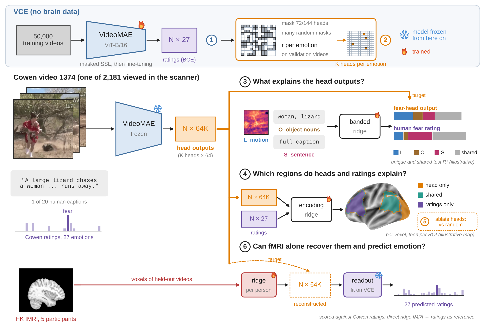
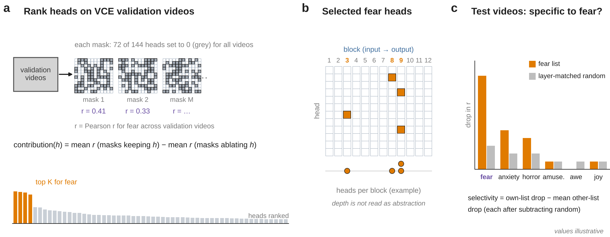
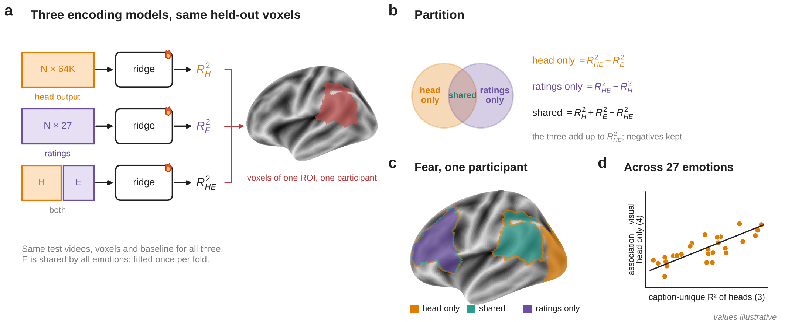
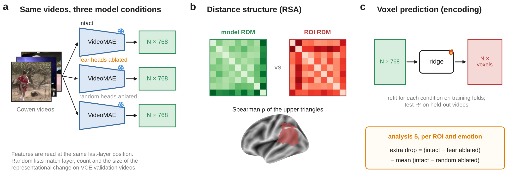

# 연구설계 통합문서

작성 시작: 2026-11-24

최종 수정: 2026-11-26

> 연구설계와 결과 해석 기준을 기록한 문서다. 그림 1은 분석의 연결을, 그림 2~5는 실행 방법을 보여 준다. 그림의 영상 프레임은 실제 Cowen 영상(1374, 366, 55)에서, 뇌 그림은 MNI152 표준 뇌와 fsaverage 피질 표면에서 가져왔다. 그림은 `figures/src/`의 Python 코드로 다시 그릴 수 있고, 가상 예시의 수치는 그림 안에 "values illustrative"로 표시했다. 제시한 비교는 분석 계획이며 실제 측정값은 결과가 나온 뒤 채운다.

**정해진 전제:** 모델은 기존 논문의 모델을 가져와 사용합니다. 필요한 작은 수정이나 튜닝은 가능하며, 원래 구조와 우리가 바꾼 부분을 구분해서 기록합니다.

<a id="overview"></a>

## 전체 흐름

**본 분석은 세 단계, 여섯 개다. 대표 결과는 ③과 ④, 역방향 검증은 ⑥이다.** VCE 영상에서 정서 예측에 기여하는 attention head(모델 한 층 안에서 토큰 정보를 모으는 단위)를 ②에서 정서별로 고른다. 그 목록을 고정한 뒤, ③에서는 같은 head의 영상별 출력을 무엇이 설명하는지, ④에서는 그 출력이 어느 영역의 뇌 반응을 설명하는지, ⑥에서는 그 출력을 뇌에서 복원할 수 있는지 묻는다.

<a id="figure-1"></a>



**그림 1. 정서별 자극 정보에서 영역별 뇌 대응과 뇌 단독 디코딩까지.** ③의 일곱 조합은 모델이 읽는 자극 정보를 설명한다. ④와 ⑥에 전달되는 것은 **영상마다 달라지는 같은 head의 실제 출력**이다. ③에서 얻은 설명력이나 캡션 자체를 뇌 모델에 입력하지 않는다. ①은 정서 학습 전후 비교, ②는 특징 선택, ⑤는 그 특징을 가렸을 때의 검증이다. [그림 PDF](figures/emobrain_ridge_overview.pdf)

```text
1절  문제 제기와 선행연구
     색과 움직임, 보이는 물체, 벌어지는 일이 함께 바뀌는 영상을 사람들이 보고 정서를 평정한다.
      ↓
2절  연구질문과 가설
     어떤 단서가 어느 정서의 예측에 쓰이며, 그 특징은 어느 뇌 영역의 반응과 대응하는가?
      ↓
3절  연구의 필요성과 기여
     영상에서 찾은 같은 특징을 실제 뇌와 대조하고, 새 영상의 뇌 반응에서도 읽을 수 있는지 검증한다.
      ↓
4절  방법론  |  질문 → 모델 제안 → 설계 검증 → 결과 검증
     영상에서 정서로     ① 정서 학습 전후 비교 → ② head와 층 찾기 → ③ 영상과 캡션으로 내용 해석
     실제 뇌와의 대응    ④ head 특징과 27개 평정의 고유분과 공유분을 영역별로 계산 → ⑤ head 제거로 대응 변화 확인
     뇌에서 정서로       ⑥ fMRI → 같은 head 특징 복원 → 고정된 VCE 판독기 → 27개 정서 평정 예측
      ↓
5절  결과와 해석
     ①~⑥의 대조 결과를 정서별로 보고한다. 뇌와의 대응은 참가자와 영역별로도 제시한다.
      ↓
6절  한계와 결론
     영상에서 확인한 단서 중 어디까지 뇌에서 복원됐는지, 어느 단계에서 근거가 약했는지 적는다.
```

[자료와 분할](#data) / [방법론 그림 2~5 PDF](figures/emobrain_methods_figures.pdf) / [모델 구조](#figure-2) / [분석별 실행법](#methods) / [원고의 완료 기준](#finish) / [논문 작성용 인용표](#references)

| 단계 | 본 분석과 실행법 | 무엇을 비교하는가 | 남길 결과 | 논문에서 가져온 방법 |
|---|---|---|---|---|
| 영상에서 정서로 | [① 정서 학습 전후 비교](#analysis-1) | 같은 VideoMAE의 영상 학습 직후와 정서 미세조정 직후에 같은 방식의 선형 판독기를 각각 맞춰, 같은 새 영상에서 평가한다. | 27개 정서 각각의 예측 상관과 전후 차이 | 고정 표상의 선형 판독과 층별 정서 판독. [Tong 등, 보충 표 11][videosupp] / [Gao 등, 그림 4][gao] |
| | [② 어느 head와 층이 기여하는가](#analysis-2) | VCE 검증 영상에서 정서별 head를 고른다. 새 영상에서 이 head를 가린 경우와 같은 층에서 같은 수를 무작위로 가린 경우를 비교한다. | 선택한 head의 층별 분포, 고른 정서 × 평가한 정서의 하락 행렬(27 × 27) | 정서 관련 CNN 필터의 제거와 영상 Transformer head의 제거. [Liu 등, 그림 6][liu24] / [Kowal 등, 표 2][kowal] |
| | [③ 그 head가 반영하는 자극 정보](#analysis-3) | Cowen 영상의 색과 움직임, 캡션 속 물체 이름, 전체 캡션을 따로 또는 함께 써서 새 영상의 head 반응과 사람 평정을 설명한다. | 세 정보 각각의 고유 기여와 겹치는 기여. 물체 등을 고려하고 전체 서술이 더 설명하는 몫 | 움직임 에너지, 명사와 전체 캡션 대조, 정보 묶음 분할. [Nishimoto 등, 그림 1B][nishimoto] / [Doerig 등, 그림 3][doerig] / [Garcia 등, 3절][garcia] / [Dupré la Tour 등, 2.7절][banded] |
| 실제 뇌와의 대응 | [④ 같은 head와 사람 평정의 영역별 뇌 대응](#analysis-4) | 정서마다 선택한 head 특징만, 27개 평정만, 둘을 함께 사용해 같은 시험 영상의 같은 복셀을 예측한다. 별도로 온전한 모델의 정서 학습 전후 RSA와 encoding을 비교한다. | 27개 정서별 head 묶음 × 영역별 head 고유분, 평정 고유분, 공유분. 참가자별 값과 사전 지정 영역 간 차이 | [Horikawa 등(2020), 그림 5][hk] / [McMahon 등(2023), 그림 5와 Methods][mcmahon] / [Lescroart 등(2015), 그림 3, 9][lescroart] |
| | [⑤ 정서별 head 제거와 영역별 변화](#analysis-5) | ②의 head를 가린 뒤 ④에서 정한 마지막 층 RSA와 복셀 예측을 반복한다. 같은 층과 개수에서 표상 변화량까지 비슷한 무작위 제거와 비교한다. Encoding은 각 조건의 훈련 자료로 다시 맞춘다. | 정서 × 영역별 RSA와 encoding의 추가 하락. 영역 간 하락 차이 | 영상 head 제거와 모델–뇌 비교를 이 연구에서 연결한다. [Kowal 등, 표 2][kowal] / [Liu 등, 그림 3][vca] / [Nili 등, 그림 1][nili] |
| 뇌에서 정서로 | [⑥ 선택 특징을 거친 뇌 단독 디코딩](#analysis-6) | 참가자별 fMRI에서 ②의 **같은 head 특징**을 ridge로 복원한다. VCE에서 별도로 학습해 고정한 판독기로 평정을 예측한다. 같은 fMRI의 직접 ridge 및 짝을 바꾼 대조와 비교한다. | 특징 복원 정확도와 정서별 평정 예측. HK 교차검증 후 MC 시험 영상 72개의 결과 | fMRI에서 영상 모델 특징을 복원한 뒤 별도 판독기로 읽는 절차. [Wen 등, 식 10 및 그림 9][wen] / [Horikawa, 반복 시청 시험][mc] |

**③에서 무엇이 다음 단계로 이어지는가?** 하나의 정서를 고르면, ③에는 두 줄의 결과가 생긴다. 첫 줄은 시각, 물체, 전체 캡션이 **사람의 해당 정서 평정**을 설명한 몫이고, 둘째 줄은 같은 정보가 **그 정서를 기준으로 고른 모델 head의 반응**을 설명한 몫이다. 사람과 모델에서 서로 다른 단서가 두드러질 수도 있다. ④는 이 두 번째 줄에서 해석한 head의 실제 출력과 27개 평정 전체를 비교 대상으로 삼아 어느 영역에서 설명력이 겹치는지 본다. ⑥에서는 새 영상의 fMRI로 같은 head 출력을 복원하고, 고정 판독기로 읽은 평정을 사람 평정과 비교한다. ④의 통계값이나 시험 성적을 ⑥의 특징으로 쓰지 않는다.

**실행 범위.** 12월 7일 원고와 12월 15일 심사의 완료 기준은 [여섯 분석의 결과표](#finish)다. 영상당 head 출력을 요약하는 방법, 마스크 반복 수, 정서당 선택할 head 수는 [파일럿에서 고정](#analysis-2)한다. VCE와 Cowen의 영상 중복 수, 참가자별 복셀 자료 가용성은 [분할을 확정하기 전](#data)에 실제 파일로 확인한다.

## 1. 문제 제기와 선행연구

이 절에서는 **알려진 것에서 남아 있는 문제로** 이어지게 씁니다.

| 채울 내용 | 생각할 질문 | 작성 |
| --- | --- | --- |
| 설명할 현상 | 우리가 관심을 갖는 현상은 무엇인가? | 1-1 |
| 현재까지 알려진 것 | 선행연구는 그 현상을 어떻게 설명했는가? | 1-2 |
| 남은 문제 | 기존 연구에서 확인하지 못했거나, 서로 구별하지 못한 설명은 무엇인가? | 1-3 |
| 이번 연구의 출발점 | 그중 정확히 어느 문제를 다룰 것인가? | 1-4 |

### 1-1. 설명할 현상

인간은 시각 자극을 보는 것만으로 정서를 경험하며, 같은 영상에 대한 여러 사람의 보고를 모으면 영상별 정서 평정의 차이를 측정할 수 있다. [Cowen과 Keltner(2017)](https://pmc.ncbi.nlm.nih.gov/articles/PMC5617253)는 2,185개의 짧은 영상에 대한 자기보고에서 27개의 정서 범주가 신뢰롭게 구분됨을 보였다. 그러나 시각 자극의 어떤 정보가 이러한 정서를 일으키는지는 충분히 밝혀지지 않았다.

개와 사람이 함께 있는 영상이라도, 개가 사람 곁에서 뛰노는 때와 사람을 뒤쫓는 때의 평정은 다를 수 있다. 두 영상은 움직임도 다를 수 있다. 관심은 **어느 정서에서 색과 움직임, 보이는 물체, 행동과 상황에 관한 정보가 각각 설명을 더하고, 어느 정서에서는 이 정보들이 겹치는지**다. 같은 영상을 본 사람들의 뇌 반응으로 이 설명을 검증한다. 영상에서 ‘누가 누구에게 무엇을 하는가’는 상황을 기술하는 한 방식이다. 자연 영상에서 세 정보가 독립적으로 변한다는 가정은 두지 않는다. [Yatskar 등, 그림 1 및 3절][yatskar]

### 1-2. 현재까지 알려진 것

| 구분 | 알려진 것 | 근거 |
| --- | --- | --- |
| 자극 정보와 정서 평정 | Kragel 등은 시각 모델로 정서 범주를 학습하고, 사진을 본 사람의 뇌 반응으로 모델 정서 유닛 출력을 예측했다. Gao 등은 물체 인식 모델의 층별 특징으로 평정을 읽고, 별도로 LOC를 포함한 시각 영역의 fMRI에서 평정을 읽었다. 모델이 예측한 정서, 모델 내부 특징, 사람이 보인 뇌 반응을 다른 측정으로 유지한다. Gao의 LOC 결과는 층과 LOC를 직접 대응시킨 결과로 인용하지 않는다. | [Kragel 등, 그림 4][kragel] / [Gao 등, 그림 4, 7][gao] |
| 모델 내부의 정서 관련 특징 | Liu 등의 2024년 연구는 물체 인식 CNN의 정서 선택 필터를 손상시킨 뒤 같은 층의 무작위 필터 손상과 비교했다. 보충자료에서는 사진 설명에서 얻은 물체 범주도 조사했다. Kowal 등은 영상 Transformer에서 행동 판별에 기여한 head 및 시공간 개념을 구분하고, 학습 영상에서 정한 head 순위를 다른 영상에서 검증했다. 모델 내부를 조작해 **어느 출력이 바뀌는지** 확인한다. 여기서는 CNN 필터나 행동 분류 정확도 대신 VideoMAE head와 27개 연속 평정을 쓰고, 같은 특징을 fMRI까지 추적한다. | [Liu 등, 그림 4–6 및 보충 Topic 8][liu24] / [Kowal 등, 표 2 및 부록 7][kowal] |
| 모델 표상과 뇌 | Liu 등의 편도체 모델에서 그림 3은 네 층의 표상을 합쳐 실제 편도체의 사진 간 반응 유사성과 비교했다. 그림 6은 각 층과 **정서가 및 각성 평정**의 유사성 구조를 비교했다. 출판본은 2026년이며 2025년 공개본과 같은 VCA 연구다. 정서를 잘 맞히는 것과 내부 표상이 실제 뇌와 맞는 것을 따로 본다. 이 논문을 ‘각 모델 층과 각 뇌 영역을 직접 비교했다’는 근거로 쓰지 않는다. | [Liu 등, 그림 3, 6][vca] |
| 자극 정보와 정서 평정 | 정서를 학습하지 않은 시각 모델도 사진 평정을 상당 부분 설명했다. Conwell 등의 72.9%는 160개 모델 중 최고 모델이 사진의 각성, 정서가, 아름다움 평정에서 설명한 **설명 가능 분산**이다. 영상만 학습한 모델도 같은 조건에서 평가한다. 시각과 언어를 함께 학습한 모델의 성능은 의미 정보의 가능성을 보여 준다. 이 설계에서 영상 학습만으로 포착한 내용을 캡션과 비교하면 그 둘이 어디서 겹치는지 물을 수 있다. | [Conwell 등, 결과 1절][conwell] / [Liu 등, Discussion][vca] |
| 물체와 상황 정보 | 고차 시각 피질에서 사진의 전체 캡션이 명사만 남긴 캡션보다 높은 대응을 보인 연구가 있다. 짧은 사회적 영상에서는 캡션과 영상 모델의 우위가 평가 대상에 따라 달랐고, 어순을 섞어도 여러 행동 평정의 예측이 유지됐다. 이 영상 연구에서 캡션 언어 모델이 최고였던 fMRI 관심 영역은 없었으며, 시각과 캡션을 결합한 분할은 검정하지 않았다. 사람이 표시한 의미 및 정서 특징의 결합으로 후두측두 피질의 반응을 설명한 연구도 있다. 물체 이름과 문장 전체를 분리해 비교한다. 캡션의 추가 기여는 고차 시각 영역에서도 나타날 수 있다. | [Doerig 등, 그림 3][doerig] / [Garcia 등, 그림 3–5][garcia] / [Abdel-Ghaffar 등, 그림 1–3][abdel] |
| 정서와 뇌 | Horikawa 등은 같은 영상 자료의 34개 범주 및 14개 차원을 뇌에서 예측했고, 일부 연합 영역은 사용한 물체 및 의미 특징보다 정서 범주 평정으로 더 잘 설명됐다. MindCaptioning은 영상 시청 중 뇌 반응에서 캡션의 의미 특징을 읽었다. 이번 기여는 정서별 뇌 지도 자체에 있지 않다. **영상에서 먼저 선택한 특징**의 내용, 영역별 대응, 그 특징을 거친 뇌 단독 예측이 같은 정서에서 함께 성립하는지 확인한다. | [Horikawa 등(2020), 그림 2, 4, 5][hk] / [Horikawa, Methods][mc] |

### 1-3. 남은 문제

1. **저수준 시각, 물체, 상황이 함께 변한다.** 물체로 학습한 특징이 평정을 예측해도, 그 물체의 움직임이나 행동을 묘사한 서술이 추가로 설명하는 부분은 따로 검증해야 한다. [Gao 등][gao] / [Liu 등, 보충자료][liusupp]
2. **시각 피질 밖의 대응이 남는다.** 연합 영역에서 정서 평정을 읽을 수 있지만, 어느 자극 정보가 그 대응에 기여했는지는 별개다. [Horikawa 등][hk]
3. **영상은 시간에 걸쳐 변한다.** 사진 모델의 층별 결과를 영상의 움직임이나 사건에 그대로 적용하기 어렵다. [Kragel 등][kragel] / [Garcia 등][garcia]
4. **정서마다 확인해야 한다.** 어떤 정서에서 중요한 단서가 다른 정서에도 같은 방식으로 쓰이는지, 새 영상에서 같은 단위를 가려 비교한다. [Liu 등][liu24] / [Kowal 등][kowal]
5. **뇌에서 같은 특징을 읽을 수 있는지 남는다.** 모델과 fMRI의 대응을 발견한 뒤, 별도 영상에서 그 특징과 평정을 실제로 복원할 수 있는지 검증한다. [Wen 등][wen]

### 1-4. 이번 연구의 출발점

이 연구에서 **캡션은 모델이 영상에서 배운 내용을 알아보는 데 쓴다.** 영상 모델은 VCE 영상만으로 학습한 뒤 27개 정서 평정으로 추가 학습한다. 정서 예측에 기여한 특징을 VCE에서 고르고, 새로운 영상에서는 색과 움직임, 사람이 쓴 캡션의 물체와 행동이 같은 특징을 얼마나 설명하는지 본다. 그 특징을 실제 뇌와 대조하고, 마지막에는 뇌에서 복원한 특징만 고정 판독기에 넣는다. [VCE][vce] / [Cowen과 Keltner][cowen] / [MindCaptioning][mc]

## 2. 연구질문과 가설

이 절에서는 **어떤 설명들을 어떤 예측으로 구별할지** 정합니다.

| 채울 내용 | 생각할 질문 | 작성 |
| --- | --- | --- |
| 핵심 연구질문 | 이번 연구가 답할 질문을 한 문장으로 쓰면 무엇인가? | 2-1 |
| 제안하는 설명 | 그 현상이 왜 나타난다고 생각하는가? | 2-2 |
| 대안 설명 | 같은 현상을 다른 이유로도 설명할 수 있는가? | 2-3 |
| 구별되는 예측 | 각 설명이 맞다면 어떤 결과가 달라져야 하는가? | 2-2, 4-4 |

### 2-1. 핵심 연구질문

**시각 자극의 어떤 정보가 자극이 일으키는 정서와 그에 대응하는 뇌 반응을 설명하며, 그 설명은 정서 범주와 뇌 영역에 따라 어떻게 달라지는가? 또한 그 정보를 이용하여 뇌 반응으로부터 시각 자극의 정서 평정을 예측할 수 있는가?**

### 2-2. 제안하는 설명

**가설 1.** 저수준 시각, 물체 이름, 전체 캡션이 설명하는 몫과 서로 겹치는 몫은 정서에 따라 다르며, 이 구성은 사람 평정과 정서 예측에 기여한 head 양쪽에서 측정할 수 있다.

**가설 2.** 정서별로 선택한 head 특징과 사람의 27개 평정이 새 영상의 실제 복셀 반응을 겹쳐서 또는 따로 설명하는 정도는 영역에 따라 다르다. ③에서 측정한 정보 내용까지 특정하려면 사전에 정한 영역 간 대비와 그 내용의 대응을 직접 확인해야 한다.

**검정할 예측.**

1. **정서에 따른 차이.** 어떤 head를 가렸는지에 따라 더 크게 영향을 받는 정서가 다르고, 그 차이의 일부가 저수준 시각, 물체 및 캡션의 정보로 설명된다. 모든 정서가 비슷하게 떨어지면 공통된 예측 의존성으로 보고한다. 추정이 불안정하면 공통성도 결론내리지 않는다.
2. **영역에 따른 차이.** ④에서 같은 head와 27개 평정의 고유분 및 공유분을 구한다. ③에서 캡션이 선택 head 묶음의 반응을 더 많이 설명하는 정서일수록 ④에서 연합 영역과 시각 영역 간 head 고유분 차이가 큰지 별도 대비로 검정한다. 영역 간 차이가 불명확하면 해당 영역군의 선택성은 보류한다. ⑤는 선택 head 제거에 따른 대응 변화로 이 결과를 점검한다.
3. **뇌에서 읽을 수 있는 정보.** 영상에서 선택한 특징을, 새 영상의 뇌 반응만으로 복원할 수 있고 그 값으로 해당 정서 평정을 예측할 수 있다. 특징을 고정하고 뇌 영역만 바꾼 대조, 뇌 영역을 고정하고 특징만 바꾼 대조로 어느 선택이 기여했는지 구별한다. 이 예측의 성립과 직접 ridge보다 성능이 높은지는 별개의 결과다.

실제 head 특징에서 평정은 읽히지만 fMRI에서 그 특징을 복원하지 못하면 ⑥의 역방향 예측은 지지되지 않는다. ③에서 사람과 모델의 차이가 보이거나 ④에서 평정 고유분만 남는 결과도 독립적으로 보고한다.

| 가설 | 근거 |
| --- | --- |
| 가설 1 | 물체 인식 표상에서도 정서 선택성이 나타나며, 전체 캡션과 물체 이름이 같은 정보를 담는지는 새 자극에서 비교할 수 있다. [Gao 등][gao] / [Liu 등][liu24] / [Doerig 등][doerig] |
| 가설 2 | 정서 범주가 분산된 뇌 반응에서 읽히고, 후두측두 피질에서도 의미와 정서 특징이 함께 설명력을 갖는다. 영역 간 직접 비교가 필요하다. [Horikawa 등][hk] / [Abdel-Ghaffar 등][abdel] |
| 뇌 단독 예측 | fMRI에서 영상 모델의 특징을 복원한 뒤, 자극으로 따로 학습한 판독기를 시험하는 선례가 있다. [Wen 등, 식 10 및 그림 9][wen] |

### 2-3. 대안 설명

가설 1과 가설 2에 대립하는 설명은 다음과 같다.

| 번호 | 구분 | 대안 설명 | 근거 | 대립하는 가설 |
| --- | --- | --- | --- | --- |
| 1 | 이론 | 물체 이름과 물체 관련 시각 특징만으로 평정 차이가 설명될 수 있다. | Gao 등의 일상 사진에서는 AlexNet fc8이, Cowen 영상 프레임에서는 EmoNet fc8이 더 잘 예측했다. 영상에서 캡션이 물체 이름에 더하는 설명력은 ③에서 검정한다. [Gao 등][gao] | 가설 1 |
| 2 | 이론 | 영상만 학습한 표상에 정서 예측에 필요한 단서가 이미 있을 수 있다. | 정서를 직접 학습하지 않은 모델의 평정 예측과 유닛 선택성이 보고됐다. 분석 1에서 같은 구조를 비교한다. [Conwell 등][conwell] / [Liu 등][liu24] | 가설 1 |
| 3 | 이론 | 상황을 기술한 정보가 고차 시각 영역과 연합 영역에서 비슷하게 대응할 수 있다. | 고차 시각 피질과 전체 캡션의 대응이 보고됐다. 분석 5에서 영역 간 하락 차이를 검증한다. [Doerig 등][doerig] | 가설 2 |
| 4 | 이론 | 시각 영역과 연합 영역에서 읽은 정보가 겹칠 수 있다. | Kragel 등은 뇌로 모델 정서 유닛을 예측했다. 단일 ROI의 예측력으로 영역 고유의 정보를 단정할 수 없다. [Kragel 등, 그림 4][kragel] | 가설 2 |
| 5 | 이론 | 연합 영역의 반응에 참가자의 경험이나 기대가 기여할 수 있다. | HK의 평정자와 fMRI 참가자는 다르다. 이 자료는 개인이 보고한 정서 경험을 분리해 주지 않는다. [Horikawa 등][hk] | 가설 1, 2 |
| 6 | 이론 | 영상 속 인물의 감정을 추론한 반응이 시청자의 반응에 함께 나타날 수 있다. | 단일 시청 반응과 영상별 평정으로 두 설명을 구별하기 어렵다. [Horikawa 등, Discussion][hk] | 가설 2 |
| 7 | 방법 | 캡션 효과가 물체 이름, 서술 길이, 정서 단어만으로 설명될 수 있다. | 분석 3에서 세 항목을 통제한다. 문장 전체의 추가 기여와 행위자 역할 이해를 구별한다. [Doerig 등][doerig] / [Garcia 등][garcia] | 가설 1, 2 |
| 8 | 방법 | 모델과 뇌를 연결하는 방법 또는 head를 가렸을 때의 일반적 손상이 영역 차이를 설명할 수 있다. | 분석 4~5에서 RSA와 재적합 encoding을 구분하고 손상량을 맞춘 대조를 둔다. [Nili 등][nili] / [Kowal 등][kowal] | 가설 2 |

## 3. 연구의 필요성과 기여

이 절에서는 **답을 얻었을 때 새롭게 알게 되는 것**을 씁니다.

| 채울 내용 | 생각할 질문 | 작성 |
| --- | --- | --- |
| 왜 중요한가 | 이 질문에 답하는 것이 해당 분야에서 왜 필요한가? | 3-1 |
| 선행연구와의 차이 | 기존 연구가 했던 것에서 무엇을 더 알아내는가? | 3-2 비교표 |
| 얻게 될 지식 | 현상이나 뇌에 대해 무엇을 말할 수 있게 되는가? | 3-1, 결과 기록은 5절 |
| 기여의 기준 | 예측 성능 외에 어떤 설명을 구별해야 연구가 의미 있는가? | 3-1, 4-4 |

### 3-1. 왜 중요한가

뇌 반응으로 영상의 정서 평정을 예측할 수 있어도 무엇을 읽었는지는 여전히 열려 있다. 공포를 많이 보고한 영상에서 보이는 물체, 빠른 움직임, 추격이라는 사건은 같은 영상에 함께 나타날 수 있다. 한 요소를 통제한 결과와 여러 요소가 겹쳐 예측한 부분을 함께 보아야 어느 정서에 어떤 설명이 타당한지 판단할 수 있다. [Horikawa 등][hk] / [Gao 등][gao] / [Dupré la Tour 등][banded]

영상 모델에서는 같은 영상의 같은 내부 특징을 가릴 수 있다. 그 조작이 어느 정서의 예측을 바꾸는지 먼저 확인하면, 실제 뇌에서도 그 특징이 어디서 읽히는지 별도로 시험할 수 있다. 이 세 측정이 일치하는 경우와 갈라지는 경우를 구별하는 것이 기여의 기준이다. [Liu 등][liu24] / [Kowal 등][kowal] / [Wen 등][wen]

### 3-2. 선행연구와의 차이

| 연구 | 자극 | 정서 측정 | 비교한 자극 정보 | 뇌 범위 |
| --- | --- | --- | --- | --- |
| Kragel 등(2019) | Cowen 영상 프레임으로 학습. 사진 시청 fMRI와 독립 영화 클립 시청 fMRI(32명) | 사진은 모델 유닛 출력, 영화 클립은 정서 범주 | 정서 학습 모델 특징 | 사진에서는 뇌로 모델 출력을 예측했고, 영화 클립에서는 후두엽 반응으로 범주를 분류했다. [전문][kragel] |
| Gao 등(2025) | BOLD5000 사진과 Cowen 영상에서 뽑은 6,555 프레임. 뇌 분석은 BOLD5000 | 범주별 정서 평정 | AlexNet 층별 특징 | 초기 시각 피질, LOC, PPA, RSC, OPA, Heschl 대조. [전문][gao] |
| Liu 등(2024, 2026a) | 사진 | 범주 집단 또는 정서가와 각성 | 선택 필터 제거, 편도체 모듈의 표상 | 2024년은 모델 내 조작, VCA는 실제 편도체와의 대응도 평가. [2024][liu24] / [VCA][vca] |
| Horikawa 등(2020) | 영상 2,181개 | 34개 범주와 14개 차원 | 정서 평정과 시각 및 의미 특징 | 전뇌 영역별 encoding과 decoding. [전문][hk] |
| Abdel-Ghaffar 등(2024) | 사진 | 정서가, 각성 | 사람이 표시한 의미 및 정서 특징 | 후두측두 피질. [전문][abdel] |
| Garcia 등(2025) | 사회적 영상 250개 | 행동 및 정서 평정 | 시각 모델과 캡션 모델 | 여러 시각 영역에서 실제 반응과 비교. [전문][garcia] |
| Conwell 등(2025) | 사진 | 정서가, 각성, 아름다움 | 시각 및 언어 정렬 모델 | 행동 평정 예측. [전문][conwell] |
| 본 연구 | VCE로 학습, Cowen 영상과 같은 영상의 뇌 반응에서 검증 | 두 자료에서 대응되는 27개 범주 | 영상에서 찾은 같은 head의 저수준 시각, 물체, 상황 정보 | HK와 MC에서 영역별 대응, 뇌 단독 특징 복원과 정서 예측. |

## 4. 방법론

이 절에서는 **모델 선택, 비교 조건, 뇌 자료의 역할이 같은 연구질문으로 연결되게** 설계합니다.

<a id="data"></a>

### 4-0. 사용할 자료와 검증 범위

| 채울 내용 | 생각할 질문 | 작성 |
| --- | --- | --- |
| 데이터와 참가자 | 어떤 자료와 참가자를 사용하는가? | 아래 본문 |
| 측정값 | 어떤 자극, 행동 평정, 뇌 반응이 있는가? | 아래 본문 |
| 학습과 평가의 구분 | 학습에 쓰는 자료와 검증 및 시험에 쓰는 자료는 무엇인가? | 아래 본문 |
| 자료가 허용하는 범위 | 이 자료로 무엇을 확인할 수 있고, 무엇은 확인할 수 없는가? | 아래 참가자 및 영상 단위, 6절 |

**데이터와 참가자.**

| 자료 | 영상 및 관찰 단위 | 이 연구에서 쓰는 곳 |
|---|---|---|
| **VCE** | 공식 분할은 무음 영상 61,046개 중 학습 50,000개, 시험 11,046개다. 사람이 해당 정서를 고른 후 강도를 1~10으로 평정했다. 배포 파일은 영상별로 27개 평균 강도 값(0~1)을 제공한다. | 영상 학습과 정서 판독기 적합(공식 학습 목록 전체), head 선정(공식 시험 목록에서 뗀 검증 한 벌), 독립 시험(시험 목록의 나머지). 배포한 연속 값을 그대로 사용한다. [Mazeika 등, 3절, 보충 B][vce] / [공식 자료 설명][vcedata] |
| **Cowen 영상과 평정** | 원 연구 영상 2,185개. 34개 범주 각각에 대해 해당 정서를 고른 평정자의 비율. 27개 원래 범주 열을 VCE 이름과 맞춘다. | 고정 영상 모델과 고정 판독기의 다른 자료 전이, 정보 내용 해석, 뇌 예측 채점. [Cowen과 Keltner, 그림 1 및 표 S1][cowen] |
| **영상별 캡션** | MindCaptioning 자료의 사람이 쓴 캡션 20개를 영상 ID로 연결한다. 20개는 같은 영상에 관한 반복 서술이다. | 물체, 행동, 상황의 측정 및 캡션 간 일치도. 같은 영상의 캡션은 항상 같은 분할에 둔다. [Horikawa, Stimulus descriptions][mc] |
| **HK 시청 fMRI** | 5명, 원 논문 분석 영상 2,181개. 원 절차는 BOLD 신호를 4초 이동한 뒤 영상 제시 구간에 걸쳐 평균했다. 참가자별, 영상별 복셀 반응을 쓴다. | MC 시험 영상 72개를 제외한 HK 개발 자료에서 영역 대응과 뇌 단독 예측을 검증한다. [Horikawa 등, Transparent Methods][hk] |
| **MC 시청 fMRI** | 6명, 원 논문 고유 영상 2,180개. 72개를 제외한 2,108개는 참가자 적합에 사용 가능한 영상이다. 별도 시험 72개는 영상당 다섯 번 반복한 시청 반응을 평균한다. | HK에서 선택을 마친 뒤, MC 참가자별 매핑을 적합하고 고정한 72개로 검증한다. 같은 영상에 관한 외부 평정은 공유하므로 새로운 평정 자료의 재현과 구분한다. [Horikawa, Experimental design 및 fMRI data processing][mc] |

**측정값.**

| 구분 | 내용 |
| --- | --- |
| 자극 | 무음 영상에서 측정한 색과 움직임, 같은 영상에 붙은 사람 캡션 20개의 물체 및 상황 서술. [MindCaptioning][mc] |
| 정서 평정 | 공통 27개 범주. VCE는 정서의 강도, Cowen은 그 정서를 선택한 사람의 비율. [VCE][vce] / [Cowen과 Keltner][cowen] |
| 뇌 반응 | 참가자 한 명이 한 영상을 보는 동안 측정한 영역 내 복셀 패턴. HK는 영상 제시 구간의 반응, MC 시험은 같은 영상의 5회 반복 평균을 쓴다. [HK][hk] / [MC][mc] |

**같은 정서 이름과 다른 평정 척도.** VCE에는 영상마다 27개 값이 동시에 있다. Cowen의 34개 원래 범주에서 Contempt, Disappointment, Envy, Guilt, Pride, Sympathy, Triumph를 제외한 범주가 VCE 범주에 대응한다. 표준 범주명으로 연결하고 대소문자, 공백, ‘Awe (or Wonder)’ 같은 표기 차이를 적은 27행 대응표를 보관한다. Cowen의 27개 요인 점수를 가져오거나, 제외한 일곱 범주를 모두 신뢰도가 낮다고 부르지 않는다. 공포와 불안처럼 구분해서 물을 수 있는 범주가 이번 분석 단위다. 두 자료 모두 사람들이 영상을 보고 자신의 반응을 보고했다. VCE는 선택한 정서의 강도, Cowen은 그 정서를 선택한 사람의 비율을 분석하므로 숫자의 의미가 다르다. [VCE 평정 지시문, 보충 B.1][vcesupp] [Cowen과 Keltner, 그림 1 및 표 S1][cowen] / [VCE의 실제 라벨 예시][vcedata]

**학습과 평가의 구분.**

| 구분 | 내용 |
| --- | --- |
| 영상 모델의 학습 | VCE 학습 영상으로 두 checkpoint와 정서 판독기를 학습하고, 검증에서 checkpoint와 head를 선택한다. |
| 교차 검증 | HK 개발 자료에서 run 묶음 여섯 fold를 사용한다. |
| 영상 단위 분할 | 같은 원본, 같은 영상의 여러 참가자 반응 및 캡션은 같은 fold에 둔다. |
| 시험 fold의 사용 | 해당 영상은 적합, 영역 선택, 표준화 통계 산출에서 제외한다. |
| 일반화 평가 | MC 시험 72개를 양쪽 자료의 개발에서 제외하고, 사전 선택을 끝낸 절차를 평가한다. |

**시험 정보를 어디서 차단하는가.**

1. 영상 ID뿐 아니라 같은 원본의 재인코딩, 발췌본과 반복 제시를 연결한다. 파일 해시로 동영상 일치를 찾고, 프레임 지문으로 찾은 근접 후보는 프레임열로 확인한다. VCE와 Cowen이 겹치면 VCE 쪽에서 제외해 Cowen을 외부 평가로 유지한다. 제외 전후 및 확인 불가 건수를 분할별로 남긴다. 이미 학습한 가중치에 시험 자극이 포함됐다면 해당 자료에 대한 독립 검증 표현을 철회하거나 중복 제거 후 재학습한다.
2. **검증 한 벌은 VCE의 공식 시험 목록(11,046개)에서 뗀다(11/26 결정).** 자기지도 학습과 정서 미세조정, 판독기 가중치 적합은 공식 학습 목록 50,000개 전체를 쓰므로, 학습 목록에서 검증을 떼면 학습에 쓴 영상이 검증에 섞인다. 시험 목록을 원본 묶음 단위로 검증과 최종 시험으로 나누고, 크기와 추출 규칙(seed 포함)은 실행 manifest에 기록한다. 같은 원본의 재인코딩이나 발췌본은 한쪽에만 둔다. 검증 한 벌은 checkpoint, 규제 강도, head 선정에 쓴다. 모든 선택을 끝낸 뒤 남은 시험 영상에서 고정 절차를 한 번 평가한다. 따라서 VCE 시험 결과의 분모는 공식 시험 목록 전체가 아니라 검증을 뺀 나머지다. 공개 fork의 dense 학습 loader는 학습 라벨 전체를 읽고 검증 loader는 같은 목록의 마지막 10%를 읽는다. 최적 checkpoint를 고르는 기본 지표도 top-1 정확도다. 우리 실행에서는 학습에 쓰지 않은 검증 목록과 연속 평정 지표를 사용하고, 실제로 읽힌 두 목록의 교집합이 0인지 기록한다. [VCE fork][vcecode] / [Kowal 등, 표 2][kowal]
3. HK는 기존 run 묶음 6-fold를 사용한다. 같은 영상 및 중복 묶음, 참가자 간 같은 자극은 한 fold에 둔다. 기존 통합문서의 분할 기록은 2,109개 중 5명 모두에게 있는 영상 1,969개, 일부에게만 있는 영상 140개, fold당 317~380개다. **실행 분모는 실제 분할과 참가자별 유효 행을 조인해 다시 센다.** 정서 평정 및 길이로 맞춘 기존 분할을 결과에 따라 바꾸지 않는다. 각 바깥 fold에서 규제와 영역 선택은 남은 run 안의 내부 검증으로 정한다. 어떤 참가자에게 없는 반응은 채워 넣지 않는다.
4. MC 시험 72개의 ID는 HK 발견, 캡션 적합, 특징 및 영역 선택, MC 참가자 적합에서 모두 제외한다. HK와 MC의 원 논문이 보고한 고유 영상 수는 하나 차이 난다. 이름이나 행 번호로 동일성을 가정하지 않고 원본 ID 대조표를 사용한다. MC에서는 시험 영상의 최초 단일 제시를 개발에 넣지 않으며 시험 반응은 별도 시험 반복으로 계산한다. MC의 encoding 및 특징 복원 가중치는 각자의 개발 영상에서 새로 적합한다. VCE 판독기, ROI 규칙과 평가지표를 그대로 적용한다.
5. **뇌 파일을 열 때 확인할 것.** HK 원 논문의 370영역은 피질 360개와 추가 영역 10개이며 10개에는 소뇌와 뇌간이 포함된다. 프로젝트의 13개 묶음으로 결과를 요약하면 사용한 atlas와 영역 대응표를 명시한다. 참가자별 복셀 행렬과 영역 마스크가 있어야 영역 내부 RSA 및 참가자별 ridge를 실행할 수 있다. 기존 프로젝트의 `brain.roi_mean`은 5명 평균, 별도 450영역의 평균값이다. 이 배열만 확보된 경우 4~6의 예정된 영역 분석은 자료 미확보로 기록한다. [HK 원문 및 보충][hk] / [프로젝트 자료 설명][projectdata]

**실행에서 남길 기준 파일.** 영상 ID, 원본 묶음, 자료명, train/validation/test, HK fold, 참가자, run, 반복 ID, 영상 및 캡션 존재 여부, 실제 평정 열 이름을 연결한 표와 버전을 보관한다. 기존 HK 분할 식별자는 프로젝트 기록의 `splits/hk_dev_v4/`다. 동일한 이름의 다른 사본과 구분하려면 실제 사용 파일의 해시를 남긴다. 영상 모델별 학습 ID, checkpoint, 코드 버전, 평가 view 수, 결측과 제외 수를 함께 남긴다. 이 표는 여섯 분석이 같은 영상을 같은 이름으로 추적하게 하는 준비 단계다.

### 4-1. 질문

큰 연구질문을 실제로 확인할 수 있는 비교로 옮깁니다.

| 채울 내용 | 생각할 질문 | 작성 |
| --- | --- | --- |
| 구체적인 비교 | 큰 연구질문의 어느 부분을 어떤 비교로 확인하는가? | 전체 흐름의 여섯 분석, 아래 대응표 |
| 측정 대상 | 어떤 변수와 관찰 단위를 사용하는가? | 영상, 정서, head, 참가자별 영역 내 복셀 |
| 방법을 선택한 이유 | 왜 이 비교와 측정이 그 질문에 답하는가? | 2-3의 대안 설명 및 각 분석의 Why? |

**선행 연구가 다루지 않은 것과 본 연구의 자료.**

| | 질문 | 선행 연구가 다루지 않은 것 | 본 연구의 자료 | 1-3의 문제 |
| --- | --- | --- | --- | --- |
| [분석 1](#analysis-1) | 영상만 학습했을 때와 정서까지 학습했을 때 어떤 정서의 평정 예측이 달라지는가? | 물체 인식 모델에서 읽히는 정서 정보와 영상 모델이 정서 미세조정으로 얻는 정보는 구분해야 한다. [Gao 등][gao] / [Conwell 등][conwell] | 같은 VideoMAE의 두 checkpoint, VCE와 Cowen 평정 | 1, 4 |
| [분석 2](#analysis-2) | 어느 head를 가려야 어느 정서 예측이 달라지며, 그 head는 어느 층에 있는가? | 정서 관련 CNN 필터와 영상 행동 예측 head의 제거를 연속 정서 평정에 적용한다. [Liu 등][liu24] / [Kowal 등][kowal] | VCE에서 고정한 head와 27개 정서별 제거 효과 | 4 |
| [분석 3](#analysis-3) | 영상의 움직임과 물체 이름을 고려하고도 상황 서술이 정보를 더하는가? 세 정보가 함께 설명하는 몫은 얼마인가? | 정지 사진의 물체 정보만으로 영상의 움직임과 내용을 설명하기 어렵고, 전체 캡션에는 물체 이름도 들어 있다. [Nishimoto 등][nishimoto] / [Doerig 등][doerig] / [Garcia 등][garcia] | Cowen 영상, 영상당 캡션 20개, 평정, 선택 head 특징 | 1, 3 |
| [분석 4](#analysis-4) | 정서별 head 특징과 27개 평정은 실제 복셀 반응을 각각, 그리고 함께 얼마나 설명하는가? | 별도 모형의 성능 순위만으로는 공유분을 알 수 없다. 온전한 모델 전후 RSA와 encoding은 표상 변화 및 ⑤의 기준이다. [Horikawa 등(2020), 그림 5][hk] / [McMahon 등(2023)][mcmahon] / [Lescroart 등(2015)][lescroart] | 동일 자극의 정서별 head 출력, 전체 평정, HK 참가자별 fMRI | 2, 5 |
| [분석 5](#analysis-5) | 정서별 head를 가렸을 때 대응이 특히 많이 달라지는 뇌 영역이 있는가? | 표상 전체를 크게 바꾼 효과와 특정 영역에서 추가로 나타나는 하락을 구분한다. [Kowal 등][kowal] / [Nili 등][nili] | 동일한 fMRI, 선택 및 무작위 제거 조건, 분석 4의 지표 | 2, 4 |
| [분석 6](#analysis-6) | 같은 영상 특징을 뇌에서 복원해 평정을 예측할 수 있는가? | 복원한 영상 특징을 별도 판독기로 읽은 선례를, VCE에서 학습한 정서별 판독기에 적용한다. [Wen 등][wen] | HK와 MC 참가자별 fMRI, 고정 VCE 판독기, 직접 ridge | 5 |

### 4-2. 모델 제안

기존 모델 중 질문에 적합한 모델을 선택하고, 가져오는 범위를 명시합니다.

| 채울 내용 | 생각할 질문 | 작성 |
| --- | --- | --- |
| 가져올 모델 | 모델 이름, 원 논문, 공식 구현은 무엇인가? | 공개 VideoMAE ViT-B/16과 VCE fork |
| 선택 근거 | 왜 이 모델이 제안한 설명을 검사하기에 적절한가? | 동일 구조 학습 전후 비교와 attention head 조작 가능 |
| 그대로 사용하는 부분 | 원래 모델에서 어떤 구조와 학습 방식을 유지하는가? | VideoMAE 블록, 마스킹 자기지도 학습 및 fork의 정서 미세조정 |
| 수정하는 부분 | 무엇을 바꾸며, 그 수정이 왜 필요한가? | 검증 ID 분리, 연속 평정 채점, head 가림 및 읽기 |
| 입력과 출력 | 모델은 무엇을 받아 무엇을 예측하는가? | 학습 때 영상 → 27개 평정, 마지막 시험에서 fMRI → 특징 → 평정 |
| 학습 방식 | 어떤 목표로 어느 부분을 학습하고, 어느 부분을 고정하는가? | 분석 1의 두 checkpoint 및 분석 6의 두 매핑 참조 |

그림 2에서 주황색으로 표시한 위치에서 각 attention head의 출력을 읽습니다. [그림 3](#figure-3)에서 정서별로 고른 head의 출력을 [그림 5](#figure-5)에서는 참가자의 뇌 반응으로 복원합니다. [그림 4](#figure-4)에서는 그 head들을 가린 뒤 녹색으로 표시한 마지막 층의 768차원 벡터를 다시 계산해, 어느 뇌 영역과의 대응이 달라지는지 봅니다.

<a id="figure-2"></a>


**그림 2. VideoMAE의 영상 입력, 정서 출력, 한 블록의 내부 구조.** [벡터 PDF](figures/emobrain_videomae_methods.pdf) / [편집용 SVG](figures/emobrain_videomae_methods.svg)

**위쪽 경로. 영상에서 정서 평정으로** 모델에 입력한 클립에서 이웃한 두 프레임의 16 × 16픽셀 영역을 토큰 하나로 바꾼다. 위치 정보를 더한 토큰은 12개 Transformer 블록을 지난다. 마지막 블록의 토큰 평균에 LayerNorm을 적용하면 768차원 벡터가 나온다. 정서 미세조정 때는 이 벡터를 선형층에 넣어 27개 logit을 얻고 연속 평정으로 학습한다. sigmoid를 적용하면 한 영상 클립에 대해 27개 정서를 동시에 예측한다. 그림의 위쪽은 미세조정 모델이다. 영상만 학습한 checkpoint와의 비교에는 양쪽의 표상을 각각 고정하고 같은 방식의 선형 판독기를 맞춘다. [분석 1](#analysis-1) / [Tong 등, §3 및 그림 1][videomae] / [VCE fork의 모델 코드][vceattn] / [학습 손실][vceloss]

**아래 확대도. 한 블록에서 head를 읽거나 가리는 위치** 각 블록은 토큰당 768개 값을 12개 head로 처리한다. 그림의 세로 띠 하나가 head 하나이며, 각 head는 토큰마다 64개 값을 낸다. 주황색 띠는 임의의 한 head를 예로 든 것이다. 온전한 모델에서는 이 값을 출력 투영 직전에서 읽는다. 제거할 때는 같은 위치에서 고른 head의 64개 값만 모든 토큰에서 0으로 두고 순전파를 계속한다. VCE 검증 자료에서 중요도 순위를 정하는 마스크 하나는 전체 144개 중 72개를 가린다. **정서별로 복원할 상위 head 수 K**는 별도로 정한다. LN은 LayerNorm, ⊕는 잔차를 더하는 연산이다. 각 head의 출력은 softmax(QKᵀ / √64)V이고, Q, K, V는 이 head에서 계산한 query, key, value다. [분석 2](#analysis-2) / [fork의 head 출력 및 투영 코드][vceattn] / [Kowal 등, 표 2][kowal]

### 4-3. 설계 검증

모델의 어떤 요소가 결과에 기여하는지, 다른 이유로도 설명할 수 있는지 확인합니다.

| 채울 내용 | 생각할 질문 | 작성 |
| --- | --- | --- |
| 비교 조건 | 어떤 요소를 빼거나 바꾸는가? | 분석 1 학습 전후, 2 head 가림, 3 정보 묶음, 4~5 뇌 대응, 6 뇌 단독 복원 |
| 같게 유지할 것 | 비교 조건 사이에서 무엇을 동일하게 유지하는가? | 비교별 영상 ID, 분할, 표상 위치, 참가자, 영역, 지표 |
| 비교가 필요한 이유 | 이 비교가 없으면 어떤 대안 설명이 남는가? | 정서별 기여, 입력 간 중복, 일반적 표상 손상과 영역 선택의 영향을 구분 |
| 선택의 근거 | 기존 문헌이나 자료가 이 비교를 어떻게 뒷받침하는가? | 2-3 및 아래 분석별 근거 |
| 판단 기준 | 어떤 결과가 나오면 설명을 지지하거나 수정해야 하는가? | 사전 지정한 대조와 독립 시험, 4-4 및 5절 |

<a id="figure-3"></a>

**그림 3a. VideoMAE의 어느 블록에서 공포 예측에 기여하는 head를 찾는가?**



**블록을 따라 읽기.** 한 층은 Transformer 블록 하나다. 토큰이 블록 하나를 지날 때 그 안의 12개 attention head가 병렬로 계산한다. 9층 확대도의 주황색 4번과 9번은 각각 토큰당 64개 값을 낸다. 이 값이 다른 head 출력과 합쳐져 투영되기 직전이 우리가 읽거나 0으로 가리는 위치다. 블록의 정규화와 잔차 연결은 [그림 2](#figure-2)에 있다. 27개 정서 예측은 12개 블록을 모두 지난 뒤 한 번에 나온다. [Tong 등][videomae] / [VCE fork 모델 코드][vceattn]

**주황색 head 고르기.** 학습에 쓰지 않은 VCE 검증 영상(공식 시험 목록에서 뗀 영상)에서, 매번 144개 중 72개 head를 무작위로 가린다. 각 head를 남겼을 때와 가렸을 때의 공포 평정 예측력을 영상 간 상관으로 비교해 기여 순위를 구한다. 처음 보는 시험 영상에서는 고른 head를 가린 경우와 같은 층에서 같은 수를 무작위로 가린 경우를 비교하고, 다른 정서 예측의 변화도 확인한다. 블록 아래 점은 선택한 head를 그 원래 위치에서 센 것이다. 예시에서는 3층에 하나, 8층에 하나, 9층에 둘이 있다. 실제로 고른 개수와 위치는 결과로 채운다. 블록별 분포는 정서마다 비교하고, 블록별 표상과 실제 뇌의 대응은 [분석 4](#analysis-4)의 보조 비교에서 다룬다. [분석 2](#analysis-2) / [VCE 자료와 분할][vce] / [Kowal 등, 표 2][kowal]

**그림 3b. 저수준 시각, 물체 이름, 전체 캡션의 일곱 조합이 두 예측 대상을 얼마나 설명하는가?**


**그림 3b의 a와 b.** 예시는 Cowen 영상 1374다. 캡션 20개 중 13개가 ‘쫓다’를 썼고("A large lizard chases a woman ..."), 공포를 고른 평정자 비율은 0.55다. 저수준 시각 L은 영상에서 잰 밝기, 색, 움직임이다. O는 사람 캡션의 구체 명사(여자, 도마뱀, 밧줄), S는 전체 캡션의 표현이다. O와 S는 같은 고정 DeBERTa-large로 영상당 사람 캡션 20개에서 추출하고, S에서는 미리 정한 정서 단어를 제거한다. L, O, S를 각각, 둘씩, 모두 함께 써서 같은 영상 분할에서 두 대상을 따로 예측한다. b의 보라색 막대는 각 Cowen 영상에서 공포를 선택한 평정자의 비율을 맞힌 시험 R²이고, 주황색 막대는 같은 영상에서 온전한 VideoMAE가 실제로 낸 선택 head 출력을 맞힌 시험 R²이다. 막대 아래 점은 그 조합에 들어간 입력(L, O, S)이다. head는 64개 좌표의 R²을 먼저 평균한 뒤 공포 예측에 기여한 head들에서 요약한다. [분석 3](#analysis-3) / [Doerig 등, 그림 3][doerig] / [Garcia 등, 3절][garcia]

**그림 3b의 c.** 수치는 계산법을 보여 주는 가상 값이다. 예시에서 전체 캡션의 고유분은 사람 평정에서 0.30 − 0.20 = 0.10이고, head 반응에서는 0.28 − 0.23 = 0.05다. 전체 모형의 R²에서 공통 변수만 쓴 기준 모형의 R²과 세 고유분을 빼면 두 묶음 이상이 공유한 몫이 남는다. c의 공유 네 칸은 이를 L과 O만, L과 S만, O와 S만, 셋 모두의 네 몫으로 분해해 중복 없이 더한 것이다. 공포 평정 예시의 합은 0.14, head 반응의 합은 0.11이다. 공통 기준은 예시에서만 0.00으로 뒀다. 실제 시험 영상에서 추정한 고유분과 공유분은 음수도 그대로 보고한다. [Lescroart 등, 방법과 그림 3, 9][lescroart] / [Dupré la Tour 등, 2.7절][banded]

[그림 3a와 3b 벡터 PDF](figures/emobrain_head_interpretation.pdf) / [그림 3a 편집용 SVG](figures/emobrain_head_layers.svg) / [그림 3b 편집용 SVG](figures/emobrain_head_captions.svg)

[단어 하나로 읽는 예시와 그림 3c는 부록에 있다.](#words-and-emotions)

### 4-4. 결과 검증

각 측정이 설명의 어느 부분을 검증하는지 정합니다. 필요한 검증만 선택합니다.

| 검증 대상 | 생각할 질문 | 작성 |
| --- | --- | --- |
| 행동이나 정서 평정 | 모델이 설명해야 할 사람의 반응은 무엇인가? | VCE와 Cowen의 27개 정서별 영상 간 Pearson 상관 |
| 모델 내부 표현 | 모델이 어떤 정보를 표현하는지 무엇으로 확인하는가? | 중간 head별 기여 순위, 층 분포, 영상 및 캡션의 고유 및 공유 기여 |
| 실제 뇌 반응 | 어떤 뇌 영역이나 반응을 어떤 지표로 비교하는가? | 실제 영역 안의 복셀 패턴을 RSA 및 encoding으로 평가 |
| 평가 절차 | 어떤 검증 자료와 통계 절차를 사용하는가? | HK 바깥 fold, 고정된 MC 72개, 아래 통계 절차 |
| 지지와 반박의 기준 | 어떤 결과가 각 설명을 지지하거나 반박하는가? | 같은 영상 대조 차이, 영역 간 직접 비교, 특징 복원 및 정서 예측을 분리 |

<a id="figure-4"></a>

**그림 4a. 선택 head와 사람 평정이 영역 반응을 얼마나 따로, 함께 설명하는가?**



[벡터 PDF](figures/emobrain_roi_partition.pdf) / [편집용 SVG](figures/emobrain_roi_partition.svg) / [분석 ④의 계산과 해석](#analysis-4)

<a id="figure-4b"></a>



**그림 4b. 온전한 모델과 실제 뇌의 거리 구조 및 예측력.** 이 도식은 정서 학습 전후 비교와 ⑤의 기준을 보여 준다. [벡터 PDF](figures/emobrain_regional_alignment.pdf) / [편집용 SVG](figures/emobrain_regional_alignment.svg)

온전한 모델과 head를 가린 모델 모두에서 **마지막 층의 768차원 벡터**를 다시 꺼낸다. 가운데 패널(b)의 RSA에서는 같은 영상 쌍들로 모델과 뇌 영역 안의 복셀 패턴에서 거리 행렬(RDM)을 하나씩 만든 뒤, 두 행렬의 위쪽 삼각형을 Spearman 상관으로 비교한다. 오른쪽 패널(c)의 encoding에서는 각 조건의 훈련 영상으로 ridge를 다시 맞춰 새 영상의 실제 복셀 반응을 예측한다. 분석 5에서는 선택 head를 가렸을 때의 변화를 층과 개수를 맞추고 표상 변화량이 비슷한 무작위 제거와 비교한다. [분석 4](#analysis-4) / [분석 5](#analysis-5) / [Nili 등, 그림 1][nili] / [Liu 등, 그림 3][vca]

**ROI와 네트워크.** 계산 단위는 참가자 한 사람의 ROI 안에 있는 여러 복셀이다. HK의 370개 ROI를 기준으로 영역별 값을 남기고, 네트워크 수준의 그림이 필요하면 미리 정한 13개 묶음 안에서 ROI 결과를 참가자별로 요약한다. 전체 영역 지도는 탐색 결과이며 확인적 영역 대비는 사전에 정한다. 실행에 필요한 참가자별 복셀과 영역 마스크의 가용성은 [자료 점검](#data)에 기록한다.

**점수의 분모.** 한 사람의 한 정서에 대해 새 영상들의 예측과 실제 평정을 나란히 놓고 Pearson 상관 하나를 계산한다. HK에서는 여섯 바깥 fold의 시험 예측을 모으고, MC에서는 72개 영상당 예측 하나씩을 쓴다. 27개 정서를 한 줄로 펼친 상관이나 사람을 섞은 상관으로 대체하지 않는다. 한 정서의 두 변수가 상수면 결과는 ‘계산 불가’로 두고 분모를 남긴다. 정서별 영상 간 상관을 계산할 때 VCE 강도와 Cowen 응답 비율의 단위를 통일할 필요는 없다. 다만 평정자가 고를 수 있던 범주도 27개와 34개로 달라 영상 간 순위가 달라질 수 있다. 같은 영상 묶음에서 예측 전체에 같은 양의 기울기와 절편을 적용해도 Pearson 상관은 바뀌지 않는다. 주 분석에서는 VCE 판독기를 고정한다. Cowen 판독기는 ⑥에서 같은 표적으로 학습한 경로끼리 비교할 때만 별도로 적합한다. 두 자료의 평정 선택지 수(34개와 27개)와 응답 방식 차이로 영상 간 순위 자체가 달라질 가능성은 남는다. Spearman은 같은 비교의 보조값이다. 영상별로 27개 정서의 척도가 같다고 가정하는 프로필 상관은 주 지표에 포함하지 않는다. [Horikawa 등, Decoding analysis][hk] / [Cowen과 Keltner][cowen] / [Mazeika 등][vce]

**불확실성을 계산하는 단위.** 같은 참가자, 영상, fold에서 나온 예측을 짝지어 차이를 구한다. 고정된 시험 예측의 95% 신뢰구간은 동일 원본 묶음과 run 의존성을 보존한 재표집으로 구한다. 독립 영상 평정인 VCE와 Cowen에서는 영상 또는 동일 원본 묶음, HK에서는 분할에서 함께 둔 run 묶음, MC 시험에서는 반복을 먼저 평균한 고유 영상을 단위로 한다. MC의 영상 단위 구간은 시험 run을 고정한 조건부 결과다. 모든 모델, ROI, 정서에 같은 추출 인덱스를 사용한다. RSA는 뽑힌 영상에 해당하는 행과 열을 **함께** 다시 뽑으며, 같은 영상의 복제로 생긴 자기 거리를 빼고 계산한다. 이는 이 참가자와 저장한 모델에서 새로운 영상에 대한 불확실성이다. 가중치 재학습의 변동이나 사람 모집단으로 일반화한 오차범위로 부르지 않는다. MC의 반복 시청 다섯 번은 같은 자극 한 개로 센다. [Schütt 등, 1-factor bootstraps][schutt] / [Nili 등, Statistical inference][nili]

**확인적 대비와 다중비교.** 실행안은 각 연구질문에 대해 미리 명시한 대비를 하나의 검정군으로 묶는 것이다. 예를 들어 분석 2의 정서 선택성은 아래의 자기 정서 목록 대 다른 정서 목록 대비로 확인한다. 같은 층 무작위 제거와의 비교만으로 특정 정서에 더 기여했다고 결론 내리지 않는다. 분석 4는 ③의 캡션 추가 설명력과 사전 지정 영역군 차이를 잇는 한 대비를 평가한다. 분석 5는 27개 정서 × 사전 지정 영역 대비, 분석 6은 27개 정서 × 두 대비(짝지은 head, 짝지은 영역)다. 교환 가능성이 보장되는 귀무분포에서 얻은 개별 p값에 Holm 보정(검정군별 0.05)을 적용한다. 무작위 head 효과를 검정할 때는 동일 층별 head 개수, 분석 5에서는 유사한 손상량까지 적용한 귀무분포를 쓴다. 뇌와 영상의 대응 자체는 자극 짝을 바꾼 귀무분포로 평가한다. **이 두 무작위화는 서로 다른 질문에 답한다.** 여러 영역 중 최댓값을 고르는 절차가 들어가면 귀무 반복에서도 같은 선택을 수행한다. 사후에 높은 셀을 고른 370영역 지도는 크기와 불확실성을 기술한다. 유의 표기를 붙이려면 그 전체를 검정군에 포함한다. [Holm, Scheme I][holm] / [Schütt 등, 그림 4][schutt]

**같은 결과를 다시 만들기 위한 실행 기본안.** 다음 값은 원 논문 결과나 기존 합의 수치와 구분되는 **구현 제안**이다. 이번 원고 결과를 보기 전에 개발 자료에서 기록하고 같은 비교의 모든 조건에 동일하게 쓴다.

| 항목 | 고정할 규칙과 이유 |
|---|---|
| Ridge | 훈련 자료로 열을 표준화하고 절편에는 규제를 걸지 않는다. 손실을 평균제곱오차로 정의한 뒤, 규제 계수는 로그 간격의 공통 격자에서 내부 검증으로 선택한다. 예시 격자는 10⁻⁴부터 10⁴까지 10배 간격이다. 평균 대신 잔차제곱합을 쓰는 구현이면 표본 수 배율을 환산한다. banded ridge의 묶음별 계수도 같은 내부 분할에서 선택한다. 시험 fold별 y 변환은 원 좌표로 되돌려 예측을 합친다. [Dupré la Tour 등, Methods][banded] |
| 뇌 영역의 짝 | atlas 및 영역 묶음의 구성은 영상 결과를 열기 전 고정한다. 실행 기본안은 각 정서, 참가자의 HK **바깥 훈련 영상 안에서만** 수행한 내부 검증에서, intact encoding이 양수인 영역 중 분석 5의 ‘무작위 대비 추가 encoding 하락’이 가장 큰 영역 한 곳이다. 유효 후보가 없으면 미선정으로 남긴다. 광범위한 전뇌 비교에는 같은 분할을 쓴다. MC의 짝은 HK 개발 내에서 재현성이 가장 높은 atlas 영역(내부 선택 빈도, 동률은 평균 대비, 그마저 같으면 고정 atlas 순서)을 한 번 고정한다. MC 시험에서 좋은 영역을 다시 찾지 않는다. |
| 무작위 대조와 순열 | 같은 층 무작위 집합은 예를 들어 seed 고정 100개로 분포를 기술한다. 유의성 검정에 사용할 때는 필요한 해상도만큼 독립 귀무추출을 추가하고, 계산이 부족한 대비는 효과 크기 및 구간만 제시한다. 난수 seed, 추출 횟수, 유효한 고유 무작위 묶음 수, 층별 head 구성, 영역별 유효 복셀 수, 움직인 표상의 크기를 남긴다. 서로 다른 원본의 교환 가능한 묶음끼리만 치환하고 반복은 같은 짝을 유지한다. 검정의 단측 무작위화 p값은 (관측값 이상인 귀무값 수 + 1)/(반복 수 + 1)로 구하며 최소값은 1/(반복 수 + 1)이다. 양측 대비는 중심화한 통계량의 절댓값으로 같은 계산을 한다. 필요한 보정 기준보다 해상도가 낮으면 그 검정으로 유의하다고 결론내릴 수 없다. |
| 결과표 한 행 | 자료, 참가자, 분할, 영상/원본 묶음 수, 정서 이름, 층/head 목록 ID, ROI, 마스크/비교 조건, 지표명, 추정값, 구간과 유효 분모를 기록한다. 원예측과 실제값을 영상 ID로 저장해 표와 그림을 다시 계산할 수 있게 한다. |

<a id="methods"></a>

### 구체적인 분석을 기록할 때의 양식

아래 여섯 분석을 원래 양식의 **Question / Why? / Input / Analysis / Figure / 해석** 순서로 기록합니다. 번호는 전체 흐름 표와 같습니다.

**공통 기호.** 아래에서 정서 e는 공포 등 27개 중 한 범주, 영역 R은 한 참가자의 특정 뇌 영역을 뜻한다. **attention head**는 한 층 안에서 여러 토큰의 정보를 모으는 단위다. **정서 출력층**은 전체 영상 표상을 27개 예측으로 바꾸는 층이다. **정서 판독기**는 분석 6에서 선택 head의 값만으로 한 정서 평정을 예측하도록 VCE에서 따로 맞춘 선형 모형이다.

<a id="analysis-1"></a>

#### [분석 1. 영상만 배웠을 때와 정서까지 배웠을 때 무엇이 달라지는가?]

- **Question:** 정서 평정을 추가로 학습하면 어떤 정서의 평정을 새 영상에서 더 잘 읽을 수 있는가?

- **Why?:** 시각 과제로 학습한 표상만으로도 여러 정서 평정을 예측할 수 있다. 학습 전에도 어느 정도 읽을 수 있었는지 알아야 학습 뒤의 결과를 해석할 수 있다. [Gao 등, 그림 4][gao] / [Conwell 등, 결과 1절][conwell]

- **Input:** 모델은 VideoMAE ViT-B/16 한 구조를 사용한다. 공개 Kinetics 가중치를 불러오지 않고, 첫 checkpoint는 VCE **학습 영상만**으로 가린 부분을 복원하도록 자기지도 학습한다(계획 800 epoch). 그 가중치에서 시작해 VCE 학습 영상과 27개 평정으로 encoder 전체와 정서 출력층을 미세조정한다(계획 50 epoch). 학습 ID, 실제 epoch, 학습률과 층별 감쇠, seed, checkpoint 선택 지표를 로그로 확인한다. 미세조정 checkpoint의 기본 선택 지표는 VCE 검증에서 계산 가능한 27개 범주별 Pearson 상관의 평균이며, 유효 범주는 모든 후보에서 같게 둔다. 이미 다른 기준으로 선택했다면 그 기준을 보고한다. VCE 원 논문은 Kinetics-400 사전학습을 사용했다. 공개 가중치에서 시작한 모델은 이번 원고의 분석에 쓰지 않고, 성능 비교를 위한 후속 연구로 둔다(11/26 결정). 원문의 L1 손실과 공개 VideoMAE fork의 연속 표적 BCE도 서로 구분한다. 여기서는 fork의 BCEWithLogitsLoss를 적용한다. [Tong 등, 방법 및 보충 표 8, 11][videomae] / [Mazeika 등, 5절][vce] / [공개 fork의 학습 코드][vceloss]

- **Analysis:**

  1. 영상 → 27개 logit을 얻어 정서별로 sigmoid를 적용한다. 같은 영상의 여러 clip 및 crop은 **sigmoid 뒤** 평균해 영상마다 27개 예측 한 줄을 만든다.
  2. 두 encoder를 각각 고정하고, 동일 위치의 마지막 pooled 특징에 같은 형태의 선형 출력층을 **각각 새로** 적합한다. 두 판독기 모두 같은 VCE 학습 영상, 평정, 규제 선택 규칙을 쓴다. 이 비교는 임의 초기화된 출력층과 학습된 출력층의 차이를 피한다. 미세조정 모델 원래 출력층의 시험 성능도 별도 열에 남긴다.
  3. 정서마다 여러 영상에 걸쳐 예측과 실제 평정의 Pearson `r`을 계산한다. VCE 시험과 Cowen 개발 영상의 결과는 분리한다. VCE 시험을 열기 전에 분석 2의 선택도 끝낸다. [Horikawa 등, Decoding analysis][hk] / [Tong 등, linear probing][videomae]

- **Figure:** 정서마다 영상만 학습한 모델과 추가 학습 모델의 `r`을 같은 줄에 연결한다. VCE와 Cowen을 나란히 보이고, 차이와 영상 수를 붙인다. 평균 외에 27개 모두를 보인다.

27개 정서를 모두 다음 단계의 결과표에도 유지한다. Cowen에서 관찰된 상관으로 정서를 선별하지 않는다. VCE 검증 반분 사이의 head 목록 안정성과 Cowen 전이 성능은 각각 별도 열에 기록한다. 신뢰할 수 없는 목록이나 변이가 없어 계산할 수 없는 정서는 그 이유와 함께 표시한다.

- **해석:** 차이는 이 자료로 미세조정한 한 번의 학습 전후 차이다. 지도 목적 일반, 학습량, seed의 효과가 남는다. Cowen에서 같은 부호가 보이는지는 다른 영상과 평정 방식으로의 전이다. 정서별 자기지도 표상을 판독할 때도 **판독기만은** 정서 평정을 보고 학습한다. 800번의 중간 checkpoint 전체를 분석하는 설계는 아니다.

<a id="analysis-2"></a>

#### [분석 2. 어느 head를 가리면 어느 정서의 예측이 달라지는가?]

- **Question:** 공포 등 한 정서의 예측에 유난히 기여하는 head가 있는가? 그런 head가 모델의 어느 층에 분포하는가?

- **Why?:** head의 attention 가중치나 자극에 대한 평균 반응만 보면, 모델이 그 출력을 바탕으로 정서를 예측했는지 알기 어렵다. 같은 모델에서 head 출력을 실제로 가리고 **새 영상에서 어떤 예측이 달라지는지** 본다. 정서 선택 필터 손상은 Liu, 영상 Transformer의 head 순위와 제거는 Kowal의 선례다. [Liu 등(2024), 그림 6][liu24] / [Kowal 등, 표 2][kowal]

- **Input:** 정서 학습을 마친 모델의 **12개 층 × 층마다 12개 = 144개 head**. VCE 검증 자료로 순위를 정하고, 결정이 끝난 모델과 head 목록을 VCE 시험 및 Cowen에 적용한다. 영상 한 편의 27개 연속 예측을 모두 남긴다.

- **Analysis:**

  1. 매 마스크마다 144개 중 72개를 무작위로 고른다. 각 층의 출력 투영 직전(`blocks[l].attn.proj` 입력)에서 해당 head의 연속된 64개 성분을 모든 토큰에서 0으로 한다. fork는 q, v bias를 별도로 더하므로 qkv 계산을 교체하지 않는다. 빈 마스크에서 원 모델 출력이 재현되고 고른 구간만 0이 되는지 확인한다.
  2. **마스크 하나를 같은 검증 영상 묶음 전체에** 적용한 뒤 정서별 상관 `r[마스크, 정서]` 하나씩을 구한다. batch별 상관의 평균을 쓰지 않는다. head 기여값은 `그 head를 남긴 마스크들의 평균 r − 가린 마스크들의 평균 r`이다. 전체 마스크의 절반을 가리는 조건에서의 상대적 기여다.
  3. 각 정서의 기여 순위를 구한다. 여러 정서에 공통으로 중요한 head와 정서마다 순위가 달라지는 head를 함께 표시한다. 정서별 같은 수의 상위 head를 선택하고 층별 개수를 저장한다.
  4. 고정한 순서로 head를 누적 제거한다. 같은 층 구성과 같은 개수를 지키는 무작위 목록을 대조로 쓰고, 각 제거 조건에서 **평가할 27개 정서 전부**의 상관 하락을 구한다. 27 × 27 행렬에서 **평가 대상 정서 한 열을 고정**하고, 자기 정서용 목록 제거가 다른 정서용 목록 제거보다 얼마나 더 떨어뜨리는지 비교한다. 각 셀에서 같은 층 구성과 같은 수의 무작위 제거 평균 하락을 먼저 뺀다. 자기 목록의 대조 대비 하락에서 다른 목록들의 평균 대조 대비 하락을 뺀 값을 정서별로 보고하고, 계산 가능한 정서의 평균도 보고한다. 시험 영상 묶음을 공동 재표집해 모든 셀과 대비를 함께 다시 계산한다. 서로 겹치는 head와 정서를 독립 반복으로 세지 않는다. 선택성과 VCE 성능이 약한 정서도 표시한다. Kowal은 중요도가 낮은 head를 제거한 행동 분류 결과를 보고했다. 층과 수를 맞춘 대조 및 연속 정서별 대비는 이 연구에 적용한 설계다. [Kowal 등(2024), 표 2][kowal] / [head 마스크 코드][vtcdheads] / [개념 마스크 코드][vtcdconcept]

- **Figure:** 왼쪽은 12개 층 × 27개 정서의 head 분포, 가운데는 제거 개수에 따른 성능 하락, 오른쪽은 ‘어느 정서를 기준으로 골랐나 × 어느 정서의 예측을 평가했나’ 27 × 27 행렬이다. 대각선은 같은 정서다. 그림의 수치 단위는 상관의 차이다.

- **해석:** 무작위 대조보다 큰 하락이 있어도 다른 정서가 똑같이 떨어지면 공통 예측 단서다. 깊은 층에 head가 몰리는 것은 모델의 층 의존성이다. 추상적인 내용을 반영한다는 해석에는 분석 3에서 물체와 저수준 측정치를 고려한 뒤에도 서술 내용이 새 영상의 head 반응을 설명하는 결과가 필요하다. 깊이만으로 추상성이나 뇌의 처리 순서를 붙이지 않는다.

**이 분석에서 먼저 고정할 실행값.** Kowal 공개 head 스크립트는 **배치당 25개 마스크**를 쓴다. 4,000은 **개념 단위 제거**를 수행하는 별도 스크립트의 기본값이다. 우리 방식에서 한 번은 검증 영상 묶음 전체에 대한 마스크 한 개다. 다음은 결정 기록의 미확정 항목에 대한 **파일럿용 실행안**이다. 검증 자료에서 고정하고 시험 개봉 전에 실제 값을 남긴다.

| 값 | 실행안 및 판정 |
|---|---|
| 마스크 반복 수 | 같은 검증 영상 1,000~2,000편, 영상당 고정 1 view로 시작한다. 마스크 수를 배증하면서 마스크 두 절반의 144개 head 순위 상관과 Spearman–Brown 보정값을 정서별로 낸다. 실행 예는 128, 256, 512, 1,024, 2,048회에서 확인하고, 보정 신뢰도 0.95를 연속 두 지점에서 넘은 정서의 순위를 안정적으로 기록하는 것이다. 검증을 열기 전에 상한과 기준을 고정한다. 이 숫자는 우리 제안이다. 검증 영상 반분에서도 상위 목록 겹침을 기록한다. 상한에 달해도 불안정한 정서는 **순위 미확립**으로 남긴다. 출력이나 평정이 상수이면 상관은 결측이다. |
| 정서당 사용할 head 수 `K` | 원 논문에서 정해 주지 않는다. 제안하는 실행 기본안은 동일한 후보 (K=4,8,12) 중 검증 반분 간 상위 목록의 Jaccard 겹침(교집합 크기/합집합 크기)이 같은 층 무작위의 평균 겹침보다 크고, 제거 효과가 무작위보다 큰 정서 수가 가장 많은 **한 값**을 전체 정서에 적용하는 것이다(동률이면 작은 값). 이 격자는 소수 head만으로 읽을 수 있는지 비교하면서 27개 정서와 모든 대조에서 특징 차원 수를 같게 두기 위한 우리 선택이다. 정서별 효과는 시험에서 검증한다. 어떤 값도 검증 기준을 충족하지 않으면 선택적 단위 주장을 유보한다. |
| 영상당 head 특징 | 기본안은 자르기 전후의 좌표가 같은 `proj` 입력에서, head별 64차원 출력을 먼저 유효 토큰에 대해 평균하고 고정된 clip 및 crop들에 대해 다시 평균하는 것이다. 영상당 head 하나에 64개 값, 정서별로 `64 × K`개다. ViT-B의 마지막 층 토큰 평균은 원 모델 방식이다. **중간 head까지 평균하는 것은 이 연구의 선택**이며 짧은 순간이나 위치 정보가 약해질 수 있다. 일부 특징에 결측이 있으면 해당 원인과 영상 수를 남긴다. [Tong 등, 보충자료][videomae] / [fork 모델 코드][vceattn] |

<a id="analysis-3"></a>

#### [분석 3. 선택한 head는 저수준 시각, 물체, 상황 중 무엇을 반영하는가?]

- **Question:** 움직임과 물체가 비슷해도, 사람들이 행동이나 상황을 다르게 묘사한 영상에서 해당 head의 반응이 달라지는가? 어느 정보가 겹쳐서 정서 예측에 기여하는가?

- **Why?:** 같은 시각 자극 안에서 움직임과 물체, 사람이 묘사한 행동이 함께 변한다. 원래 캡션을 넣은 모형 하나로는 그중 무엇이 예측을 설명하는지 구별할 수 없다. 같은 영상에서 세 입력을 따로, 함께 평가해 각 고유분과 공유분을 추정한다. [Lescroart 등(2015)][lescroart] / [McMahon 등(2023), 그림 5][mcmahon]

- **Input:** MC 시험 72개를 제외한 Cowen 영상, 영상당 사람 캡션 20개, 분석 2에서 고정한 head의 영상별 특징. 저수준 시각 묶음은 **영상 자체**에서 휘도, 색 분포와 시공간 움직임 에너지를 측정한다. 움직임 에너지의 근거는 휘도에 적용한 시공간 필터다. 색 통계를 함께 넣는 것은 우리 선택이다. 실행안은 색 채널과 휘도의 평균 및 표준편차, 방향과 주파수별 움직임 에너지의 영상 평균을 열로 저장하는 것이다. 필터 뱅크 버전과 프레임률을 고정한다. 물체 묶음은 캡션의 사람, 동물, 사물 이름으로 만든다. 상황 서술 묶음은 같은 영상의 **전체 캡션**을 기존 고정 문장 encoder로 각각 임베딩한 후 영상 안에서 평균한다. 단어 출현량은 20개 중 해당 기본형을 쓴 캡션 비율로 계산한다. 명사만으로 만든 캡션도 같은 encoder와 같은 요약 규칙을 쓴다. [Nishimoto 등, 그림 1B][nishimoto] / [Doerig 등, Methods][doerig] / [Garcia 등, 3.3절][garcia]

- **Analysis:**

  1. 저수준 시각을 `L`, 물체를 `O`, 전체 캡션을 `S`라 쓴다. 주 O는 구체 명사만 남긴 캡션 임베딩으로 고정하고, 물체 이름 출현율은 단어 사례 점검에 쓴다. 행동을 명사로 표현한 말까지 물체로 세지 않도록 명사 목록을 정서 결과에 앞서 고정한다. 캡션 길이 및 정서 단어 출현량은 모든 모형에 공통으로 넣는다. 주 `S`에서는 27개 정서 이름과 미리 정한 활용형을 제거한다. 길이와 출현량은 제거 전 캡션에서 계산한다. 어휘 목록, 형태소 분석기, 캡션 encoder 버전 및 추출 층을 훈련 전에 기록한다. 실행안은 프로젝트에서 사용한 고정 DeBERTa-large의 마지막 층, padding과 특수 토큰을 제외한 평균을 두 캡션 조건에 공통 적용하는 것이다. 빈 명사 목록은 사전 지정한 영벡터로 처리하고 빈 문장 수를 보고한다. 모델 사양의 근거는 He 등이며 이 토큰 평균은 우리 선택이다. [He 등, 3절 및 부록 표 8][deberta]
  2. 같은 영상 분할에서 공통 변수만 쓴 기준과 **일곱 조합(L, O, S, L+O, L+S, O+S, L+O+S)**을 적합한다. 먼저 영상의 27개 실제 평정을 각각 예측하고, 같은 절차로 각 head의 64차원 반응을 예측한다. 각 정보 묶음에 별도 규제를 허용하는 banded ridge를 사용하고 내부 검증으로 규제값을 고른다. 표준화 및 차원 축소가 필요하면 훈련 자료로만 맞춘다. Lescroart 등은 자연 사진의 푸리에 파워, 지각된 거리, 물체 범주를 이 일곱 방식으로 조합해 별도 사진의 복셀 반응을 예측했다. 우리 연구는 조합 간 비교를 가져오며, 예측 대상과 특징, 평가 지표를 바꾼다. 원문의 지표는 부호를 보존한 예측 상관의 제곱이고 여기서는 시험 영상의 R²을 쓴다. [Lescroart 등, 방법 및 그림 3, 9][lescroart]
  3. 새 영상의 R²로 전체 조합과 각 묶음을 뺀 모형을 비교한다. 예를 들어 `R²(L,O,S) − R²(L,O)`는 물체 및 움직임을 고려한 뒤 **캡션이 더하는 예측력**이다. head는 훈련 평균만 쓴 기준 대비 각 좌표의 시험 R²을 구해 평균하고, 분석 2의 정서별 head 목록 안에서 요약한다.
  4. 물체와 상황이 모두 같은 영상을 설명하면 공유분으로 남긴다. 예를 들어 `L`이 주어졌을 때 (O,S)의 순공유분은 `R²(L,O) + R²(L,S) − R²(L) − R²(L,O,S)`다. 음의 값도 보존하고, 분할 오차나 억제 효과를 포함할 수 있음을 표시한다. 일곱 조합은 이 분석 안의 적합 횟수다. [Dupré la Tour 등, 2.7절][banded]

  5. **단어와 사람 평정의 직접 대응을 본다(보조).** 영상마다 각 영어 단어의 기본형을 한 번 이상 쓴 캡션의 비율을 구한다. 한 영상이 한 관측치다. 단어별로 이 비율과 27개 정서 각각의 평정자 비율 사이에 영상 간 Pearson 상관을 구한다. 27개 정서 이름과 미리 정한 활용형은 단서 후보에서 제외한다. 어휘의 최소 영상 수와 선정 규칙은 탐색 자료에서 정하고, MC 시험 72개를 제외한 별도 Cowen 영상에서 선택한 단어의 방향과 크기를 다시 구한다. 단어마다 등장 영상 수를 함께 보고하고, 여러 단어와 정서의 유의성을 판단할 때는 검정한 단어와 정서 쌍 전체에 대한 다중비교를 반영한다. 같은 영상의 캡션 20개는 언제나 같은 분할에 둔다. 단어 사용 빈도와 심리 측정치를 직접 연결한 선례는 Schwartz 등이다. 여기서는 관측 단위를 영상으로 바꾸고 별도 평정자의 응답을 연결한다. [Schwartz 등, Materials and Methods][schwartz] / [Cowen과 Keltner][cowen] / [Horikawa, 캡션 자료][mc]
  6. **사람 평정에 대응한 단어가 모델에서도 읽히는지 본다(보조).** 예를 들어 동사 ‘쫓다’는 저수준 시각, 물체 이름, 공통 변수로 예측한 모형과 여기에 이 동사의 언급 비율을 더한 모형을 비교한다. 같은 시험 영상에서 사람의 공포 평정과, VCE에서 미리 고른 공포 head의 64차원 출력에 대한 R² 변화를 각각 구한다. 명사를 점검할 때는 해당 명사의 기본형과 활용형을 물체 입력에서도 제거해 같은 단어를 두 번 넣지 않는다. head 반응의 변화는 그 head가 연결된 정서와 함께 보고한다. 다른 단어와 늘 함께 나오거나 시험 영상에서 변이가 부족하면 개별 단어의 기여를 구별할 수 없다고 표시한다.

- **Figure:** 세 정보 묶음의 고유 및 공유 기여는 그림 3b에 제시한다. 단어 결과는 행이 단어, 열이 27개 정서인 표에 영상 간 상관과 등장 영상 수로 표시한다. 예시 영상은 같은 단어를 써도 공포 평정이 높은 경우와 낮은 경우를 함께 보여 준다. 사람 평정과의 대응, 선택 head의 추가 설명력이 각각 재현됐는지 구분해 표시한다. [‘쫓다’ 예시](#words-and-emotions)

**대표 결과 ③.** 27개 정서를 동일한 행 순서로 두고, 사람의 해당 정서 평정과 해당 정서로 고른 head 출력을 별도 열에 그린다. 같은 정서에서 공유분만 클 수도 있고, 사람 평정과 head가 다른 입력으로 설명될 수도 있다. 캡션의 고유분이 불확실하면 현재의 영상과 특징으로 새 영상의 예측력 증가를 구별하기 어려웠다고 쓴다. 비교를 위해 쓴 세 입력의 측정 범위 밖까지 시각 또는 물체가 충분하다고 일반화하지 않는다. ④의 뇌 반응 예측에 넣는 값은 고정된 head의 영상별 출력이다. ③의 설명력 요약은 이후 영역 간 차이를 해석하는 비교에만 쓴다.

- **해석:** 전체 캡션이 고유하게 기여하면 **측정한** 색, 움직임, 물체 이름으로 설명되지 않는 서술 정보가 있다고 말할 수 있다. 물체를 고정한 문장 안에서 행위자와 대상의 역할까지 구별했다는 증거는 별도로 필요하다. 유사어, 배경, 자세, 측정하지 못한 움직임도 설명 후보로 남는다. 세 묶음이 함께 설명한 부분에 시각이나 상황 한쪽의 이름을 붙이지 않는다. [Yatskar 등, 표 3][yatskar] / [Doerig 등, 그림 3][doerig] / [Garcia 등, 그림 3][garcia]

<a id="analysis-4"></a>

#### [분석 4. 같은 head와 사람의 정서 평정은 어느 영역의 뇌 반응을 함께 설명하는가?]

- **Question:** ③에서 내용을 해석한 head의 출력과 사람의 27개 정서 평정은 새 영상의 실제 복셀 반응을 얼마나 함께, 또는 고유하게 설명하는가? 온전한 모델에서는 어떤 영상들이 비슷하게 표현되는지가 뇌 영역과도 대응하는가?

- **Why?:** 모델이 사람들의 평정 순위를 잘 맞혀도 뇌가 어떤 영상들을 비슷하게 표현했는지는 다를 수 있다. RSA는 **영상들 사이의 거리 구조**, encoding은 **특징으로부터 새 영상의 뇌 반응을 예측하는 정확도**를 잰다. 두 측정은 서로 다른 근거를 준다. [Liu 등, 그림 3][vca] / [Nili 등, 그림 1][nili] / [Wen 등, Neural encoding][wen]

- **Input:** 대표 결과 ④는 한 정서를 기준으로 ②에서 고른 head의 **영상별 출력**(영상 수 × 64K, K는 선택 head 수), 같은 Cowen 영상의 **전체 27개 평정**(영상 수 × 27), HK 참가자 한 사람의 한 영역 안 복셀 반응(영상 수 × 복셀 수)을 쓴다. ③의 일곱 R²은 영상별 입력으로 사용할 수 없다. 보완 비교인 학습 전후 RSA와 encoding에는 두 checkpoint 각각의 마지막 층 pooled 특징(영상 수 × 768)을 쓴다. 모든 비교의 행을 영상 ID로 맞춘다.

- **Analysis:**

  1. **RSA.** 각 시험 영상 묶음 안에서 두 영상의 특징 벡터 간 거리(1 − Pearson 상관)를 모든 영상 쌍에 구한다. 두 checkpoint 각각에 적용하고, 같은 영상들에 대해 영역 안의 복셀 패턴에서도 거리 행렬(RDM)을 만든다. 대각선을 제외한 위쪽 삼각형끼리 Spearman 상관을 구한다. fold별 결과를 유효 쌍 수로 가중해 참가자별 요약값을 내되, 영상 쌍을 독립 표본으로 검정하지 않는다. 패턴 분산이 0인 영상은 양 조건에서 같은 기준으로 처리한다.
  2. **Encoding.** 바깥 훈련 영상에서 모델 특징 → 개별 복셀 반응의 ridge를 맞춘다. 규제는 내부 검증으로 정하고 바깥 시험 영상의 실제 복셀 반응과 비교한다. 각 복셀에 대해 모든 바깥 시험 예측의 잔차제곱합을 합치고, 각 fold 훈련평균으로 예측한 기준의 잔차제곱합과 비교해 예측 R²을 구한다. 영역값은 사전에 유효한 복셀들의 평균이다. 음수도 남긴다.
  3. 동일한 마지막 층에서 두 모델의 RSA와 encoding을 비교하고, 정서 학습 뒤 어느 영역의 대응이 더 달라졌는지 본다. 감각 영역과 연합 영역의 차이를 말할 때는 같은 참가자, 같은 영상에서 뺀 차이와 참가자별 값을 보인다. 영상 수가 다른 참가자를 한 줄로 이어 붙이지 않는다. [Nili 등, Basics of RSA][nili] / [Schütt 등, 그림 1, 4][schutt] / [Horikawa 등, Model comparison][hk]

  4. **대표 결과 ④. 영역별 분할.** 정서 e와 영역 하나를 정한 뒤 동일한 복셀을 (H) 해당 정서의 선택 head 특징만, (E) 사람의 27개 정서 평정만, (HE) 둘을 함께 넣어 예측한다. E는 모든 e에 공통이며 fold와 참가자가 같으면 한 번 적합해 재사용한다. 결합 모형은 두 입력 묶음에 별도 ridge 규제를 허용한다. 표준화와 규제 선택은 바깥 훈련 영상 안에서만 한다. 동일한 시험 영상, 유효 복셀, fold별 훈련평균 기준 및 같은 분모로 얻은 예측 R²를 각각 H, E, HE로 표기한다. **head 고유분 = HE − E, 평정 고유분 = HE − H, 공유분 = H + E − HE**다. 세 몫의 합은 HE다. 복셀별로 구한 뒤 같은 ROI 안에서 평균하고, 음수도 원값과 구간을 함께 보고한다. 공유분은 해당 정서 하나의 평정이 아닌 **27개 평정 전체**와의 통계적 중복이다. 예측 자료의 잡음과 규제에도 영향을 받으므로 생리적 분산의 비율로 읽지 않는다. [Horikawa 등(2020), 그림 5][hk] / [McMahon 등(2023), Variance partitioning][mcmahon] / [Lescroart 등(2015), 그림 3, 9][lescroart]
  5. **③의 내용과 영역 차이를 연결하는 대비.** x는 정서별 선택 head 출력에서 전체 캡션이 색, 움직임, 물체를 고려한 뒤 더한 시험 R²이다. y는 같은 head 묶음의 ④ head 고유분에서 사전 지정한 연합 영역군 값과 시각 영역군 값의 차이다(연합 − 시각). x는 각 HK 바깥 훈련 영상 안에서 ③을 내부 교차검증해 구하고 y는 해당 바깥 시험 영상으로 구한다. 영역군의 구성과 집계 방식은 결과를 보기 전에 기록한다. 참가자와 fold 안에서 27개 정서의 x와 y 사이 기울기를 구하고 참가자별로 요약한다. 기울기 및 두 영역군 간 대비의 불확실성은 동일 영상과 run 묶음을 모든 정서와 ROI에 대해 함께 재표집하고 같은 절차를 반복해 구한다. 정서 간 동일 head 재사용 및 같은 참가자의 ROI 간 의존성을 보존한다. x의 변이가 없거나 영역 측정이 불안정하면 이 대비는 판단 불가다. 기울기가 지지돼도 어떤 단어나 상황이 해당 영역 반응을 일으켰다고 추론하지 않는다.

- **Figure:** 대표 결과 ④는 ③과 같은 정서 순서로, 각 영역에서 head 고유분, 평정 고유분, 공유분을 나란히 그린다. 사전 지정 영역군 대비는 참가자별 값과 구간으로 제시한다. 전체 370 ROI 지도는 기술 결과다. 학습 전후의 마지막 층 RSA와 encoding은 별도 패널에 둔다. 이는 ⑤의 기준이며 위 세 몫을 RSA 상관에서 차감하지 않는다. [그림 4a와 4b](#figure-4)

- **해석:** RSA가 높으면 영상 간 거리 구조가 닮았고, encoding이 높으면 선형 가중치를 허용했을 때 새 영상의 복셀 반응이 예측됐다고 쓴다. 두 결과가 다르면 관찰된 쪽을 명시한다. 한 영역에서 온전한 모델로도 대응을 신뢰할 수 없으면, 다음 분석에서 하락이 작아도 그 영역에 해당 정보가 없다고 판단할 수 없다.

**층 의존성을 어디에서 보는가.** 분석 2의 **선택 head가 속한 층**은 본 분석이다. 두 checkpoint의 **같은 층과 실제 뇌 영역 간 RSA가 어떻게 달라졌는가**는 분석 4에서 계산할 수 있는 사전 지정 보조 비교다. 이것을 별도의 일곱 번째 분석이나 12 × 370 × 27 검정으로 만들지 않는다. 층마다 동일한 방식으로 블록 출력을 요약하고 영역별로 비교한다. 층별 학습률 감쇠가 있으면 뒤층이 더 많이 변할 수 있다. 층별 모델 RDM 변화량과, 그 변화 방향과 영역 RDM의 대응을 분리해 그린다. 구체적으로 같은 영상 쌍으로 순위화하고 중심화해 길이 1로 만든 RDM 벡터를 쓰면, 전후 RSA 차이는 **모델 벡터 변화의 길이 × 변화 방향과 뇌 벡터의 내적**이다. 변화가 사실상 0인 층에서 방향은 해석하지 않는다. 한 영역이 다른 영역보다 특정 층의 변화 방향과 더 잘 맞는지 확인한다. Lu 등은 시각 모델을 EEG로 추가 학습한 뒤 별도 fMRI와 비교했다. 이들은 영역마다 모든 모델 층 중 가장 높은 RSA를 보고했다. 여기서 같은 층의 학습 전후 대응을 영역별로 비교하는 것은 우리 보조 분석이다. [Lu 등, 그림 1–3][lu] HK에서 같은 영상들을 본 참가자들의 RDM과 나머지 참가자의 평균 RDM을 비교한 신뢰도 참조도 함께 볼 수 있다. ROI 요약값 하나로 영역 안의 RDM을 만들 수는 없다. [Gao 등, 그림 4][gao] / [Liu 등, 그림 3, 6][vca] / [Nili 등, noise ceiling][nili] / [프로젝트 결정 기록][decisions]

<a id="analysis-5"></a>

#### [분석 5. 정서별 head를 가리면 어느 영역의 대응이 더 줄어드는가?]

- **Question:** 예를 들어 VCE에서 선택한 공포 head를 가리면, 같은 영상에 대한 모델과 뇌의 대응이 특정 영역에서 더 크게 달라지는가?

- **Why?:** 강한 head를 가려 모델 표상 전체가 크게 흔들리면 어느 영역의 설명력도 떨어질 수 있다. **같은 층, 같은 수, 비슷한 표상 변화량**을 가진 대조와 영역 간 직접 비교가 있어야 정서 및 영역을 특정할 수 있다. [Liu 등, 그림 6][liu24] / [Kowal 등, 표 2][kowal] / [Nili 등][nili]

- **Input:** 분석 2에서 VCE로 고정한 정서별 head 목록, 같은 층에서 같은 수로 고른 무작위 목록, 분석 4와 동일한 영상, 뇌 반응, 분할 및 최종 pooled 특징 위치. 선택한 head 자신의 64개 좌표를 분석 5의 입력으로 삼으면 가린 순간 0이 되므로, 모든 가림이 지나간 뒤의 동일한 위치에서 특징을 읽는다. 바뀌는 것은 **영상 모델 안에서 어떤 head를 0으로 만드는가**뿐이다.

- **Analysis:**

  1. 온전한 모델, 선택 head를 가린 모델, 무작위 head를 가린 모델로 같은 영상의 최종 특징을 다시 뽑는다. 대조 목록은 seed를 기록해 미리 생성한다. 무작위 묶음 중 VCE 검증 영상에서 측정한 온전한 표상과의 거리 변화량이 선택 묶음에 가장 가까운 묶음들을 사용한다. 매칭 전후 분포, 사용 수, 남은 불일치를 남긴다. 손상이 비슷한 대조가 없으면 특정 영역에 대한 해석을 줄인다.
  2. 각 조건에서 RSA를 다시 계산한다. intact, 선택 제거, 무작위 제거 모두 같은 영상 쌍만 남긴다. **Encoding은 제거한 특징으로 HK 훈련 fold에서 가중치와 규제를 다시 맞춘 뒤** 같은 시험 fold에서 채점한다. 남은 특징에 그 영역을 설명할 정보가 얼마나 있는지 묻기 때문이다. 기존 가중치를 고정한 하락은 특징 분포 이동에도 민감하므로 보조로만 본다.
  3. 각 지표의 하락은 `온전한 값 − 가린 뒤 값`, 선택 head의 추가 하락은 `선택 head 하락 − 대응 무작위 head 평균 하락`이다. 영역 하나가 다른 영역보다 더 민감한지는 이 추가 하락을 영역 간에 직접 뺀다. 특정 정서에서 더 큰지는 정서 간에도 직접 뺀다.
  4. ③과 ④의 직접 연결은 분석 4의 5번 대비로 평가한다. **보완 점검으로**, 분석 3에서 전체 캡션이 더 설명한 head가 많은 묶음일수록 사전에 정한 시각 영역과 연합 영역의 하락 차이가 커지는지도 표 안에서 본다. 예를 들어 각 정서에서 선택 head의 캡션 고유 기여를 평균해 x축에, 두 영역의 대조 대비 하락 차이를 y축에 놓는다. 영역 묶음은 이 그림을 보기 전에 정하고 정서 간에 겹친 head를 독립 표본으로 세지 않는다. 같은 층 구성을 유지한 대조로 층 효과를 고려한다. 정서 간 head가 겹친 횟수도 공개한다.

- **Figure:** 행은 **어느 정서로 고른 head를 가렸는가(27개)**, 열은 **어느 뇌 영역의 실제 반응을 비교했는가**다. 각 셀에 대조 대비 RSA 변화, encoding 변화를 별도 패널로 보인다. 13개 묶음의 그림을 쓰면 사전에 정한 ROI 집계 규칙으로 참가자 안에서 요약하고, 개별 ROI의 전체 수치를 남긴다. 분석 3의 정보 프로필은 행 옆에 놓는다. 캡션은 이 그림에 새 축으로 곱해지지 않는다.

- **해석:** 예를 들어 ‘공포 head를 가렸을 때 동등한 무작위 제거보다 영역 R의 대응이 더 줄었고, 그 차이가 영역 T보다 컸다’까지 말할 수 있다. 해당 영역을 억제했거나, 그 영역이 공포를 발생시킨 결과로 해석할 수 없다. 4와 5는 같은 fMRI를 쓰는 연속된 측정이다. 독립 자료에서의 검증은 고정 절차를 적용한 MC 결과로 구분한다.

<a id="analysis-6"></a>

#### [분석 6. 같은 특징을 뇌에서 읽어 정서 평정을 예측할 수 있는가?]

- **Question:** 영상에서 확인한 시각 자극의 특징을 참가자의 뇌에서 복원하면, 처음 보는 영상에 대한 별도 평정자들의 평정을 예측할 수 있는가?

- **Why?:** “모델과 뇌가 비슷한 영상을 비슷하게 표현한다”와 “새 영상의 뇌 반응에서 이 특징을 읽어 사람 평정을 맞힌다”는 다른 주장이다. Wen 등은 영상 시청 fMRI에서 ridge로 AlexNet의 **7층** 특징을 복원한 뒤 별도 이미지로 학습한 범주 판독기를 재사용했다. 이를 VCE에서 고른 정서별 특징과 연속 평정으로 옮긴다. 실제 중간값으로 두 매핑을 따로 적합하고 시험 때 예측한 중간값을 넣는 논리는 Koh 등의 독립 학습 방식과도 같다. 우리 중간값은 모델 특징이다. [Koh 등, 3절][koh] [Wen 등, Semantic Categorization, 식 10 및 그림 9][wen] / [Kragel 등, 그림 4][kragel]

<a id="figure-5"></a>


**그림 5. 주 경로. 참가자별 fMRI로 같은 head 특징을 복원하고 정서별 평정을 예측한다.** [벡터 PDF](figures/emobrain_brain_decoding.pdf) / [편집용 SVG](figures/emobrain_brain_decoding.svg)

**개인별로 무엇을 학습하는가?** 예를 들어 같은 영상 특징을 복원할 때도 참가자 A의 복셀에는 A의 ridge 가중치를, 참가자 B의 복셀에는 B의 ridge 가중치를 맞춘다. 현재 설계에서 이 ridge가 fMRI에 적용하는 개인별 선형 변환 전부다. 그다음에 쓰는 VCE 정서 판독기는 참가자 사이에 공유하며 고정한다.

참가자별 ridge의 목표는 [그림 2](#figure-2)의 출력 투영 직전에서 **가리기 전에 읽은 선택 head 출력**이다. 실행안은 head별 출력을 토큰과 영상 내 평가 view에 걸쳐 평균한 뒤 K개 head를 이어 붙이는 것이다. 정서 하나당 목표 차원은 64 × K이며, 평균 방법과 K는 시험 전에 파일럿에서 고정한다. ridge는 참가자별 fMRI와 실제 head 특징으로 학습한다. 오른쪽 선형 판독기는 별도로 VCE에서 실제 head 특징과 해당 정서 평정으로 학습하고 고정한다. 시험에는 fMRI만 넣어 얻은 복원 특징으로 정서마다 평정 한 개씩, 총 27개를 예측한다. 같은 fMRI로 평정을 직접 예측하는 ridge와 비교한다. 캡션으로 이 특징의 내용을 해석하는 절차는 [그림 3](#figure-3)에 있다. [분석 3](#analysis-3) / [분석 6의 두 매핑 학습표](#analysis-6) / [Wen 등, 식 10 및 그림 9][wen]

- **Input:** 정서 e의 선택 head 특징, VCE의 정서 e 평정, HK 및 MC의 참가자별 영역 내 복셀 반응, 시험 채점을 위한 Cowen 평정. 두 학습을 아래처럼 분리한다.

  | 언제 | 무엇을 입력해 무엇을 맞히는가 | 어느 자료로 무엇이 바뀌는가 |
  |---|---|---|
  | 영상 쪽 학습 | **실제 선택 head 특징 → 해당 정서 평정** | VCE 학습 영상에서 정서별 선형 판독기 하나씩 적합한다. head 순서는 고정하고 VCE 학습 평균/표준편차로 특징 좌표를 표준화한다. 판독기는 연속 VCE 표적에 맞춘 규제 선형 모형으로 구현한다. 검증에서 규제를 정한 뒤 변환과 가중치를 함께 고정한다. |
  | 뇌 쪽 학습 | **한 참가자의 fMRI → 그 영상의 실제 선택 head 특징** | 같은 Cowen 영상을 모델에 넣어 얻은 표준화 특징이 목표다. HK 바깥 훈련 fold 안에서 참가자별 다출력 ridge를 맞춘다. 규제는 내부 영상에서 **특징 복원**으로 정한다. 이 ridge는 정서 평정 없이 학습한다. |
  | 뇌 단독 시험 | **새 영상의 fMRI → 복원한 특징 → 고정된 VCE 정서 판독기 → 27개 예측** | 가중치는 이미 고정돼 있다. 참가자의 뇌 반응만 입력한다. 시험 영상의 실제 특징과 사람 평정은 예측 저장 후 채점에 쓴다. |
  | 직접 비교 | **같은 참가자, 같은 영역의 fMRI → 27개 정서 평정** | 참가자별 직접 ridge는 HK 훈련 영상의 Cowen 평정으로 학습한다. 두 경로에 같은 시험 영상, 영역, 분할을 쓴다. |

**학습 표적을 맞춘 해석용 대조.** 직접 ridge는 Cowen, 기본 특징 경로의 고정 판독기는 VCE 평정으로 학습한다. 두 성능 차이를 특징 경로의 효과로 해석할 때에는 같은 HK 바깥 훈련 영상의 실제 선택 head 출력과 Cowen 평정으로 선형 판독기를 별도 적합해 고정한다. 그 fold의 동일한 복원 특징을 VCE 판독기와 Cowen 판독기에 각각 넣는다. 직접 ridge와 Cowen 판독기 경로는 학습 평정을 맞춘 두 방법의 비교이며, 두 판독기 경로는 복원 특징을 맞추고 판독기 학습 자료를 바꾼 비교다. 남은 규제, 표본 수, 적합 절차의 영향까지 분리한 인과 효과로 읽지 않는다. 이 보조 비교를 하지 않을 때 두 경로의 성능 차이는 기술적 참조값으로만 보고한다. MC 시험 72개 평정은 어느 판독기의 적합이나 선택에도 쓰지 않는다.

- **Analysis:**

  1. 먼저 시험 영상의 **실제 head 특징**을 고정 판독기에 넣고 Cowen 평정과 상관을 구한다. 이 값은 판독기가 자료 사이에서 작동하는지 보여 주는 **참조값**이다. 측정오차와 ridge의 수축 때문에 뇌 경로의 상관이 수학적으로 그 이하일 필요는 없다.
  2. 뇌에서 복원한 특징과 실제 특징 간 영상별 예측을 저장하고, 각 특징 좌표에서 영상 간 상관을 계산한 뒤 정서별 묶음 안에서 요약한다.
  3. 복원 특징을 고정 판독기에 넣고, 참가자 및 정서마다 영상 간 평정의 Pearson 상관을 계산한다. 실제 특징이 이미 VCE 기준으로 표준화됐다면 ridge 출력에 같은 변환을 두 번 적용하지 않는다.
  4. head 이점을 볼 때는 뇌 영역을 고정하고, 같은 층의 같은 수 무작위 head로 바꾼다. **그 좌표에 맞는 판독기도 같은 VCE 자료로 새로 적합**해 고정한다. ROI 이점을 볼 때는 **head와 판독기를 그대로** 두고 짝지어진 영역, 복셀 수를 맞춘 다른 영역, 전뇌 참조를 비교한다. 다른 영역과의 비교에는 두 영역의 공통 가능 복셀 수로 반복 추출한 결과를 사용한다. 전뇌 값은 입력 크기가 다른 참조로 표시한다. ④의 뇌 대응은 어떤 특징을 뇌에서 읽을지 설명하는 근거다. ④의 시험 예측이나 영역별 설명력 자체는 ⑥의 입력에 넣지 않는다. 주 영역 후보를 분석 5에서 고르는 경우, 각 HK 바깥 시험 fold를 빼고 5의 대응 지도부터 다시 구해 선택한다. 전체 HK 지도를 보고 고른 영역은 MC에서만 독립 평가할 수 있다.
  5. run, 같은 자극 묶음, 반복 구조를 보존한 교환 가능한 단위에서 fMRI와 목표 영상의 짝을 바꿔 우연 기준을 만든다. 각 무작위 조건에서도 ridge 적합과 설정 선택을 반복한다. 교환 가능한 단위가 부족하면 그 조건의 검정은 산출하지 않는다.

- **Figure:** 정서별로 (가) 실제 특징 → 평정, (나) 뇌 → 특징 복원, (다) 뇌 → 복원 특징 → 평정, (라) 같은 뇌 → 평정 직접 ridge를 보인다. 앞의 세 값은 서로 다른 질문에 답하므로 점수를 단순 차감해 ‘매개 비율’을 만들지 않는다. HK와 MC를 분리하고 각 참가자 값을 표시한다.

- **해석:** 선택 특징이 복원되고 고정 판독기가 새 영상의 평정을 예측하면, 해당 뇌 반응에 **영상에서 확인한 특징으로 읽을 수 있는 정서 관련 정보**가 있다고 쓸 수 있다. 특징을 거친 경로가 직접 ridge보다 낮아도 이 결과는 성립할 수 있다. 실제 특징으로도 평정 예측이 약하면 VCE 판독기의 전이가 먼저 제한된 것이다. 반대로 실제 특징 판독은 되는데 뇌 복원만 약하면 그 단계를 한계로 보고한다. 스캔 참가자가 그 순간 느낀 정서를 측정한 연구는 아니다.

## 5. 결과와 해석

계획 단계에서는 결과를 미리 채우지 않고 **결과별 해석 기준**을 적습니다. 분석 후 실제 결과와 구분해서 기록합니다.

| 채울 내용 | 생각할 질문 | 작성 |
| --- | --- | --- |
| 관찰한 결과 | 실제로 무엇이 나타났는가? | 분석 후 여섯 결과를 기록 |
| 가설과의 관계 | 어떤 예측이 지지되었고, 어떤 예측은 지지되지 않았는가? | 2-2의 예측별로 지지, 불일치, 판단 불가를 구별 |
| 대안 설명과의 관계 | 무엇을 구별했고, 무엇은 여전히 구별하지 못했는가? | 2-3에서 구별된 설명과 남은 설명을 기록 |
| 뇌에 관한 해석 | 모델에서 확인한 결과 중 실제 뇌 자료가 뒷받침하는 것은 무엇인가? | 참가자별 HK 결과와 고정한 MC 시험을 구분 |
| 기여에 대한 답 | 처음 제시한 문제에 어디까지 답했는가? | 같은 영상 특징이 세 단계에서 어디까지 이어졌는지 기록 |

<a id="finish"></a>

**12월 7일 원고에서 어디까지 하면 끝인가**

| 순서 | 완료 확인 | 결과가 약하거나 자료가 부족할 때 |
|---|---|---|
| [분석 1](#analysis-1) | 두 checkpoint의 같은 선형 판독과 정서 학습 모델 자체의 27개 정서별 시험 결과가 있다. | 전이가 약한 정서도 전체 표에 남긴다. |
| [분석 2](#analysis-2) | 검증에서 고정한 head 목록, 안정성, 시험에서의 대조 제거 곡선과 정서별 하락 행렬이 있다. | 순위가 흔들리거나 출력이 상수면 그 정서에 선택성 근거가 부족하다고 기록한다. |
| [분석 3](#analysis-3) | 27개 정서 각각에서 사람 평정과 선택 head 양쪽에 대한 세 입력의 고유분과 공유분을 추정하고 구간을 제시했다. | 캡션의 추가 예측력이 불분명하거나 사람과 모델의 결과가 다르면 그 결과를 보고한다. 특정 단어의 재현은 완료 요건에 포함하지 않는다. |
| [분석 4](#analysis-4) | 각 영역의 H, E, HE 시험 예측과 세 몫, ③의 내용과 사전 지정 영역 간 대비를 계산했다. 온전한 모델의 학습 전후 RSA와 encoding을 별도로 기록했다. | 평정 고유분만 남는 경우도 결과다. 영역 신뢰도나 구간이 충분하지 않으면 영역 차이는 판단 보류로 표시한다. |
| [분석 5](#analysis-5) | 선택 제거와 층, 수, 손상을 맞춘 대조 제거의 영역별 차이를 추정했다. | 모든 영역에서 비슷하거나 불확실하면 국소적 의존을 주장하지 않는다. |
| [분석 6](#analysis-6) | 실제 특징 참조, 뇌에서의 특징 복원, 고정 판독기를 통한 정서 예측, 직접 ridge, 짝 대조, MC 독립 시험을 구분해 보고했다. | 어느 고리가 약했는지 제시한다. MC 자료로 설정을 바꾼 뒤 같은 72개를 새 검증으로 세지 않는다. |

**분석을 끝낸 뒤 쓸 수 있는 결론.** ③은 정서마다 사람 평정과 모델 head의 반응을 무엇이 설명했는지, ④는 이 특징과 평정이 실제 영역 반응의 어느 부분을 함께 설명했는지, ⑥은 같은 특징을 뇌에서 복원했을 때 평정까지 읽을 수 있었는지에 각각 답한다. 한 정서에서 세 결과가 모두 양성이어야 연구가 완료되는 것은 아니다. ③에서 시각과 캡션의 공유분이 크고 ④에서 평정 고유분이 남으면, 측정한 단서들이 겹치고 모델 특징이 포착하지 못한 뇌 대응도 있다는 결과다. ⑥의 불확실성이 크면 역방향 예측 주장의 강도를 줄인다. 참가자 자신의 주관적 경험이나 뇌에서의 인과적 처리 순서는 별도의 질문이다.

## 6. 한계와 결론

| 채울 내용 | 생각할 질문 | 작성 |
| --- | --- | --- |
| 주장 가능한 범위 | 이번 자료와 비교로 말할 수 있는 것은 무엇인가? | 모델의 정서별 예측 의존성, 실제 영역 반응과의 대응, 뇌에서의 복원 |
| 남는 한계 | 다른 설명, 측정의 한계, 일반화 범위는 무엇인가? | 평정자와 시청자의 차이, 영상 단서 간 중복, 소수 참가자와 단일 학습 실행 |
| 핵심 결론 | 연구질문에 대한 답을 한 문장으로 쓰면 무엇인가? | 독립 시험 결과를 확인한 뒤 작성 |
| 다음 단계 | 이번 결과가 다음 연구나 모델링에 무엇을 제공하는가? | 12월 15일 이후 선택 가능한 후속 연구 |

**범위 결정.** 결과의 해석이 가능한지는 출력 정확도와 함께 **모델 내부 특징과 실제 fMRI의 대응**으로 판단한다. 위 여섯 분석 안의 대조와 MC 평가는 포함한다. 층별 학습 전후 RSA의 본문 배치, 고정 encoding 가중치로 본 제거 효과, 안정적인 단어 사례는 보조다. 해부 모듈, feedback, CLIP 백본 교체, 새 멀티모달 뇌 디코더, 중간 checkpoint 전체 추적은 이번 원고의 완료 조건에 넣지 않는다. 12월 15일 이후 발견한 특징과 영역의 짝을 비선형으로 학습시키는 후속 연구는, 이번 발견을 고정한 뒤 새 평가 자료로 검증할 별도 질문이다. 후속에서 뇌 자료로 자극 표상까지 바꾼다면, 다른 참가자의 뇌 유사성 구조에 CLIP 또는 GloVe를 맞춘 Vafaei 등의 방법, 사진과 뇌의 짝을 함께 학습한 Gryshchuk 등의 방법이 비교 근거다. 현재 ridge에서는 복원 목표가 되는 영상 모델을 고정한다. [Vafaei 등, 그림 1–3][vafaei] / [Gryshchuk 등, 4절 및 그림 1][bale]

## 현재 작성 위치

**설계와 실행의 경계.** 영상 두 모델, 144개 head의 대상, 72개를 가리는 방식, VCE에서 고르고 Cowen에서 해석하는 순서, RSA와 재적합 encoding, 뇌 단독 ridge와 VCE 고정 판독기는 결정 기록에 따른다. 중간 head의 평균 방식, 마스크 안정 기준/횟수, 공통 K, 층별 학습 전후 비교의 지면 배치, 통계의 세부 격자와 영역 선택 구현은 실행안으로 명시했다. 학습 로그, 영상 중복 수, HK 분할별 실측 행 수, 참가자별 복셀 파일의 실제 가용성은 이 문서 작성으로 검증된 결과가 아니다. [기준 결정 기록][decisions] / [문장별 기존 인용 감사 기록][audit]

### 앞서 정해 둔 것 (해당 절을 채울 때 옮긴다)

**11/26 검토 반영.** 대표 결과를 ③의 정보별 설명과 ④의 영역별 분할에 두고, ⑤는 가림 대조, ⑥은 별도 역방향 검증으로 둔다. 27개 정서를 모두 보고한다. 단어 하나를 따라가는 설명은 부록 그림 3c에 있다. 뇌 단독 두 경로의 성능 차이를 해석할 때만 Cowen 판독기 짝 대조를 쓴다. [브랜치에 공개된 문장별 검토][docreview] 이 문단의 분석 우선순위는 별도로 전달받은 종합 의견을 반영했다.

아래는 원문에서 날짜별로 기록한 결정입니다. 이후 변경된 항목은 오른쪽에 현재 적용할 절과 상태를 적었습니다.

| 정한 것 | 옮길 절 | 날짜 |
| --- | --- | --- |
| 중심 논문: Kragel 2019, Gao 2025, Liu 세 편(2024, 2026a, 2026b), Doerig 2025, Abdel-Ghaffar 2024, Vafaei 2026, Gryshchuk 2025, Lu 2026 | 1절 (반영함), 4절 | 11/24 |
| 처리 순서(위계)는 말하지 않는다. "자극의 어떤 정보가 어느 정서, 어느 영역과 연결되는가"까지만 말한다 | 2절, 6절 | 11/24 |
| 궁금한 것은 시각 정보와 의미 정보(물체, 사건, 상황) 양쪽이다. 캡션 쪽 조작뿐 아니라 시각 쪽 조작도 본다 | 2절, 4절 | 11/24 |
| Brain-like의 뜻: 기존 모델 구조에 모듈이든 학습이든 무언가를 더했을 때 달라지는 것, 또는 모델 구조 자체를 뇌와 비슷하게 만드는 것. 백세범 교수님 논문과 같은 방식 | 4-2 | 11/24 |
| 표현 맞추기 후보 셋(Vafaei, Gryshchuk, Lu)은 합치지 않고 각각 원래대로 우리 자료에 돌려 본다. 그중 의미 있는 발견이 나온 것을 고른다. 우선순위는 주 질문과 시각 정보, 의미 정보를 알아내는 데 가장 효과적인 것부터 | 4-2, 4-3. 후속 연구로 이동(11/25) | 11/24 |
| 구성은 Kragel 등(2019), Gao 등(2025)과 같은 형식으로 한다. 모델을 중심에 두고 주장은 뇌와 정서에 대해 한다 | 4절 전체 | 11/24 |
| 줄거리는 세 단계다. 뇌 없이 자극만으로 정서가 어떻게 예측되는지 분석한다. 그것이 뇌와 어떻게 연결되는지 밝힌다. 그 정보를 이용해 뇌에서 정서를 예측한다. 자극에서 정서를 예측하는 쪽과 뇌에서 정서를 예측하는 쪽을 같은 무게로 둔다 | 4-1, 4-2 | 11/24 |
| 뇌에서 정서를 예측하는 모델은 가능하면 자극 정보와 정서, 뇌 영역의 관계 자체를 학습하게 한다. 안 되면 자극 특징을 맞히는 loss로 간다. 자극 정보만 학습해도 정서가 예측된다는 것도 결과로 본다 | 4-2. 이번 원고는 특징 복원 ridge로 확정(11/25) | 11/24 |
| 조건: 기존 논문의 모델을 그대로 쓴다(약간의 조정은 가능). 모델 구조를 통째로 새로 만들지 않는다 | 4-2 | 11/24 |
| 전형적인 지표 보고에 그치지 않고, 참신한 방법이나 자료로 새로운 것을 알아내고 보여 준다. 최신 모델로 바꾸는 것 자체가 목적은 아니다 | 4-3, 4-4 | 11/24 |
| 정서 점수는 27개 범주로 고정한다. 외부 영상 자료(VCE)의 27개 범주와 같다 | 4-0, 4-1 | 11/25 |
| 쓰는 자료는 세 묶음이다. VCE 영상(61,046개와 27개 범주 평정), Cowen 영상과 캡션(2,181개), HK와 MC의 뇌 반응 | 4-0. 원자료별 고유 영상 수와 실제 교집합은 4-0 참조 | 11/25 |
| 영상 모델은 두 가지만 둔다. VCE 영상만 학습한 모델과 정서로 학습한 모델이다. 공개 가중치에서 시작해 추가 학습하는 조건은 두지 않는다. 둘을 비교하고, 이후 분석은 둘 중 하나로 한다 | 4-2. 모델 둘을 비교한 뒤 head 제거는 정서 미세조정 모델에서 수행. 공개 가중치(Kinetics-400 등)에서 시작한 모델은 후속 성능 비교용으로 둔다(11/26) | 11/25 |
| 캡션의 활용이 연구의 중심이다 | 4-1, 4-3 | 11/25 |
| VCE 검증 한 벌은 공식 시험 목록에서 뗀다. 자기지도와 미세조정은 공식 학습 목록 50,000개 전체를 쓴다 | [4-0](#data) 2번. 11/25의 "학습 목록의 약 10%"를 대체한다 | 11/26 |
| 생성형 LLM은 사용하지 않는다. 사람이 쓴 캡션의 구체 명사와 전체 문장에서 같은 고정 DeBERTa-large로 특징을 추출한다. 영상에서 측정한 저수준 특징과 함께 일곱 조합으로 비교한다. | [분석 3](#analysis-3). 11/25에 열어 둔 캡션 분석 도구의 범위를 확정했다. | 11/26 |
| Liu 등(2024)의 유닛 분석은 영상 모델에 적용할 후보로 둔다. 어느 질문에 넣을지는 정하지 않았다 | 4-3. 분석 2에서 attention head 단위로 구체화(11/25) | 11/25 |
| 본문에서 빼는 것: AP의 단계 구조, 뇌로 모델 조종하기, Shared-AE, 학습 안 된 V-JEPA2, 모델을 여러 개 늘어놓는 비교 | 4절, 5절 | 11/24 |
| 뇌 단독 디코딩은 참가자별 특징 복원 ridge와 VCE 고정 판독기로 수행하며 같은 fMRI를 쓰는 직접 ridge와 비교한다. | 4-2, 분석 6 | 11/25 |
| head는 VCE 검증 자료에서 선정하고 Cowen에서는 영상 측정치와 캡션으로 그 반응을 해석한다. | 분석 2~3 | 11/25 |
| 뇌 대응은 RSA와 재적합 encoding으로 평가한다. 고정된 가중치에 가린 특징을 넣는 경우는 보조로 둔다. | 분석 4~5 | 11/25 |

<a id="words-and-emotions"></a>

### 부록. 캡션의 단어 하나로 읽어 보는 예시

그림 3c는 ③에서 찾을 수 있는 단서 하나를 예로 든다. 같은 절차를 각 정서에 적용한다.

그림 3b는 전체 캡션이 얼마나 설명하는지 보여 준다. 특정 단어를 보려면 원래 캡션으로 돌아간다. 예를 들어 Cowen 영상 1374는 캡션 20개 중 13개가 영어 `chase` 또는 그 활용형을 써서 ‘쫓다’ 언급 비율이 0.65다. 이 영상에서 공포를 고른 평정자 비율은 0.55다. 같은 영상에서 공포를 고른 평정자의 비율은 Cowen 자료에서 따로 읽는다. 캡션을 쓴 사람과 정서를 평정한 사람은 서로 다른 일을 했다.

| 영상 하나에서 읽는 값 | 여러 영상에 걸쳐 묻는 질문 |
|---|---|
| ‘쫓다’를 쓴 캡션 비율과 사람의 공포 평정 | ‘쫓다’라는 묘사가 잦은 영상일수록 공포를 선택한 사람이 많은가? 같은 단어를 불안, 즐거움 등 27개 정서 각각과 비교한다. |
| 같은 단어의 언급 비율과 공포 예측에 기여한 head의 출력 | 영상의 움직임과 물체 이름을 고려한 뒤에도, ‘쫓다’ 언급 비율을 더하면 새 영상의 head 반응을 더 잘 예측하는가? |

13/20과 0.55는 영상 1374의 실제 값이고, 그림 3c의 나머지 점과 막대는 설명용 가상 값이다. 실제 단어 목록과 효과는 분석 후 채운다. ‘쫓다’가 추격과 놀이 양쪽에서 쓰이면 공포와의 대응이 약하거나 영상에 따라 달라질 수 있다. [분석 3의 단어별 절차](#analysis-3) / [Schwartz 등, 단어 빈도와 심리 측정치 분석][schwartz]

<a id="figure-3c"></a>

**그림 3c. 단어 한 개로 읽는 보조 예시. ‘쫓다’와 연결된 공포 예측 head는 어느 뇌 영역의 반응과 맞는가?**


공포를 더 많이 보고한 영상에서 ‘쫓다’라는 묘사가 잦았더라도, 모델은 빠른 움직임만으로 공포를 예측했을 수 있다. 먼저 VCE 영상에서 head를 가려 공포 예측 기여를 확인한다. 이들 가운데 어떤 head에서 ‘쫓다’ 언급 비율이 저수준 시각, 물체 이름, 공통 변수를 넘어 출력을 추가로 설명하는지는 분석 3의 절차로 확인한다. 단어와 head의 대응이 다른 영상에서도 반복될 때 다음 연결을 해석한다. [그림 3a](#figure-3) / [분석 3](#analysis-3)

**예시 결과를 추가로 검토할 때.** 이 단어의 재현 여부는 ③, ④, ⑥의 진행 및 완료 기준에 들어가지 않는다. 바깥 훈련 자료 안에서 단어와 head의 선택을 마친다. 같은 head가 영상마다 낸 64차원 특징을 사용해 참가자별 ridge로 각 복셀의 반응을 예측한다. 시험 영상은 단어와 head 선택, 규제값 선택, ridge 적합 모두에서 제외한다. 영역마다 시험 R²을 구하고, 같은 층에서 고른 무작위 head를 사용했을 때와 비교한다. 특정 영역에서 더 잘 맞는다고 쓰려면 이 대조 대비 차이를 같은 참가자의 다른 영역과 직접 비교한다. 여러 단어나 영역을 탐색했다면 그 범위를 포함해 불확실성을 보고한다. 기존 분석 5의 head 묶음 전체 제거와 이 개별 head 비교는 구분한다. 모델 특징으로 새 영상의 실제 복셀 반응을 예측한 선례는 Wen 등이며, 단어로 좁힌 head를 쓰는 것은 이 연구의 보조 설계다. [Wen 등, Neural encoding][wen] / [분석 4](#analysis-4) / [분석 5](#analysis-5)

**해석 범위.** 세 비교가 지지되면 “‘쫓다’ 묘사와 함께 변하고 공포 예측에도 기여한 영상 모델 head의 출력이, 영역 R의 반응을 새 영상에서 예측했다”고 쓸 수 있다. head가 담은 움직임 등 다른 단서가 뇌 예측을 설명할 여지는 남는다. 영상만 본 참가자의 해당 영역이 영어 단어를 처리했다거나, 추격을 해석해 공포를 일으켰다는 인과 결론은 낼 수 없다. [그림 3c 벡터 PDF](figures/emobrain_chase_head_roi.pdf)

<a id="references"></a>

### 부록. 논문 작성용 인용표

아래 문헌은 본문 전문에서 방법과 결과를 대조했다. 세부 절차가 보충자료에만 있는 경우 확인한 부록을 표시했다. 구현 세부는 논문과 공개 코드를 따로 연결했다. 우리 연구에서 새로 정한 값은 해당 선행연구의 결과로 인용하지 않는다.

| 원고에서 쓸 위치 | 서지 및 전문 | 인용할 근거 |
|---|---|---|
| ③과 ④의 특징을 하나씩 빼는 비교 | McMahon E, Bonner MF, Isik L (2023). *Hierarchical organization of social action features along the lateral visual pathway*. Current Biology. [전문][mcmahon] | 그림 5와 Methods의 Voxel-wise encoding models, Variance partitioning. 자연 영상의 특징을 모두 쓴 경우와 관심 특징을 뺀 경우를 같은 시험 영상에서 비교했다. 원문의 OLS와 부호를 보존한 상관 제곱을 본 연구에서는 ridge와 시험 R²로 바꾼다. |
| 분석 3의 단어별 대응 | Schwartz HA 등 (2013). *Personality, Gender, and Age in the Language of Social Media: The Open-Vocabulary Approach*. PLOS ONE 8, e73791. [전문][schwartz] | Materials and Methods의 Differential Language Analysis, 그림 6. 개인별 언어 사용과 독립적인 측정치를 연결했다. 우리 설계에서는 영상별 캡션 언급 비율을 다른 사람들이 같은 영상에 매긴 정서 평정과 연결한다. |
| 서론, 범주 평정 | Cowen AS, Keltner D (2017). *Self-report captures 27 distinct categories of emotion bridged by continuous gradients*. PNAS 114, E7900–E7909. [전문][cowen] | 결과 그림 1, 보충 표 S1. 34개 원평정과 27개 구별되는 차원. |
| 자료, 영역, 채점 | Horikawa T, Cowen AS, Keltner D, Kamitani Y (2020). *The Neural Representation of Visually Evoked Emotion Is High-Dimensional, Categorical, and Distributed across Transmodal Brain Regions*. iScience 23, 101060. [전문][hk] | 그림 2, 4, 5 및 Transparent Methods의 자극 라벨, ROI, regularized linear regression, 영상 간 상관. |
| 자료, 캡션, 반복 | Horikawa T (2025). *Mind captioning: Evolving descriptive text of mental content from human brain activity*. Science Advances 11, eadw1464. [전문][mc] / [저자 배포 자료][mccode] | 영상의 설명문 수, 시청과 반복 시험 분할, 참가자별 뇌 자료. |
| 자료, 영상 모델 학습 | Mazeika M 등 (2022). *How Would The Viewer Feel? Estimating Wellbeing From Video Scenarios*. NeurIPS Datasets and Benchmarks. [전문][vce] / [보충자료][vcesupp] / [공식 데이터 설명][vcedata] | 3절, 5절, 부록 B 및 C. VCE와 별도 V2V 과제를 구별한다. |
| 모델, 두 checkpoint | Tong Z, Song Y, Wang J, Wang L (2022). *VideoMAE: Masked Autoencoders are Data-Efficient Learners for Self-Supervised Video Pre-Training*. NeurIPS 35. [전문][videomae] / [보충자료][videosupp] | 모델과 자기지도 학습, 보충 표 8, 11. SSv2의 학습량 실험은 VCE에서 충분한 성능을 보장하지 않는다. |
| 서론, 뇌에서 모델 출력 읽기 | Kragel PA, Reddan MC, LaBar KS, Wager TD (2019). *Emotion schemas are embedded in the human visual system*. Science Advances 5, eaaw4358. [전문][kragel] | 그림 4와 그림 S3의 예측 표적은 EmoNet 출력이다. 그림 5의 독립 영화 fMRI 실험에서는 후두엽 반응으로 클립 범주를 분류했다. |
| 층별 예측, 직접 뇌 판독 | Gao C, Ajith S, Peelen MV (2025). *Object representations drive emotion schemas across a large and diverse set of daily-life scenes*. Communications Biology 8, 697. [전문][gao] | 그림 4의 모델 층별 평정 판독, 그림 7의 초기 시각 피질, LOC, PPA, OPA, RSC와 Heschl 대조. |
| 정서별 유닛, 물체 통제 | Liu P, Bo K, Ding M, Fang R (2024). *Emergence of emotion selectivity in deep neural networks trained to recognize visual objects*. PLOS Computational Biology 20, e1011943. [전문][liu24] / [보충 S1 Text][liusupp] | 그림 4–6, 보충 Topics 5–8. 필터 손상 및 사진 설명의 물체 범주 분석. |
| 모델 표상과 뇌 대응 | Liu P, Bo K, Chen Y, Keil A, Ding M, Fang R (2026a). *Biologically inspired deep neural network models for visual emotion processing*. Network Neuroscience. [출판 전문][vca] | 그림 3의 모델 대 실제 편도체, 그림 6의 층 대 행동 평정. 2025년 공개 VCA와 중복 인용하지 않는다. |
| 논의, 되먹임의 범위 | Liu P, Bo K, Chen Y, Keil A, Ding M, Fang R (2026b). *Visual Emotion Perception in a Deep Neural Network Model with Both Bottom-Up and Top-Down Connections*. bioRxiv v1. [전문][emofb] | 그림 5. 모델 내부 신호 조작과 사람 fMRI의 사후 대응. |
| 정서 학습 전 시각 표상 | Conwell C, Graham D, Boccagno C, Vessel EA (2025). *The perceptual primacy of feeling: Affectless visual machines explain a majority of variance in human visually evoked affect*. PNAS 122, e2306025121. [전문][conwell] | 결과 1절. 최고 모델과 모델군 평균, 사진 평정과 영상 범주 평정을 구분한다. |
| head 제거 | Kowal M, Dave A, Ambrus R, Gaidon A, Derpanis KG, Tokmakov P (2024). *Understanding Video Transformers via Universal Concept Discovery*. CVPR, 10946–10956. [전문][kowal] / [저자 본문과 부록][kowalapp] | 3절, 표 2, 부록 7. 행동, 시공간 개념과 head 조작. |
| 상황의 정의 | Yatskar M, Zettlemoyer L, Farhadi A (2016). *Situation Recognition: Visual Semantic Role Labeling for Image Understanding*. CVPR, 5534–5542. [전문][yatskar] | 그림 1, 3절, 표 3. 동사와 역할에 맞는 대상을 별도 채점했다. |
| 저수준 영상 측정 | Nishimoto S 등 (2011). *Reconstructing visual experiences from brain activity evoked by natural movies*. Current Biology 21, 1641–1646. [전문][nishimoto] | 그림 1B 및 실험 절차. 시공간 휘도 필터의 움직임 에너지. |
| 캡션 encoder | He P, Liu X, Gao J, Chen W (2021). *DeBERTa: Decoding-enhanced BERT with Disentangled Attention*. ICLR. [전문][deberta] | 3절 및 부록 표 8. 언어 모델의 사양. 영상별 캡션 또는 중간 head의 평균 절차는 이 논문의 결과가 아니다. |
| 캡션의 추가 기여 | Doerig A 등 (2025). *High-level visual representations in the human brain are aligned with large language models*. Nature Machine Intelligence 7, 1220–1234. [전문][doerig] | 그림 3, Methods. 사진의 전체 캡션, 명사와 동사 통제. |
| 영상과 캡션 대조 | Garcia K, McMahon E, Conwell C, Bonner MF, Isik L (2025). *Modeling Dynamic Social Vision Highlights Gaps Between Deep Learning and Humans*. ICLR. [전문][garcia] | 3.3, 3.5, 3.6절 및 그림 3–5. 영상당 캡션 평균, 문장 조작, 사람 평정과 뇌의 구분. |
| 정서와 의미의 뇌 대응 | Abdel-Ghaffar SA 등 (2024). *Occipital-temporal cortical tuning to semantic and affective features of natural images predicts associated behavioral responses*. Nature Communications 15, 5531. [전문][abdel] | 그림 1–3, Methods. 사람이 표시한 의미 및 정서 특징으로 새 사진의 복셀 반응을 예측. |
| 세 특징의 단독 및 조합 비교 | Lescroart MD, Stansbury DE, Gallant JL (2015). *Fourier power, subjective distance, and object categories all provide plausible models of BOLD responses in scene-selective visual areas*. Frontiers in Computational Neuroscience 9, 135. [전문][lescroart] | 방법 및 그림 3, 8, 9. PPA, RSC, OPA에서 설명된 변동의 대부분이 세 모형에 공통이었고, 두 다른 모형을 고려한 뒤에도 고유한 몫이 남은 것은 물체 범주였다. |
| 정보 묶음의 겹침 | Dupré la Tour T, Eickenberg M, Nunez-Elizalde AO, Gallant JL (2022). *Feature-space selection with banded ridge regression*. NeuroImage 264, 119728. [전문][banded] | 2.7절의 부분모형 분할. 우리의 full-minus-reduced 차이와 원문 2.6절의 product measure를 구분한다. |
| 후속, 뇌에 맞춘 의미 표상 | Vafaei 등 (2026). *Brain-aligning of semantic vectors improves neural decoding of visual stimuli*. Communications Biology 9, 206. [전문][vafaei] | 그림 1–3. 뇌 반응에 맞춰 의미 벡터 자체를 바꿨다. |
| 후속, 사진과 뇌의 공동 학습 | Gryshchuk, Maistro, Lioma & Ruotsalo (2025). *Decoding Affective States without Labels: Bimodal Image-brain Supervision*. ACM ICMI. [전문][bale] | 4절 그림 1, 표 2–3. 사진과 뇌의 짝을 대조 학습했다. |
| 모델 학습과 뇌 평가 분리 | Lu Z 등 (2026). *Achieving more human brain-like vision via human EEG representational alignment*. Communications Biology 9, 463. [전문][lu] | 그림 1~3 및 Methods. EEG로 학습하고 별도 fMRI에서 영역별로 모델 층 중 가장 높은 RSA를 보고했다. 뇌 자료로 모델을 추가 학습하는 설계는 후속이다. |
| 두 매핑의 독립 학습 | Koh PW 등 (2020). *Concept Bottleneck Models*. ICML, PMLR 119, 5338–5348. [전문][koh] | 3절. 실제 중간값으로 판독기를 따로 학습하는 경우와 예측 중간값으로 판독기를 맞추는 경우를 구별한다. |
| 뇌에서 내부 특징을 복원 | Wen H, Shi J, Zhang Y, Lu KH, Cao J, Liu Z (2018). *Neural Encoding and Decoding with Deep Learning for Dynamic Natural Vision*. Cerebral Cortex 28, 4136–4160. [전문][wen] | Semantic Categorization 식 10, 그림 9. 별도 영상 특징 복원과 판독기 재사용. |
| RSA | Nili H 등 (2014). *A Toolbox for Representational Similarity Analysis*. PLOS Computational Biology 10, e1003553. [전문][nili] | 그림 1 및 4, 거리 행렬 비교와 noise ceiling. |
| RSA 불확실성 | Schütt HH, Kipnis AD, Diedrichsen J, Kriegeskorte N (2023). *Statistical inference on representational geometries*. eLife 12, e82566. [전문][schutt] | 그림 1, 4 및 1-factor bootstraps. 자극과 참가자에 대한 추론을 구분. |
| 다중비교 | Holm S (1979). *A Simple Sequentially Rejective Multiple Test Procedure*. Scandinavian Journal of Statistics 6, 65–70. [원문][holm] | 66–67쪽 Scheme I, Theorem 1. 검정군의 크기와 보정. |

**코드와 설계 출처.** [VCE 배포본][vcedata], [VCE VideoMAE fork][vcecode], [모델의 attention 구현][vceattn], [훈련 손실][vceloss], [평가 구현][vceeval], [VTCD head 스크립트][vtcdheads], [VTCD 개념 스크립트][vtcdconcept]. 데이터셋 및 기존 모델 원문과 우리 코드 적용을 구별한다. 연구 안에서의 결정은 [11월 25일 결정 기록][decisions]과 [같은 판의 인용 감사표][audit]를 대조했다.

[vafaei]: https://doi.org/10.1038/s42003-025-09482-x
[schwartz]: https://journals.plos.org/plosone/article?id=10.1371/journal.pone.0073791
[bale]: https://doi.org/10.1145/3716553.3750786
[lu]: https://doi.org/10.1038/s42003-026-09685-w
[koh]: https://proceedings.mlr.press/v119/koh20a.html
[deberta]: https://openreview.net/pdf?id=XPZIaotutsD
[cowen]: https://doi.org/10.1073/pnas.1702247114
[hk]: https://pmc.ncbi.nlm.nih.gov/articles/PMC7191651/
[mc]: https://doi.org/10.1126/sciadv.adw1464
[mccode]: https://github.com/horikawa-t/MindCaptioning
[vce]: https://proceedings.neurips.cc/paper_files/paper/2022/file/75ff01252ab45ce278cb060effce4ca1-Paper-Datasets_and_Benchmarks.pdf
[vcesupp]: https://proceedings.neurips.cc/paper_files/paper/2022/file/75ff01252ab45ce278cb060effce4ca1-Supplemental-Datasets_and_Benchmarks.pdf
[vcedata]: https://github.com/hendrycks/emodiversity/tree/4deaea3d6246e8bac76b980a548077dbd42e6e3a
[videomae]: https://arxiv.org/pdf/2203.12602
[videosupp]: https://proceedings.neurips.cc/paper_files/paper/2022/file/416f9cb3276121c42eebb86352a4354a-Supplemental-Conference.pdf
[kragel]: https://pmc.ncbi.nlm.nih.gov/articles/PMC6656543/
[gao]: https://doi.org/10.1038/s42003-025-08145-1
[liu24]: https://doi.org/10.1371/journal.pcbi.1011943
[liusupp]: https://journals.plos.org/ploscompbiol/article/file?type=supplementary&id=10.1371/journal.pcbi.1011943.s001
[vca]: https://doi.org/10.1162/NETN.a.596
[emofb]: https://doi.org/10.64898/2026.04.06.716704
[conwell]: https://doi.org/10.1073/pnas.2306025121
[kowal]: https://openaccess.thecvf.com/content/CVPR2024/papers/Kowal_Understanding_Video_Transformers_via_Universal_Concept_Discovery_CVPR_2024_paper.pdf
[kowalapp]: https://arxiv.org/html/2401.10831v3
[yatskar]: https://www.cv-foundation.org/openaccess/content_cvpr_2016/papers/Yatskar_Situation_Recognition_Visual_CVPR_2016_paper.pdf
[nishimoto]: https://doi.org/10.1016/j.cub.2011.08.031
[doerig]: https://doi.org/10.1038/s42256-025-01072-0
[garcia]: https://proceedings.iclr.cc/paper_files/paper/2025/file/b1bdb0f22c9748203c62f29aa297ac57-Paper-Conference.pdf
[abdel]: https://doi.org/10.1038/s41467-024-49073-8
[mcmahon]: https://pmc.ncbi.nlm.nih.gov/articles/PMC10841461/
[docreview]: https://github.com/Transconnectome/EmoBrain/blob/95641f1c/docs/notes/methods_spec_2026-11-25/review/final_doc_review_2026-11-26.md
[lescroart]: https://pmc.ncbi.nlm.nih.gov/articles/PMC4633487/
[banded]: https://escholarship.org/content/qt4p35c15w/qt4p35c15w.pdf
[wen]: https://pmc.ncbi.nlm.nih.gov/articles/PMC6215471/
[nili]: https://doi.org/10.1371/journal.pcbi.1003553
[schutt]: https://doi.org/10.7554/eLife.82566
[holm]: https://www.jstor.org/stable/4615733
[vcecode]: https://github.com/JunShern/VideoMAE/tree/893228f4a6647ba79c2d1a3b833e6126ed2bfc57
[vceattn]: https://github.com/JunShern/VideoMAE/blob/893228f4a6647ba79c2d1a3b833e6126ed2bfc57/modeling_finetune.py#L60-L100
[vceloss]: https://github.com/JunShern/VideoMAE/blob/893228f4a6647ba79c2d1a3b833e6126ed2bfc57/run_class_finetuning.py#L454-L457
[vceeval]: https://github.com/JunShern/VideoMAE/blob/893228f4a6647ba79c2d1a3b833e6126ed2bfc57/engine_for_finetuning.py
[vtcdheads]: https://github.com/YorkUCVIL/VTCD/blob/main/prune_heads_full_dataset.py
[vtcdconcept]: https://github.com/YorkUCVIL/VTCD/blob/main/CRIS.py
[decisions]: https://github.com/Transconnectome/EmoBrain/blob/a296f382f6765b6a56516542ef14965051bc9db1/docs/notes/methods_spec_2026-11-25/decisions.md
[audit]: https://github.com/Transconnectome/EmoBrain/blob/a296f382f6765b6a56516542ef14965051bc9db1/docs/notes/methods_spec_2026-11-25/citation_audit_2026-11-25.md
[projectdata]: https://github.com/Transconnectome/EmoBrain/blob/a296f382f6765b6a56516542ef14965051bc9db1/project/README.md
