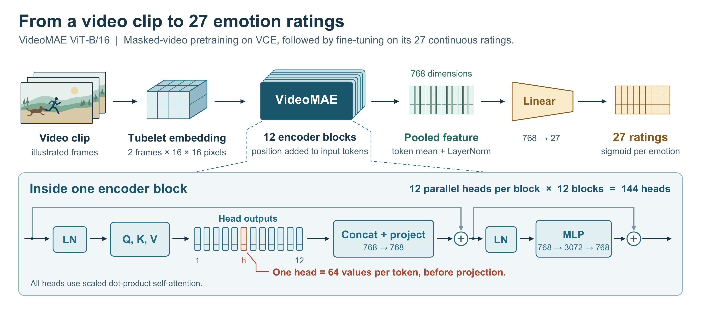
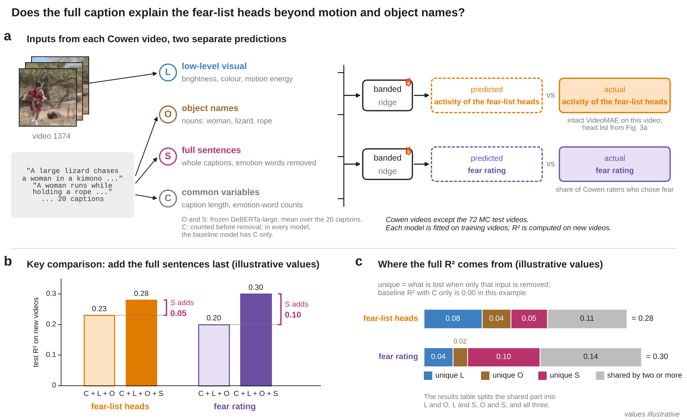
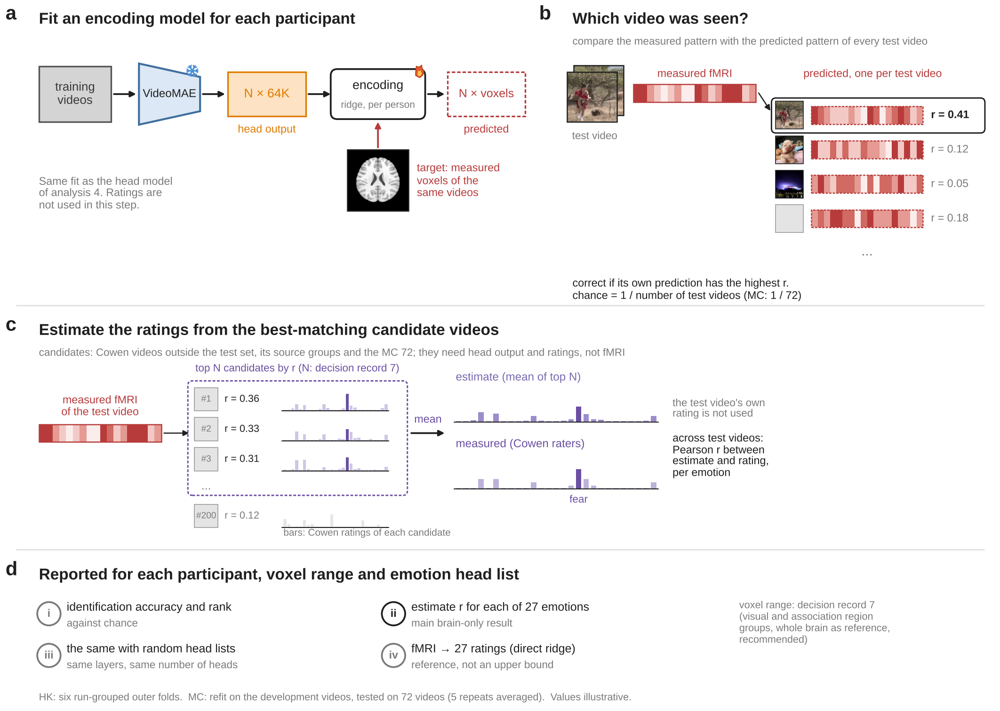
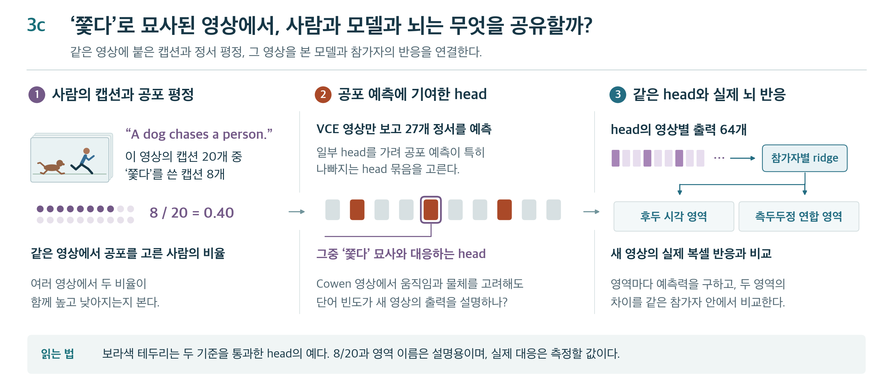

# 연구설계 통합문서

작성 시작: 2026-11-24

최종 수정: 2026-11-26

> 연구설계와 결과 해석 기준을 기록한 문서다. 그림 1은 분석의 연결을, 그림 2~5는 실행 방법을 보여 준다. 그림의 영상 프레임은 실제 Cowen 영상(1374, 366, 55)에서, 뇌 그림은 MNI152 표준 뇌와 fsaverage 피질 표면에서 가져왔다. 그림은 `figures/src/`의 Python 코드로 다시 그릴 수 있고, 가상 예시의 수치는 그림 안에 "values illustrative"로 표시했다. 제시한 비교는 분석 계획이며 실제 측정값은 결과가 나온 뒤 채운다.

**정해진 전제:** 모델은 기존 논문의 모델을 가져와 쓴다. 필요한 작은 수정이나 튜닝은 허용한다. 원래 구조와 이 연구에서 바꾼 부분은 구분해 기록한다.

**약어와 자료 이름.** 본문에서 풀어 쓰지 않는 약어와 자료 이름은 다음과 같다.

| 약어 | 뜻 |
|---|---|
| VCE | Video Cognitive Empathy. Mazeika 등(2022)이 공개한 영상 정서 평정 자료다. 영상 61,046개에 27개 정서 범주의 평정이 있다. |
| V2V | Video to Valence. 같은 논문에서 두 영상 중 어느 쪽이 더 유쾌한지 평정한 별도 자료다. 이 연구에서는 쓰지 않는다. |
| fork | VCE 저자들이 공개한 VideoMAE 수정 코드 저장소(JunShern/VideoMAE)다. |
| Cowen 영상 | Cowen과 Keltner(2017)가 34개 정서 범주의 자기보고를 모은 짧은 영상 2,185개다. |
| HK | Horikawa 등(2020)의 영상 시청 fMRI 자료다. 참가자는 5명이고, 원 논문이 분석한 Cowen 영상은 2,181개다. |
| MC | Horikawa(2025)의 영상 시청 fMRI와 사람 캡션 자료다. 참가자는 6명이고, 영상마다 여러 사람이 쓴 캡션 20개가 있다. |
| SSv2 | Something-Something V2. Tong 등(2022)의 VideoMAE 원문과 Kowal 등(2024)이 쓴 행동 인식 영상 자료다. |
| VTCD | Video Transformer Concept Discovery. Kowal 등(2024)의 영상 Transformer 개념 발견 방법과 공개 코드다. |
| CRIS | Concept Randomized Importance Sampling. Kowal 등(2024)이 여러 단위를 무작위로 함께 제거해 중요도를 구한 방법이다. |
| VCA | Visual Cortex Amygdala. Liu 등(2026a)이 시각 모듈과 편도체 모듈을 이어 붙인 모델이다. |
| CNN | 합성곱 신경망(convolutional neural network). |
| RSA | 표상 유사성 분석(representational similarity analysis). |
| ROI | 관심 영역(region of interest). |
| BOLD5000 | Gao 등(2025)이 분석한 공개 fMRI 자료다. 참가자 4명이 사진 약 5,000장을 보았고, 그중 1명은 일부 회기만 있다. |
| CLIP, GloVe | Vafaei 등(2026)이 쓴 의미 표상이다. CLIP은 이미지 encoder의 특징이고, GloVe(global vectors for word representation)는 단어 벡터다. |
| EVC | 초기 시각 피질(early visual cortex). |
| MT | 움직임에 선택적인 중측두 영역(middle temporal area). |
| LOC | 외측 후두 복합체(lateral occipital complex). |
| EBA | 선조외 신체 영역(extrastriate body area). |
| FFA | 방추상 얼굴 영역(fusiform face area). |
| PPA | 해마곁 장소 영역(parahippocampal place area). |
| OPA | 후두 장소 영역(occipital place area). |
| RSC | 팽대후부 복합체(retrosplenial complex). |
| pSTS | 후측 상측두구(posterior superior temporal sulcus). |
| IPL | 하두정소엽(inferior parietal lobule). |
| VMPFC | 복내측 전전두 피질(ventromedial prefrontal cortex). |

<a id="overview"></a>

## 전체 흐름

**이 연구는 세 단계에 걸친 여섯 분석으로 이루어진다. 대표 결과는 ③과 ④이고, ⑥은 역방향 검증이다.** VCE 영상에서 정서 예측에 기여하는 attention head(모델 한 층 안에서 토큰 정보를 모으는 단위)를 ②에서 정서별로 고른다. 그 목록을 고정한 뒤, ③에서는 같은 head의 영상별 출력을 무엇이 설명하는지, ④에서는 그 출력이 어느 영역의 뇌 반응을 설명하는지, ⑥에서는 그 출력으로 맞춘 encoding 모델을 거꾸로 써서, 뇌 반응만으로 본 시각 자극을 맞히고 정서 평정을 추정할 수 있는지 묻는다.

<a id="figure-1"></a>


**그림 1. 정서별 자극 정보에서 영역별 뇌 대응과 뇌 반응만으로 한 추정까지.** ③에서는 일곱 조합으로 사람의 해당 정서 평정과 선택 head의 출력을 각각 어느 자극 정보가 설명하는지 본다. ④와 ⑥에 전달되는 것은 **영상마다 달라지는 같은 head의 실제 출력**이다. ③에서 얻은 설명력이나 캡션 자체를 뇌 모델에 입력하지 않는다. ①은 정서 학습 전후 비교, ②는 특징 선택, ⑤는 ②에서 고른 head를 제거했을 때의 검증이다. 그림 1~5에서 선택 head 출력은 주황색, 마지막 층의 768차원 벡터는 녹색, 사람 정서 평정은 보라색, fMRI는 붉은색으로 표시한다. [벡터 PDF](figures/emobrain_ridge_overview.pdf) / [편집용 SVG](figures/emobrain_ridge_overview.svg)

```text
1절  문제 제기와 선행연구
     색과 움직임, 보이는 물체, 벌어지는 일이 함께 바뀌는 시각 자극을 보고 사람들이 정서를 평정한다.
      ↓
2절  연구질문과 가설
     시각 자극의 어떤 정보가 사람의 정서 평정과 정서 예측에 기여한 head의 출력을 각각 설명하는가?
     그 head 출력과 평정은 어느 뇌 영역의 반응을 함께 설명하는가?
     그 head 출력으로 맞춘 encoding 모델로 뇌 반응에서 본 시각 자극을 맞히고 정서 평정을 추정할 수 있는가?
      ↓
3절  연구의 필요성과 기여
     영상 모델에서 찾은 같은 head 특징을 실제 뇌와 대조하고, 새 시각 자극에 대한 뇌 반응에서도 읽을 수 있는지 검증한다.
      ↓
4절  방법론  |  질문 → 모델 제안 → 설계 검증 → 결과 검증
     영상에서 정서로     ① 정서 학습 전후 비교 → ② head와 층 찾기 → ③ 영상과 캡션으로 내용 해석
     실제 뇌와의 대응    ④ head 특징과 27개 평정의 고유분과 공유분을 영역별로 계산 → ⑤ head 제거로 대응 변화 확인
     뇌에서 정서로       ⑥ ④의 encoding 모델 → 시험 영상의 실제 반응과 예측 반응 비교 → 본 영상 맞히기, 닮은 후보 영상의 평정으로 정서 추정
      ↓
5절  결과와 해석
     ①~⑥의 대조 결과를 정서별로 보고한다. 뇌와의 대응은 참가자와 영역별로도 제시한다.
      ↓
6절  한계와 결론
     영상 모델에서 고른 head 특징이 뇌 대응과 뇌 반응만으로 한 추정까지 어디까지 이어졌는지, 어느 단계에서 근거가 약했는지 적는다.
```

[자료와 분할](#data) / [방법론 그림 2~5 PDF](figures/emobrain_methods_figures.pdf) / [모델 구조](#figure-2) / [분석별 실행법](#methods) / [원고의 완료 기준](#finish) / [논문 작성용 인용표](#references)

| 단계 | 주 분석과 실행법 | 무엇을 비교하는가 | 남길 결과 | 논문에서 가져온 방법 |
|---|---|---|---|---|
| 영상에서 정서로 | [① 정서 학습 전후 비교](#analysis-1) (기준 비교) | 같은 VideoMAE의 영상 학습 직후와 정서 미세조정 직후에 같은 방식의 전체 표상 판독기를 각각 맞춰, 같은 새 영상에서 평가한다. | 27개 정서 각각의 예측 상관과 전후 차이 | 고정 표상의 선형 판독과 층별 정서 판독. [Tong 등, 표 3 및 arXiv 부록 표 11][videomae] / [Gao 등, 그림 4][gao] |
| | [② 어느 head와 층이 기여하는가](#analysis-2) (특징 선택) | VCE 검증 영상에서 head를 제거했을 때의 정서별 영상 간 상관 변화로 head 후보를 고른다. 새 영상에서 이 head를 제거한 경우를 같은 층에서 같은 수를 무작위로 제거한 경우, 그리고 다른 정서 기준 목록을 제거한 경우와 비교한다. | 선택한 head의 층별 분포, 고른 정서 × 평가한 정서의 하락 행렬(27 × 27) | 정서 관련 CNN 필터의 제거와 영상 Transformer head의 제거. [Liu 등(2024), 그림 6][liu24] / [Kowal 등(2024), 표 2][kowal] |
| | [③ 그 head가 반영하는 자극 정보](#analysis-3) (대표 결과) | Cowen 영상의 색과 움직임, 캡션 속 물체 이름, 전체 캡션을 따로 또는 함께 써서 새 영상의 head 반응과 사람 평정을 설명한다. | 세 정보 각각의 고유 기여와 겹치는 기여. 물체 등을 고려한 뒤 전체 캡션이 더 설명하는 부분 | 움직임 에너지, 명사와 전체 캡션 대조, 정보 묶음 분할. [Nishimoto 등, 그림 1B][nishimoto] / [Doerig 등, 그림 3][doerig] / [Garcia 등, 3절][garcia] / [Dupré la Tour 등, 2.7절][banded] |
| 실제 뇌와의 대응 | [④ 같은 head와 사람 평정의 영역별 뇌 대응](#analysis-4) (대표 결과) | 정서마다 선택한 head 특징만, 27개 평정만, 둘을 함께 사용해 같은 시험 영상의 같은 복셀을 예측한다. 별도로 온전한 모델의 정서 학습 전후 RSA와 encoding을 비교한다. | 27개 정서별 head 목록 × 영역별 head 고유분, 평정 고유분, 공유분. 참가자별 값과 사전 지정 영역 간 차이 | [Horikawa 등(2020), 그림 5][hk] / [McMahon 등(2023), 그림 5와 Methods][mcmahon] / [Lescroart 등(2015), 그림 3, 9][lescroart] |
| | [⑤ 정서별 head 제거와 영역별 변화](#analysis-5) (가림 대조) | ②의 head를 제거한 뒤 ④에서 정한 마지막 층 RSA와 복셀 예측을 반복한다. 같은 층과 개수에서 표상 변화량까지 비슷한 무작위 제거와 비교한다. Encoding은 각 조건의 훈련 자료로 다시 맞춘다. | 정서 × 영역별 RSA와 encoding의 추가 하락. 영역 간 하락 차이 | 영상 head 제거와 모델과 뇌의 비교를 이 연구에서 연결한다. [Kowal 등(2024), 표 2][kowal] / [Liu 등(2026a), 그림 3][vca] / [Nili 등(2014), 그림 1][nili] |
| 뇌에서 정서로 | [⑥ encoding 모델로 본 영상 맞히기와 정서 추정](#analysis-6) (역방향 검증) | ④와 **같은 head 특징**으로 맞춘 참가자별 encoding 모델의 예측 반응을 시험 영상의 실제 fMRI와 비교한다. 본 영상을 맞히고, 가장 닮은 후보 영상들의 Cowen 평정을 평균해 정서를 추정한다. 같은 층 무작위 head로 맞춘 encoding 모델, 같은 fMRI의 직접 ridge와 함께 보고한다. | 복셀 범위별, 정서별 영상 맞히기 정확도와 추정 상관. HK 교차검증 후 MC 시험 영상 72개의 결과 | encoding 모델에서 decoding을 끌어내는 순서, 본 자극 맞히기, 후보 영상으로 한 재구성. [Naselaris 등(2011)][naselaris] / [Kay 등(2008)][kay] / [Nishimoto 등(2011), 그림 3, 4][nishimoto] / [Horikawa(2025), Video presentation experiment][mc] |

**③에서 무엇이 다음 단계로 이어지는가?** 하나의 정서를 고르면, ③에는 두 줄의 결과가 생긴다. 첫 줄은 시각, 물체, 전체 캡션이 **사람의 해당 정서 평정**을 설명한 정도이고, 둘째 줄은 같은 정보가 **그 정서를 기준으로 고른 모델 head의 반응**을 설명한 정도다. 사람과 모델에서 서로 다른 단서가 두드러질 수도 있다. ④는 이 두 번째 줄에서 해석한 head의 실제 출력과 27개 평정 전체를 비교 대상으로 삼아 어느 영역에서 설명력이 겹치는지 본다. ⑥에서는 ④와 같은 head 출력으로 맞춘 encoding 모델을 거꾸로 써서, 새 영상의 fMRI만으로 본 영상을 맞히고 정서 평정을 추정한다. HK에서 ⑥이 ④에서 가져오는 것은 바깥 훈련 영상으로 맞춘 encoding 가중치뿐이고, MC에서는 같은 규칙으로 새로 맞춘다. ③과 ④의 설명력 요약이나 영역별 통계값은 ⑥의 입력으로 쓰지 않는다.

**실행 범위.** 12월 7일 원고와 12월 15일 심사의 완료 기준은 [여섯 분석의 결과표](#finish)다. 영상당 head 출력을 요약하는 방법, 마스크 반복 수, 정서당 선택할 head 수는 [파일럿에서 고정](#analysis-2)한다. VCE와 Cowen의 영상 중복 수는 [분할을 확정하기 전](#data)에 실제 파일로 확인한다. 참가자별 복셀 파일은 프로젝트 기록에 해시가 있으므로, 실행 전에 같은 파일인지 다시 확인한다.

## 1. 문제 제기와 선행연구

이 절에서는 **알려진 것에서 남아 있는 문제로** 이어지게 쓴다.

| 채울 내용 | 생각할 질문 | 작성 |
| --- | --- | --- |
| 설명할 현상 | 이 연구가 관심을 갖는 현상은 무엇인가? | 1-1 |
| 현재까지 알려진 것 | 선행연구는 그 현상을 어떻게 설명했는가? | 1-2 |
| 남은 문제 | 기존 연구에서 확인하지 못했거나, 서로 구별하지 못한 설명은 무엇인가? | 1-3 |
| 이번 연구의 출발점 | 그중 정확히 어느 문제를 다룰 것인가? | 1-4 |

### 1-1. 설명할 현상

사람들은 소리 없이 영상을 보기만 해도 느낀 정서를 보고한다. VCE 평정자는 소리를 끈 영상을 보고 27개 범주에서 정서를 골랐다. [Mazeika 등, 3절][vce] 같은 시각 자극에 대한 여러 사람의 보고를 모으면 자극별 정서 평정의 차이를 측정할 수 있다. [Cowen과 Keltner(2017)](https://pmc.ncbi.nlm.nih.gov/articles/PMC5617253)는 2,185개의 짧은 영상에 대한 자기보고에서 27개의 정서 범주가 신뢰롭게 구분됨을 보였다. 그러나 시각 자극의 어떤 정보가 이러한 정서를 일으키는지는 충분히 밝혀지지 않았다.

개와 사람이 함께 등장하는 시각 자극이라도, 개가 사람 곁에서 뛰노는 때와 사람을 뒤쫓는 때의 평정은 다를 수 있다. 두 자극은 움직임도 다를 수 있다. 관심은 **어느 정서에서 색과 움직임, 보이는 물체, 행동과 상황에 관한 정보가 각각 설명을 더하고, 어느 정서에서는 이 정보들이 겹치는지**다. 같은 시각 자극을 본 사람들의 뇌 반응으로 이 설명을 검증한다. 시각 자극에서 ‘누가 누구에게 무엇을 하는가’는 상황을 기술하는 한 방식이다. 자연 시각 자극에서 세 정보가 독립적으로 변한다는 가정은 두지 않는다. [Yatskar 등, 그림 1 및 3절][yatskar]

### 1-2. 현재까지 알려진 것

| 구분 | 알려진 것 | 근거 |
| --- | --- | --- |
| 자극 정보와 정서 평정 | Kragel 등은 시각 모델로 정서 범주를 학습하고, 사진을 본 사람의 뇌 반응으로 모델 정서 유닛 출력을 예측했다. Gao 등은 물체 인식 모델의 층별 특징으로 평정을 읽고, 별도로 LOC를 포함한 시각 영역의 fMRI에서 평정을 읽었다. Gao 등은 모델 층과 LOC를 직접 대응시키지 않았다. | [Kragel 등, 그림 4][kragel] / [Gao 등, 그림 4, 7][gao] |
| 모델 내부의 정서 관련 특징 | Liu 등(2024)은 물체 인식 CNN의 정서 선택 필터를 손상시킨 뒤 같은 층의 무작위 필터 손상과 비교했다. 보충자료에서는 사진 설명에서 얻은 물체 범주도 조사했다. Kowal 등은 영상 Transformer에서 행동 판별에 기여한 head 및 시공간 개념을 구분하고, 학습 영상에서 정한 head 순위를 다른 영상에서 검증했다. 두 연구는 모델 내부를 조작해 **어느 출력이 바뀌는지** 확인했다. 두 연구 모두 그 결과를 뇌 자료와 대조하지 않았다. | [Liu 등(2024), 그림 6 및 보충 Topic 8][liu24] / [Kowal 등(2024), 3.2절, 5.1절 및 표 2][kowal] |
| 모델 표상과 뇌 | Liu 등(2026a)의 편도체 모델에서 그림 3은 네 층의 표상을 합쳐 실제 편도체의 사진 간 반응 유사성과 비교했다. 그림 6은 각 층과 **정서가 및 각성 평정**의 유사성 구조를 비교했다. 각 층을 실제 뇌 영역과 따로 비교하지는 않았다. | [Liu 등(2026a), 그림 3, 6][vca] |
| 정서 학습 전 시각 표상 | 정서를 학습하지 않은 시각 모델도 사진 평정을 상당 부분 설명했다. Conwell 등의 72.9%는 순수 시각 모델 160개 중 최고 모델(ConvNext-Large)이 두 이미지 자료의 네 평정(OASIS의 각성, 정서가, 아름다움과 Vessel의 아름다움)에서 설명한 **설명 가능 분산** 비율의 평균이다. 시각과 언어를 함께 학습한 모델의 성능은 의미 정보의 가능성을 보여 준다. | [Conwell 등(2025), 결과 1.1절, 1.4절][conwell] / [Liu 등(2026a), 그림 4][vca] |
| 물체와 상황 정보 | 고차 시각 피질에서 사진의 전체 캡션이 명사만 남긴 캡션보다 높은 대응을 보인 연구가 있다. 짧은 사회적 영상에서는 사회적 행동 평정의 최고 모델이 캡션 언어 모델이었고, 시각 공간 평정의 최고 모델은 사진 모델이었다. 캡션의 단어 순서를 섞어도 8개 평정 중 6개는 예측이 유의하게 떨어지지 않았고, 공간 규모와 함께 행동하는 정도의 예측만 떨어졌다. 이 영상 연구의 fMRI에서는 MT, EBA, LOC, pSTS에서 영상 모델의 평균 성능이 사진 모델보다 유의하게 높았지만, 캡션 언어 모델의 평균 성능이 시각 모델보다 유의하게 높은 관심 영역은 없었고 EVC, FFA, PPA에서는 유의하게 낮았다. 최고 모델이 캡션 언어 모델인 영역도 없었고, 시각과 캡션을 결합한 분할은 검정하지 않았다. 사람이 표시한 의미 및 정서 특징의 결합으로 후두측두 피질의 반응을 설명한 연구도 있다. 영상에서 시각 특징과 물체 이름을 함께 고려한 뒤에도 고차 시각 영역에 전체 캡션의 기여가 남는지는 아직 열린 질문이다. | [Doerig 등, 그림 3][doerig] / [Garcia 등, 그림 2~4][garcia] / [Abdel-Ghaffar 등, 그림 1~3][abdel] |
| 정서와 뇌 | Horikawa 등(2020)은 같은 영상 자료의 34개 범주 및 14개 차원을 뇌에서 예측했고, 일부 연합 영역은 사용한 물체 및 의미 특징보다 정서 범주 평정으로 더 잘 설명됐다. Horikawa(2025)는 영상 시청 중 뇌 반응에서 캡션의 의미 특징을 읽었다. | [Horikawa 등(2020), 그림 2, 4, 5][hk] / [Horikawa(2025), Feature decoding analysis][mc] |

### 1-3. 남은 문제

1. **저수준 시각, 물체, 상황이 함께 변한다.** 물체로 학습한 특징이 평정을 예측해도, 그 물체의 움직임이나 행동을 묘사한 서술이 추가로 설명하는 부분은 따로 검증해야 한다. [Gao 등, Discussion][gao] / [Liu 등(2024), 보충자료][liusupp]
2. **시각 피질 밖의 대응이 남는다.** 연합 영역에서 정서 평정을 읽을 수 있지만, 어느 자극 정보가 그 대응에 기여했는지는 별개다. [Horikawa 등(2020)][hk]
3. **영상은 시간에 걸쳐 변한다.** 사진 모델의 층별 결과를 영상의 움직임이나 사건에 그대로 적용하기 어렵다. [Kragel 등, 결과 1절][kragel] / [Garcia 등][garcia]
4. **정서마다 확인해야 한다.** 어떤 정서에서 중요한 단서가 다른 정서에도 같은 방식으로 쓰이는지, 새 영상에서 같은 단위를 제거해 비교한다. [Liu 등(2024)][liu24] / [Kowal 등(2024)][kowal]
5. **정서 평정을 뇌 반응에서 읽을 수 있는지 남는다.** encoding 모델로 처음 보는 자극을 뇌 반응에서 맞히고 본 영상을 재구성한 연구는 있지만, 같은 방식으로 시각 자극의 정서 평정을 추정한 연구는 확인하지 못했다. [Kay 등(2008)][kay] / [Nishimoto 등(2011)][nishimoto]

### 1-4. 이번 연구의 출발점

이 연구에서 **캡션은 모델이 영상에서 배운 내용을 알아보는 데 쓴다.** 영상 모델은 VCE 영상만으로 학습한 뒤 27개 정서 평정으로 추가 학습한다. 정서 예측에 기여한 특징을 VCE에서 고르고, 새로운 영상에서는 색과 움직임, 사람이 쓴 캡션의 물체와 행동이 같은 특징을 얼마나 설명하는지 본다. 그 특징을 실제 뇌와 대조하고, 마지막에는 그 특징으로 맞춘 encoding 모델로 뇌 반응만으로 본 영상을 맞히고 정서 평정을 추정한다. [Mazeika 등(2022)][vce] / [Cowen과 Keltner(2017)][cowen] / [Horikawa(2025)][mc]

모델이 예측한 정서, 모델 내부 특징, 사람의 뇌 반응은 서로 다른 측정으로 다룬다. 선행연구의 CNN 필터나 행동 분류 정확도 대신 VideoMAE head와 27개 연속 평정을 쓰고, 같은 head 특징을 fMRI까지 추적한다. 영상만 학습한 모델도 정서로 학습한 모델과 같은 조건에서 평가한다. 캡션에서는 물체 이름과 전체 캡션을 분리해 비교한다. 이 연구의 기여는 정서별 뇌 지도 자체에 있지 않다. 영상 모델에서 먼저 선택한 head 특징의 내용, 영역별 대응, 그 특징으로 맞춘 encoding 모델로 한 뇌 단독 예측이 같은 정서에서 함께 성립하는지 확인하는 데 있다.

## 2. 연구질문과 가설

이 절에서는 **어떤 설명들을 어떤 예측으로 구별할지** 정한다.

| 채울 내용 | 생각할 질문 | 작성 |
| --- | --- | --- |
| 핵심 연구질문 | 이번 연구가 답할 질문을 한 문장으로 쓰면 무엇인가? | 2-1 |
| 제안하는 설명 | 그 현상이 왜 나타난다고 생각하는가? | 2-2 |
| 대안 설명 | 같은 현상을 다른 이유로도 설명할 수 있는가? | 2-3 |
| 구별되는 예측 | 각 설명이 맞다면 어떤 결과가 달라져야 하는가? | 2-2, 4-4 |

### 2-1. 핵심 연구질문

**시각 자극의 어떤 정보가 자극이 일으키는 정서와 그에 대응하는 뇌 반응을 설명하며, 그 설명은 정서 범주와 뇌 영역에 따라 어떻게 달라지는가? 또한 그 정보를 이용하여 뇌 반응으로부터 시각 자극의 정서 평정을 예측할 수 있는가?**

### 2-2. 제안하는 설명

**가설 1.** 저수준 시각, 물체 이름, 전체 캡션이 각 정서의 사람 평정과 그 정서로 고른 head 출력을 각각 설명하는 부분과 서로 겹쳐 설명하는 부분의 구성은 정서에 따라 다르다.

**가설 2.** 정서별로 선택한 head 특징과 사람의 27개 평정이 새 시각 자극에 대한 실제 복셀 반응을 함께 또는 따로 설명하는 정도는 영역에 따라 다르다.

**뇌 단독 예측.** 정서별로 선택한 head 특징으로 맞춘 참가자별 encoding 모델을 거꾸로 쓰면, 새 시각 자극을 본 뇌 반응만으로 어느 시각 자극을 봤는지 맞히고 그 시각 자극의 정서 평정을 추정할 수 있다.

**검정할 예측.** 예측 1은 가설 1에 대응하며 분석 2와 3으로 확인한다. 가설 1의 확인적 검정은 아직 정하지 않았다. 예측 2는 가설 2에 대응하며 분석 4와 5로 확인한다. 예측 3은 뇌 단독 예측에 대응하며 분석 6으로 확인한다.

1. **정서에 따른 정보 구성의 차이.** 새 시각 자극에서 추정한 저수준 시각, 물체 이름, 전체 캡션의 고유분과 공유분은 정서마다 다른 구성을 보인다. ③은 이 구성을 사람의 해당 정서 평정과 그 정서로 고른 head 출력에서 따로 추정한다. head 쪽 결과는 그 목록이 ②의 시험에서 해당 정서의 예측에 기여했는지와 함께 해석한다. 모든 정서에서 구성이 비슷하면 공통 구성으로 보고한다. 추정이 불안정하면 공통성도 결론 내리지 않는다.
2. **영역에 따른 차이.** ④에서 같은 head와 27개 평정의 고유분 및 공유분을 구한다. ③에서 캡션이 선택 head 목록의 반응을 더 많이 설명하는 정서일수록 ④에서 연합 영역과 시각 영역 간 head 고유분 차이가 큰지 별도 대비로 검정한다. 영역 간 차이가 불명확하면 해당 영역군의 선택성은 보류한다. ⑤는 선택 head 제거에 따른 대응 변화로 이 결과를 점검한다. ③에서 측정한 정보 내용을 영역 차이에 연결하려면 위의 별도 대비가 지지되어야 한다.
3. **뇌에서 읽을 수 있는 정보.** 정서별로 선택한 head 특징으로 맞춘 encoding 모델을 쓰면, 새 시각 자극에 대한 뇌 반응만으로 본 시각 자극을 우연 수준보다 잘 맞히고, 가장 닮은 후보 영상들의 평정으로 해당 정서 평정을 추정할 수 있다. 같은 층, 같은 수의 무작위 head로 맞춘 encoding 모델과 비교해 선택한 head가 기여했는지 구별한다. 비교할 복셀 범위는 [결정 기록 7][decisions]에서 정한다. 같은 fMRI에서 평정을 직접 예측하는 ridge는 참조값으로 함께 보고한다. 이 예측의 성립 여부는 encoding 모델을 거친 추정과 직접 ridge 중 어느 쪽의 상관이 큰지로 판단하지 않는다.

⑥의 영상 맞히기와 정서 추정은 따로 판단한다. 영상을 우연 수준보다 잘 맞히지 못하면, 그 head 특징으로 본 시각 자극을 구별할 정보가 뇌 반응에서 확인되지 않은 것이다. 정서 추정이 순열 기준보다 낫지 않으면, 정서 평정을 추정할 정보가 확인되지 않은 것이다. 후보 평균은 본 영상을 정확히 맞히지 못해도 비슷한 영상들의 평정을 모을 수 있으므로, 한쪽만 성립하는 결과도 그대로 보고한다. ③에서 사람과 모델의 차이가 보이거나 ④에서 평정 고유분만 남는 결과도 독립적으로 보고한다.

| 구분 | 근거 |
| --- | --- |
| 가설 1 | 물체 인식 표상에서도 정서 선택성이 나타나며, 전체 캡션과 물체 이름이 같은 정보를 담는지는 새 자극에서 비교할 수 있다. [Gao 등][gao] / [Liu 등(2024)][liu24] / [Doerig 등][doerig] |
| 가설 2 | 정서 범주가 분산된 뇌 반응에서 읽히고, 후두측두 피질에서도 의미와 정서 특징이 함께 설명력을 갖는다. 영역 간 직접 비교가 필요하다. [Horikawa 등(2020)][hk] / [Abdel-Ghaffar 등][abdel] |
| 뇌 단독 예측 | 복셀별 encoding 모델로 처음 보는 사진을 뇌 반응에서 맞히고, 후보 영상들로 본 영상을 재구성한 선례가 있다. [Kay 등(2008)][kay] / [Nishimoto 등(2011), 그림 3, 4][nishimoto] |

### 2-3. 대안 설명

가설 1과 가설 2에 대립하는 설명은 다음과 같다.

| 번호 | 구분 | 대안 설명 | 근거 | 대립하는 가설 |
| --- | --- | --- | --- | --- |
| 1 | 이론 | 물체 이름과 물체 관련 시각 특징만으로 평정 차이가 설명될 수 있다. | Gao 등의 일상 사진에서는 AlexNet fc8이, Cowen 영상 프레임에서는 EmoNet fc8이 더 잘 예측했다. Cowen 프레임에서는 EmoNet fc8이 같은 모델의 fc7보다도 나았다. 저자들은 Cowen 결과를 물체 범주만으로는 정서 예측에 충분하지 않다는 근거로 보았다. 다만 EmoNet은 fc8만 다시 학습했으므로 fc7까지는 물체 인식으로 학습한 AlexNet 층 그대로다. 영상에서 캡션이 물체 이름에 더하는 설명력은 ③에서 검정한다. [Gao 등, 그림 2d, 4f 및 Discussion][gao] | 가설 1 |
| 2 | 이론 | 영상만 학습한 표상에 정서 예측에 필요한 단서가 이미 있을 수 있다. | 정서를 직접 학습하지 않은 모델의 평정 예측과 유닛 선택성이 보고됐다. 분석 1에서 같은 구조를 비교한다. [Conwell 등][conwell] / [Liu 등(2024)][liu24] | 가설 1 |
| 3 | 이론 | 상황을 기술한 정보가 고차 시각 영역과 연합 영역에서 비슷하게 대응할 수 있다. | 사진에서는 고차 시각 피질과 전체 캡션의 대응이 보고됐다. 사회적 영상에서는 캡션 언어 모델의 평균 성능이 FFA와 PPA에서 시각 모델보다 유의하게 낮았다. 분석 5에서 영역 간 하락 차이를 검증한다. [Doerig 등][doerig] / [Garcia 등, 그림 4][garcia] | 가설 2 |
| 4 | 이론 | 시각 영역과 연합 영역에서 읽은 정보가 겹칠 수 있다. | Kragel 등은 개별 시각 영역, 후두엽 전체, 전뇌의 반응으로 각각 모델 정서 유닛을 예측해 비교했다. 후두엽 모델과 전뇌 모델이 개별 영역보다 잘 예측했고, 저자들은 이 정보가 후두엽 밖의 뇌 영역에도 일부 중복되어 있다고 해석했다. 단일 ROI의 예측력으로 영역 고유의 정보를 단정할 수 없다. [Kragel 등, 결과 4절 및 그림 S5][kragel] | 가설 2 |
| 5 | 이론 | 연합 영역의 반응에 참가자의 경험이나 기대가 기여할 수 있다. | HK의 평정자와 fMRI 참가자는 다르다. 이 자료는 개인이 보고한 정서 경험을 분리해 주지 않는다. [Horikawa 등(2020)][hk] | 가설 1, 2 |
| 6 | 이론 | 다른 사람이 어떻게 느낄지 예측한 정보(3인칭 정서)가 시청자 자신의 정서 경험과 함께 뇌 반응에 나타날 수 있다. | 단일 시청 반응과 영상별 평정으로 두 설명을 구별하기 어렵다. HK는 정서 범주 모델이 시각 물체 및 의미 모델보다 더 잘 예측한 영역(IPL, VMPFC 등)이 마음 이론 네트워크와 겹친다는 점을 들어, 1인칭과 3인칭 정서가 섞였을 가능성을 한계로 적었다. [Horikawa 등(2020), Discussion의 Limitations of the Study][hk] | 가설 2 |
| 7 | 방법 | 캡션 효과가 물체 이름, 서술 길이, 정서 단어만으로 설명될 수 있다. | 분석 3에서 물체 이름과 서술 길이를 통제한다. 전체 캡션은 정서 단어를 지우지 않고 쓰므로(11/27 결정 8), 정서 단어 출현량을 공통 변수로 통제하지 않으면 전체 캡션의 추가 설명에 정서 단어의 효과가 들어간다. 출현량을 넣어도 문장 임베딩에 담긴 정서 단어의 효과는 일부 남을 수 있다. 통제할지는 [결정 기록 8][decisions]에서 정한다. 통제한 뒤에도 전체 캡션이 더 설명하는 부분을 행위자와 대상의 역할을 이해한 증거로 해석하지는 않는다. [Doerig 등][doerig] / [Garcia 등][garcia] | 가설 1, 2 |
| 8 | 방법 | 모델과 뇌를 연결하는 방법 또는 head를 제거했을 때 표상 전체가 바뀐 일반적 효과가 영역 차이를 설명할 수 있다. | 분석 4~5에서 RSA와 재적합 encoding을 구분하고 표상 변화량을 맞춘 대조를 둔다. 표상 변화량을 맞추는 조건은 이 연구에서 더했다. [Nili 등][nili] / [Kowal 등(2024)][kowal] | 가설 2 |

## 3. 연구의 필요성과 기여

이 절에서는 **답을 얻었을 때 새롭게 알게 되는 것**을 쓴다.

| 채울 내용 | 생각할 질문 | 작성 |
| --- | --- | --- |
| 왜 중요한가 | 이 질문에 답하는 것이 해당 분야에서 왜 필요한가? | 3-1 |
| 선행연구와의 차이 | 기존 연구가 했던 것에서 무엇을 더 알아내는가? | 3-2 비교표 |
| 얻게 될 지식 | 현상이나 뇌에 대해 무엇을 말할 수 있게 되는가? | 3-1, 결과 기록은 5절 |
| 기여의 기준 | 예측 성능 외에 어떤 설명을 구별해야 연구가 의미 있는가? | 3-1, 4-4 |

### 3-1. 왜 중요한가

뇌 반응으로 시각 자극의 정서 평정을 예측할 수 있어도 무엇을 읽었는지는 여전히 열려 있다. 공포 평정이 높은 시각 자극에서는 보이는 물체, 빠른 움직임, 추격이라는 사건이 한 자극 안에 함께 나타날 수 있다. 한 요소를 통제한 결과와 여러 요소가 겹쳐 예측한 부분을 함께 보아야 어느 정서에 어떤 설명이 타당한지 판단할 수 있다. [Horikawa 등(2020)][hk] / [Gao 등][gao] / [Dupré la Tour 등][banded]

영상 모델에서는 같은 영상의 같은 내부 특징을 제거할 수 있다. 그 조작이 어느 정서의 예측을 바꾸는지 먼저 확인하면, 실제 뇌에서도 그 특징이 어디서 읽히는지 별도로 시험할 수 있다. 이렇게 고른 정서별 특징을 두고, 시각 자극의 어떤 정보가 그 특징과 사람 평정을 설명하는지(③), 그 특징과 사람 평정이 어느 영역의 반응을 함께 설명하는지(④), 그 특징으로 맞춘 encoding 모델로 뇌 반응만으로 본 영상을 맞히고 평정까지 추정할 수 있는지(⑥)를 같은 정서에서 묻는다. 세 결과가 일치하는 경우와 서로 다른 경우를 구별하는 것이 기여의 기준이다. [Liu 등(2024)][liu24] / [Kowal 등(2024)][kowal] / [Kay 등(2008)][kay]

### 3-2. 선행연구와의 차이

| 연구 | 자극 | 정서 측정 | 비교한 자극 정보 | 뇌 범위 |
| --- | --- | --- | --- | --- |
| Kragel 등(2019) | Cowen 영상 프레임으로 AlexNet의 fc8만 다시 학습. IAPS와 GAPED 사진 112장 시청 fMRI(18명)와 독립 영화 클립 시청 fMRI(32명) | 사진은 모델 유닛 출력, 영화 클립은 정서 범주 | 정서 학습 모델 특징 | 사진에서는 뇌로 모델 출력을 예측했고, 영화 클립에서는 후두엽 반응으로 범주를 분류했다. [전문][kragel] |
| Gao 등(2025) | BOLD5000 사진과 Cowen 영상에서 뽑은 6,555 프레임. 뇌 분석은 BOLD5000(4명) | 범주별 정서 평정 | AlexNet 층별 특징과 EmoNet fc8 | 초기 시각 피질, LOC, PPA, RSC, OPA, Heschl 대조. [전문][gao] |
| Liu 등(2024, 2026a) | 사진 | 정서가 평정으로 나눈 유쾌, 중립, 불쾌(2024) 또는 정서가와 각성 평정(VCA) | 선택 필터 제거, 편도체 모듈의 표상 | 2024년은 모델 내 조작, VCA는 실제 편도체와의 대응도 평가. [2024][liu24] / [2026a][vca] |
| Horikawa 등(2020) | 영상 2,181개 | 34개 범주와 14개 차원 | 정서 평정과 시각 및 의미 특징 | 전뇌 영역별 encoding과 decoding. [전문][hk] |
| Abdel-Ghaffar 등(2024) | 사진 | fMRI 참가자 본인의 정서가 분류(3수준)와 각성 평정(참가자별 중앙값으로 나눈 2수준) | 독립 평정자 4명이 표시한 의미 범주와 의미와 정서를 함께 담은 복합 특징, 참가자 본인의 정서가와 각성 | 후두측두 피질. [전문][abdel] |
| Garcia 등(2025) | 사회적 영상 250개 | 시각 공간, 사회적 행동, 정서가와 각성 평정 | 시각 모델과 캡션 모델 | 여러 시각 영역에서 실제 반응과 비교. [전문][garcia] |
| Conwell 등(2025) | 사진 | 정서가, 각성, 아름다움 | 시각 및 언어 정렬 모델 | 행동 평정 예측. [전문][conwell] |
| 본 연구 | VCE로 학습, Cowen 영상과 같은 영상의 뇌 반응에서 검증 | 두 자료에서 대응되는 27개 범주 | 선택 head의 출력과 사람 평정을 설명하는 저수준 시각, 물체 이름, 전체 캡션 | HK와 MC에서 영역별 대응, encoding 모델로 한 본 영상 맞히기와 정서 추정. |

## 4. 방법론

이 절에서는 **모델 선택, 비교 조건, 뇌 자료의 역할이 같은 연구질문으로 연결되게** 설계한다.

<a id="data"></a>

### 4-0. 사용할 자료와 검증 범위

| 채울 내용 | 생각할 질문 | 작성 |
| --- | --- | --- |
| 데이터와 참가자 | 어떤 자료와 참가자를 사용하는가? | 아래 본문 |
| 측정값 | 어떤 자극, 행동 평정, 뇌 반응이 있는가? | 아래 본문 |
| 학습과 평가의 구분 | 학습에 쓰는 자료와 검증 및 시험에 쓰는 자료는 무엇인가? | 아래 본문 |
| 자료가 허용하는 범위 | 이 자료로 무엇을 확인할 수 있고, 무엇은 확인할 수 없는가? | 아래 참가자 및 영상 단위, 6절 |

**약어.** 이 문서에서 쓰는 자료, 방법, 뇌 영역의 약어는 다음과 같다.

- VCE: Mazeika 등(2022)의 Video Cognitive Empathy 자료. 무음 영상 61,046개와 27개 정서 평정이다.
- V2V: 같은 논문의 Video to Valence 자료. VCE 영상 일부에 대해 어느 영상이 더 유쾌한지 비교한 선호 응답이다.
- HK: Horikawa 등(2020)의 영상 시청 fMRI 자료(5명).
- MC: Horikawa(2025)의 Mind Captioning 자료. 영상별 사람 캡션과 6명의 영상 시청 fMRI를 포함한다.
- VCA: Liu 등(2026a)의 visual cortex amygdala 모델.
- VTCD: Kowal 등(2024)의 Video Transformer Concept Discovery 방법과 공개 코드. CRIS(Concept Randomized Importance Sampling)는 같은 논문의 중요도 추정 방법이다.
- SSv2: Something-Something V2 행동 영상 자료.
- CNN: convolutional neural network(합성곱 신경망).
- RSA, RDM: representational similarity analysis(표상 유사성 분석), representational dissimilarity matrix(표상 비유사성 행렬).
- ROI: region of interest(관심 영역).
- 뇌 영역: EVC(early visual cortex), LOC(lateral occipital complex), PPA(parahippocampal place area), OPA(occipital place area), RSC(retrosplenial cortex), FFA(fusiform face area), EBA(extrastriate body area), MT(middle temporal area), pSTS(posterior superior temporal sulcus), IPL(inferior parietal lobule), VMPFC(ventromedial prefrontal cortex).

**데이터와 참가자.**

| 자료 | 영상 및 관찰 단위 | 이 연구에서 쓰는 곳 |
|---|---|---|
| **VCE** | 공식 분할은 무음 영상 61,046개 중 학습 50,000개, 시험 11,046개다. 사람이 해당 정서를 고른 후 강도를 1~10으로 평정했다. 배포 파일은 영상마다 27개 정서 각각에 0~1 값 하나를 주고, 배포 설명은 이 값을 평균 강도라고 부른다. 이 값에는 그 정서를 고른 사람의 수와 강도가 함께 들어 있는 것으로 보인다(아래 ‘같은 정서 이름과 다른 평정 척도’). | 영상 학습, 전체 표상 판독기 적합(공식 학습 목록 전체. 분석 6의 보조 분석을 하면 선택 head 판독기도 여기서 적합), head 선정(공식 시험 목록에서 뗀 검증 한 벌), 독립 시험(시험 목록의 나머지). 배포한 연속 값을 그대로 사용한다. [Mazeika 등, 3절][vce] / [Mazeika 등, 보충 B][vcesupp] / [공식 자료 설명][vcedata] |
| **Cowen 영상과 평정** | 원 연구 영상 2,185개. HK의 설명에 따르면 평정자(영상당 9~17명)가 34개 범주 각각을 100점 척도로 평정했고, 0보다 큰 점수를 1로 바꿔 평정자들의 값을 평균했다. 즉 영상별 값은 그 범주에 0보다 큰 점수를 준 평정자의 비율이다. 27개 원래 범주 열을 VCE 이름과 맞춘다. 일부 영상에는 원래 소리가 있었고, HK와 MC는 fMRI 실험에서 영상을 소리 없이 제시했다. Cowen 평정자가 소리를 들었는지는 원 논문 본문에서 확인하지 못했다. [Horikawa 등(2020), Transparent Methods의 Emotional movie stimuli][hk] / [Horikawa(2025), Visual stimuli][mc] | 고정 영상 모델과 고정한 전체 표상 판독기의 다른 자료 전이, 정보 내용 해석, 분석 6 정서 추정의 후보 평정, 뇌 예측 채점. 보조 분석을 하면 선택 head 판독기의 전이도 본다. [Cowen과 Keltner, 표 S1][cowen] / [Horikawa 등(2020), Transparent Methods의 Video stimulus labeling 및 그림 1B][hk] |
| **영상별 캡션** | MC 자료에서 사람이 쓴 캡션 20개를 영상 ID로 연결한다. 20개는 여러 사람이 같은 영상을 보고 쓴 서로 다른 문장이다. | 물체, 행동, 상황의 측정 및 캡션 간 일치도. 같은 영상의 캡션은 항상 같은 분할에 둔다. [Horikawa(2025), Caption annotation for visual stimuli][mc] |
| **HK 시청 fMRI** | 5명, 원 논문 분석 영상 2,181개. 원 절차는 BOLD 신호를 4초(2 volume) 이동하고, run마다 ±3 SD를 넘는 극단값을 줄인 뒤, 자극 블록(영상 제시 구간과 이어지는 2초 휴지) 안에서 평균하고, 전체 영상에 걸쳐 복셀별로 표준화했다. 8초보다 짧은 영상은 8초를 넘을 때까지 반복 제시했다. 참가자별, 영상별 복셀 반응을 쓴다. | MC 시험 영상 72개를 제외한 HK 개발 자료에서 영역 대응과 뇌 단독 예측을 검증한다. [Horikawa 등(2020), Transparent Methods의 Experimental design 및 MRI data preprocessing][hk] |
| **MC 시청 fMRI** | 6명, 원 논문 고유 영상 2,180개. 원 논문은 시험 영상이 제시된 학습 세션의 마지막 두 run을 버리고 나머지 2,108개 영상의 반응을 학습에 썼다. 별도 시험 72개는 영상당 다섯 번 반복한 시청 반응을 평균했다. 프로젝트 재전처리본의 품질 점검 기록에서는 참가자별 개발 영상이 2,081~2,108개이고, 5번 참가자의 시험 영상 1개와 6번 참가자의 3개는 반복이 4회만 남아 있다(`manifests/s2/mc_blocks.tsv`, `manifests/s2/mc_test_repeats.tsv`). MC에 이 재전처리본과 저자 배포본 중 무엇을 쓸지는 아직 정하지 않았다. | HK에서 선택을 마친 뒤, MC 참가자별 매핑을 적합하고 고정한 72개로 검증한다. 같은 영상에 관한 외부 평정은 공유하므로 새로운 평정 자료의 재현과 구분한다. MC 원 논문에 따르면 실험 설정과 분석 절차는 참가자 S1의 예비 실험에서 정했다. 원 논문은 S1이 같은 자극을 여러 번 보았으므로 뇌 반응이 영향을 받았을 수 있다고 적었다. HK와 MC의 참가자 중 같은 사람이 있는지는 확인하지 못했다. [Horikawa(2025), Subjects, Visual stimuli, Video presentation experiment, MRI data preprocessing 및 Statistical analysis][mc] |

**측정값.**

| 구분 | 내용 |
| --- | --- |
| 자극 | 무음 영상에서 측정한 색과 움직임, 같은 영상에 붙은 사람 캡션 20개의 물체 및 상황 서술. [Horikawa(2025)][mc] |
| 정서 평정 | 공통 27개 범주. VCE는 평균 강도(0~1, 고른 사람의 수도 함께 반영된 것으로 보임), Cowen은 그 정서를 선택한 사람의 비율. [Mazeika 등(2022), 3절][vce] / [Cowen과 Keltner(2017)][cowen] |
| 뇌 반응 | 참가자 한 명이 한 영상을 보는 동안 측정한 영역 내 복셀 패턴. HK는 영상 제시 구간과 이어지는 2초 휴지를 묶은 블록의 평균 반응, MC 시험은 같은 영상을 반복해 본 반응의 평균을 쓴다(원 설계는 5회). [Horikawa 등(2020), Transparent Methods의 MRI data preprocessing][hk] / [Horikawa(2025), MRI data preprocessing][mc] |

**같은 정서 이름과 다른 평정 척도.** VCE에는 영상마다 27개 값이 동시에 있다. Cowen의 34개 원래 범주 중 VCE 범주명에 없는 Contempt, Disappointment, Envy, Guilt, Pride, Sympathy, Triumph를 뺀 27개가 VCE 범주에 대응한다. Cowen 본문도 이 일곱 개를 독립된 차원에 대응하지 않는 범주로 꼽았다. 다만 그림 1 범례는 Pride 대신 Relief를 넣어 본문과 다르므로, 대응은 VCE 범주명을 기준으로 정한다. 표준 범주명으로 연결하고 대소문자, 공백, ‘Awe (or Wonder)’ 같은 표기 차이를 적은 27행 대응표를 보관한다. Cowen의 27개 요인 점수를 가져오거나, 제외한 일곱 범주를 모두 신뢰도가 낮다고 부르지 않는다. Cowen 본문에 따르면 Pride와 Triumph는 Admiration 차원에, Contempt와 Disappointment는 Anger 차원에, Sympathy는 Empathic Pain과 Sadness 두 차원에 함께 적재됐고, Guilt와 Envy는 어느 차원에도 적재가 거의 없었다. 평정자가 고를 수 있던 범주도 Cowen은 34개, VCE는 27개였다. 공포와 불안처럼 구분해서 물을 수 있는 범주가 이번 분석 단위다. 두 자료 모두 사람들이 영상을 보고 자신의 반응을 보고했다. VCE 배포 값은 정서별 평균 강도(0~1)다. 배포 설명의 예시 영상에는 0.1보다 작은 값(Amusement 0.067, Joy 0.083)이 있다. 1~10 강도를 10으로 나눠 그 정서를 고른 사람끼리만 평균했다면 이런 값은 나올 수 없다. 예시의 값은 모두 1/120의 배수이며, 고르지 않은 평정자를 0으로 넣고 평정자 12명 전체로 평균하면 이런 값이 나온다. 따라서 배포 값에는 그 정서를 고른 사람의 수와 강도가 함께 들어 있는 것으로 보인다. Cowen 값은 그 정서를 선택한 사람의 비율이므로 두 숫자의 의미가 다르다. 전체 라벨 파일에서도 같은지 확인해 기록한다. [Mazeika 등(2022), 보충 B.1의 평정 지시문][vcesupp] / [Cowen과 Keltner, Evidence for 27 Distinct Varieties of Reported Emotional Experience, 그림 1 범례 및 표 S1][cowen] / [VCE의 실제 라벨 예시][vcedata]

**학습과 평가의 구분.**

| 구분 | 내용 |
| --- | --- |
| 영상 모델의 학습 | VCE 학습 영상으로 두 checkpoint와 전체 표상 판독기를 학습하고, 검증에서 checkpoint와 head를 선택한다. 분석 6의 보조 분석을 하면 선택 head 판독기도 같은 학습 영상으로 맞춘다. |
| 교차 검증 | HK 개발 자료에서 run 단위로 나눈 여섯 fold를 사용한다. |
| 영상 단위 분할 | 같은 원본, 같은 영상의 여러 참가자 반응 및 캡션은 같은 fold에 둔다. |
| 시험 fold의 사용 | 해당 영상은 적합, 영역 선택, 표준화 통계 산출에서 제외한다. |
| 일반화 평가 | MC 시험 72개를 양쪽 자료의 개발에서 제외하고, 사전 선택을 끝낸 절차를 평가한다. |

**시험 정보를 어디서 차단하는가.**

1. 영상 ID뿐 아니라 같은 원본의 재인코딩, 발췌본과 반복 제시를 연결한다. 파일 해시로 동영상 일치를 찾고, 프레임 지문으로 찾은 근접 후보는 프레임열로 확인한다. VCE와 Cowen이 겹치면 VCE 쪽에서 제외해 Cowen을 외부 평가로 유지한다. 제외 전후 및 확인 불가 건수를 분할별로 남긴다. 이미 학습한 가중치에 시험 자극이 포함됐다면 해당 자료에 대한 독립 검증 표현을 철회하거나 중복 제거 후 재학습한다.
2. **검증 한 벌은 VCE의 공식 시험 목록(11,046개)에서 뗀다(11/26 결정).** 자기지도 학습과 정서 미세조정, 판독기 가중치 적합은 공식 학습 목록 50,000개 전체를 쓰므로, 학습 목록에서 검증을 떼면 학습에 쓴 영상이 검증에 섞인다. 시험 목록을 동일 원본 집합 단위로 검증과 최종 시험으로 나누고, 크기와 추출 규칙(seed 포함)은 실행 manifest에 기록한다. 같은 원본의 재인코딩이나 발췌본은 한쪽에만 둔다. VCE 배포 설명의 metadata 예시에는 원본 영상 ID가 없다. 그래서 원본 묶음은 1번에서 같은 원본으로 연결한 영상들로 정한다. 검증 한 벌은 checkpoint, 규제 강도, head 선정에 쓴다. 모든 선택을 끝낸 뒤 남은 시험 영상에서 고정 절차를 한 번 평가한다. 따라서 VCE 시험 결과를 계산하는 영상은 공식 시험 목록 전체가 아니라 검증을 뺀 나머지다. 공개 fork의 dense 학습 loader(`vce_dense.py`)는 학습 라벨 전체를 읽고, 검증 loader(`vce.py`)는 같은 목록의 마지막 10%를 읽는다. 그래서 너무 짧아 clip을 만들지 못해 학습에서 빠진 영상을 빼면 fork의 검증 영상은 모두 학습에 쓴 영상이다. 최적 checkpoint를 고르는 기본 지표(`run_class_finetuning.py`)도 27개 연속 평정에서 값이 가장 큰 정서를 모델의 1순위 출력이 맞혔는지 세는 top-1 정확도다. 이 연구의 실행에서는 학습에 쓰지 않은 검증 목록과 연속 평정 지표를 사용하고, 실제로 읽힌 두 목록의 교집합이 0인지 기록한다. [VCE fork][vcecode]
3. HK 자료에는 프로젝트의 기존 run 단위 6-fold(`hk_dev_v4`)를 쓴다. HK 원 논문의 6-fold(61개 run을 10개씩 다섯 집합과 11개 한 집합으로 나눔)와는 다른 분할이다. [Horikawa 등(2020), Transparent Methods의 Regularized linear regression analysis][hk] 같은 영상 및 동일 원본 집합, 참가자 간 같은 자극은 한 fold에 둔다. 기존 통합문서의 분할 기록은 프로젝트 자료의 참가자별 유효 행 기준으로 2,109개 중 5명 모두에게 있는 영상 1,969개, 일부에게만 있는 영상 140개, fold당 317~380개다. 같은 기록(`manifests/s2/participant_blocks_hk.tsv`)을 이 분할과 조인하면 참가자별 유효 영상은 참가자 1~5 순서로 2,105개, 2,108개, 2,100개, 2,088개, 2,001개다. **실행에 쓰는 영상 수는 실제 분할과 참가자별 유효 행을 조인해 다시 센다.** 정서 평정 및 길이로 맞춘 기존 분할을 결과에 따라 바꾸지 않는다. 각 바깥 fold에서 규제는 남은 run 안의 내부 검증으로 정한다. 분석 6의 후보 수 N도 이렇게 정할지는 [결정 기록 7][decisions]에서 정한다. 어떤 참가자에게 없는 반응은 채워 넣지 않는다.
4. MC 시험 72개의 ID는 HK 발견, 캡션 적합, 특징 및 영역 선택, MC 참가자 적합에서 모두 제외한다. HK와 MC의 원 논문이 보고한 고유 영상 수는 하나 차이 난다. 두 논문 모두 Cowen 자료의 영상 2,196개에서 시작해 HK는 중복 15개를, MC는 16개를 뺐다(HK 2,181개, MC 2,180개). [Horikawa 등(2020), Transparent Methods의 MRI data preprocessing][hk] / [Horikawa(2025), Visual stimuli][mc] 이름이나 행 번호로 동일성을 가정하지 않고 원본 ID 대조표를 사용한다. 프로젝트의 ID 대조표(`manifests/s2/hk_mc_id_map.tsv`)에서 한 개 차이는 거의 같은 내용인 영상 1349와 1363 한 쌍에서 생긴다. HK는 두 영상을 모두 분석 영상으로 두었고, 이 연구의 분할은 둘을 같은 fold에 둔다. MC는 1349 하나만 남겼다. MC 시험 72개는 같은 내용인 파일 1과 2186을 함께 세면 영상 파일 ID 73개에 해당한다. 이에 대응하는 HK 분석 영상 72개는 모두 HK 개발 분할에서 빠져 있다. MC에서는 시험 영상의 최초 단일 제시를 개발에 넣지 않으며 시험 반응은 별도 시험 반복으로 계산한다. MC의 encoding 가중치는 각자의 개발 영상에서 새로 적합하고, HK에서 정한 후보 수 N, 복셀 범위, 평가지표를 그대로 적용한다. 보조 분석을 하면 특징 복원 가중치도 새로 적합하고 선택 head 판독기는 그대로 쓴다.
5. **뇌 파일을 열 때 확인할 것.** HK 원 논문의 370영역은 피질 360개와 추가 영역 10개이며 10개에는 소뇌와 뇌간이 포함된다. 네트워크 수준의 요약에는 프로젝트의 13개 영역군을 쓴다. 13개 영역군은 Ji 등(2019)이 공개한 전뇌 네트워크 분할에서 피질 영역에 배정된 기능 네트워크 12개와, 피질하 10개 영역을 합친 해부학적 영역군 하나다. 피질하 영역군은 기능 네트워크가 아니다. 영역군의 ROI 수는 4개(ventral multimodal)에서 77개(Default)까지 다르므로, 영역군 요약에는 ROI 수와 영역 대응표(`manifests/s2/cabnp_groups.tsv`, `manifests/s2/roi_table.tsv`)를 함께 적는다. [Ji 등(2019), 초록][ji19] 참가자별 복셀 행렬과 영역 마스크가 있어야 영역 내부 RSA 및 참가자별 ridge를 실행할 수 있다. 기존 프로젝트의 `brain.roi_mean`은 5명 평균, 별도 450영역의 평균값이다. 그래서 이 배열은 분석 4~6에 쓰지 않는다. 참가자별 복셀 배열(HK 5명, MC 6명)의 파일 해시는 프로젝트 레포(a714d364)의 `manifests/s2/provenance.json`에 기록돼 있고, 370영역 표는 같은 커밋의 `manifests/s2/roi_table.tsv`다. 실행 전에 실제 파일의 해시가 기록과 같은지 다시 확인한다. 370영역 중 피질 360개는 저자 공개 ROI다. 피질하 10개는 HK가 밝힌 PickAtlas 해부 마스크 정의를 따라 참가자마다 새로 만들었으므로, 포함된 복셀이 저자의 마스크와 다르다. [Horikawa 등, Transparent Methods의 Regions of interest (ROI)][hk] [Horikawa 등(2020), 원문 및 보충][hk] / [프로젝트 자료 설명][projectdata]

**실행에서 남길 기준 파일.** 영상 ID, 동일 원본 집합, 자료명, train/validation/test, HK fold, 참가자, run, 반복 ID, 영상 및 캡션 존재 여부, 실제 평정 열 이름을 연결한 표와 버전을 보관한다. 기존 HK 분할은 프로젝트 레포 `design/emobrain-final-2026-11-03` 브랜치(a714d364)의 `splits/hk_dev_v4/split_hk_dev.tsv`다. 분할 이름은 `hk_dev_rungroup6_v4`이고, 파일 해시는 `ab652b18`로 시작한다. fold는 이 파일의 fold 열을 쓴다. 중복 기록표 `manifests/s1/duplicates_15.tsv`의 fold_kept 열은 이 분할의 fold와 값이 달라 쓰지 않는다. 동일한 이름의 다른 사본과 구분하려면 실제 사용 파일의 해시를 남긴다. 영상 모델별 학습 ID, checkpoint, 코드 버전, 평가 view 수, 결측과 제외 수를 함께 남긴다. 이 표는 여섯 분석이 같은 영상을 같은 이름으로 추적하게 하는 준비 단계다.

### 4-1. 질문

큰 연구질문을 실제로 확인할 수 있는 비교로 옮긴다.

| 채울 내용 | 생각할 질문 | 작성 |
| --- | --- | --- |
| 구체적인 비교 | 큰 연구질문의 어느 부분을 어떤 비교로 확인하는가? | 전체 흐름의 여섯 분석, 아래 대응표 |
| 측정 대상 | 어떤 변수와 관찰 단위를 사용하는가? | 영상, 정서, head, 참가자별 영역 내 복셀 |
| 방법을 선택한 이유 | 왜 이 비교와 측정이 그 질문에 답하는가? | 2-3의 대안 설명 및 각 분석의 Why? |

**선행연구가 다루지 않은 것과 본 연구의 자료.**

| | 질문 | 선행연구가 다루지 않은 것 | 본 연구의 자료 | 1-3의 문제 |
| --- | --- | --- | --- | --- |
| [분석 1](#analysis-1) | 영상만 학습한 모델과 정서까지 학습한 모델에서 어떤 정서의 평정 예측이 달라지는가? | 물체 인식 모델에서 읽히는 정서 정보와 영상 모델이 정서 미세조정으로 얻는 정보는 구분해야 한다. [Gao 등][gao] / [Conwell 등][conwell] | 같은 VideoMAE의 두 checkpoint, VCE와 Cowen 평정 | 1, 4 |
| [분석 2](#analysis-2) | 어느 head를 제거해야 어느 정서 예측이 달라지며, 그 head는 어느 층에 있는가? | 정서 관련 CNN 필터와 영상 행동 예측 head의 제거를 연속 정서 평정에 적용한다. [Liu 등(2024)][liu24] / [Kowal 등(2024)][kowal] | VCE에서 고정한 head와 27개 정서별 제거 효과 | 4 |
| [분석 3](#analysis-3) | 시각 자극의 밝기, 색, 움직임과 물체 이름을 고려하고도 전체 캡션이 설명을 더하는가? 세 정보가 함께 설명하는 부분은 얼마인가? | 움직임에 반응하지 않는 Gabor 필터만 쓴 모형은 움직임 에너지 모형보다 초기 시각 영역 반응의 예측 정확도가 낮았다. 전체 캡션에는 물체 이름도 들어 있다. [Nishimoto 등, 그림 2][nishimoto] / [Doerig 등][doerig] / [Garcia 등][garcia] | Cowen 영상, 영상당 캡션 20개, 평정, 선택 head 특징 | 1, 3 |
| [분석 4](#analysis-4) | 정서별 head 특징과 27개 평정은 실제 복셀 반응을 각각, 그리고 함께 얼마나 설명하는가? | 별도 모형의 성능 순위만으로는 공유분을 알 수 없다. 온전한 모델의 학습 전후 RSA와 encoding으로 표상 변화를 본다. 같은 경로를 ⑤에도 쓴다. [Horikawa 등(2020), 그림 5][hk] / [McMahon 등(2023)][mcmahon] / [Lescroart 등(2015)][lescroart] | 동일 자극의 정서별 head 출력, 전체 평정, HK 참가자별 fMRI | 2, 5 |
| [분석 5](#analysis-5) | 정서별 head를 제거했을 때 대응이 특히 많이 달라지는 뇌 영역이 있는가? | 표상 전체를 크게 바꾼 효과와 특정 영역에서 추가로 나타나는 하락을 구분한다. [Kowal 등(2024)][kowal] / [Nili 등][nili] | 동일한 fMRI, 선택 및 무작위 제거 조건, 분석 4의 지표 | 2, 4 |
| [분석 6](#analysis-6) | ④의 encoding 모델로 뇌 반응에서 본 시각 자극을 맞히고 정서 평정을 추정할 수 있는가? | encoding 모델에서 decoding을 끌어내는 순서, 본 자극 맞히기, 후보 영상으로 한 재구성을 정서 평정 추정에 옮긴다. [Naselaris 등(2011)][naselaris] / [Kay 등(2008)][kay] / [Nishimoto 등(2011)][nishimoto] | HK와 MC 참가자별 fMRI, ④와 같은 head 특징, 후보 Cowen 영상의 특징과 평정, 직접 ridge | 5 |

### 4-2. 모델 제안

기존 모델 중 질문에 적합한 모델을 선택하고, 가져오는 범위를 명시한다.

| 채울 내용 | 생각할 질문 | 작성 |
| --- | --- | --- |
| 가져올 모델 | 모델 이름, 원 논문, 공식 구현은 무엇인가? | 공개 VideoMAE ViT-B/16과 VCE fork |
| 선택 근거 | 왜 이 모델이 제안한 설명을 검사하기에 적절한가? | 동일 구조 학습 전후 비교와 attention head 조작 가능 |
| 그대로 사용하는 부분 | 원래 모델에서 어떤 구조와 학습 방식을 유지하는가? | VideoMAE 블록, 마스킹 자기지도 학습 및 fork의 정서 미세조정 |
| 수정하는 부분 | 무엇을 바꾸며, 그 수정이 왜 필요한가? | 검증 ID 분리, 연속 평정 채점, head 제거 및 읽기 |
| 입력과 출력 | 모델은 무엇을 받아 무엇을 예측하는가? | 학습 때 영상 → 27개 평정. 분석 6에서는 head 특징 → 참가자별 복셀 반응(encoding)을 맞춘 뒤, 시험 fMRI와 예측 반응을 비교해 본 영상을 맞히고 후보 영상의 평정을 평균한다 |
| 학습 방식 | 어떤 목표로 어느 부분을 학습하고, 어느 부분을 고정하는가? | 분석 1의 두 checkpoint 참조. 분석 6은 ④와 같은 encoding ridge를 쓴다 |

[그림 2](#figure-2)에서 주황색으로 표시한 위치에서 각 attention head의 출력을 읽는다. [그림 5](#figure-5)에서는 [그림 3a](#figure-3)에서 정서별로 고른 head의 출력으로 맞춘 encoding 모델을 거꾸로 써서, 참가자의 뇌 반응에서 본 영상을 맞히고 정서 평정을 추정한다. [그림 4a](#figure-4)에서는 가리지 않은 그 head들의 출력과 27개 평정으로 영역별 뇌 반응을 예측해, 둘이 따로 또는 함께 설명하는 부분을 나눈다. [그림 4b](#figure-4b)에서는 그 head들을 제거한 뒤 녹색으로 표시한 마지막 층의 768차원 벡터를 다시 계산해, 어느 뇌 영역과의 대응이 달라지는지 본다.

<a id="figure-2"></a>



**그림 2. VideoMAE의 영상 입력, 정서 출력, 한 블록의 내부 구조.** [벡터 PDF](figures/emobrain_videomae_methods.pdf) / [편집용 SVG](figures/emobrain_videomae_methods.svg)

**위쪽 경로. 영상에서 정서 평정으로.** 모델에 입력한 클립에서 이웃한 두 프레임의 16 × 16픽셀 영역을 토큰 하나로 바꾼다. 위치 정보를 더한 토큰은 12개 Transformer 블록을 지난다. 마지막 블록의 토큰 평균에 LayerNorm을 적용하면 768차원 벡터가 나온다. 정서 미세조정 때는 이 벡터를 선형층에 넣어 27개 logit을 얻고 연속 평정으로 학습한다. sigmoid를 적용하면 한 영상 클립에 대해 27개 정서를 동시에 예측한다. 그림의 위쪽은 미세조정 모델이다. 영상만 학습한 checkpoint와의 비교에는 양쪽의 표상을 각각 고정하고 같은 방식의 전체 표상 판독기를 맞춘다. [분석 1](#analysis-1) / [Tong 등, §3 및 그림 1][videomae] / [VCE fork의 모델 코드, 토큰 평균과 출력층][vcepool] / [학습 손실][vceloss]

**아래 확대도. 한 블록에서 head를 읽거나 제거하는 위치.** 각 블록은 토큰당 768개 값을 12개 head로 처리한다. 그림의 세로 띠 하나가 head 하나이며, 각 head는 토큰마다 64개 값을 낸다. 주황색 띠는 임의의 한 head를 예로 든 것이다. 온전한 모델에서는 이 값을 출력 투영 직전에서 읽는다. 제거할 때는 같은 위치에서 고른 head의 64개 값만 모든 토큰에서 0으로 두고 순전파를 계속한다. 이 문서에서 **head 제거**는 이 조작만을 뜻한다. VCE 검증 자료에서 중요도 순위를 정하는 무작위 마스크 하나는 전체 144개 중 72개를 제거한다. **정서별로 고를 상위 head 수 K**는 별도로 정한다. 각 head의 출력은 softmax(QKᵀ / √64)V이고, Q, K, V는 이 head에서 계산한 query, key, value다. [분석 2](#analysis-2) / [fork의 head 출력 및 투영 코드][vceattn] / [Kowal 등(2024), 3.2절][kowal] / [head 마스크 코드][vtcdheads]

### 4-3. 설계 검증

모델의 어떤 요소가 결과에 기여하는지, 다른 이유로도 설명할 수 있는지 확인한다.

| 채울 내용 | 생각할 질문 | 작성 |
| --- | --- | --- |
| 비교 조건 | 어떤 요소를 빼거나 바꾸는가? | ① 학습 전후, ② head 제거, ③ 정보 묶음 분할, ④와 ⑤ 뇌 대응, ⑥ 뇌 반응만으로 한 영상 맞히기와 정서 추정 |
| 같게 유지할 것 | 비교 조건 사이에서 무엇을 동일하게 유지하는가? | 비교별 영상 ID, 분할, 표상 위치, 참가자, 영역, 지표 |
| 비교가 필요한 이유 | 이 비교가 없으면 어떤 대안 설명이 남는가? | 정서별 기여, 입력 간 중복, head 제거에 따른 일반적 표상 변화와 영역 선택의 영향을 구분 |
| 선택의 근거 | 기존 문헌이나 자료가 이 비교를 어떻게 뒷받침하는가? | 2-3 및 아래 분석별 근거 |
| 판단 기준 | 어떤 결과가 나오면 설명을 지지하거나 수정해야 하는가? | 사전 지정한 대조와 독립 시험, 4-4 및 5절 |

<a id="figure-3"></a>


**그림 3a. 모델이 영상마다 다른 공포 평정을 예측할 때 기대는 head는 무엇이고, 어느 층에 있는가?**

**블록을 따라 읽기.** 한 층은 Transformer 블록 하나다. 토큰이 블록 하나를 지날 때 그 안의 12개 attention head가 병렬로 계산한다. [그림 2](#figure-2)의 9층 확대도에서 주황색으로 표시한 head는 토큰마다 64개 값을 낸다. 이 값이 다른 head 출력과 합쳐져 투영되기 직전이 이 연구에서 읽거나 0으로 두어 제거하는 위치다. 27개 정서 예측은 12개 블록을 모두 지난 뒤 한 번에 나온다. [Tong 등][videomae] / [VCE fork 모델 코드][vceattn]

**그림 3a의 a.** 학습에 쓰지 않은 VCE 검증 영상(공식 시험 목록에서 뗀 영상)에서 마스크마다 144개 중 72개 head를 무작위로 제거하고, 같은 마스크를 검증 영상 전체에 적용해 공포의 영상 간 Pearson 상관 하나를 구한다. 주황 테두리로 표시한 head h의 기여는 h를 남긴 마스크들의 평균 상관에서 h를 제거한 마스크들의 평균 상관을 뺀 값이다(예시 0.40 − 0.34 = 0.06). 절반을 제거한 조건에서의 상대적 기여이므로 0은 ‘효과 없음’이 아니라 ‘평균적인 head만큼 기여함’을 뜻한다. 이 순위의 상위 K개가 공포 목록이며, 시험 전에는 후보다. 원래 기여와 정서 특이 기여 중 무엇으로 순위를 정할지는 [결정 기록 5-F][decisions]에서 정한다. [분석 2](#analysis-2) / [Mazeika 등(2022), 3절][vce] / [Kowal 등(2024), 3.2절, 5.1절 및 표 2][kowal] / [head 마스크 코드][vtcdheads]

**그림 3a의 b.** 블록 아래 점은 공포 목록 head를 그 원래 층에서 센 것이다. 예시에서는 3층에 하나, 8층에 하나, 9층에 둘이 있고, 검은 테두리가 a의 head h다. 실제로 고른 개수와 위치는 결과로 채운다. 깊은 층에 있다는 것만으로 추상적인 내용을 담는다고 해석하지 않는다. 층별 분포는 정서마다 비교하고, 층별 표상과 실제 뇌의 대응은 [분석 4](#analysis-4)의 보조 비교에서 다룬다.

**그림 3a의 c.** 모든 선택을 끝낸 뒤 VCE 최종 시험 영상에서 온전한 모델로부터 목록만 제거한다. 첫째, 공포 목록을 제거한 경우의 공포 상관 하락이 같은 층 구성과 같은 수의 무작위 목록들보다 크면 “이 목록은 공포 평정의 예측에 기여했다”고 쓴다(예시 0.12 대 평균 0.03). 같은 층, 같은 수 무작위 대조는 Liu 등(2024)이 CNN 필터에 쓴 대조를 head에 적용한 것이다. 둘째, 같은 공포 상관을 평가하면서 각 정서의 목록을 제거한 하락에서 대응 무작위 하락을 뺀 값을 비교한다. 27 × 27 표에서 공포 열에 해당한다. 자기 목록 값에서 다른 26개 목록의 평균을 뺀 값이 크면 “공포에 특히 중요했다”고 쓴다(예시 0.09 − 0.02 = 0.07). 둘째 결론의 검정 방식은 [결정 기록 5-G][decisions]에서 정한다. 목록과 정서의 짝을 바꾸어 정서 하나를 검정하면 p값은 1/27(약 0.037)보다 작아질 수 없다. 그래서 27개 정서에 Holm 보정을 적용하면 어느 정서도 첫 기준 0.05/27(약 0.00185)을 통과하지 못한다. 첫째만으로 둘째를 쓰지 않는다. [Liu 등(2024), 그림 6][liu24] / [Zhou 등(2018), 그림 1][zhou18]

<a id="figure-3b"></a>



**그림 3b. 전체 캡션은 움직임과 물체 이름을 고려한 뒤에도 공포 목록 head의 반응을 더 설명하는가?**

**그림 3b의 a.** 예시는 Cowen 영상 1374다. 캡션 20개 중 13개가 ‘쫓다’를 썼고("A large lizard chases a woman ..."), 공포를 고른 평정자 비율은 0.55다. 저수준 시각 L은 영상에서 계산한 밝기, 색, 움직임이다. O는 사람 캡션의 구체 명사(여자, 도마뱀, 밧줄), S는 전체 캡션의 표현이다. O와 S는 같은 고정 DeBERTa-large로 영상당 사람 캡션 20개에서 추출한다. S는 캡션을 고치지 않고 쓰므로 정서 단어도 들어 있다(11/27 결정 8). 캡션 길이(그림의 C)는 공통 변수로 기준 모형과 일곱 조합에 모두 넣는다. 정서 단어 출현량을 C에 더할지는 [결정 기록 8][decisions]에서 정한다. L, O, S를 각각, 둘씩, 모두 함께 넣은 일곱 조합을 같은 영상 분할에서 banded ridge로 적합하고, 두 대상을 따로 예측한다. 위 줄의 대상은 온전한 VideoMAE가 그 영상에서 실제로 낸 공포 목록 head의 출력이고(그림 3a), 아래 줄은 각 Cowen 영상에서 공포를 고른 평정자의 비율이다. MC 시험 72개를 제외한 Cowen 영상 안에서 학습 영상에 적합하고 새 영상에서 시험 R²을 구한다. head는 64개 좌표의 R²을 먼저 평균한 뒤 목록의 head들에서 요약한다. [분석 3](#analysis-3) / [Horikawa(2025), Semantic features][mc] / [Doerig 등, 그림 3][doerig] / [Garcia 등, 3절][garcia]

**그림 3b의 b.** 일곱 조합 가운데 핵심 비교 하나만 그렸다. 공통 변수와 L, O를 쓴 모형에 S를 마지막으로 더했을 때 시험 R²이 늘어난 양이 S의 고유분이다. 예시에서 사람 평정은 0.30 − 0.20 = 0.10, head 반응은 0.28 − 0.23 = 0.05다. 일곱 조합의 R²은 모두 결과표에 적는다.

**그림 3b의 c.** 수치는 계산법을 보여 주는 가상 값이다. 막대 한 줄은 한 대상의 전체 모형 R²이다. 전체 모형의 R²에서 공통 변수만 쓴 기준 모형의 R²과 세 고유분을 빼면 두 묶음 이상이 공유한 부분이 남는다. c의 회색 칸은 이 공유분이며, 결과표에서는 L과 O만, L과 S만, O와 S만, 셋 모두의 네 부분으로 분해해 중복 없이 적는다. 네 부분은 각 조합의 R²에서 기준 모형의 R²을 먼저 뺀 값으로 계산한다. 빼지 않으면 셋 모두의 공유분만 기준 모형의 R²만큼 커진다([분석 3](#analysis-3)의 4번). 공포 평정 예시에서 전체 모형의 R²은 0.30, 공유분은 0.14다. head 반응에서는 각각 0.28과 0.11이다. 공통 기준은 예시에서만 0.00으로 뒀다. 실제 시험 영상에서 추정한 고유분과 공유분은 음수도 그대로 보고한다. [Lescroart 등, 방법과 그림 3, 9][lescroart] / [Dupré la Tour 등, 2.6절, 2.7절][banded]

[그림 3a와 3b 벡터 PDF](figures/emobrain_head_interpretation.pdf) / [그림 3a 편집용 SVG](figures/emobrain_head_layers.svg) / [그림 3b 편집용 SVG](figures/emobrain_head_captions.svg)

[단어 하나로 읽는 예시와 보충 그림 S1은 부록에 있다.](#words-and-emotions)

### 4-4. 결과 검증

각 측정이 설명의 어느 부분을 검증하는지 정한다. 필요한 검증만 선택한다.

| 검증 대상 | 생각할 질문 | 작성 |
| --- | --- | --- |
| 행동이나 정서 평정 | 모델이 설명해야 할 사람의 반응은 무엇인가? | VCE와 Cowen의 27개 정서별 영상 간 Pearson 상관 |
| 모델 내부 표현 | 모델이 어떤 정보를 표현하는지 무엇으로 확인하는가? | 중간 head별 기여 순위, 층 분포, 영상 및 캡션의 고유 및 공유 기여 |
| 실제 뇌 반응 | 어떤 뇌 영역이나 반응을 어떤 지표로 비교하는가? | 실제 영역 안의 복셀 패턴을 RSA 및 encoding으로 평가 |
| 평가 절차 | 어떤 검증 자료와 통계 절차를 사용하는가? | HK 바깥 fold, 고정된 MC 72개, 아래 통계 절차 |
| 지지와 반박의 기준 | 어떤 결과가 각 설명을 지지하거나 반박하는가? | 같은 영상 대조 차이, 영역 간 직접 비교, 본 영상 맞히기와 정서 추정을 분리 |

<a id="figure-4"></a>


**그림 4a. 선택 head와 사람 평정이 영역 반응을 얼마나 따로, 함께 설명하는가?**

**그림 4a의 설명.** a의 세 모형은 같은 시험 영상, 같은 유효 복셀, fold별 훈련평균 기준을 쓴다. E는 모든 정서에 공통이다. 결합 모형은 두 입력 묶음에 별도 규제를 허용하는 banded ridge다. b의 예시에서 head 고유분은 0.13 − 0.08 = 0.05, 평정 고유분은 0.13 − 0.10 = 0.03, 공유분은 0.10 + 0.08 − 0.13 = 0.05이고, 세 값의 합은 0.13이다. 공유분은 공포 평정 하나가 아니라 27개 평정 전체와의 중복이다. c는 영역마다 세 값을 나란히 그리며 음수는 0 아래로 그린다. 영역을 한 부분으로 분류하지 않는다. c의 연합 영역 1이 a와 b의 예시 영역이다. d는 분석 4의 5번 대비다. 점 하나는 한 정서의 head 목록이고, 테두리가 있는 점은 c의 공포 값이다(연합 영역 두 곳의 head 고유분 평균 0.04 − 시각 영역 두 곳의 평균 0.06 = −0.02). x는 그림 3b의 b와 같은 양이지만 HK 바깥 훈련 영상 안에서 구하고, y는 바깥 시험 영상에서 구한다. 기울기는 참가자와 fold 안에서 구해 참가자별로 요약한다. [분석 4](#analysis-4) / [Lescroart 등, 그림 3C][lescroart]

[벡터 PDF](figures/emobrain_roi_partition.pdf) / [편집용 SVG](figures/emobrain_roi_partition.svg) / [④의 계산과 해석](#analysis-4)

<a id="figure-4b"></a>


**그림 4b. 모델 판과 뇌 영역의 비교, 그리고 공포 목록 head를 제거했을 때의 추가 하락.** [벡터 PDF](figures/emobrain_regional_alignment.pdf) / [편집용 SVG](figures/emobrain_regional_alignment.svg)

a의 위쪽은 분석 4의 보완 비교로, 영상만 학습한 모델과 정서로 미세조정한 모델이다. 아래쪽은 분석 5의 세 조건이다. 온전한 모델, 공포 목록 head를 0으로 둔 모델, 같은 층과 같은 수를 지키고 VCE 검증 영상에서 표상 변화량이 비슷한 무작위 head를 0으로 둔 모델이다. 12 × 12 격자에서 열은 층이고 칸 하나가 head 하나다. 회색 칸은 대응 무작위 목록 하나의 예이며, 공포 목록과 층 구성과 개수가 같다. 실제로는 이런 목록을 여럿 뽑는다. 모든 판에서 같은 위치의 **마지막 층 768차원 벡터**를 꺼낸다. b의 RSA에서는 같은 영상 쌍들로 모델과 뇌 영역 안의 복셀 패턴에서 거리 행렬(RDM)을 하나씩 만든 뒤, 두 행렬의 위쪽 삼각형을 Spearman 상관으로 비교한다. encoding에서는 각 판의 훈련 영상으로 ridge를 다시 맞춰 새 영상의 실제 복셀 반응을 예측한다. c는 분석 5의 계산 예시다. 각 지표의 하락은 `온전한 값 − 제거한 뒤 값`이고, 추가 하락은 `공포 목록 head의 하락 − 대응 무작위 목록들의 평균 하락`이다. 예시에서 연합 영역의 추가 하락은 0.08 − 0.03 = 0.05, 시각 영역은 0.03 − 0.02 = 0.01이다. 영역 간 차이는 두 추가 하락을 직접 빼서 본다. 수치는 가상 예시다. [분석 4](#analysis-4) / [분석 5](#analysis-5) / [Nili 등(2014), 그림 1][nili] / [Liu 등(2026a), 그림 3][vca]

**ROI와 네트워크.** 계산 단위는 참가자 한 사람의 ROI 안에 있는 여러 복셀이다. HK의 370개 ROI를 기준으로 영역별 값을 남기고, 네트워크 수준의 그림이 필요하면 미리 정한 13개 영역군 안에서 ROI 결과를 참가자별로 요약한다. 전체 영역 지도는 탐색 결과이며 확인적 영역 대비는 사전에 정한다. 실행에 필요한 참가자별 복셀과 영역 마스크의 가용성은 [자료 점검](#data)에 기록한다.

**상관을 계산하는 단위.** 한 사람의 한 정서에 대해 새 영상들의 예측과 실제 평정을 나란히 놓고 Pearson 상관 하나를 계산한다. HK에서는 여섯 바깥 fold의 시험 예측을 모으고, MC에서는 72개 영상당 예측 하나씩을 쓴다. 27개 정서를 한 줄로 펼친 상관이나 사람을 섞은 상관으로 대체하지 않는다. 한 정서에서 예측과 실제 평정 중 하나라도 모든 영상에서 같은 값이면 상관은 ‘계산 불가’로 두고 영상 수를 기록한다. 정서별 영상 간 상관을 계산할 때 VCE 강도와 Cowen 응답 비율의 단위를 통일할 필요는 없다. 같은 영상 집합에서 예측 전체에 기울기가 양수인 같은 선형 변환(a × 예측 + b, a > 0)을 적용해도 Pearson 상관은 바뀌지 않는다. 다만 이 성질로 무시할 수 있는 것은 예측의 크기와 기준점 차이뿐이다. 분석 1과 2에서는 VCE에서 맞춘 정서 출력층과 전체 표상 판독기를 고정한다. ⑥의 보조 분석을 하면 선택 head 판독기도 VCE에서 맞춰 고정한다. ⑥의 주 분석은 Cowen 평정만 쓰므로 이 척도 차이가 생기지 않는다. 두 자료의 평정 선택지 수(34개와 27개)와 응답 방식 차이로 영상 간 순위 자체가 달라질 가능성은 남는다. Spearman은 같은 비교의 보조값이다. 영상별로 27개 정서의 척도가 같다고 가정하는 프로필 상관은 주 지표에 포함하지 않는다. [Horikawa 등(2020), Neural Decoding Analysis to Predict Emotion Scores 및 Transparent Methods의 Regularized linear regression analysis][hk] / [Cowen과 Keltner][cowen] / [Mazeika 등][vce]

**불확실성을 계산하는 단위.** 같은 참가자, 영상, fold에서 나온 예측을 짝지어 차이를 구한다. 고정된 시험 예측의 95% 신뢰구간은 동일 원본 집합과 run 의존성을 보존한 재표집으로 구한다. 독립 영상 평정인 VCE와 Cowen에서는 영상 또는 동일 원본 집합, HK에서는 분할에서 함께 둔 run 집합, MC 시험에서는 반복을 먼저 평균한 고유 영상을 단위로 한다. MC의 영상 단위 구간은 시험 run을 고정한 조건부 결과다. 모든 모델, ROI, 정서에 같은 추출 인덱스를 사용한다. RSA는 뽑힌 영상에 해당하는 행과 열을 **함께** 다시 뽑으며, 같은 영상의 복제로 생긴 자기 거리를 빼고 계산한다. 이는 이 참가자와 저장한 모델에서 새로운 영상에 대한 불확실성이다. 가중치 재학습의 변동이나 사람 모집단으로 일반화한 오차범위로 부르지 않는다. MC의 반복 시청 다섯 번은 같은 자극 한 개로 센다. [Schütt 등, Methods의 Bootstrapping conditions 및 그림 4a][schutt] / [Nili 등, Statistical inference][nili]

**확인적 대비와 다중비교.** 실행안은 각 연구질문에 대해 미리 명시한 대비를 하나의 검정군으로 묶는 것이다. 예를 들어 분석 2의 정서 선택성은 아래의 자기 정서 목록 대 다른 정서 목록 대비로 확인한다. 같은 층 무작위 제거와의 비교만으로 특정 정서에 더 기여했다고 결론 내리지 않는다. 분석 4는 ③의 캡션 추가 설명력과 사전 지정 영역군 차이를 잇는 한 대비를 평가한다. 분석 5는 27개 정서 × 사전 지정 영역 대비, 분석 6은 비교할 복셀 범위마다 정서별 영상 맞히기와 27개 정서 추정이다. 각 목록의 점수를 순열 기준과 비교할지, 선택 head 대 같은 층 무작위 head 대비로 검정할지는 영상 맞히기의 대표값, 복셀 범위와 함께 [결정 기록 7][decisions]에서 정한다. 교환 가능성이 보장되는 귀무분포에서 얻은 개별 p값에 Holm 보정(검정군별 0.05)을 적용한다. 선택 head의 효과를 무작위 head 대조와 비교할 때, 귀무분포는 층별 head 개수를 같게 맞춘 무작위 목록으로 만든다. 분석 5에서는 표상 변화량까지 비슷한 무작위 목록으로 제한한다. 뇌와 영상의 대응 자체는 자극 짝을 바꾼 귀무분포로 평가한다. **이 두 무작위화는 서로 다른 질문에 답한다.** 여러 영역 중 최댓값을 고르는 절차가 들어가면 귀무 반복에서도 같은 선택을 수행한다. 사후에 높은 셀을 고른 370영역 지도는 크기와 불확실성을 기술한다. 유의 표기를 붙이려면 그 전체를 검정군에 포함한다. [Holm, Scheme I][holm] / [Nili 등, 그림 5 및 Discussion][nili]

**같은 결과를 다시 만들기 위한 실행 기본안.** 다음 값은 원 논문 결과나 기존 합의 수치와 구분되는 **구현 제안**이다. 이번 원고 결과를 보기 전에 개발 자료에서 기록하고 같은 비교의 모든 조건에 동일하게 쓴다.

| 항목 | 고정할 규칙과 이유 |
|---|---|
| Ridge | 훈련 자료로 열을 표준화하고 절편에는 규제를 걸지 않는다. 손실을 평균제곱오차로 정의한 뒤, 규제 계수는 로그 간격의 공통 격자에서 내부 검증으로 선택한다. 예시 격자는 10⁻⁴부터 10⁴까지 10배 간격이다. 평균 대신 잔차제곱합을 쓰는 구현이면 표본 수 배율을 환산한다. banded ridge의 묶음별 계수도 같은 내부 분할에서 선택한다. 시험 fold별 y 변환은 원 좌표로 되돌려 예측을 합친다. [Dupré la Tour 등, 2.2절 식 2, 3.2절 식 10, 4.5절][banded] |
| 분석 6의 복셀 범위와 후보 수 | atlas 및 영역군의 구성은 영상 결과를 열기 전 고정한다. 분석 6은 head 목록에 맞춰 영역을 고르는 단계를 두지 않는다. 비교할 복셀 범위와 평균할 후보 수 N은 [결정 기록 7][decisions]에서 정한다. 추천안은 미리 정한 시각 영역군과 연합 영역군을 각각 쓰고 전뇌를 참조로 두는 것, 그리고 N을 HK 바깥 훈련 영상 안의 내부 검증으로 정해 HK 시험 fold와 MC에 그대로 쓰는 것이다. MC 시험에서 N이나 영역을 다시 고르지 않는다. |
| 무작위 대조와 순열 | 같은 층 무작위 집합은 예를 들어 seed 고정 100개로 분포를 기술한다. 유의성 검정에 사용할 때는 필요한 해상도만큼 독립 귀무추출을 추가하고, 계산이 부족한 대비는 효과 크기 및 구간만 제시한다. 난수 seed, 추출 횟수, 유효한 고유 무작위 목록 수, 층별 head 구성, 영역별 유효 복셀 수, 표상 변화량을 남긴다. 서로 다른 원본의 교환 가능한 단위끼리만 치환하고 반복은 같은 짝을 유지한다. 검정의 단측 무작위화 p값은 (관측값 이상인 귀무값 수 + 1)/(반복 수 + 1)로 구하며 최소값은 1/(반복 수 + 1)이다. 양측 대비는 중심화한 통계량의 절댓값으로 같은 계산을 한다. 필요한 보정 기준보다 해상도가 낮으면 그 검정으로 유의하다고 결론 내릴 수 없다. |
| 결과표 한 행 | 자료, 참가자, 분할, 영상/동일 원본 집합 수, 정서 이름, 층/head 목록 ID, ROI, 제거/비교 조건, 지표명, 추정값, 구간과 유효 표본 수를 기록한다. 원예측과 실제값을 영상 ID로 저장해 표와 그림을 다시 계산할 수 있게 한다. |

<a id="methods"></a>

### 분석별 방법

아래 여섯 분석은 원래 양식의 **Question(질문) / Why?(근거) / Input(입력) / Analysis(분석) / Figure(그림) / 해석** 순서로 기록한다. 번호는 전체 흐름 표와 같다. 본문에서는 같은 분석을 '분석 4'로도, '④'로도 쓴다.

**공통 기호.** 아래에서 정서 e는 공포 등 27개 중 한 범주, 영역 R은 한 참가자의 특정 뇌 영역을 뜻한다. **attention head**는 한 층 안에서 여러 토큰의 정보를 모으는 단위다. **정서 출력층**은 정서 미세조정 모델의 원래 출력층으로, 마지막 층의 768차원 벡터를 27개 예측으로 바꾼다. **전체 표상 판독기**는 분석 1에서 두 checkpoint 각각의 768차원 벡터에 새로 맞춘 선형 모형이다. **head encoding 모델**은 정서 e의 선택 head 특징(64 × K)으로 한 참가자의 복셀 반응을 예측하는 ridge다(분석 4의 H 모형, 분석 6). 분석 4의 2번과 분석 5에서 마지막 층 768차원 벡터로 맞추는 encoding과 구별한다. **선택 head 판독기**는 분석 6의 보조 분석에서 같은 특징만으로 그 정서의 평정을 예측하도록 VCE 학습 영상에서 맞춘 뒤 고정한 선형 모형이다.

<a id="analysis-1"></a>

#### [분석 1. 영상만 배웠을 때와 정서까지 배웠을 때 무엇이 달라지는가?]

- **Question:** 정서 평정으로 미세조정하기 전과 후에, 새 시각 자극에서 정서별 평정을 읽을 수 있는 정도는 어떻게 다른가?

- **Why?:** 시각 과제로 학습한 표상만으로도 여러 정서 평정을 예측할 수 있다. 학습 전에도 어느 정도 읽을 수 있었는지 알아야 학습 뒤의 결과를 해석할 수 있다. [Gao 등, 그림 4][gao] / [Conwell 등, 결과 1절][conwell]

- **Input:** 모델은 VideoMAE ViT-B/16 한 구조를 사용한다. 공개 Kinetics 가중치를 불러오지 않고, 첫 checkpoint는 VCE **학습 영상만**으로, 시공간 조각 일부를 가린(마스킹한) 영상에서 가린 부분을 복원하도록 자기지도 학습한다(계획 800 epoch). 그 가중치에서 시작해 VCE 학습 영상과 27개 평정으로 encoder 전체와 정서 출력층을 미세조정한다(계획 50 epoch). 학습 ID, 실제 epoch, 학습률과 층별 감쇠, seed, checkpoint 선택 지표를 로그로 확인한다. 미세조정 checkpoint의 기본 선택 지표는 VCE 검증에서 계산 가능한 27개 범주별 Pearson 상관의 평균이며, 유효 범주는 모든 후보에서 같게 둔다. 이미 다른 기준으로 선택했다면 그 기준을 보고한다. fork 코드를 그대로 실행해 저장된 `checkpoint-best.pth`는 학습에도 쓴 영상으로 이루어진 검증에서 top-1 정확도로 고른 것이므로, 이 파일을 쓰면 그 사실을 함께 밝힌다. VCE 원 논문은 Kinetics-400 사전학습을 사용했다. 공개 가중치에서 시작한 모델은 이번 원고의 분석에 쓰지 않고, 성능 비교를 위한 후속 연구로 둔다(11/26 결정). 원문의 L1 손실과 공개 VideoMAE fork의 연속 표적 BCE도 서로 구분한다. 여기서는 fork의 BCEWithLogitsLoss를 적용한다. [Tong 등, 방법 및 arXiv 부록 표 8~10][videomae] / [Mazeika 등, 5절][vce] / [공개 fork의 학습 코드][vceloss]

- **Analysis:**

  1. 영상 → 27개 logit을 얻어 정서별로 sigmoid를 적용한다. 같은 영상의 여러 clip 및 crop은 **sigmoid 뒤** 평균해 영상마다 27개 예측 한 줄을 만든다. 공개 fork의 평가 코드는 clip 및 crop별 logit을 sigmoid 없이 평균하고, 27개 사람 평정 중 값이 가장 큰 정서가 평균 logit의 상위 1개 또는 3개 안에 드는지만 센다. [fork 평가 구현][vceeval]
  2. 두 encoder를 각각 고정하고, 동일 위치의 마지막 pooled 특징에 같은 형태의 전체 표상 판독기(선형 출력층)를 **각각 새로** 적합한다. 두 전체 표상 판독기 모두 같은 VCE 학습 영상, 평정, 규제 선택 규칙을 쓴다. 이 비교는 임의 초기화된 출력층과 학습된 출력층의 차이를 피한다. 미세조정 모델의 정서 출력층 자체의 시험 성능도 별도 열에 남긴다. 미세조정 encoder는 판독기가 쓰는 VCE 학습 영상의 평정으로 이미 학습했으므로, 두 판독기 모두 VCE 학습 영상과 검증 영상의 `r`을 함께 보고한다.
  3. 정서마다 여러 영상에 걸쳐 예측과 실제 평정의 Pearson `r`을 계산한다. VCE 시험과 Cowen 개발 영상의 결과는 분리한다. VCE 시험을 열기 전에 분석 2의 선택도 끝낸다. [Horikawa 등(2020), Neural Decoding Analysis to Predict Emotion Scores][hk] / [Tong 등, linear probing][videomae]

- **Figure:** 정서마다 영상만 학습한 모델과 추가 학습 모델의 `r`을 같은 줄에 연결한다. VCE와 Cowen을 나란히 보이고, 차이와 영상 수를 붙인다. 평균 외에 27개 모두를 보인다.

27개 정서를 모두 다음 단계의 결과표에도 유지한다. Cowen에서 관찰된 상관으로 정서를 선별하지 않는다. VCE 검증 반분 사이의 head 목록 안정성과 Cowen 전이 성능은 각각 별도 열에 기록한다. 신뢰할 수 없는 목록이나 변이가 없어 계산할 수 없는 정서는 그 이유와 함께 표시한다.

- **해석:** 차이는 이 자료로 미세조정한 한 번의 학습 전후 차이다. 지도 목적 일반, 학습량, seed의 효과가 남는다. Cowen에서 같은 부호가 보이는지는 다른 영상과 평정 방식으로의 전이다. 정서별 자기지도 표상을 판독할 때도 **판독기만은** 정서 평정을 보고 학습한다. 800번의 중간 checkpoint 전체를 분석하는 설계는 아니다.

<a id="analysis-2"></a>

#### [분석 2. 어느 head를 제거하면 어느 정서의 예측이 달라지는가?]

- **Question:** 모델이 공포 등 한 정서에서 영상마다 다른 평정을 예측할 때 실제로 기대는 head는 무엇인가? 그 head는 같은 층의 아무 head보다 그 예측에 더 기여하는가, 그리고 다른 정서보다 그 정서의 예측에 특히 기여하는가? 그런 head는 모델의 어느 층에 분포하는가?

- **Why?:** head의 attention 가중치나 자극에 대한 평균 반응이 커도, 다른 head가 같은 정보를 주면 그 head를 제거해도 예측이 유지될 수 있다. 그래서 반응의 크기가 아니라 **head를 제거했을 때 새 영상에서 정서 예측이 얼마나 나빠지는지**로 head를 고른다. 이 절차가 보여 주는 것은 모델의 예측이 그 head 출력에 기대는 정도이며, 그 head가 어떤 영상에 크게 반응하는지는 아니다. 예측의 좋고 나쁨은 정서마다 영상 간 Pearson 상관으로 본다. 묻는 것이 영상 사이의 차이이고, Horikawa 등(2020)도 정서마다 2,181개 영상에 걸친 예측과 평정의 Pearson 상관으로 decoding을 평가했다. 선행연구가 실제로 한 것은 다음과 같다(11/26 원문 확인).

    - Kowal 등: VideoMAE의 head를 무작위 조합으로 제거해 SSv2 학습 자료에서 head 순위를 정하고, 같은 자료의 검증 영상에서 중요도가 낮은 head를 제거한 행동 분류 정확도를 보고했다. 무작위 head 대조는 없다. [Kowal 등(2024), 5.1절 및 표 2][kowal] / [head 마스크 코드][vtcdheads]
    - Jo와 Myaeng: 사람이 문장 쌍의 유사성을 연속값으로 평정한 STS-B에서 head 출력마다 판독기를 따로 붙이고, 검증 Pearson 상관으로 head를 골랐다. 측정한 것은 제거 효과가 아니라 개별 head에 담긴 정보다. [Jo와 Myaeng, 3.3절, 그림 1 및 부록 A.3][jo20]
    - Prasanna 등: 손실의 기울기로 head 중요도를 정하고, head와 MLP를 함께 제거한 BERT를 STS-B에서 Pearson 상관으로 평가했다. [Prasanna 등, 3.3절, 표 1 및 그림 2][prasanna20]
    - Liu 등(2024): 물체 인식을 학습한 VGG에서 유쾌, 중립, 불쾌 사진에 대한 반응 차이로 정서 선택 필터를 정한 뒤 반응을 키우거나(그림 4~5) 제거했고(그림 6), 제거는 같은 층에서 같은 수의 무작위 필터를 제거한 경우와 비교했다. [Liu 등(2024), 그림 3~6][liu24]
    - Yang 등: 영상 Transformer에서 head를 무작위로 함께 제거하는 시행을 반복해 head 순위를 정했고, 여러 영상 과제가 중요도가 높은 head 일부를 공유한다고 보고했다(arXiv 사전 공개). [Yang 등, 3절][yang26]
    - 이 연구는 Kowal 등의 무작위 head 제거를 정서별 영상 간 상관에 적용하고, Liu 등(2024)의 같은 층, 같은 수 무작위 대조를 붙인다. 남긴 조합과 제거한 조합의 평균 상관 차이로 head 순위를 정하는 절차 전체를 head에 쓴 연구는 찾지 못했다. 이 차이 자체는 Banzhaf 값의 추정에 쓰인 형태다(아래 2번).

- **Input:** 정서 학습을 마친 모델의 **12개 층 × 층마다 12개 = 144개 head**. VCE 검증 자료로 순위를 정하고, 결정이 끝난 모델과 head 목록을 VCE 시험 및 Cowen에 적용한다. 영상 하나의 27개 연속 예측을 모두 남긴다.

- **Analysis:**

  1. 매 마스크마다 144개 중 72개를 무작위로 고른다. 각 층의 출력 투영 직전(`blocks[l].attn.proj` 입력)에서 해당 head의 연속된 64개 성분을 모든 토큰에서 0으로 한다. fork는 q, v bias를 별도로 더하므로 qkv 계산을 교체하지 않는다. 빈 마스크에서 원 모델 출력이 재현되고 고른 구간만 0이 되는지 확인한다.
  2. **마스크 하나를 같은 검증 영상 집합 전체에** 적용한 뒤 정서별 상관 `r[마스크, 정서]` 하나씩을 구한다. batch별 상관의 평균을 쓰지 않는다. head 기여값은 `그 head를 남긴 마스크들의 평균 r − 그 head를 제거한 마스크들의 평균 r`이다. 마스크마다 144개 중 절반을 제거한 조건에서의 상대적 기여이므로 여기까지는 **후보 순위**다. 남긴 쪽 평균에서 제거한 쪽 평균을 빼는 이 계산은 이 연구의 선택이다. 같은 차이는 각 원소를 1/2 확률로 독립적으로 남기는 마스크에서 Banzhaf 값의 추정량으로 쓰였다(Wang과 Jia의 maximum sample reuse). 72개로 고정한 마스크에서는 이 값의 기대값이 `2 × (그 head를 남긴 마스크들의 평균 r − 전체 마스크의 평균 r)`이다. 그래서 0은 ‘효과 없음’이 아니라 ‘절반을 제거한 조건에서 평균적인 head만큼 기여함’을 뜻한다. 같은 마스크 분포에서는 Kowal 등의 식 6과 공개 코드의 점수도 기대값에서 같은 순서를 준다. Kowal 등의 식 6은 어떤 단위를 제거한 마스크들에서 생긴 성능 하락을 더해 전체 마스크 수로 나누고, 공개 head 코드는 그 head를 남긴 마스크들의 배치 정확도를 더한다. [Kowal 등(2024), 3.2절 식 6][kowal] / [head 마스크 코드][vtcdheads] / [Wang과 Jia, MSR 추정량][banzhaf]
  3. 각 정서의 기여 순위를 구한다. 여러 정서에 공통으로 중요한 head와 정서마다 순위가 달라지는 head를 함께 표시한다. 정서별 같은 수의 상위 head를 선택하고 층별 개수를 저장한다. 시험을 열기 전에 27개 목록의 쌍별 겹침을 기록한다. 27개 출력은 마지막 층의 같은 768차원 벡터를 하나의 선형층으로 읽으므로, 제거했을 때 이 벡터를 크게 바꾸는 head는 모든 정서의 순위 위쪽에 올 수 있다. 순위를 원래의 기여로 정할지, 27개 정서가 함께 떨어진 부분을 뺀 기여로 정할지는 [결정 기록 5-F][decisions]에서 석진 님이 정한다. [fork의 pooling 및 출력층 코드][vcepool] / [Yang 등, 3.2절][yang26]
  4. 고정한 순서로 head를 누적 제거한다. 같은 층 구성과 같은 개수를 지키는 무작위 목록을 대조로 쓰고, 각 제거 조건에서 **평가할 27개 정서 전부**의 상관 하락을 구한다. 27 × 27 행렬에서 **평가 대상 정서 한 열을 고정**하고, 자기 정서용 목록 제거가 다른 정서용 목록 제거보다 얼마나 더 떨어뜨리는지 비교한다. 각 셀에서 같은 층 구성과 같은 수의 무작위 제거 평균 하락을 먼저 뺀다. 자기 목록의 대조 대비 하락에서 다른 목록들의 평균 대조 대비 하락을 뺀 값을 정서별로 보고하고, 계산 가능한 정서의 평균도 보고한다. 시험 영상 집합을 공동 재표집해 모든 셀과 대비를 함께 다시 계산한다. 서로 겹치는 head와 정서를 독립 반복으로 세지 않는다. 선택성과 VCE 성능이 약한 정서도 표시한다. 결론은 두 단계로 쓴다. (1) 처음 보는 시험 영상에서 공포 목록을 제거했을 때 공포 `r`이 같은 층, 같은 수의 무작위 head를 제거했을 때보다 더 떨어지면 “이 목록은 공포 평정의 예측에 기여했다”고 쓴다. (2) 똑같이 공포 `r`을 평가하면서 다른 정서 기준으로 고른 목록을 제거했을 때보다도 더 떨어져야 “공포 예측에 특히 중요했다”고 쓴다. (1)만으로 (2)를 쓰지 않는다. 단위 하나를 제거한 효과가 전체 정확도에는 거의 드러나지 않고 특정 범주에서 크게 나타난 사례가 있어, 평가는 정서마다 따로 한다. 검정의 귀무분포, 무작위 추출 수, 검정할 K와 검정군은 [결정 기록 5-G][decisions]에서 정한다. Kowal은 중요도가 낮은 head를 제거한 행동 분류 결과를 보고했다. 층과 수를 맞춘 대조 및 연속 정서별 대비는 이 연구에 적용한 설계다. [Kowal 등(2024), 표 2][kowal] / [head 마스크 코드][vtcdheads] / [개념 마스크 코드][vtcdconcept] / [Zhou 등, 그림 1][zhou18]

- **Figure:** 왼쪽은 12개 층 × 27개 정서의 head 분포, 가운데는 제거 개수에 따른 성능 하락, 오른쪽은 ‘어느 정서를 기준으로 골랐나 × 어느 정서의 예측을 평가했나’ 27 × 27 행렬이다. 대각선은 같은 정서다. 그림의 수치 단위는 상관의 차이다.

- **해석:** 무작위 대조보다 큰 하락이 있어도 다른 정서가 똑같이 떨어지면 여러 정서가 함께 쓰는 head로 읽는다. 제거 결과는 의존을 보여 주며 반응의 방향을 보여 주지 않는다. 그래서 “공포가 높은 영상에 반응하는 head”라고 쓰지 않는다. 검증 단계에서는 “공포 목록”, 시험의 무작위 대비를 통과한 뒤에는 “공포 예측에 기여한 head”라고 쓴다. head 출력이 무엇을 담는지는 분석 3에서 본다. Liu 등(2024)의 반응 선택성은 필수 분석에 넣지 않는다(11/26 석진 님 결정). Liu 등(2024)의 질문은 정서를 학습하지 않은 모델에서 선택성이 생기는가인데, 이 분석의 대상은 정서로 미세조정한 모델이다. 깊은 층에 head가 몰리는 것은 모델의 층 의존성이다. 추상적인 내용을 반영한다는 해석에는 분석 3에서 물체와 저수준 측정치를 고려한 뒤에도 서술 내용이 새 영상의 head 반응을 설명하는 결과가 필요하다. 깊이만으로 추상성이나 뇌의 처리 순서를 붙이지 않는다.

**이 분석에서 먼저 고정할 실행값.** Kowal 공개 head 스크립트는 기본값으로 **배치(영상 2개)마다 마스크 25개를 새로 뽑고**, 배치별 기여값을 평균한다. Kowal 등은 개념 중요도(CRIS)를 계산할 때 다른 물체 뒤에 있어 보이지 않는 물체까지 추적하는 TCOW 모델을 뺀 모든 모델에 마스크 4,000개를 썼다고 보고했다(TCOW는 8,000개). 공개 개념 스크립트도 이 값을 기본으로 두고, **영상마다** 개념의 절반을 제거하는 마스크 4,000개를 뽑은 뒤 영상 간 평균을 낸다. [Kowal 등(2024), 부록 8(arXiv v3)][kowalapp] / [head 마스크 코드][vtcdheads] / [개념 마스크 코드][vtcdconcept] / [head 스크립트 기본값][vtcdheadsdef] / [개념 스크립트 기본값][vtcdconceptdef] 이 연구에서 마스크 반복 한 번은 검증 영상 집합 전체에 적용하는 마스크 한 개다. 위의 25개와 4,000개는 배치나 영상 하나마다 센 수라서 이 연구의 마스크 반복 수 근거로 그대로 옮기지 않는다. 다음은 결정 기록의 미확정 항목에 대한 **파일럿용 실행안**이다. 검증 자료에서 고정하고 시험 개봉 전에 실제 값을 남긴다.

| 값 | 실행안 및 판정 |
|---|---|
| 마스크 반복 수 | 같은 검증 영상 1,000~2,000개, 영상당 고정 1 view로 시작한다. 마스크 수를 배증하면서 마스크 두 절반의 144개 head 순위 상관과 Spearman–Brown 보정값을 정서별로 낸다. 실행 예는 128, 256, 512, 1,024, 2,048회에서 확인하고, 보정 신뢰도 0.95를 연속 두 지점에서 넘은 정서의 순위를 안정적으로 기록하는 것이다. 검증을 열기 전에 상한과 기준을 고정한다. 이 수치들은 선행연구에서 가져온 값이 아니라 이 연구가 제안한 값이다. 검증 영상 반분에서도 상위 목록 겹침을 기록한다. 상한에 달해도 불안정한 정서는 **순위 미확립**으로 남긴다. 출력이나 평정이 상수이면 상관은 결측이다. 예측이 상수가 된 마스크를 기여 계산에서 어떻게 다룰지는 [결정 기록 5-H][decisions]에서 정한다. |
| 정서당 사용할 head 수 `K` | 원 논문에서 정해 주지 않는다. 제안하는 실행 기본안은 동일한 후보 (K=4,8,12) 중 검증 반분 간 상위 목록의 Jaccard 겹침(교집합 크기/합집합 크기)이 같은 층 무작위의 평균 겹침보다 크고, 제거 효과가 무작위보다 큰 정서 수가 가장 많은 **한 값**을 전체 정서에 적용하는 것이다(동률이면 작은 값). 이 격자는 소수 head만으로 읽을 수 있는지 비교하면서 27개 정서와 모든 대조에서 특징 차원 수를 같게 두기 위한 이 연구의 선택이다. 정서별 효과는 시험에서 검증한다. 어떤 값도 검증 기준을 충족하지 않으면 선택적 단위 주장을 유보한다. |
| 영상당 head 특징 | 기본안은 head 제거를 적용하는 위치와 같은 `proj` 입력에서, head별 64차원 출력을 먼저 유효 토큰에 대해 평균하고 고정된 clip 및 crop들에 대해 다시 평균하는 것이다. 영상당 head 하나에 64개 값, 정서별로 `64 × K`개다. ViT-B의 마지막 층 토큰 평균은 VideoMAE 공개 코드의 기본 설정(`use_mean_pooling=True`)이다. **중간 head까지 평균하는 것은 이 연구의 선택**이며 짧은 순간이나 위치 정보가 약해질 수 있다. 일부 특징에 결측이 있으면 해당 원인과 영상 수를 남긴다. [fork 모델 코드, head 출력][vceattn] / [fork 모델 코드, 토큰 평균][vcepool] |

<a id="analysis-3"></a>

#### [분석 3. 선택한 head의 출력은 저수준 시각, 물체 이름, 전체 캡션 중 무엇과 함께 변하는가?]

- **Question:** 움직임과 물체가 비슷해도, 사람들이 행동이나 상황을 다르게 묘사한 시각 자극에서 해당 head의 반응이 달라지는가? 어느 정보가 겹쳐서 정서 예측에 기여하는가?

- **Why?:** 같은 시각 자극 안에서 움직임과 물체, 사람이 묘사한 행동이 함께 변한다. 원래 캡션을 넣은 모형 하나로는 그중 무엇이 예측을 설명하는지 구별할 수 없다. 같은 영상에서 세 입력을 따로, 함께 평가해 각 고유분과 공유분을 추정한다. [Lescroart 등(2015), 그림 3, 9][lescroart] / [McMahon 등(2023), 그림 4의 범주별 고유분][mcmahon]

- **Input:** MC 시험 72개를 제외한 Cowen 영상, 영상당 사람 캡션 20개, 분석 2에서 고정한 head의 영상별 특징. 저수준 시각 묶음은 **영상 자체**에서 휘도, 색 분포와 시공간 움직임 에너지를 측정한다. 움직임 에너지의 근거는 휘도에 적용한 시공간 필터다. 색 통계를 함께 넣는 것은 이 연구의 선택이다. 실행안은 색 채널과 휘도의 평균 및 표준편차, 방향과 주파수별 움직임 에너지의 영상 평균을 열로 저장하는 것이다. 필터 뱅크 버전과 프레임률을 고정한다. 물체 묶음은 캡션의 사람, 동물, 사물 이름으로 만든다. 전체 캡션 묶음(S)은 같은 영상의 **전체 캡션**을 가중치를 고정한 DeBERTa-large 언어 모델로 캡션마다 임베딩한 뒤 영상 안에서 평균한다. 단어 출현량은 20개 중 해당 기본형을 쓴 캡션 비율로 계산한다. 명사만으로 만든 캡션도 같은 encoder와 같은 요약 규칙을 쓴다. Doerig 등은 nltk로 고른 캡션 명사를 모두 이어 붙인 문자열을 MPNet에 넣었다. 명사만 남긴 캡션도 캡션별로 임베딩한 뒤 영상 안에서 평균하는 것은 이 연구의 선택이다. [Nishimoto 등, 그림 1B][nishimoto] / [Doerig 등, Methods][doerig] / [Garcia 등, 3.3절 및 3.5.1절][garcia]

- **Analysis:**

  1. 저수준 시각을 `L`, 물체를 `O`, 전체 캡션을 `S`라 쓴다. 주 O는 구체 명사만 남긴 캡션 임베딩으로 고정하고, 물체 이름 출현율은 단어 사례 점검에 쓴다. 행동을 명사로 표현한 말까지 물체로 세지 않도록 명사 목록을 정서 결과에 앞서 고정한다. 캡션 길이는 모든 모형에 공통으로 넣는다. `S`는 캡션 20개를 고치지 않고 쓰므로 정서 단어도 그대로 들어 있다(11/27 결정 8). 그래서 S의 고유분은 정서 단어를 포함한 전체 캡션이 더하는 설명이다. 정서 단어 출현량을 공통 변수에 더할지와 셀 단어 목록은 [결정 기록 8][decisions]에서 정한다. 어휘 목록, 형태소 분석기, 캡션 encoder 버전 및 추출 층을 훈련 전에 기록한다. 실행안은 프로젝트에서 사용한 고정 DeBERTa-large의 마지막 층에서 padding과 특수 토큰을 제외한 토큰 평균을 구해 두 캡션 조건에 공통 적용하는 것이다. Horikawa(2025)는 이 평균을 층마다 따로 구해 여러 층을 특징으로 썼으므로, 마지막 층 하나만 쓰는 것은 이 연구의 선택이다. 빈 명사 목록은 미리 정한 영벡터로 처리하고 빈 문장 수를 보고한다. 특수 토큰을 제외한 캡션별 토큰 평균과 영상 안의 캡션 20개 평균은 같은 캡션에 DeBERTa-large를 쓴 Horikawa(2025)의 절차를 따른다. 명사만 남긴 캡션에 이 절차를 쓰는 것은 이 연구의 선택이다. 모델 사양의 근거는 He 등이다. [Horikawa(2025), Semantic features][mc] / [He 등, 3절 및 부록 표 8][deberta]
  2. 같은 영상 분할에서 공통 변수만 쓴 기준과 **일곱 조합(L, O, S, L+O, L+S, O+S, L+O+S)**을 적합한다. 먼저 영상의 27개 실제 평정을 각각 예측하고, 같은 절차로 각 head의 64차원 반응을 예측한다. 각 정보 묶음에 별도 규제를 허용하는 banded ridge를 사용하고 내부 검증으로 규제값을 고른다. 표준화 및 차원 축소가 필요하면 훈련 자료로만 맞춘다. Lescroart 등은 자연 사진의 푸리에 파워, 지각된 거리, 물체 범주를 이 일곱 방식으로 조합해 별도 사진의 복셀 반응을 예측했다. 이 연구는 조합 간 비교를 가져오며, 예측 대상과 특징, 평가 지표를 바꾼다. 원문의 지표는 부호를 보존한 예측 상관의 제곱이고 여기서는 시험 영상의 R²을 쓴다. 원문은 규제가 분산 분할의 해석을 복잡하게 하고, 특징 수가 자료에 비해 적어 규제를 써도 성능이 오르지 않았다는 이유로 OLS를 썼다. 여기서는 O와 S가 각각 1,024차원이라 banded ridge를 쓴다. 따라서 고유분과 공유분에는 조합마다 고른 규제값의 차이도 섞일 수 있다. [Lescroart 등, 방법 및 그림 3, 9][lescroart]
  3. 새 영상의 R²로 전체 조합과 각 묶음을 뺀 모형을 비교한다. 예를 들어 `R²(L,O,S) − R²(L,O)`는 물체 및 움직임을 고려한 뒤 **캡션이 더하는 예측력**이다. head는 훈련 평균만 쓴 기준 대비 각 좌표의 시험 R²을 구해 평균하고, 분석 2의 정서별 head 목록 안에서 요약한다.
  4. 물체와 상황이 모두 같은 영상을 설명하면 공유분으로 남긴다. 예를 들어 `L`이 주어졌을 때 (O,S)의 순공유분은 `R²(L,O) + R²(L,S) − R²(L) − R²(L,O,S)`다. 이 식과 고유분에서는 공통 변수만 쓴 기준 모형의 R²이 상쇄된다. 셋 모두의 공유분 `R²(L) + R²(O) + R²(S) − R²(L,O) − R²(L,S) − R²(O,S) + R²(L,O,S)`에서는 상쇄되지 않는다. 그래서 이 값은 각 R²에서 기준 모형의 R²을 먼저 뺀 뒤 계산한다. 음의 값도 보존하고, 분할 오차나 억제 효과를 포함할 수 있음을 표시한다. 일곱 조합은 이 분석 안의 적합 횟수다. [Lescroart 등, 방법 및 그림 9][lescroart] / [Dupré la Tour 등, 2.3절, 2.6절, 2.7절][banded]

  5. **단어와 사람 평정의 직접 대응을 본다(보조).** 영상마다 각 영어 단어의 기본형을 한 번 이상 쓴 캡션의 비율을 구한다. 한 영상이 한 관측치다. 단어별로 이 비율과 27개 정서 각각의 평정자 비율 사이에 영상 간 Pearson 상관을 구한다. 27개 정서 이름과 미리 정한 활용형은 단서 후보에서 제외한다. 어휘의 최소 영상 수와 선정 규칙은 탐색 자료에서 정하고, MC 시험 72개를 제외한 별도 Cowen 영상에서 선택한 단어의 방향과 크기를 다시 구한다. 단어마다 등장 영상 수를 함께 보고하고, 여러 단어와 정서의 유의성을 판단할 때는 검정한 단어와 정서 쌍 전체에 대한 다중비교를 반영한다. 같은 영상의 캡션 20개는 언제나 같은 분할에 둔다. 단어 사용 빈도와 심리 측정치를 직접 연결한 선례는 Schwartz 등이다. 원문은 참가자의 1% 이상이 쓴 단어와 구마다 Anscombe 변환한 상대빈도를 설명변수로 OLS를 적합했고, 나이와 성별 같은 변수를 공변량으로 넣은 계수를 관계의 강도로 보았다. 여기서는 관측 단위를 영상으로 바꾸고 별도 평정자의 응답을 연결한다. 캡션 언급 비율의 정의와 상관 지표는 이 연구의 선택이다. [Schwartz 등, Materials and Methods][schwartz] / [Cowen과 Keltner][cowen] / [Horikawa(2025), 캡션 자료][mc]
  6. **사람 평정에 대응한 단어가 모델에서도 읽히는지 본다(보조).** 예를 들어 동사 ‘쫓다’는 저수준 시각, 물체 이름, 공통 변수로 예측한 모형과 여기에 이 동사의 언급 비율을 더한 모형을 비교한다. 같은 시험 영상에서 사람의 공포 평정과, VCE에서 미리 고른 공포 목록 head의 64차원 출력에 대한 R² 변화를 각각 구한다. 명사를 점검할 때는 해당 명사의 기본형과 활용형을 물체 입력에서도 제거해 같은 단어를 두 번 넣지 않는다. head 반응의 변화는 그 head가 연결된 정서와 함께 보고한다. 다른 단어와 늘 함께 나오거나 시험 영상에서 변이가 부족하면 개별 단어의 기여를 구별할 수 없다고 표시한다.

- **Figure:** 세 정보 묶음의 고유 및 공유 기여는 [그림 3b](#figure-3b)에 제시한다. 단어 결과는 행이 단어, 열이 27개 정서인 표에 영상 간 상관과 등장 영상 수로 표시한다. 예시 영상은 같은 단어를 써도 공포 평정이 높은 경우와 낮은 경우를 함께 보여 준다. 사람 평정과의 대응, 선택 head의 추가 설명력이 각각 재현됐는지 구분해 표시한다. [‘쫓다’ 예시](#words-and-emotions)

  **대표 결과 ③.** 27개 정서를 동일한 행 순서로 두고, 사람의 해당 정서 평정과 해당 정서로 고른 head 출력을 별도 열에 그린다. 같은 정서에서 공유분만 클 수도 있고, 사람 평정과 head가 다른 입력으로 설명될 수도 있다. 캡션의 고유분이 불확실하면 현재의 영상과 특징으로 새 영상의 예측력 증가를 구별하기 어려웠다고 쓴다. 비교를 위해 쓴 세 입력의 측정 범위 밖까지 시각 또는 물체가 충분하다고 일반화하지 않는다. ④의 뇌 반응 예측에 넣는 값은 고정된 head의 영상별 출력이다. ③의 설명력 요약은 이후 영역 간 차이를 해석하는 비교에만 쓴다.

- **해석:** 전체 캡션이 고유하게 기여하면 **측정한** 색, 움직임, 물체 이름으로 설명되지 않는 서술 정보(캡션 속 정서 단어 포함, 결정 8)가 있다고 말할 수 있다. 물체를 고정한 문장 안에서 행위자와 대상의 역할까지 구별했다는 증거는 별도로 필요하다. 캡션 속 정서 단어, 유사어, 배경, 자세, 측정하지 못한 움직임도 설명 후보로 남는다. 세 묶음이 함께 설명한 부분에 시각이나 상황 한쪽의 이름을 붙이지 않는다. [Yatskar 등, 표 3][yatskar] / [Doerig 등, 그림 3][doerig] / [Garcia 등, 그림 3][garcia]

<a id="analysis-4"></a>

#### [분석 4. 같은 head와 사람의 정서 평정은 어느 영역의 뇌 반응을 함께 설명하는가?]

- **Question:** ③에서 내용을 해석한 head의 출력과 사람의 27개 정서 평정은 새 시각 자극에 대한 실제 복셀 반응을 얼마나 함께, 또는 고유하게 설명하는가? 온전한 모델에서는 어떤 시각 자극들이 비슷하게 표현되는지가 뇌 영역과도 대응하는가?

- **Why?:** 모델이 사람들의 평정 순위를 잘 맞혀도 뇌가 어떤 영상들을 비슷하게 표현했는지는 다를 수 있다. RSA는 **영상들 사이의 거리 구조**, encoding은 **특징으로부터 새 영상의 뇌 반응을 예측하는 정확도**를 본다. 두 측정은 서로 다른 근거를 준다. [Liu 등(2026a), 그림 3][vca] / [Nili 등(2014), 그림 1][nili] / [Wen 등(2018), Neural encoding][wen]

- **Input:** 대표 결과 ④는 한 정서를 기준으로 ②에서 고른 head의 **영상별 출력**(영상 수 × 64K, K는 선택 head 수), 같은 Cowen 영상의 **전체 27개 평정**(영상 수 × 27), HK 참가자 한 사람의 한 영역 안 복셀 반응(영상 수 × 복셀 수)을 쓴다. ③의 일곱 R²은 영상별 입력으로 사용할 수 없다. 보완 비교인 학습 전후 RSA와 encoding에는 두 checkpoint 각각의 마지막 층 pooled 특징(영상 수 × 768)을 쓴다. 모든 비교의 행을 영상 ID로 맞춘다.

- **Analysis:**

  1. **RSA.** 각 시험 fold 안에서 두 영상의 특징 벡터 간 거리(1 − Pearson 상관)를 모든 영상 쌍에 구한다. 두 checkpoint 각각에 적용하고, 같은 영상들에 대해 영역 안의 복셀 패턴에서도 거리 행렬(RDM)을 만든다. 대각선을 제외한 위쪽 삼각형끼리 Spearman 상관을 구한다. fold별 결과를 유효 쌍 수로 가중해 참가자별 요약값을 내되, 영상 쌍을 독립 표본으로 검정하지 않는다. 패턴 분산이 0인 영상은 양 조건에서 같은 기준으로 처리한다.
  2. **Encoding.** 바깥 훈련 영상에서 모델 특징 → 개별 복셀 반응의 ridge를 맞춘다. 규제는 내부 검증으로 정하고 바깥 시험 영상의 실제 복셀 반응과 비교한다. 각 복셀에 대해 모든 바깥 시험 예측의 잔차제곱합을 합치고, 각 fold 훈련평균으로 예측한 기준의 잔차제곱합과 비교해 예측 R²을 구한다. 영역값은 사전에 유효한 복셀들의 평균이다. 음수도 남긴다.
  3. 동일한 마지막 층에서 두 모델의 RSA와 encoding을 비교하고, 정서 학습 뒤 어느 영역의 대응이 더 달라졌는지 본다. 감각 영역과 연합 영역의 차이를 말할 때는 같은 참가자, 같은 영상에서 뺀 차이와 참가자별 값을 보인다. 영상 수가 다른 참가자를 한 줄로 이어 붙이지 않는다. 이 규칙은 이 연구가 정한 것이다. HK는 영역별 모델 비교에서 참가자별 값과 함께 다섯 명의 복셀을 합친 결과도 보고했다. [Nili 등, Basics of RSA][nili] / [Schütt 등, 그림 1, 4][schutt] / [Horikawa 등(2020), 그림 4D, 5 및 Transparent Methods의 Slope estimates for performance comparisons][hk]

  4. **대표 결과 ④. 영역별 분할.** 정서 e와 영역 하나를 정한 뒤 동일한 복셀을 (H) 해당 정서의 선택 head 특징만, (E) 사람의 27개 정서 평정만, (HE) 둘을 함께 넣어 예측한다. E는 모든 e에 공통이며 fold와 참가자가 같으면 한 번 적합해 재사용한다. 결합 모형은 두 입력 묶음에 별도 ridge 규제를 허용한다. 표준화와 규제 선택은 바깥 훈련 영상 안에서만 한다. 동일한 시험 영상, 유효 복셀, fold별 훈련평균 기준 및 같은 분모로 얻은 예측 R²를 각각 H, E, HE로 표기한다. **head 고유분 = HE − E, 평정 고유분 = HE − H, 공유분 = H + E − HE**다. 세 값의 합은 HE다. 복셀별로 구한 뒤 같은 ROI 안에서 평균하고, 음수도 원값과 구간을 함께 보고한다. 공유분은 해당 정서 하나의 평정이 아닌 **27개 평정 전체**와의 통계적 중복이다. 예측 자료의 잡음과 규제에도 영향을 받으므로 생리적 분산의 비율로 읽지 않는다. 사람 평정은 영상당 9~17명 평정자의 비율이라 어떤 평정자가 참여했는지에 따른 오차를 담는다. 그래서 이 오차가 없었다면 평정만 넣은 모형이 설명했을 반응의 일부가 head 고유분에 들어갈 수 있다. head 고유분, 평정 고유분, 공유분의 세 식은 Lescroart 등의 그림 3C를 따른다. McMahon 등은 전체 모형에서 관심 범주나 특징을 뺀 모형과의 차이로 고유분만 구했고, valence와 arousal 평정을 시각 특징과 같은 복셀 모형에 넣었다. Horikawa 등(2020)의 그림 5는 정서, 시각 물체, 의미 모형을 따로 적합해 예측 정확도를 비교한 결과다. [Lescroart 등(2015), 그림 3C][lescroart] / [McMahon 등(2023), 그림 4와 Variance partitioning][mcmahon] / [Horikawa 등(2020), 그림 5][hk]
  5. **③의 내용과 영역 차이를 연결하는 대비.** x는 정서별 선택 head 출력에서 전체 캡션이 색, 움직임, 물체를 고려한 뒤 더한 시험 R²이다. y는 같은 head 목록의 ④ head 고유분에서 사전 지정한 연합 영역군 값과 시각 영역군 값의 차이다(연합 − 시각). x는 각 HK 바깥 훈련 영상 안에서 ③을 내부 교차검증해 구하고 y는 해당 바깥 시험 영상으로 구한다. 영역군의 구성과 집계 방식은 결과를 보기 전에 기록한다. 참가자와 fold 안에서 27개 정서의 x와 y 사이 기울기를 구하고 참가자별로 요약한다. 기울기 및 두 영역군 간 대비의 불확실성은 동일 영상과 run 집합을 모든 정서와 ROI에 대해 함께 재표집하고 같은 절차를 반복해 구한다. 정서 간 동일 head 재사용 및 같은 참가자의 ROI 간 의존성을 보존한다. x의 변이가 없거나 영역 측정이 불안정하면 이 대비는 판단 불가다. 기울기가 지지돼도 어떤 단어나 상황이 해당 영역 반응을 일으켰다고 추론하지 않는다.

- **Figure:** 대표 결과 ④는 ③과 같은 정서 순서로, 각 영역에서 head 고유분, 평정 고유분, 공유분을 나란히 그린다. 사전 지정 영역군 대비는 참가자별 값과 구간으로 제시한다. 전체 370 ROI 지도는 기술 결과다. 학습 전후의 마지막 층 RSA와 encoding은 별도 패널에 둔다. 같은 RSA와 encoding 경로를 ⑤의 세 조건에도 쓴다. head 고유분, 평정 고유분, 공유분을 RSA 상관에서 차감하지 않는다. [그림 4a](#figure-4) / [그림 4b](#figure-4b)

- **해석:** RSA가 높으면 영상 간 거리 구조가 닮았고, encoding이 높으면 선형 가중치를 허용했을 때 새 영상의 복셀 반응이 예측됐다고 쓴다. 두 결과가 다르면 관찰된 쪽을 명시한다. 한 영역에서 온전한 모델로도 대응을 신뢰할 수 없으면, 다음 분석에서 하락이 작아도 그 영역에 해당 정보가 없다고 판단할 수 없다.

**층 의존성을 어디에서 보는가.** **선택 head가 어느 층에 있는지**는 분석 2의 결과로 보고한다. 두 checkpoint의 **같은 층과 실제 뇌 영역 간 RSA가 어떻게 달라졌는가**는 분석 4에서 계산할 수 있는 사전 지정 보조 비교다. 이것을 별도의 일곱 번째 분석이나 12 × 370 × 27 검정으로 만들지 않는다.

층마다 동일한 방식으로 블록 출력을 요약하고 영역별로 비교한다. 층별 학습률 감쇠가 있으면 뒤층이 더 많이 변할 수 있다. 층별 모델 RDM 변화량과, 그 변화 방향과 영역 RDM의 대응을 분리해 그린다. 구체적으로 같은 영상 쌍으로 순위화하고 중심화해 길이 1로 만든 RDM 벡터를 쓰면, 전후 RSA 차이는 **모델 벡터 변화의 길이 × 변화 방향과 뇌 벡터의 내적**이다. 변화 방향과 뇌 벡터의 내적은 두 모델 순위 벡터의 차이와 뇌 순위 벡터 사이의 Pearson 상관과 같다. 이 등식은 영상 집합 하나에서 만든 RDM에서만 정확하다. fold나 참가자에 걸쳐 평균한 RSA 차이는 RDM마다 구한 변화의 길이와 상관을 곱해 평균한 값이므로, 길이의 평균과 상관의 평균을 곱한 값과 일반적으로 다르다. 변화가 사실상 0인 층에서 방향은 해석하지 않는다. 한 영역이 다른 영역보다 특정 층의 변화 방향과 더 잘 맞는지 확인한다.

Lu 등은 시각 모델을 EEG로 추가 학습한 뒤 별도 fMRI와 비교했다. 이들은 모델 층과 뇌 영역의 대응이 분명하지 않다는 이유로 영역마다 모든 모델 층 중 가장 높은 RSA를 보고했다. 여기서 같은 층의 학습 전후 대응을 영역별로 비교하는 것은 이 연구의 보조 분석이다. [Lu 등, 그림 1, 3 및 Methods][lu] Gao 등은 AlexNet의 층마다 정서 평정을 읽었다. Liu 등(2026a)은 편도체 모델의 층마다 정서가 및 각성 평정과의 유사성 구조를 비교했고, 실제 편도체와는 네 층을 합친 표상을 비교했다. [Gao 등, 그림 4][gao] / [Liu 등(2026a), 그림 3, 6][vca] HK에서 같은 영상들에 대해 각 참가자의 RDM을 나머지 참가자들의 평균 RDM과 비교한 값(noise ceiling의 하한)도 참조로 함께 볼 수 있다. ROI 요약값 하나로 영역 안의 RDM을 만들 수는 없다. [Nili 등, noise ceiling][nili] / [프로젝트 결정 기록][decisions]

<a id="analysis-5"></a>

#### [분석 5. 정서별 head를 제거하면 어느 영역의 대응이 더 줄어드는가?]

- **Question:** 예를 들어 VCE에서 선택한 공포 목록 head를 제거하면, 같은 시각 자극에 대한 모델과 뇌의 대응이 특정 영역에서 더 크게 달라지는가?

- **Why?:** 강한 head를 제거해 모델 표상 전체가 크게 바뀌면 어느 영역의 설명력도 떨어질 수 있다. **같은 층, 같은 수, 비슷한 표상 변화량**을 가진 대조와 영역 간 직접 비교가 있어야 정서 및 영역을 특정할 수 있다. 같은 층에서 같은 수의 필터를 무작위로 손상시킨 대조는 Liu 등(2024)이 썼고, 표상 변화량까지 맞추는 조건은 이 연구에서 더했다. [Liu 등(2024), 그림 6][liu24] / [Nili 등(2014)][nili]

- **Input:** 분석 2에서 VCE로 고정한 정서별 head 목록, 같은 층에서 같은 수로 고른 무작위 목록, 분석 4와 동일한 영상, 뇌 반응, 분할 및 최종 pooled 특징 위치. 선택한 head 자신의 64개 좌표를 분석 5의 입력으로 삼으면 제거하는 순간 0이 되므로, 제거한 층을 모두 지난 뒤의 동일한 위치에서 특징을 읽는다. 바뀌는 것은 **영상 모델 안에서 어떤 head를 0으로 만드는가**뿐이다.

- **Analysis:**

  1. 온전한 모델, 선택 head를 제거한 모델, 무작위 head를 제거한 모델로 같은 영상의 최종 특징을 다시 뽑는다. 대조 목록은 seed를 기록해 미리 생성한다. 무작위 목록 중 **표상 변화량**(VCE 검증 영상에서 측정한, 제거 뒤 표상과 온전한 표상 사이의 거리)이 선택 목록에 가장 가까운 목록들을 사용한다. 매칭 전후 분포, 사용 수, 남은 불일치를 남긴다. 표상 변화량이 비슷한 대조가 없으면 특정 영역에 대한 해석을 줄인다.
  2. 각 조건에서 RSA를 다시 계산한다. 온전한 모델, 선택 제거, 무작위 제거 모두 같은 영상 쌍만 남긴다. **Encoding은 제거한 특징으로 HK 훈련 fold에서 가중치와 규제를 다시 맞춘 뒤** 같은 시험 fold에서 채점한다. 남은 특징에 그 영역을 설명할 정보가 얼마나 있는지 묻기 때문이다. 기존 가중치를 고정한 하락은 특징 분포 이동에도 민감하므로 보조로만 본다.
  3. 각 지표의 하락은 `온전한 값 − 제거한 뒤 값`, 선택 head의 추가 하락은 `선택 head 하락 − 대응 무작위 head 평균 하락`이다. 영역 하나가 다른 영역보다 더 민감한지는 이 추가 하락을 영역 간에 직접 뺀다. 특정 정서에서 더 큰지는 정서 간에도 직접 뺀다.
  4. ③과 ④의 직접 연결은 분석 4의 5번 대비로 평가한다. **보완 점검으로**, 분석 3에서 전체 캡션이 더 설명한 head가 많은 목록일수록 사전에 정한 시각 영역과 연합 영역의 하락 차이가 커지는지도 정서 간 산점도로 본다. 예를 들어 각 정서에서 선택 head의 캡션 고유 기여를 평균해 x축에, 두 영역의 대조 대비 하락 차이를 y축에 놓는다. 영역군은 이 그림을 보기 전에 정하고 정서 간에 겹친 head를 독립 표본으로 세지 않는다. 같은 층 구성을 유지한 대조로 층 효과를 고려한다. 정서 간 head가 겹친 횟수도 공개한다.

- **Figure:** 행은 **어느 정서로 고른 head를 제거했는가(27개)**, 열은 **어느 뇌 영역의 실제 반응을 비교했는가**다. 각 셀에 대조 대비 RSA 변화, encoding 변화를 별도 패널로 보인다. 13개 영역군의 그림을 쓰면 사전에 정한 ROI 집계 규칙으로 참가자 안에서 요약하고, 개별 ROI의 전체 수치를 남긴다. 분석 3의 정보 프로필은 행 옆에 따로 표시한다. 캡션 정보를 이 그림의 별도 차원으로 넣지는 않는다.

- **해석:** 예를 들어 ‘공포 목록 head를 제거했을 때 동등한 무작위 제거보다 영역 R의 대응이 더 줄었고, 그 차이가 영역 T보다 컸다’까지 말할 수 있다. 해당 영역을 억제했거나, 그 영역이 공포를 발생시킨 결과로 해석할 수 없다. ④와 ⑤는 같은 fMRI를 쓰는 연속된 측정이다. 독립 자료에서의 검증은 고정 절차를 적용한 MC 결과로 구분한다.

<a id="analysis-6"></a>

#### [분석 6. ④의 encoding 모델로 새 시각 자극을 맞히고 정서 평정을 추정할 수 있는가?]

- **Question:** ④와 같은 head 특징으로 맞춘 참가자별 encoding 모델을 거꾸로 쓰면, 학습에 쓰지 않은 시각 자극을 본 뇌 반응만으로 (1) 어느 시각 자극을 봤는지 맞히고 (2) 그 시각 자극의 정서 평정을 추정할 수 있는가? 비교할 복셀 범위에 연합 영역군을 두면([결정 기록 7][decisions]), 그 반응만으로도 가능한가?

- **Why?:** ⑥은 역방향 검증이다. ③과 ④는 정서별로 고른 head 특징과 사람 평정을 무엇이 설명하는지, 그리고 그 특징이 어느 영역의 반응을 설명하는지 묻는다. ⑥은 같은 encoding 모델로 뇌 반응에서 무엇을 읽을 수 있는지 묻는다. encoding 모델을 먼저 세우고 decoding은 그 모델에서 끌어내는 순서를 따른다(11/27 결정 7). 선행 연구가 한 것은 다음과 같다.

    - Naselaris 등(2011): encoding 모델은 원리상 한 영역의 기능을 완전히 기술할 수 있지만 decoding 모델은 그 일부만 기술한다고 보았다. 또 encoding 모델에서 최적의 decoding 모델을 끌어내기는 쉽지만 그 반대는 훨씬 어렵다고 정리했다. 그래서 모든 복셀의 encoding 모델을 먼저 추정하고 그 모델로 decoding하는 순서를 제안했다. [Naselaris 등(2011), 초록과 7절][naselaris]
    - Kay 등(2008): 자연 사진에 대한 반응으로 추정한 복셀별 수용장 모델(encoding 모델)로, 처음 보는 많은 자연 사진 가운데 참가자가 본 사진을 맞혔다. [Kay 등(2008), 초록][kay]
    - Nishimoto 등(2011): 한 번씩만 보여 준 학습 영상으로 복셀별 영상 encoding 모델을 맞추고, 10번 반복한 시험 영상으로 평가했다. 실험에 쓰지 않은 인터넷 영상 약 1,800만 초를 후보로 두고, 사후확률이 가장 높은 100개 클립을 평균한 재구성이 가장 높은 1개만 쓴 재구성보다 좋았다. 후보의 순위는 식별(그림 3)에서는 encoding 모델이 주는 로그 우도로, 재구성(그림 4)에서는 이 우도와 표집한 영상 사전분포를 결합한 사후확률로 매겼다. [Nishimoto 등(2011), 결과와 그림 3, 4][nishimoto]
    - 이 연구는 이 절차를 정서 평정 추정에 옮긴다. 후보 영상들의 평정을 평균해 정서를 추정하는 방식은 Nishimoto 등의 재구성을 옮긴 것이며, 정서 평정에 쓴 직접 선례는 확인하지 못했다.
    - 이전 판의 주 경로(뇌에서 head 특징을 복원한 뒤 VCE에서 학습한 판독기로 평정 예측)는 아래 보조 분석으로 둔다. 주 분석을 바꾼 이유는 두 가지다. 선택 목록에만 따로 학습한 판독기가 없으므로 판독기 학습에서 오는 우위는 생기지 않는다. 특징 공간의 배열에서 오는 차이는 남으며, 아래 6번에서 다룬다. 또 미리 정한 영역군을 쓰면 head 목록에 맞춰 영역을 고르는 단계가 없어, 선택 목록과 무작위 목록이 같은 절차를 거친다.

<a id="figure-5"></a>



**그림 5. 주 분석. ④의 encoding 모델로 본 시각 자극을 맞히고 정서 평정을 추정한다.** [벡터 PDF](figures/emobrain_brain_decoding.pdf) / [편집용 SVG](figures/emobrain_brain_decoding.svg)

- **Input:** 정서 e의 선택 head 특징(④와 같음), 참가자별 영역 내 복셀 반응(HK와 MC), Cowen 평정(후보 영상의 평정과 시험 채점). 단계별 자료는 다음과 같다.<a id="analysis-6-maps"></a>

  | 단계 | 무엇으로 무엇을 맞히는가 | 어느 자료로 |
  |---|---|---|
  | encoding 적합 | **선택 head 특징 → 한 참가자의 복셀 반응** | HK는 각 바깥 훈련 fold, MC는 시험 72개를 뺀 개발 영상(각 1회 시청)이다. ④의 H 모형과 같은 특징, ridge, 규제 선택 규칙을 쓴다. 정서 평정은 쓰지 않는다. |
  | 영상 맞히기 | **시험 영상의 실제 반응 ↔ 시험 영상들의 예측 반응** | HK는 그 fold의 시험 영상, MC는 시험 72개다. MC 시험 반응은 반복을 평균한다. |
  | 정서 추정 | **시험 영상의 실제 반응 ↔ 후보 영상들의 예측 반응 → 가장 닮은 N개 후보의 Cowen 평정 평균** | 후보는 시험 영상과 같은 원본 묶음, MC 시험 72개를 뺀 Cowen 영상이다. HK는 그 fold의 바깥 훈련 영상, MC는 개발 영상 전체다(11/27 결정 7). 후보에는 특징과 평정만 필요하고 뇌 반응은 필요하지 않으므로, 후보 집합은 영상 ID로 정하고 같은 fold의 참가자들에게 같다. |
  | 참조값 | **같은 참가자, 같은 영역의 fMRI → 27개 정서 평정** | 직접 ridge를 같은 분할의 Cowen 평정으로 학습한다. |

- **Analysis:**

  1. 참가자와 정서마다 encoding 모델을 맞춘다. HK에서는 ④의 H 모형 적합을 그대로 쓴다. 따라서 ④의 H 모형에 차원 축소를 두면([결정 기록의 열린 결정 16][decisions]) ⑥도 같은 축소를 따른다. MC에서는 시험 72개를 뺀 개발 영상으로 새로 맞춘다. 이 단계는 평정을 쓰지 않는다.
  2. **영상 맞히기.** 비교할 복셀 범위 안에서 시험 영상 하나의 실제 반응과 모든 시험 영상의 예측 반응 사이의 Pearson 상관을 구한다. 그 영상 자신의 예측과의 상관이 가장 크면 맞힌 것이다. Nishimoto 등은 로그 우도와 사후확률로 순위를 매겼으므로, 상관으로 순위를 매기는 것은 이 연구의 선택이다. 정확도와 함께 정답 예측의 순위를 백분위로 보고한다. 우연 수준은 시험 영상 수의 역수다(MC는 1/72). 정서별 encoding 모델마다 한 번씩 하므로 참가자와 복셀 범위마다 정확도가 27개 나온다. 대표값, 그리고 같은 fold에 있는 거의 같은 영상(HK의 1349와 1363)을 비교 대상에 둘지는 [결정 기록 7][decisions]에서 정한다. [Kay 등(2008)][kay] / [Nishimoto 등(2011), 그림 3][nishimoto]
  3. **정서 추정.** 같은 방식으로 시험 영상의 실제 반응과 후보 영상들의 예측 반응 사이의 상관을 구하고, 상관이 가장 큰 N개 후보의 Cowen 평정을 평균한다. 정서 e의 추정에는 정서 e의 head 목록으로 맞춘 encoding 모델의 후보 순위를 쓴다. 시험 영상 자신의 평정은 쓰지 않는다. 시험 영상들에 걸쳐 추정값과 실제 평정의 Pearson 상관을 정서마다 구한다. 이 문서의 다른 정서별 점수와 같은 단위다. [Nishimoto 등(2011), 그림 4][nishimoto]
  4. **평균할 후보 수 N.** N과 그 선택 방법은 [결정 기록 7][decisions]에서 정한다. 추천안은 HK 바깥 훈련 영상 안의 내부 검증으로 27개 정서에 공통인 N 하나를 골라 HK 시험 fold와 MC에 그대로 쓰는 것이다. 내부 검증, HK 바깥 fold, MC의 후보 수가 서로 다르므로 N을 개수로 둘지 후보 수에 대한 비율로 둘지도 함께 정한다.
  5. **비교할 복셀 범위.** [결정 기록 7][decisions]에서 정한다. 추천안은 미리 정한 시각 영역군과 연합 영역군을 각각 쓰고 전뇌를 참조로 두는 것이다. 이 추천안에서 영역군 구성은 ④의 영역군(열린 결정 15, 17)과 함께 정한다.
  6. **head 대조.** 같은 절차를 같은 층, 같은 수의 무작위 head 특징으로 맞춘 encoding 모델로 반복한다. 영역을 고르는 단계가 없으므로 선택 목록과 무작위 목록이 같은 절차를 거친다. head 목록은 VCE 검증 영상으로만 골랐으므로 Cowen 시험 영상의 평정은 선택에 쓰이지 않았다. 다만 후보 평균도 평정이 붙은 후보 가운데 가까운 것을 읽는 방식이다. 선택 목록은 정서 e에 맞춰 고른 특징이라, 같은 뇌 정보로도 정서 e의 추정이 더 잘 된다(11/27 모의실험). 뇌 반응에 자극 정보가 없으면 두 목록 모두 우연 수준이지만, 정보가 있으면 두 목록의 차이 크기는 특징 공간의 배열이 정한다. 그래서 두 목록의 차이 크기를 "뇌가 선택 head 형태로 정서 정보를 더 담는 정도"로 읽지 않는다. 확인적 검정을 각 목록의 순열 기준 비교로 둘지, 두 목록의 대비로 둘지는 [결정 기록 7][decisions]에서 정한다.
  7. **우연 기준.** 영상 맞히기는 시험 영상의 실제 반응과 예측 반응의 짝을 바꾸는 순열로, 정서 추정은 시험 영상과 평정의 짝을 run과 동일 원본 묶음의 구조를 지키며 바꾸는 순열로 만든다. encoding 모델은 다시 맞추지 않는다. 검정군, 무작위 목록 수, MC의 대표 통계량은 [결정 기록 5-G와 열린 결정 25][decisions]에서 정한다.
  8. **특징 공간 참조값(추천안, [결정 기록 7][decisions]).** 각 목록에서 측정 반응 대신 그 영상의 예측 반응을 넣은 값과, 뇌 자료 없이 head 특징 자체로 같은 후보 평균을 한 값을 함께 보고한다. 둘 다 뇌 정보의 양이 아니라 특징 배열이 허용하는 추정 정도를 보여 주며, 뇌 기반 점수의 상한이 아니다.

- **Figure:** 참가자와 복셀 범위마다 정서별 영상 맞히기 정확도를 우연 수준과 함께 보인다. 정서별 추정 r(27개), 직접 ridge 참조값, 선택 head와 무작위 head의 값을 나란히 둔다. HK와 MC를 분리하고 각 참가자 값을 표시한다.

- **해석:** 연합 영역군을 복셀 범위로 두었을 때 그 반응만으로 시각 자극을 맞히고 정서 평정을 추정할 수 있으면, 그 영역 반응에 ④의 head 특징으로 설명되는 정보가 정서 평정을 추정할 만큼 담겨 있다고 쓸 수 있다. 정서 추정은 후보 영상들의 평정을 빌려 오는 방식이라, 후보에 비슷한 영상이 없으면 추정이 약해진다. Nishimoto 등은 사전분포에 본 클립과 비슷한 클립이 없으면 상위 1개(MAP) 재구성이 나빠지고, 상위 100개를 평균한 재구성은 그런 경우에도 본 클립의 시공간 구조를 잡아낸다고 적었다. 이 연구의 후보는 약 2,000개로 그들의 사전분포보다 훨씬 적다. 그래서 추정이 약해도 "그 정보가 없다"로 읽지 않는다. 직접 ridge의 상관은 같은 fMRI에서 평정을 직접 읽었을 때의 참조값이며, 두 값의 대소로 판단하지 않는다. 선택 특징은 설계상 정서 e의 평정과 상관한다. 그래서 정서 e와 상관하는 뇌 신호라면 출처와 관계없이 이 절차의 추정을 돕는다. ex) 각성에 따른 생리 신호, 머리 움직임. 이 결과만으로 뇌가 이 head의 시각, 의미 내용을 담는다고 쓰지 않는다. 스캔 참가자가 그 순간 느낀 정서를 측정한 연구는 아니다.

<a id="analysis-6-aux"></a>

##### 보조 분석. 뇌에서 head 특징을 복원해 고정 판독기로 평정을 예측한다

시간이 남으면 한다(11/27 결정 7). 주 분석은 위의 encoding 모델 경로이며, 이 보조 분석을 하더라도 결과와 관계없이 두 결과를 모두 보고한다.

- **절차:** 참가자별 다출력 ridge로 fMRI에서 정서 e의 선택 head 특징을 복원한다. VCE 학습 영상에서 실제 선택 head 특징으로 정서별 판독기를 따로 학습해 고정한다. 시험 때에는 복원 특징을 그 판독기에 넣어 27개 평정을 예측한다. 실제 개념값으로 두 매핑을 따로 적합하고 시험 때 예측한 개념값을 판독기에 넣는 구조는 Koh 등(2020)의 독립 학습과 같다. Wen 등(2018)은 영상 시청 fMRI에서 ridge로 AlexNet 7층 특징을 복원한 뒤 별도 이미지로 학습한 범주 판독기를 재사용했다. [Koh 등(2020), 3절, 6.1절 및 표 1][koh] / [Wen 등(2018), Semantic Categorization, 식 10 및 그림 9][wen]
- **이 경로가 보여 주는 것:** 뇌가 head 특징 자체를 얼마나 담고 있는지를 특징 복원 정확도로 직접 보여 준다. 시험 영상의 실제 특징을 판독기에 넣은 상관도 함께 보고해, 판독기가 VCE에서 Cowen으로 전이되는지 따로 확인한다.
- **하게 되면 지킬 것(11/27 검증):** 선택 목록의 판독기는 그 정서의 예측에 기여하는 head로 학습되므로 뇌와 무관하게 무작위 목록보다 유리하다. 그래서 선택 head 대 무작위 head 비교는 각 목록의 실제 특징 참조값으로 보정해 보고한다. 영역은 주 분석과 같은 복셀 범위를 쓰고, head 목록에 맞춰 고르지 않는다. 이 경로의 판독기는 VCE 평정으로, 직접 ridge는 Cowen 평정으로 학습하므로 두 값의 차이는 기술적 참조값으로만 쓴다.

## 5. 결과와 해석

계획 단계에서는 결과를 미리 채우지 않고 **결과별 해석 기준**을 적는다. 분석 후 실제 결과와 구분해 기록한다.

| 채울 내용 | 생각할 질문 | 작성 |
| --- | --- | --- |
| 관찰한 결과 | 실제로 무엇이 나타났는가? | 분석 후 여섯 결과를 기록 |
| 가설과의 관계 | 어떤 예측이 지지되었고, 어떤 예측은 지지되지 않았는가? | 2-2의 예측별로 지지, 불일치, 판단 불가를 구별 |
| 대안 설명과의 관계 | 무엇을 구별했고, 무엇은 여전히 구별하지 못했는가? | 2-3에서 구별된 설명과 남은 설명을 기록 |
| 뇌에 관한 해석 | 모델에서 확인한 결과 중 실제 뇌 자료가 뒷받침하는 것은 무엇인가? | 참가자별 HK 결과와 고정한 MC 시험을 구분 |
| 기여에 대한 답 | 처음 제시한 문제에 어디까지 답했는가? | 영상 모델에서 선택한 head 특징이 세 단계에서 어디까지 이어졌는지 기록 |

<a id="finish"></a>

**12월 7일 원고에서 어디까지 하면 끝인가**

| 순서 | 완료 확인 | 결과가 약하거나 자료가 부족할 때 |
|---|---|---|
| [분석 1](#analysis-1) | 두 checkpoint의 전체 표상 판독기와 정서 출력층 자체의 27개 정서별 시험 결과가 있다. | 전이가 약한 정서도 전체 표에 남긴다. |
| [분석 2](#analysis-2) | 검증에서 고정한 head 목록, 안정성, 시험에서의 대조 제거 곡선과 정서별 하락 행렬이 있다. | 순위가 흔들리거나 출력이 상수면 그 정서에 선택성 근거가 부족하다고 기록한다. |
| [분석 3](#analysis-3) (대표 결과) | 27개 정서 각각에서 사람 평정과 선택 head 양쪽에 대한 세 입력의 고유분과 공유분을 추정하고 구간을 제시했다. | 캡션의 추가 예측력이 불분명하거나 사람과 모델의 결과가 다르면 그 결과를 보고한다. 특정 단어의 재현은 완료 요건에 포함하지 않는다. |
| [분석 4](#analysis-4) (대표 결과) | 각 영역의 H, E, HE 시험 예측과 세 값, ③의 내용과 사전 지정 영역 간 대비를 계산했다. 온전한 모델의 학습 전후 RSA와 encoding을 별도로 기록했다. | 평정 고유분만 남는 경우도 결과다. 영역 신뢰도나 구간이 충분하지 않으면 영역 차이는 판단 보류로 표시한다. |
| [분석 5](#analysis-5) | 선택 제거와 층, 수, 표상 변화량을 맞춘 대조 제거의 영역별 차이를 추정했다. | 모든 영역에서 비슷하거나 불확실하면 국소적 의존을 주장하지 않는다. |
| [분석 6](#analysis-6) (역방향 검증) | 복셀 범위별로 정서별 영상 맞히기 정확도와 추정 상관, 같은 층 무작위 head 대조, 직접 ridge 참조값, MC 독립 시험을 구분해 보고했다. 보조 분석을 했으면 그 결과도 함께 보고했다. | 맞히기와 추정 중 어느 단계가 약했는지 제시한다. MC 자료로 설정을 바꾼 뒤 같은 72개를 새 검증으로 세지 않는다. |

**분석을 끝낸 뒤 쓸 수 있는 결론.** ③은 정서마다 사람 평정과 모델 head의 반응을 무엇이 설명했는지, ④는 이 특징과 평정이 실제 영역 반응의 어느 부분을 함께 설명했는지, ⑥은 같은 특징으로 맞춘 encoding 모델로 뇌 반응만으로 본 영상을 맞히고 평정까지 추정할 수 있었는지에 각각 답한다. 한 정서에서 세 결과가 모두 양성이어야 연구가 완료되는 것은 아니다. ③에서 시각과 캡션의 공유분이 크고 ④에서 평정 고유분이 남으면, 측정한 단서들이 겹치고 모델 특징이 포착하지 못한 뇌 대응도 있다는 결과다. ⑥의 불확실성이 크면 뇌 단독 예측 주장의 강도를 줄인다. 참가자 자신의 주관적 경험이나 뇌에서의 인과적 처리 순서는 별도의 질문이다.

## 6. 한계와 결론

| 채울 내용 | 생각할 질문 | 작성 |
| --- | --- | --- |
| 주장 가능한 범위 | 이번 자료와 비교로 말할 수 있는 것은 무엇인가? | 대표 결과 ③(head 출력과 사람 평정을 설명하는 자극 정보)과 ④(head 출력과 평정의 영역별 분할)에서 시작한다. ⑤는 ④를 점검하고, ⑥은 별도의 역방향 검증이다. ②는 대상 head를 고르는 단계다. 아래 '주장할 수 있는 범위' |
| 남는 한계 | 다른 설명, 측정의 한계, 일반화 범위는 무엇인가? | 규범 평정, 두 평정 자료의 척도 차이, 시각 자극 단서 간 중복, 적은 참가자 수, 한 번의 학습과 시작 가중치, VCE 시험의 분모, 노출 횟수와 공유 평정, 분석별 해석의 한계, 남은 자료 확인. 아래 '한계' |
| 핵심 결론 | 연구질문에 대한 답을 한 문장으로 쓰면 무엇인가? | 시험 결과를 확인한 뒤 작성한다. 지금은 비워 둔다 |
| 다음 단계 | 이번 결과가 다음 연구나 모델링에 무엇을 제공하는가? | 공개 가중치에서 시작한 모델과의 비교, 평정과 영상의 짝을 섞은 대조 학습, 특징과 뇌 반응 사이의 비선형 학습. 아래 '이번 원고의 범위와 다음 단계' |

**주장할 수 있는 범위.** 이 연구가 주장하는 범위는 시각 자극의 어떤 정보가 어느 정서, 어느 뇌 영역과 연결되는지, 그리고 그 정보로 뇌 반응에서 정서 평정을 예측할 수 있는지까지다. 뇌 안의 처리 순서나 위계는 주장하지 않는다('앞서 정해 둔 것' 표, 11/24). 결과는 대표 결과 ③과 ④에서 시작해 아래 순서로 쓴다.

1. **자극 정보의 설명(대표 결과 ③).** 정서마다 저수준 시각, 물체 이름, 전체 캡션이 사람의 평정을 얼마나 설명하는지 보고한다. 같은 세 입력이 그 정서를 기준으로 고른 head의 출력을 얼마나 설명하는지도 나란히 보고한다. 말할 수 있는 것은 측정한 세 입력의 고유분과 공유분까지다. 세 입력이 함께 설명한 부분에는 시각이나 상황 한쪽의 이름을 붙이지 않는다([분석 3](#analysis-3)의 해석).
2. **영역별 분할(대표 결과 ④).** ③에서 해석한 head의 출력과 27개 사람 평정이 처음 보는 시각 자극에 대한 각 영역의 복셀 반응을 따로, 또 함께 설명하는 정도를 보고한다. 공유분은 해당 정서 하나의 평정이 아니라 27개 평정 전체와의 통계적 중복이다. 이 값을 생리적 분산의 비율로 읽지 않는다([분석 4](#analysis-4)의 4번). ③의 내용과 영역 차이의 연결은 사전에 정한 영역군 대비로만 말한다([분석 4](#analysis-4)의 5번). 이 대비가 지지돼도 어떤 단어나 상황이 그 영역의 반응을 일으켰다고 쓰지 않는다.
3. **head 제거에 따른 영역별 변화(분석 5).** 정서별 head를 제거했을 때, 층과 개수와 표상 변화량을 맞춘 무작위 제거보다 대응이 더 줄어든 영역이 있는지 보고한다. 이 결과는 ④를 점검하는 근거다(2-2의 예측 2). 그 head가 영역 반응을 억제했다거나 그 영역이 해당 정서를 일으켰다고 해석하지 않는다([분석 5](#analysis-5)의 해석).
4. **뇌 단독 예측(분석 6).** 이 분석은 ③, ④와 별도로 둔 역방향 검증이다('앞서 정해 둔 것'의 11/26 검토 반영). 같은 head 출력으로 맞춘 참가자별 encoding 모델로, 처음 보는 시각 자극을 뇌 반응만으로 맞히고 그 정서 평정을 추정할 수 있는지 보고한다. 이 경로가 성립하면 '그 뇌 반응에 ④의 head 특징으로 설명되는 정보가 정서 평정을 추정할 만큼 담겨 있다'고 쓴다. 같은 fMRI의 직접 ridge는 참조값이며, 이 주장의 성립 여부는 encoding 모델을 거친 추정과 직접 ridge 중 어느 쪽의 상관이 큰지로 판단하지 않는다([분석 6](#analysis-6)의 해석).
5. **head 선택(분석 2)과 학습 전후 비교(분석 1).** 분석 2는 위 주장의 대상이 되는 head를 정하는 단계다. 시험에서 같은 층, 같은 수의 무작위 대조를 넘은 목록만 '그 정서 평정의 예측에 기여한 head'라고 부른다. 다른 정서 목록과의 대조까지 넘어야 '그 정서의 예측에 특히 중요했다'고 쓴다([결정 기록 5-E][decisions]). 분석 1은 같은 구조의 두 checkpoint에서 정서별 평정 판독이 어떻게 달라졌는지 보고하며, 이후 분석을 해석하는 기준이다.

주장하지 않는 것은 스캔 참가자가 그 순간 느낀 정서, 뇌 안의 인과적 처리 순서, 층의 깊이에서 추론한 추상성, 측정한 세 입력 밖으로 넓힌 일반화다([분석 2](#analysis-2), [분석 3](#analysis-3), [분석 6](#analysis-6)의 해석, [5절의 결론 문단](#finish)).

**시험 전에 고정할 것.** 아래 항목은 결과 수치를 바꾸므로, 시험을 열기 전에 석진 님이 정해 결정 기록에 남긴다. 이 절의 '기여했다', '특히 중요했다'와 영역 차이에 관한 표현은 그 결정을 따른다.

- head 순위를 원래 기여로 정할지, 27개 정서가 함께 떨어진 부분을 뺀 기여로 정할지([결정 기록 5-F][decisions])
- 시험 검정의 귀무분포, 단측 여부, 검정군, 무작위 추출 수, 검정할 K([결정 기록 5-G][decisions])
- 예측이 상수가 된 마스크를 기여 계산에서 다루는 방식([결정 기록 5-H][decisions])
- 정서당 head 수 K, 마스크 반복 수, 영상당 head 출력의 요약 방법. 지금은 파일럿용 실행안만 있다([분석 2](#analysis-2)의 실행값 표, [결정 기록 5-B, 5-D][decisions])
- head 제거 계산의 가속(SDPA, clip 캐시, 영상마다 다른 마스크, 계산 정밀도)을 쓸지와 원래 방식과의 허용 오차([결정 기록의 열린 결정 30][decisions])
- ③의 내용과 영역 차이를 잇는 대비의 영역군, 통계량, 단측 여부([분석 4](#analysis-4)의 5번)
- head 특징만, 평정만, 둘을 함께 쓴 세 모형의 입력 차원 차이(64 × K 대 27)를 다루는 방식([분석 4](#analysis-4)의 4번)
- 가설 1과 대표 결과 ③에 확인적 검정을 둘지와 그 검정군. 현재 완료 기준은 ③의 추정값과 구간이다([완료 기준](#finish)의 분석 3)
- 영역 신뢰도 기준([완료 기준](#finish)의 분석 4)
- 분석 6에서 비교할 복셀 범위와 평균할 후보 수 N(4-4 실행 기본안의 '분석 6의 복셀 범위와 후보 수', [결정 기록 7][decisions])
- 분석 3의 공통 변수에 정서 단어 출현량을 넣을지와 셀 단어 목록([분석 3](#analysis-3)의 1번, [결정 기록 8][decisions])

**한계.** 아래 한계는 이 문서의 다른 곳이나 결정 기록에 이미 적은 것이며, 괄호에 그 위치를 단다.

- **평정은 스캔 참가자가 아니라 다른 평정자가 매긴 규범 평정이다.** 뇌 반응으로 예측한 값을 채점하는 기준은 Cowen 평정자가 매긴 영상별 평정이다([4-0](#data)의 자료 표). 따라서 주장은 '뇌 반응에 그 시각 자극이 사람들에게 일으키는 정서에 관한 정보가 있다'까지다. HK 원 논문은 Limitations of the Study에서 평정자와 fMRI 참가자가 다르다는 점을 한계로 적었다. 시청자 자신의 정서와 다른 사람이 느낄 정서의 예측이 섞였을 가능성도 함께 적었다. [Horikawa 등(2020), Discussion의 Limitations of the Study][hk] 이 두 설명은 2-3의 대안 설명 5, 6으로 남는다. HK와 MC 참가자는 영상을 소리 없이 보았다. Cowen 평정자가 소리를 들었는지는 원 논문 본문에서 확인하지 못했다([4-0](#data)의 자료 표). 따라서 평정자와 스캔 참가자의 시청 조건이 같았다고 가정하지 않는다.
- **두 평정 자료의 척도가 다르다.** VCE 값은 평균 강도이며, 그 정서를 고른 사람의 수와 강도가 함께 들어 있는 것으로 보인다. Cowen 값은 그 정서를 고른 평정자의 비율이다([4-0](#data)의 '같은 정서 이름과 다른 평정 척도'). 정서별 영상 간 Pearson 상관은 예측의 크기와 기준점 차이에 영향을 받지 않는다. 그러나 평정 선택지 수(34개와 27개)와 응답 방식의 차이로 영상 간 순위 자체가 달라질 가능성은 남는다(4-4의 '상관을 계산하는 단위').
- **시각 자극의 단서들은 함께 변한다.** 자연 시각 자극에서 저수준 시각, 물체, 상황이 독립적으로 변한다는 가정은 두지 않는다(1-1). 공유분은 어느 한 정보의 것으로 돌리지 않는다. 규제값을 조합마다 고르므로 고유분과 공유분에는 규제값의 차이도 섞일 수 있다([분석 3](#analysis-3)의 2번). 물체를 고정한 문장 안에서 행위자와 대상의 역할까지 구별했다는 증거는 별도로 필요하다. 측정한 세 입력 밖의 단서도 설명 후보로 남는다([분석 3](#analysis-3)의 해석). ex) 캡션 속 정서 단어(결정 8), 유사어, 배경, 자세, 측정하지 못한 움직임
- **참가자가 적다.** HK는 5명, MC는 6명이다([4-0](#data)의 자료 표). 구간은 이 참가자들과 저장한 모델에서 처음 보는 영상에 대한 불확실성이다. 가중치를 다시 학습할 때의 변동이나 사람 모집단으로 넓힌 오차범위로 부르지 않는다(4-4의 '불확실성을 계산하는 단위').
- **영상 모델은 한 번만 학습한다.** 분석 1의 차이는 이 자료로 한 번 수행한 미세조정 전후의 차이이며, 지도 목적 일반, 학습량, seed의 효과가 남는다([분석 1](#analysis-1)의 해석). 평정과 영상의 짝을 섞어 미세조정한 대조 모델이 없으므로, 정서 평정 학습 고유의 효과와 지도 미세조정 일반의 효과를 구별하지 못한다([결정 기록 3][decisions]).
- **시작 가중치가 VCE 원 논문과 다르다.** 첫 checkpoint는 공개 Kinetics-400 가중치를 불러오지 않고 VCE 학습 영상만으로 자기지도 학습하며, 정서 학습 모델은 이 가중치에서 미세조정한다([분석 1](#analysis-1)의 Input). VCE 원 논문은 따로 밝히지 않은 경우 Kinetics-400으로 사전학습한 VideoMAE를 썼다. [Mazeika 등(2022), 5절][vce] VideoMAE 원 논문에서 사전학습 자료를 바꾼 비교는 행동 인식 정확도로 평가한 것이다. [Tong 등(2022), 'Transfer learning: quality vs. quantity' 문단, 표 2, 4 및 그림 4][videomae] 따라서 시작 가중치가 정서 평정 예측과 head 선택에 주는 영향은 이 연구의 두 모델로는 알 수 없다. 공개 가중치에서 시작한 모델은 후속 연구로 둔다(11/26 결정).
- **VCE 시험의 분모는 공식 시험 목록 전체가 아니다.** 검증 한 벌을 공식 시험 목록에서 떼므로(11/26 결정), VCE 시험 결과는 검증을 뺀 나머지 영상에서 얻는다([4-0](#data) 2번). 이 값은 공식 시험 목록 전체로 계산한 다른 연구의 값과 분모가 다르다.
- **HK와 MC 시험은 같은 영상을 본 횟수가 다르다.** HK는 영상마다 자극 블록이 한 번뿐이다. 그래서 반복 측정으로 복셀 반응의 설명 가능한 상한을 추정할 수 없다. HK 원 논문은 정서 반응이 같은 자극에 반복 노출되면 달라질 수 있다는 이유로 단일 시행 자료를 분석했다. [Horikawa 등(2020), Discussion][hk] MC 시험 영상 72개는 여섯 참가자가 모두 본 같은 영상이다. 시험 반응은 영상당 다섯 번 반복 시청한 반응의 평균이다([4-0](#data)의 자료 표). 참가자들은 이 다섯 번 외에 학습 세션에서도 이 영상을 한 번씩 보았다([4-0](#data) 4번의 '최초 단일 제시'). [Horikawa(2025), Video presentation experiment][mc] 따라서 MC 시험 반응과 HK 반응은 노출 횟수가 다르다.
- **MC는 새 평정 자료에서의 재현이 아니다.** MC도 HK와 같은 Cowen 평정으로 채점하므로, MC 결과는 별도로 측정한 fMRI 자료에서의 재현이다([4-0](#data)의 자료 표). MC의 영상 단위 구간은 시험 run을 고정한 조건부 결과다(4-4의 '불확실성을 계산하는 단위'). MC 자료로 설정을 바꾼 뒤 같은 72개를 새 검증으로 세지 않는다([완료 기준](#finish)의 분석 6).
- **분석별 해석에는 다음 한계가 있다.**
    - 제거는 모델이 그 head에 기대는 정도를 보여 준다. head가 어떤 시각 자극에 크게 반응하는지는 보여 주지 않는다. 층의 깊이만으로 추상성을 붙이지 않는다([분석 2](#analysis-2)의 해석).
    - 실행안대로 영상당 head 출력을 토큰과 clip에 걸쳐 평균하면, 짧은 순간이나 특정 위치에만 나타난 정보는 약해질 수 있다. 요약 방법은 아직 정하지 않았다([분석 2](#analysis-2)의 실행값 표, [결정 기록 5-B][decisions]).
    - 온전한 모델로도 대응을 신뢰할 수 없는 영역에서는, 제거 뒤 하락이 작아도 그 영역에 해당 정보가 없다고 판단하지 않는다([분석 4](#analysis-4)의 해석). 단일 영역의 예측력만으로 그 영역 고유의 정보를 단정하지 않는다(2-3의 대안 설명 4).
    - 분석 4와 5는 같은 HK fMRI를 쓰는 연속된 측정이므로 서로 독립된 재현이 아니다([분석 5](#analysis-5)의 해석). 분석 6의 HK 결과도 ④의 H 모형 적합을 그대로 쓰므로 ④와 독립된 재현이 아니다. 같은 절차를 독립 자료에서 확인하는 것은 MC다.
    - 분석 6의 정서 추정은 후보 영상들의 평정을 빌려 온다. 후보는 MC 시험 72개와 시험 영상의 원본 묶음을 뺀 Cowen 영상이라 수가 한정되어 있고, 시험 영상과 비슷한 후보가 없으면 추정이 약해진다. 그래서 추정이 약한 결과를 '그 정보가 뇌에 없다'로 읽지 않는다([분석 6](#analysis-6)의 해석). [Nishimoto 등(2011)][nishimoto]
- **자료 확인이 아직 끝나지 않았다.** VCE와 Cowen의 영상 중복 수와 참가자별 복셀 자료의 실제 가용성은 아직 파일로 확인하지 않았다(아래 '현재 작성 위치'). 학습한 가중치에 시험 자극이 들어 있으면 그 자료에 대한 독립 검증 표현을 철회하거나 중복을 제거한 뒤 다시 학습한다([4-0](#data) 1번). 참가자별 복셀 행렬 없이 영역 평균값만 확보되면 분석 4~6의 영역 분석은 자료 미확보로 기록한다([4-0](#data) 5번).

**핵심 결론.** 시험 결과를 확인한 뒤 2-1의 연구질문에 답하는 한 문장으로 쓴다. 결론 문장은 대표 결과 ③과 ④에서 시작하고, ⑤의 점검 결과와 ⑥의 역방향 검증 결과를 덧붙인다. 지금은 비워 둔다.

**이번 원고의 범위와 다음 단계.** 이번 원고의 완료 조건은 여섯 분석과 그 안의 대조, MC 평가다([완료 기준](#finish)). 층별 학습 전후 RSA, 고정 encoding 가중치로 본 제거 효과, 안정적인 단어 사례는 완료 조건에 넣지 않는 보조 분석이다. 층별 학습 전후 RSA([분석 4](#analysis-4)의 보조 비교)를 수행할지, 수행한다면 본문과 보조 자료 중 어디에 둘지는 아직 정하지 않았다([결정 기록의 열린 결정][decisions], 11/25). 해부 구조를 본뜬 모듈, feedback 연결, CLIP 백본 교체, 새 멀티모달 뇌 decoder, 중간 checkpoint 전체 추적은 완료 조건에 넣지 않는다. 12월 15일 이후 선택할 수 있는 후속 연구는 다음과 같다.

- 공개 Kinetics-400 가중치에서 시작한 모델과의 성능 비교. 이번 원고의 분석에는 쓰지 않는다(11/26 결정, [분석 1](#analysis-1)의 Input).
- 평정과 영상의 짝을 섞어 미세조정한 대조와 다른 seed로 반복한 학습. 정서 평정 학습 고유의 효과를 말하려면 필요하지만, 이번 원고는 영상 모델을 둘만 둔다([결정 기록 3][decisions]).
- 이번에 고정한 특징과 뇌 반응의 관계를 비선형으로 학습하는 연구. 이번 발견을 고정한 뒤 새 평가 자료로 검증할 별도 질문이다. 현재 ridge에서는 encoding 모델의 입력이 되는 영상 모델을 고정한다. 뇌 자료로 자극 표상까지 바꾼다면 다음 방법이 비교 근거다('앞서 정해 둔 것' 표의 11/24 결정, 11/25에 후속으로 이동).
    - Vafaei 등(2026): 다른 참가자의 뇌 유사성 구조에 CLIP 또는 GloVe 벡터를 맞췄다. [Vafaei 등(2026), 그림 1–3][vafaei]
    - Gryshchuk 등(2025): 고정한 이미지 encoder 위에서 이미지와 뇌 반응의 짝을 대조 학습했다. [Gryshchuk 등(2025), 4절 및 그림 1][bale]
    - Lu 등(2026): 시각 모델을 EEG로 추가 학습한 뒤 별도 fMRI와 비교했다. [Lu 등(2026), 그림 1, 3 및 Methods][lu]

## 현재 작성 위치

**설계와 실행의 경계.** 영상 두 모델(결정 3), 144개 head를 조작 대상으로 삼는 것과 무작위 마스크마다 72개를 제거하는 방식, 재적합 encoding(결정 4), 분석 6의 encoding 모델 경로(결정 7)와 보조 분석의 VCE 고정 판독기(결정 6)는 결정 기록에 따른다. head를 VCE에서 고르고 Cowen에서 해석하는 순서와 RSA를 encoding과 함께 쓰는 방식은 아래 표에 적은 11/25 결정이다. 중간 head의 평균 방식, 마스크 안정 기준/횟수, 공통 K, 통계의 세부 격자는 실행안으로 명시했다. 분석 6의 후보 수 N과 복셀 범위는 추천안만 있고 [결정 기록 7][decisions]에서 정한다. VCE와 Cowen의 영상 중복 수와 학습 로그는 이 문서 작성으로 검증된 결과가 아니다. 참가자별 복셀 파일의 해시와 HK와 MC의 참가자별 유효 영상 수는 프로젝트 기록에서 옮겼으며(4-0), 실행 전에 실제 파일과 다시 대조한다. [기준 결정 기록][decisions] / [문장별 기존 인용 감사 기록][audit]

### 앞서 정해 둔 것 (현재 반영 상태)

**11/26 검토 반영.** 대표 결과를 ③의 정보별 설명과 ④의 영역별 분할에 두고, ⑤는 제거 대조, ⑥은 별도 역방향 검증으로 둔다. 27개 정서를 모두 보고한다. 단어 하나를 따라가는 설명은 부록의 보충 그림 S1에 있다. 11/27에 분석 6의 주 분석을 encoding 모델로 본 영상 맞히기와 정서 추정으로 바꾸고, 특징 복원과 고정 판독기 경로는 보조 분석으로 옮겼다(결정 7). 이 문단의 분석 우선순위는 별도로 전달받은 종합 의견도 반영했다. [브랜치에 공개된 문장별 검토][docreview]

아래는 원문에서 날짜별로 기록한 결정이다. 이후 변경된 항목은 '옮길 절' 칸에 현재 적용할 절과 상태를 적었다.

| 정한 것 | 옮길 절 | 날짜 |
| --- | --- | --- |
| 중심 논문: Kragel 2019, Gao 2025, Liu 세 편(2024, 2026a, 2026b), Doerig 2025, Abdel-Ghaffar 2024, Vafaei 2026, Gryshchuk 2025, Lu 2026 | 1절 (반영함). Lu 2026은 분석 4의 층별 보조 비교에서 선례로 인용한다. Vafaei 2026과 Gryshchuk 2025는 6절의 후속 연구 근거로 옮겼다(11/25) | 11/24 |
| 처리 순서(위계)는 말하지 않는다. "자극의 어떤 정보가 어느 정서, 어느 영역과 연결되는가"까지만 말한다 | 2절, 6절 | 11/24 |
| 궁금한 것은 시각 정보와 의미 정보(물체, 사건, 상황) 양쪽이다. 캡션 쪽 조작뿐 아니라 시각 쪽 조작도 본다 | 2절, 4절. 시각 쪽은 측정한 저수준 시각(L)과 영상 모델의 head 제거로, 캡션 쪽은 명사만 남긴 캡션과 전체 캡션의 비교로 다룬다(분석 3. 전체 캡션은 11/27부터 고치지 않고 쓴다, 결정 8). 입력 영상 자체를 바꾸는 조작은 이번 원고에 없다 | 11/24 |
| Brain-like의 뜻: 기존 모델 구조에 모듈이든 학습이든 무언가를 더했을 때 달라지는 것, 또는 모델 구조 자체를 뇌와 비슷하게 만드는 것. 백세범 교수님 논문과 같은 방식 | 4-2. 이번 원고에서는 해부 모듈과 뇌 정렬 학습을 두지 않는다. 뇌와의 유사성은 학습한 모델과 뇌 영역의 사후 대응에 head 조작을 붙여 본다(결정 기록 2, 11/25) | 11/24 |
| 표현 맞추기 후보 셋(Vafaei, Gryshchuk, Lu)은 합치지 않고 각각 원래대로 이 연구의 자료에 돌려 본다. 그중 의미 있는 발견이 나온 것을 고른다. 우선순위는 주 질문과 시각 정보, 의미 정보를 알아내는 데 가장 효과적인 것부터 | 4-2, 4-3. 후속 연구로 이동(11/25) | 11/24 |
| 구성은 Kragel 등(2019), Gao 등(2025)과 같은 형식으로 한다. 모델을 중심에 두고 주장은 뇌와 정서에 대해 한다 | 4절 전체 | 11/24 |
| 줄거리는 세 단계다. 뇌 없이 자극만으로 정서가 어떻게 예측되는지 분석한다. 그것이 뇌와 어떻게 연결되는지 밝힌다. 그 정보를 이용해 뇌에서 정서를 예측한다. 자극에서 정서를 예측하는 쪽과 뇌에서 정서를 예측하는 쪽을 같은 무게로 둔다 | 4-1, 4-2. 11/26부터 대표 결과를 ③과 ④에 두고, ⑥은 역방향 검증으로 둔다([전체 흐름](#overview)) | 11/24 |
| 뇌에서 정서를 예측하는 모델은 가능하면 자극 정보와 정서, 뇌 영역의 관계 자체를 학습하게 한다. 안 되면 자극 특징을 맞히는 loss로 간다. 자극 정보만 학습해도 정서가 예측된다는 것도 결과로 본다 | 4-2. 11/25에 특징 복원 ridge로 정했고, 11/27에 encoding 모델에서 끌어낸 decoding으로 바꿨다(결정 7) | 11/24 |
| 조건: 기존 논문의 모델을 그대로 쓴다(약간의 조정은 가능). 모델 구조를 통째로 새로 만들지 않는다 | 4-2 | 11/24 |
| 전형적인 지표 보고에 그치지 않고, 참신한 방법이나 자료로 새로운 것을 알아내고 보여 준다. 최신 모델로 바꾸는 것 자체가 목적은 아니다 | 4-3, 4-4 | 11/24 |
| 본문에서 빼는 것: 자극에서 정서로 가는 이전 분석(AffectProcess)의 단계 구조, 뇌로 모델 조종하기, 뇌 반응을 V-JEPA 2와 공유하는 부분, 캡션과 공유하는 부분, 나머지로 나누는 공유 autoencoder 분석(Shared-AE), 학습하지 않은 V-JEPA 2, 모델을 여러 개 늘어놓는 비교 | 4절, 5절 | 11/24 |
| 정서 점수는 27개 범주로 고정한다. 외부 영상 자료(VCE)의 27개 범주와 같다 | 4-0, 4-1 | 11/25 |
| 쓰는 자료는 세 가지다. VCE 영상(61,046개와 27개 범주 평정), Cowen 영상(원 논문 2,185개, HK 2,181개, MC 2,180개)과 영상당 캡션 20개, HK와 MC의 뇌 반응 | 4-0. 원자료별 고유 영상 수와 실제 교집합은 4-0 참조 | 11/25 |
| 영상 모델은 두 가지만 둔다. VCE 영상만 학습한 모델과 정서로 학습한 모델이다. 공개 가중치에서 시작해 추가 학습하는 조건은 두지 않는다. 둘을 비교하고, 이후 분석은 둘 중 하나로 한다 | 4-2. 모델 둘을 비교한 뒤 head 제거는 정서 미세조정 모델에서 수행. 분석 1의 학습 전후 비교와 분석 4의 학습 전후 RSA와 encoding은 두 모델을 모두 쓴다. 공개 가중치(Kinetics-400 등)에서 시작한 모델은 후속 성능 비교용으로 둔다(11/26) | 11/25 |
| 캡션의 활용이 연구의 중심이다 | 분석 3. 캡션은 사람 평정과 선택 head의 반응을 해석하는 자료로 쓴다(1-4, 11/25) | 11/25 |
| Liu 등(2024)의 유닛 분석은 영상 모델에 적용할 후보로 둔다. 어느 질문에 넣을지는 정하지 않았다 | 4-3. 분석 2에서 attention head 단위로 구체화(11/25). 반응 선택성은 넣지 않고 같은 수 무작위 대조만 가져온다(11/26) | 11/25 |
| head는 제거했을 때 정서별 영상 간 상관이 얼마나 떨어지는지로 고른다. 검증의 순위는 후보이고, 시험에서 같은 층 무작위 대조를 넘으면 “기여했다”, 다른 정서 목록 대조까지 넘으면 “특히 중요했다”고 쓴다. Liu 등(2024)의 반응 선택성은 필수 분석에 넣지 않는다 | [분석 2](#analysis-2). 원 기여와 정서 특이 기여 중 선택, 검정 세부, 상수 예측의 처리는 결정 기록 5-F, 5-G, 5-H(석진 님 결정 필요) | 11/26 |
| 뇌 단독 디코딩은 ④와 같은 head 특징으로 맞춘 참가자별 encoding 모델로 수행한다. 본 영상을 맞히고, 가장 닮은 후보 영상들의 Cowen 평정으로 정서를 추정하며, 같은 fMRI의 직접 ridge를 참조값으로 둔다. 11/25의 특징 복원 ridge와 VCE 고정 판독기는 보조 분석이다. | 4-2, 분석 6 | 11/27 |
| head는 VCE 검증 자료에서 선정하고 Cowen에서는 영상 측정치와 캡션으로 그 반응을 해석한다. | 분석 2~3 | 11/25 |
| 뇌 대응은 RSA와 재적합 encoding으로 평가한다. 고정된 가중치에 head를 제거한 모델의 특징을 넣는 경우는 보조로 둔다. | 분석 4~5. ④의 대표 결과는 선택 head 특징만, 27개 평정만, 둘을 함께 쓴 세 모형의 영역별 분할로 바꿨다. 학습 전후 RSA와 encoding은 ⑤의 기준이 되는 보완 비교로 둔다(11/26) | 11/25 |
| VCE 검증 한 벌은 공식 시험 목록에서 뗀다. 자기지도와 미세조정은 공식 학습 목록 50,000개 전체를 쓴다 | [4-0](#data) 2번. 11/25의 "학습 목록의 약 10%"를 대체한다 | 11/26 |
| 생성형 LLM은 사용하지 않는다. 사람이 쓴 캡션의 구체 명사와 전체 문장에서 같은 고정 DeBERTa-large로 특징을 추출한다. 영상에서 측정한 저수준 특징과 함께 일곱 조합으로 비교한다. | [분석 3](#analysis-3). 11/25에 열어 둔 캡션 분석 도구의 범위를 확정했다. | 11/26 |

<a id="words-and-emotions"></a>

### 부록. 캡션의 단어 하나로 읽어 보는 예시

보충 그림 S1은 ③에서 찾을 수 있는 단서 하나를 예로 든다. 같은 절차를 각 정서에 적용한다.

그림 3b는 전체 캡션이 얼마나 설명하는지 보여 준다. 특정 단어를 보려면 원래 캡션으로 돌아간다. 예를 들어 Cowen 영상 1374는 캡션 20개 중 13개가 영어 `chase` 또는 그 활용형을 써서 ‘쫓다’ 언급 비율이 0.65다. 이 영상에서 공포를 고른 평정자 비율은 0.55다. 같은 영상에서 공포를 고른 평정자의 비율은 Cowen 자료에서 따로 읽는다. 캡션을 쓴 사람과 정서를 평정한 사람은 서로 다른 일을 했다.

| 영상 하나에서 읽는 값 | 여러 영상에 걸쳐 묻는 질문 |
|---|---|
| ‘쫓다’를 쓴 캡션 비율과 사람의 공포 평정 | ‘쫓다’라는 묘사가 잦은 영상일수록 공포를 선택한 사람이 많은가? 같은 단어를 불안, 즐거움 등 27개 정서 각각과 비교한다. |
| 같은 단어의 언급 비율과 공포 예측에 기여한 head의 출력 | 영상의 움직임과 물체 이름을 고려한 뒤에도, ‘쫓다’ 언급 비율을 더하면 새 영상의 head 반응을 더 잘 예측하는가? |

13/20과 0.55는 영상 1374의 실제 값이고, 보충 그림 S1의 나머지 점과 막대는 설명용 가상 값이다. 실제 단어 목록과 효과는 분석 후 채운다. ‘쫓다’가 추격과 놀이 양쪽에서 쓰이면 공포와의 대응이 약하거나 영상에 따라 달라질 수 있다. [분석 3의 단어별 절차](#analysis-3) / [Schwartz 등, 단어 빈도와 심리 측정치 분석][schwartz]

<a id="figure-3c"></a>



**보충 그림 S1. 단어 한 개로 읽는 보조 예시. ‘쫓다’와 연결된 공포 예측 head는 어느 뇌 영역의 반응과 맞는가?** [벡터 PDF](figures/emobrain_chase_head_roi.pdf) / [편집용 SVG](figures/emobrain_chase_head_roi.svg)

공포를 더 많이 보고한 영상에서 ‘쫓다’라는 묘사가 잦았더라도, 모델은 빠른 움직임만으로 공포를 예측했을 수 있다. 먼저 VCE 영상에서 head를 제거해 공포 예측 기여를 확인한다. 이들 가운데 어떤 head에서 ‘쫓다’ 언급 비율이 저수준 시각, 물체 이름, 공통 변수를 넘어 출력을 추가로 설명하는지는 분석 3의 절차로 확인한다. 단어와 head의 대응이 다른 영상에서도 반복될 때 다음 연결을 해석한다. [그림 3a](#figure-3) / [분석 3](#analysis-3)

**예시 결과를 추가로 검토할 때.** 이 단어의 재현 여부는 ③, ④, ⑥의 진행 및 완료 기준에 들어가지 않는다. 바깥 훈련 자료 안에서 단어와 head의 선택을 마친다. 같은 head가 영상마다 낸 64차원 특징을 사용해 참가자별 ridge로 각 복셀의 반응을 예측한다. 시험 영상은 단어와 head 선택, 규제값 선택, ridge 적합 모두에서 제외한다. 영역마다 시험 R²을 구하고, 같은 층에서 고른 무작위 head를 사용했을 때와 비교한다. 특정 영역에서 더 잘 맞는다고 쓰려면 이 대조 대비 차이를 같은 참가자의 다른 영역과 직접 비교한다. 여러 단어나 영역을 탐색했다면 그 범위를 포함해 불확실성을 보고한다. 기존 분석 5의 head 목록 전체 제거와 이 개별 head 비교는 구분한다. 모델 특징으로 새 영상의 실제 복셀 반응을 예측한 선례는 Wen 등이며, 단어로 좁힌 head를 쓰는 것은 이 연구의 보조 설계다. [Wen 등(2018), Neural encoding][wen] / [분석 4](#analysis-4) / [분석 5](#analysis-5)

**해석 범위.** 세 비교가 지지되면 “‘쫓다’ 묘사와 함께 변하고 공포 예측에도 기여한 영상 모델 head의 출력이, 영역 R의 반응을 새 영상에서 예측했다”고 쓸 수 있다. head가 담은 움직임 등 다른 단서가 뇌 예측을 설명할 여지는 남는다. 영상만 본 참가자의 해당 영역이 영어 단어를 처리했다거나, 추격을 해석해 공포를 일으켰다는 인과 결론은 낼 수 없다.

<a id="references"></a>

### 부록. 논문 작성용 인용표

아래 문헌은 본문 전문에서 방법과 결과를 대조했다. 세부 절차가 보충자료에만 있는 경우 확인한 부록을 표시했다. 구현 세부는 논문과 공개 코드를 따로 연결했다. 이 연구에서 새로 정한 값은 해당 선행연구의 결과로 인용하지 않는다.

| 원고에서 쓸 위치 | 서지 및 전문 | 인용할 근거 |
|---|---|---|
| ③과 ④의 특징을 하나씩 빼는 비교 | McMahon E, Bonner MF, Isik L (2023). *Hierarchical organization of social action features along the lateral visual pathway*. Current Biology 33, 5035–5047.e8. [전문][mcmahon] | 그림 4, 5와 Methods의 Voxel-wise encoding models, Variance partitioning. 자연 영상의 특징을 모두 쓴 경우와 관심 범주나 특징을 뺀 경우를 같은 시험 영상에서 비교해 고유분만 계산했다. 그림 4의 범주에는 valence와 arousal 평정이 시각 특징과 함께 들어 있다. 원문은 특징 수가 영상 수에 비해 적고, 규제가 분산 분할을 복잡하게 한다는 지적도 있어 OLS를 택했다. 본 연구는 캡션 임베딩이 1,024차원, 선택 head 특징이 64 × K차원이라 ridge를 쓰고, 부호를 보존한 상관 제곱 대신 시험 R²을 쓴다. 그래서 분할 값에는 모형마다 고른 규제값의 차이도 섞일 수 있다. |
| 분석 3의 단어별 대응 | Schwartz HA 등 (2013). *Personality, Gender, and Age in the Language of Social Media: The Open-Vocabulary Approach*. PLOS ONE 8, e73791. [전문][schwartz] | Materials and Methods의 Differential Language Analysis, 그림 6. 참가자의 언어 사용을 같은 참가자가 응답한 성격 질문지 점수와 스스로 밝힌 성별, 나이에 연결했다. 단어와 구마다 Anscombe 변환한 상대빈도를 설명변수로 OLS를 적합했고, 그림 6의 외향성과 신경증 결과는 나이와 성별로 보정했다. 이 연구의 설계에서는 영상별 캡션 언급 비율을 다른 사람들이 같은 영상에 매긴 정서 평정과 연결한다. |
| 서론, 범주 평정 | Cowen AS, Keltner D (2017). *Self-report captures 27 distinct categories of emotion bridged by continuous gradients*. PNAS 114, E7900–E7909. [전문][cowen] | 결과 그림 1, 보충 표 S1. 34개 원평정과 27개 구별되는 차원. |
| 자료, 영역, 채점 | Horikawa T, Cowen AS, Keltner D, Kamitani Y (2020). *The Neural Representation of Visually Evoked Emotion Is High-Dimensional, Categorical, and Distributed across Transmodal Brain Regions*. iScience 23, 101060. [전문][hk] | 그림 2, 4, 5 및 Transparent Methods의 자극 라벨, ROI, regularized linear regression, 영상 간 상관. |
| 자료, 캡션, 반복 | Horikawa T (2025). *Mind captioning: Evolving descriptive text of mental content from human brain activity*. Science Advances 11, eadw1464. [전문][mc] / [저자 배포 자료][mccode] | 영상의 설명문 수, 시청과 반복 시험 분할, 참가자별 뇌 자료. |
| 자료, 영상 모델 학습 | Mazeika M 등 (2022). *How Would The Viewer Feel? Estimating Wellbeing From Video Scenarios*. NeurIPS Datasets and Benchmarks. [전문][vce] / [보충자료][vcesupp] / [공식 데이터 설명][vcedata] | 3절, 5절, 부록 B 및 C. VCE와 별도 V2V 과제를 구별한다. |
| 모델, 두 checkpoint | Tong Z, Song Y, Wang J, Wang L (2022). *VideoMAE: Masked Autoencoders are Data-Efficient Learners for Self-Supervised Video Pre-Training*. NeurIPS 35. [전문][videomae] / [보충자료][videosupp] | 모델과 자기지도 학습, 표 3의 선형 판독 정확도, arXiv 부록 표 8~11(구조, 사전학습, 미세조정, 선형 판독 설정). VideoMAE 원문의 학습량 실험은 행동 인식 자료(SSv2)의 결과이므로 VCE 정서 평정에 그대로 옮길 수 없다. |
| 서론, 뇌에서 모델 출력 읽기 | Kragel PA, Reddan MC, LaBar KS, Wager TD (2019). *Emotion schemas are embedded in the human visual system*. Science Advances 5, eaaw4358. [전문][kragel] | 그림 4와 그림 S4, S5의 예측 표적은 EmoNet 정서 범주 유닛(fc8) 출력이다. 그림 S5는 개별 시각 영역, 후두엽, 전뇌 모델을 비교했다. 그림 5의 독립 영화 fMRI 실험(32명)에서는 후두엽 반응으로 클립 범주를 분류했다. |
| 층별 예측, 직접 뇌 판독 | Gao C, Ajith S, Peelen MV (2025). *Object representations drive emotion schemas across a large and diverse set of daily-life scenes*. Communications Biology 8, 697. [전문][gao] | 그림 4의 모델 층별 평정 판독, 그림 7의 초기 시각 피질, LOC, PPA, OPA, RSC와 Heschl 대조. |
| 정서별 유닛, 물체 통제 | Liu P, Bo K, Ding M, Fang R (2024). *Emergence of emotion selectivity in deep neural networks trained to recognize visual objects*. PLOS Computational Biology 20, e1011943. [전문][liu24] / [보충 S1 Text][liusupp] | 그림 4~5는 정서 선택 필터의 gain 증가, 그림 6은 정서 선택 필터 손상을 같은 층의 같은 수 무작위 필터와 비교했다. 보충 Topics 5~8은 저수준 특징, 얼굴, 생물 여부, 사진 설명에서 얻은 물체 범주를 점검했다. |
| 모델 표상과 뇌 대응 | Liu P, Bo K, Chen Y, Keil A, Ding M, Fang R (2026a). *Biologically inspired deep neural network models for visual emotion processing*. Network Neuroscience 10, 1072–1098. [출판 전문][vca] | 그림 3의 모델 대 실제 편도체, 그림 6의 층 대 행동 평정. 2025년 공개 VCA와 중복 인용하지 않는다. |
| 논의, feedback의 범위 | Liu P, Bo K, Chen Y, Keil A, Ding M, Fang R (2026b). *Visual Emotion Perception in a Deep Neural Network Model with Both Bottom-Up and Top-Down Connections*. bioRxiv v1. [전문][emofb] | 그림 5. 모델 내부 신호 조작과 사람 fMRI의 사후 대응. |
| 정서 학습 전 시각 표상 | Conwell C, Graham D, Boccagno C, Vessel EA (2025). *The perceptual primacy of feeling: Affectless visual machines explain a majority of variance in human visually evoked affect*. PNAS 122, e2306025121. [전문][conwell] | 결과 1.1절과 1.4절. 최고 모델의 0.729와 ImageNet 물체 인식 모델 72개의 평균을 구분한다. 평정은 OASIS와 Vessel 이미지에 대한 것이며 영상 평정은 다루지 않았다. |
| head 제거 | Kowal M, Dave A, Ambrus R, Gaidon A, Derpanis KG, Tokmakov P (2024). *Understanding Video Transformers via Universal Concept Discovery*. CVPR, 10946–10956. [전문][kowal] / [저자 본문과 부록][kowalapp] | 3.2절(CRIS), 5.1절과 표 2(학습 영상에서 정한 head 순위, 검증 영상의 제거 결과), 부록 8(CRIS 마스크 4,000회, 표 2의 여섯 범주). 부록 번호는 arXiv v3 기준이다. 행동, 시공간 개념과 head 조작. |
| head 선정 지표 | Jo J, Myaeng S (2020). *Roles and Utilization of Attention Heads in Transformer-based Neural Language Models*. ACL, 3404–3417. [전문][jo20] | 3.3절과 그림 2(검증 점수로 head를 정렬해 상위 head를 고름), 그림 1(head 출력마다 판독기), 부록 A.3(STS-B에서 검증 Pearson 상관으로 선택). 제거가 아니라 head에 담긴 정보를 본 연구다. |
| 제거 후 연속값 평가 | Prasanna S, Rogers A, Rumshisky A (2020). *When BERT Plays the Lottery, All Tickets Are Winning*. EMNLP, 3208–3229. [전문][prasanna20] | 3.3절(손실 기울기로 정한 head 중요도), 표 1(STS-B 지표는 Pearson), 그림 2와 부록 C 표 3(제거 뒤 STS-B 결과). STS-B 결과는 head와 MLP를 함께 제거한 모델이다. |
| 범주별 제거 효과 | Zhou B, Sun Y, Bau D, Torralba A (2018). *Revisiting the Importance of Individual Units in CNNs via Ablation*. arXiv:1806.02891. [전문][zhou18] | 그림 1. 유닛 하나를 제거한 영향이 전체 분류 정확도에는 작고 특정 범주의 정확도에는 컸다. 3.2절과 그림 4는 범주마다 고른 유닛 집합을 무작위 유닛 집합과 비교했다. |
| 영상 Transformer head의 무작위 함께 제거 | Yang Y, Liu S, Nie B (2026). *Beyond Head Importance: Collective Computation in Video Transformers*. arXiv:2611.11875(사전 공개). [전문][yang26] | 3.1절 식 1(head를 포함한 제거 시행들의 평균 성능 하락), 3.2절(과제 간에 중요도가 높은 head 일부를 공유). |
| 남긴 조합과 제거한 조합의 평균 차이 | Wang JT, Jia R (2023). *Data Banzhaf: A Robust Data Valuation Framework for Machine Learning*. AISTATS. [전문][banzhaf] | Maximum Sample Reuse 추정량. 원소마다 1/2 확률로 포함한 무작위 부분집합에서 포함한 쪽 평균과 뺀 쪽 평균의 차이로 Banzhaf 값을 추정한다. 학습 자료 점수에 쓴 방법이며, head에 쓰는 것은 이 연구의 적용이다. |
| 상황의 정의 | Yatskar M, Zettlemoyer L, Farhadi A (2016). *Situation Recognition: Visual Semantic Role Labeling for Image Understanding*. CVPR, 5534–5542. [전문][yatskar] | 그림 1, 3절, 표 3. 동사와 역할에 맞는 대상을 별도 채점했다. |
| 저수준 영상 측정 | Nishimoto S 등 (2011). *Reconstructing visual experiences from brain activity evoked by natural movies*. Current Biology 21, 1641–1646. [전문][nishimoto] | 그림 1B 범례 및 보충 정보. 색 채널을 제거한 휘도에 시공간 Gabor 필터 6,555개를 적용한 움직임 에너지. 분석 6에서는 한 번씩 본 학습 영상으로 encoding 모델을 맞추고 실험에 쓰지 않은 인터넷 영상 약 1,800만 초를 사전분포로 두어 재구성한 절차(결과, 그림 3, 4)의 근거로도 쓴다. 후보 순위는 로그 우도와 사후확률로 매겼다. |
| encoding 모델에서 decoding으로 | Naselaris T, Kay KN, Nishimoto S, Gallant JL (2011). *Encoding and decoding in fMRI*. NeuroImage 56, 400–410. [전문][naselaris] | 초록과 7절. encoding 모델을 먼저 추정하고 그 모델로 decoding하는 순서를 제안했다. 분석 6 주 분석의 근거다. |
| encoding 모델로 본 자극 맞히기 | Kay KN, Naselaris T, Prenger RJ, Gallant JL (2008). *Identifying natural images from human brain activity*. Nature 452, 352–355. [전문][kay] | 초록. 자연 사진 반응으로 추정한 복셀별 수용장 모델로, 처음 보는 많은 자연 사진 가운데 본 사진을 맞혔다. 분석 6의 영상 맞히기 근거다. 유사도 척도는 원문에서 확인하지 못했다. |
| 캡션 encoder | He P, Liu X, Gao J, Chen W (2021). *DeBERTa: Decoding-enhanced BERT with Disentangled Attention*. ICLR. [전문][deberta] | 3절 및 부록 표 8. 언어 모델의 사양. 영상별 캡션 또는 중간 head의 평균 절차는 이 논문의 결과가 아니다. |
| 캡션의 추가 기여 | Doerig A 등 (2025). *High-level visual representations in the human brain are aligned with large language models*. Nature Machine Intelligence 7, 1220–1234. [전문][doerig] | 그림 3, Methods. 사진의 전체 캡션, 명사와 동사 통제. |
| 영상과 캡션 대조 | Garcia K, McMahon E, Conwell C, Bonner MF, Isik L (2025). *Modeling Dynamic Social Vision Highlights Gaps Between Deep Learning and Humans*. ICLR. [전문][garcia] | 3.3, 3.5, 3.6절 및 그림 3~5. 영상당 캡션 평균, 문장 조작, 사람 평정과 뇌의 구분. |
| 정서와 의미의 뇌 대응 | Abdel-Ghaffar SA 등 (2024). *Occipital-temporal cortical tuning to semantic and affective features of natural images predicts associated behavioral responses*. Nature Communications 15, 5531. [전문][abdel] | 그림 1~3, Methods. 독립 평정자 4명이 표시한 의미 범주와 의미와 정서를 함께 담은 복합 특징, fMRI 참가자 본인의 정서가 분류와 각성 평정으로 새 사진의 복셀 반응을 예측. |
| 세 특징의 단독 및 조합 비교 | Lescroart MD, Stansbury DE, Gallant JL (2015). *Fourier power, subjective distance, and object categories all provide plausible models of BOLD responses in scene-selective visual areas*. Frontiers in Computational Neuroscience 9, 135. [전문][lescroart] | 방법 및 그림 3, 8, 9. PPA, RSC, OPA에서 설명된 변동의 대부분이 세 모형에 공통이었고, 두 다른 모형을 고려한 뒤에도 고유한 설명력이 남은 것은 물체 범주였다. |
| 정보 묶음의 겹침 | Dupré la Tour T, Eickenberg M, Nunez-Elizalde AO, Gallant JL (2022). *Feature-space selection with banded ridge regression*. NeuroImage 264, 119728. [전문][banded] | 2.2절, 3.2절, 4.5절의 ridge와 banded ridge 규제값 선택, 시험 자료나 ridge의 R²은 엄밀한 설명 분산이 아니라는 2.3절의 지적, 2.7절의 부분모형 분할. 2.6절 끝 문단은 product measure가 음수를 낼 수 있고 분산 분할에도 같은 문제가 있다고 적었다. 이 연구의 full-minus-reduced 차이와 원문 2.6절의 product measure를 구분한다. |
| 후속, 뇌에 맞춘 의미 표상 | Vafaei S 등 (2026). *Brain-aligning of semantic vectors improves neural decoding of visual stimuli*. Communications Biology 9, 206. [전문][vafaei] | 그림 1~3. CLIP 또는 GloVe 벡터를 autoencoder로 재구성하면서, 잠재공간의 유사성 행렬이 다른 참가자 4명의 fMRI에서 영역마다 구한 유사성 행렬의 평균에 가까워지도록 학습했다. 이 잠재 벡터를 선형 decoder의 목표로 썼다. |
| 후속, 이미지와 뇌의 대조 학습 | Gryshchuk V, Maistro M, Lioma C, Ruotsalo T (2025). *Decoding Affective States without Labels: Bimodal Image-brain Supervision*. ICMI, 25–34. [전문][bale] | 4절 그림 1, 표 2~3. 사전학습 ViT 이미지 encoder는 고정한 채 이미지와 뇌 반응의 짝을 대조 학습했다. 이미지는 fNIRS 자료에서 IAPS 사진, fMRI 자료에서 얼굴 표정 영상의 마지막 프레임이다. |
| 모델 학습과 뇌 평가 분리 | Lu Z 등 (2026). *Achieving more human brain-like vision via human EEG representational alignment*. Communications Biology 9, 463. [전문][lu] | 그림 1–3 및 Methods. EEG로 학습하고 별도 fMRI에서 영역별로 모델 층 중 가장 높은 RSA를 보고했다. 뇌 자료로 모델을 추가 학습하는 설계는 후속이다. |
| 두 매핑의 독립 학습(분석 6 보조) | Koh PW 등 (2020). *Concept Bottleneck Models*. ICML, PMLR 119, 5338–5348. [전문][koh] | 3절, 6.1절 및 표 1. 실제 개념값으로 판독기를 학습하는 독립 방식과 예측 개념값으로 판독기를 학습하는 순차 방식을 구별한다. 무릎 X선으로 골관절염 등급을 예측하는 자료(OAI)에서 앞의 방식은 개입 없이 쓰면 오차가 약간 컸다. |
| 뇌에서 내부 특징을 복원(분석 6 보조) | Wen H, Shi J, Zhang Y, Lu KH, Cao J, Liu Z (2018). *Neural Encoding and Decoding with Deep Learning for Dynamic Natural Vision*. Cerebral Cortex 28, 4136–4160. [전문][wen] | Semantic Categorization 식 10, 그림 9. 영상 시청 fMRI에서 AlexNet 7층 특징을 복원하고, 별도 이미지로 학습한 판독기를 재사용. |
| RSA | Nili H 등 (2014). *A Toolbox for Representational Similarity Analysis*. PLOS Computational Biology 10, e1003553. [전문][nili] | 그림 1, 4, 5 및 Discussion. 거리 행렬 비교와 noise ceiling. 그림 5의 실제 fMRI 자료에서는 기준 RDM과의 관련성을 자극 라벨을 섞는 검정으로, 후보 RDM 사이의 차이를 자극 bootstrap으로 검정했다. Discussion에서는 자극 라벨을 섞으면 두 RDM이 무관하다는 귀무만 만들어지므로 후보 사이의 비교에는 맞지 않는다고 했다. |
| RSA 불확실성 | Schütt HH, Kipnis AD, Diedrichsen J, Kriegeskorte N (2023). *Statistical inference on representational geometries*. eLife 12, e82566. [전문][schutt] | 그림 1, 4 및 Methods의 Bootstrapping conditions. 자극과 참가자에 대한 추론을 구분. |
| 다중비교 | Holm S (1979). *A Simple Sequentially Rejective Multiple Test Procedure*. Scandinavian Journal of Statistics 6, 65–70. [원문][holm] | 66–67쪽 Scheme I, Theorem 1. 검정군의 크기와 보정. |

**코드와 설계 출처.** [VCE 배포본][vcedata], [VCE VideoMAE fork][vcecode], [모델의 attention 구현][vceattn], [훈련 손실][vceloss], [평가 구현][vceeval], [VTCD head 스크립트][vtcdheads], [VTCD 개념 스크립트][vtcdconcept]. 데이터셋 및 기존 모델 원문과 이 연구의 코드 적용을 구별한다. 연구 안에서의 결정은 [결정 기록][decisions]과 [11월 25일 인용 감사표][audit]를 대조했다.

[vafaei]: https://doi.org/10.1038/s42003-025-09482-x
[schwartz]: https://journals.plos.org/plosone/article?id=10.1371/journal.pone.0073791
[bale]: https://doi.org/10.1145/3716553.3750786
[lu]: https://doi.org/10.1038/s42003-026-09685-w
[koh]: https://proceedings.mlr.press/v119/koh20a.html
[deberta]: https://openreview.net/pdf?id=XPZIaotutsD
[cowen]: https://doi.org/10.1073/pnas.1702247114
[hk]: https://pmc.ncbi.nlm.nih.gov/articles/PMC7191651/
[mc]: https://doi.org/10.1126/sciadv.adw1464
[mccode]: https://github.com/horikawa-t/MindCaptioning
[vce]: https://proceedings.neurips.cc/paper_files/paper/2022/file/75ff01252ab45ce278cb060effce4ca1-Paper-Datasets_and_Benchmarks.pdf
[vcesupp]: https://proceedings.neurips.cc/paper_files/paper/2022/file/75ff01252ab45ce278cb060effce4ca1-Supplemental-Datasets_and_Benchmarks.pdf
[vcedata]: https://github.com/hendrycks/emodiversity/tree/4deaea3d6246e8bac76b980a548077dbd42e6e3a
[videomae]: https://arxiv.org/pdf/2203.12602v3
[videosupp]: https://proceedings.neurips.cc/paper_files/paper/2022/file/416f9cb3276121c42eebb86352a4354a-Supplemental-Conference.pdf
[kragel]: https://pmc.ncbi.nlm.nih.gov/articles/PMC6656543/
[gao]: https://doi.org/10.1038/s42003-025-08145-1
[liu24]: https://doi.org/10.1371/journal.pcbi.1011943
[liusupp]: https://journals.plos.org/ploscompbiol/article/file?type=supplementary&id=10.1371/journal.pcbi.1011943.s001
[vca]: https://doi.org/10.1162/NETN.a.596
[emofb]: https://doi.org/10.64898/2026.04.06.716704
[conwell]: https://doi.org/10.1073/pnas.2306025121
[kowal]: https://openaccess.thecvf.com/content/CVPR2024/papers/Kowal_Understanding_Video_Transformers_via_Universal_Concept_Discovery_CVPR_2024_paper.pdf
[kowalapp]: https://arxiv.org/html/2401.10831v3
[yatskar]: https://www.cv-foundation.org/openaccess/content_cvpr_2016/papers/Yatskar_Situation_Recognition_Visual_CVPR_2016_paper.pdf
[nishimoto]: https://doi.org/10.1016/j.cub.2011.08.031
[naselaris]: https://doi.org/10.1016/j.neuroimage.2010.07.073
[kay]: https://doi.org/10.1038/nature06713
[doerig]: https://doi.org/10.1038/s42256-025-01072-0
[garcia]: https://proceedings.iclr.cc/paper_files/paper/2025/file/b1bdb0f22c9748203c62f29aa297ac57-Paper-Conference.pdf
[abdel]: https://doi.org/10.1038/s41467-024-49073-8
[mcmahon]: https://pmc.ncbi.nlm.nih.gov/articles/PMC10841461/
[docreview]: https://github.com/Transconnectome/EmoBrain/blob/95641f1c/docs/notes/methods_spec_2026-11-25/review/final_doc_review_2026-11-26.md
[lescroart]: https://pmc.ncbi.nlm.nih.gov/articles/PMC4633487/
[banded]: https://escholarship.org/content/qt4p35c15w/qt4p35c15w.pdf
[wen]: https://pmc.ncbi.nlm.nih.gov/articles/PMC6215471/
[nili]: https://doi.org/10.1371/journal.pcbi.1003553
[schutt]: https://doi.org/10.7554/eLife.82566
[holm]: https://www.jstor.org/stable/4615733
[vcecode]: https://github.com/JunShern/VideoMAE/tree/893228f4a6647ba79c2d1a3b833e6126ed2bfc57
[vceattn]: https://github.com/JunShern/VideoMAE/blob/893228f4a6647ba79c2d1a3b833e6126ed2bfc57/modeling_finetune.py#L54-L98
[vcepool]: https://github.com/JunShern/VideoMAE/blob/893228f4a6647ba79c2d1a3b833e6126ed2bfc57/modeling_finetune.py#L256-L276
[vceloss]: https://github.com/JunShern/VideoMAE/blob/893228f4a6647ba79c2d1a3b833e6126ed2bfc57/run_class_finetuning.py#L454-L457
[vceeval]: https://github.com/JunShern/VideoMAE/blob/893228f4a6647ba79c2d1a3b833e6126ed2bfc57/engine_for_finetuning.py
[vtcdheads]: https://github.com/YorkUCVIL/VTCD/blob/027dde1194be234c00ac9dbe7c46004b2c40c595/prune_heads_full_dataset.py#L56-L108
[jo20]: https://aclanthology.org/2020.acl-main.311.pdf
[prasanna20]: https://aclanthology.org/2020.emnlp-main.259.pdf
[zhou18]: https://arxiv.org/abs/1806.02891
[yang26]: https://arxiv.org/abs/2611.11875
[banzhaf]: https://arxiv.org/abs/2205.15466
[vtcdconcept]: https://github.com/YorkUCVIL/VTCD/blob/027dde1194be234c00ac9dbe7c46004b2c40c595/CRIS.py#L141-L288
[vtcdheadsdef]: https://github.com/YorkUCVIL/VTCD/blob/027dde1194be234c00ac9dbe7c46004b2c40c595/prune_heads_full_dataset.py#L474-L489
[vtcdconceptdef]: https://github.com/YorkUCVIL/VTCD/blob/027dde1194be234c00ac9dbe7c46004b2c40c595/CRIS.py#L639
[decisions]: https://github.com/Transconnectome/EmoBrain/blob/2945a867400ce15e983b2baaa4965128e930c978/docs/notes/methods_spec_2026-11-25/decisions.md
[audit]: https://github.com/Transconnectome/EmoBrain/blob/a296f382f6765b6a56516542ef14965051bc9db1/docs/notes/methods_spec_2026-11-25/citation_audit_2026-11-25.md
[projectdata]: https://github.com/Transconnectome/EmoBrain/blob/a296f382f6765b6a56516542ef14965051bc9db1/project/README.md
[ji19]: https://doi.org/10.1016/j.neuroimage.2018.10.006
