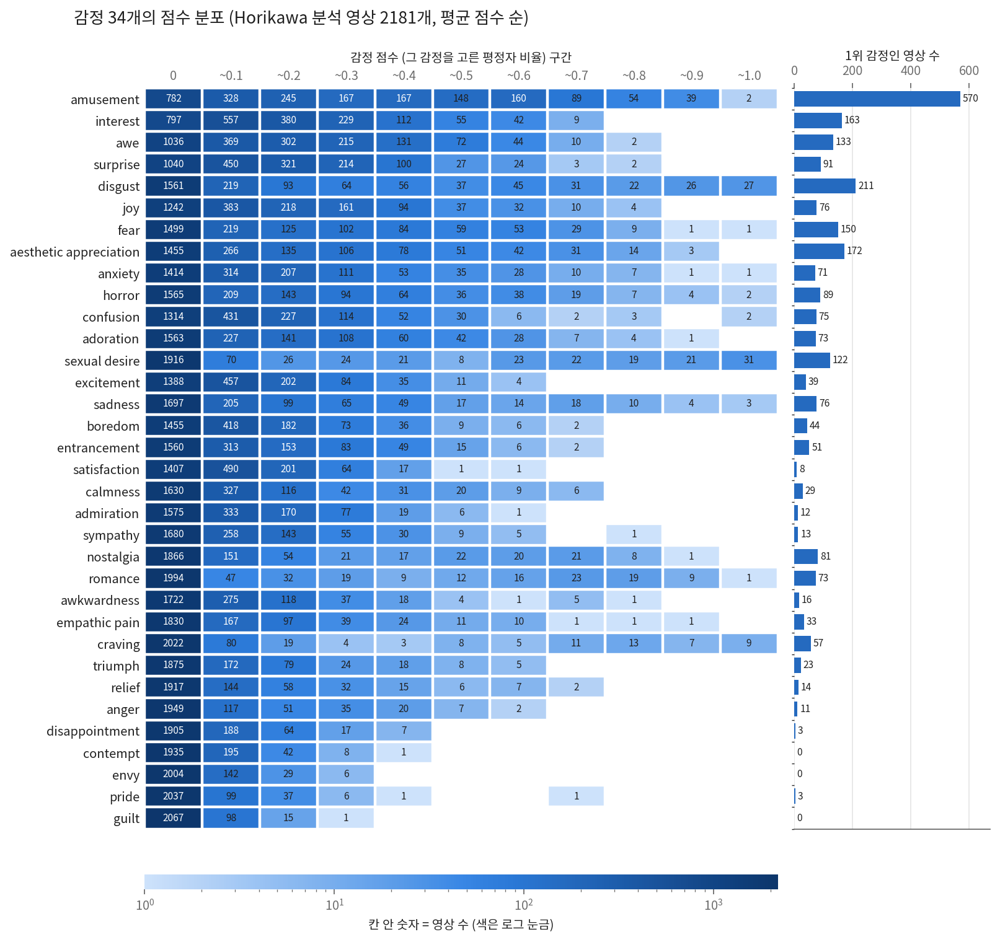
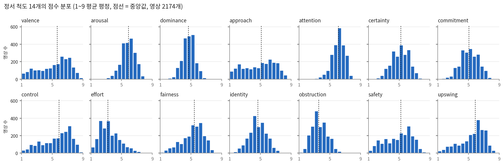
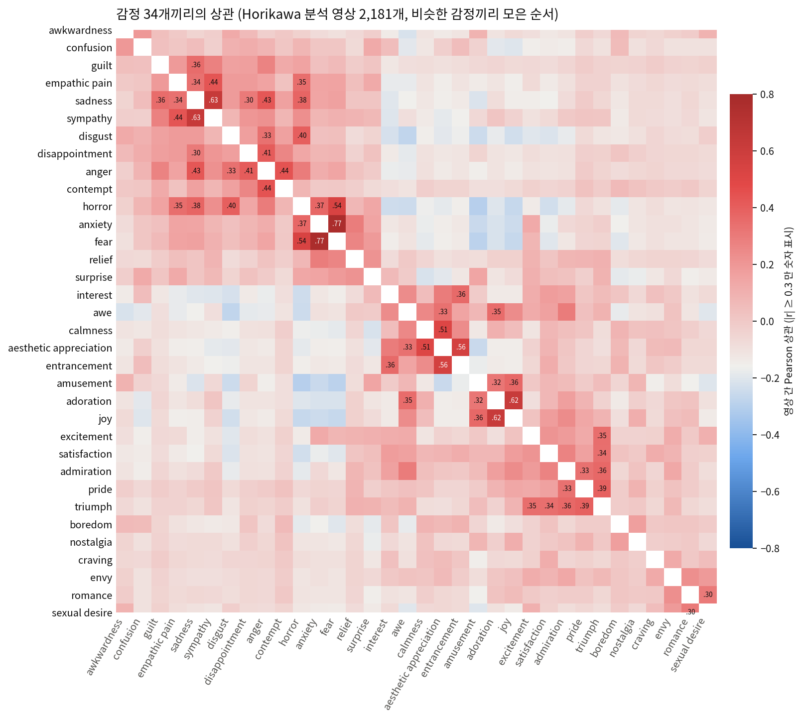
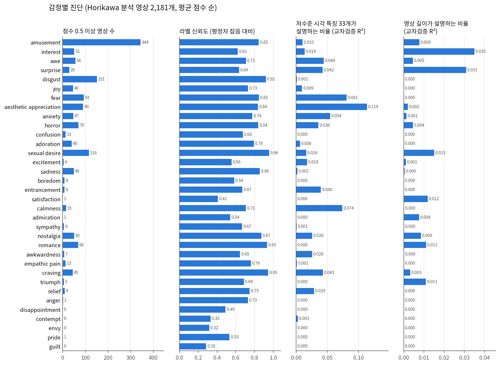
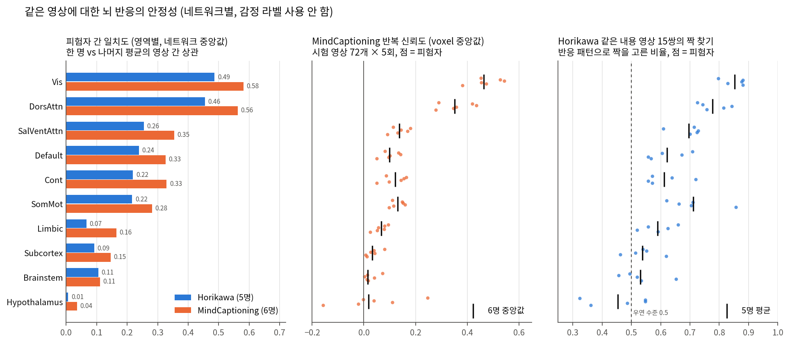

# EmoBrain 선행 분석 0단계 보고서: 데이터와 라벨 점검

_2026-10-22 · 주 데이터 = Horikawa 2020 (5명), 재현 데이터 = MindCaptioning (6명) (결정 기록 D23) · 입력 = QC 후 `v3_qc`(Horikawa)·`v2_qc`(MindCaptioning)_

이 단계는 예측 모델을 돌리기 전에 **라벨과 뇌 자료를 믿을 수 있는지, 어디까지 맞힐 수 있는지(상한), 무엇이 지름길이 될 수 있는지**를 확인한다.
감정 라벨로 모델을 고르거나 성능을 본 결과는 없다. 라벨 분석은 영상 단위 표만, 뇌 안정성 분석은 라벨 없이 계산했다.

---

## 한눈에 보기

| # | 질문 | 답 | 다음 분석에 주는 의미 |
|---|---|---|---|
| 분포 | 감정별 점수 분포는? | 모든 감정에서 0점 영상이 가장 많다 (amusement 36% ~ guilt 95%). 점수 0.5 이상 영상 수가 344개(amusement)부터 0개(guilt 등)까지 극단적으로 다르다 | 감정별 결과를 자료량에 따라 묶어서 보고 |
| 0-1 | 34개 감정이 서로 겹치나 | 일부만 겹친다 (anxiety–fear 0.76). 분산 80%에 주성분 19개 필요 | 몇 개 축으로 줄일 수 없는 고차원 라벨 |
| 0-2 | 34개와 14개 척도의 관계 | valence 는 34개로 79% 설명, arousal·dominance·attention 은 23~27% | 두 target 은 따로 본다 |
| 0-3 | 드문 감정 | 0.5 이상 영상이 20개 미만인 감정이 18개, 그중 4개는 0개 | 주 결과에서 빼고 따로 보고 |
| 0-4 | 라벨 자체의 안정성 | 영상당 평정자 7~32명. 라벨 신뢰도 0.28(guilt)~0.96(sexual desire), 중앙값 0.71 | 감정마다 맞힐 수 있는 상한이 다르다 |
| 0-5 | 라벨이 감정과 무관한 요인과 얽혀 있나 | **영상 길이만** 얽힘 (surprise +0.24 등). run 안 순서·세션·머리 움직임은 없음 | "영상 길이만" 기준선 필수 |
| 0-6 | 라벨이 저수준 시각 특징과 얽혀 있나 | 대부분 1% 안팎. aesthetic appreciation 11%, fear 8%, calmness 7% | "저수준 시각 특징만" 기준선 필수 |
| 0-7 | QC 후 블록 반응에 이상값이 있나 | 결측 0. 튀는 블록은 Horikawa 5명 합쳐 5개. 단, 블록 잡음 크기가 영상 길이와 강하게 얽힘 | 점검한 항목에서 자료 문제 발견 안 됨. "뇌 전체 평균·신호 크기만" 기준선 필수 |
| 0-8 | 같은 영상에 대한 뇌 반응이 안정적인가 | 시각·배측 주의 영역은 안정적, Limbic·피질하·시상하부는 매우 약함 | 뇌 → 감정은 시각계 신호에 크게 기댈 가능성이 높다 |
| 0-9 | 영상 길이가 라벨을 얼마나 설명하나 | 최대 3.5% (interest). 영상의 72%가 딱 10초 | 라벨 쪽 영향은 작지만 뇌 쪽 영향(0-7)과 합쳐지면 지름길이 됨 |

## 핵심 해석과 접근 방법

> **자료는 깨끗하지만, 감정 라벨은 영상 내용과 강하게 묶여 있고 뇌에서 안정적으로 잡히는 신호는 주로 시각 영역이다. 따라서 "뇌가 감정을 맞혔다"는 결과가 감정 자체인지 내용을 거친 것인지를 가르는 설계가 필요하다.**

**핵심 해석**

1. **전처리 결과는 믿고 쓸 수 있다.** 결측이 없고 튀는 블록이 극소수이며, 시각 영역 반응은 같은 영상에서 잘 재현된다.
2. **감정 라벨은 어려운 정답이다.**
   - 몇 개 축으로 줄지 않는 고차원 라벨이고, 대부분의 영상이 0점이다.
   - 감정마다 자료량과 신뢰도가 크게 다르다.
   - 따라서 34개 평균 성능 하나로 보면 왜곡된다.
3. **많은 감정이 영상 내용으로 정해진다.**
   - 켜짐/꺼짐형(sexual desire, craving, romance, disgust)은 특정 내용이 나오면 켜진다.
   - 일부 감정은 저수준 시각 특징과도 얽혀 있다.
   - 이는 결함이 아니라 EmoBrain 이 묻는 질문(뇌·내용·감정의 관계) 자체다.
4. **뇌에서 안정적인 신호는 시각·주의 영역에 있다.**
   - Limbic·피질하·시상하부는 반복해도 반응이 거의 재현되지 않는다.
   - 따라서 뇌만으로 한 감정 예측은 주로 시각 영역이 본 내용을 거칠 가능성이 높다.
   - 단, "그 영역에 감정 정보가 없다"는 뜻이 아니라 "이 자료로는 잡기 어렵다"는 뜻이다.
5. **약한 지름길이 있다.** 영상 길이, 저수준 시각 특징, 뇌 전체 신호 크기다. 각각은 약하지만 모델이 찾아 쓸 수 있으므로 기준선으로 막는다.

**접근 방법: 같은 채점표로 쌓는 비교 사다리**

| 단계 | 입력 → 감정 | 묻는 것 |
|---|---|---|
| ① 기준선 | 평균 / 영상 길이 / 저수준 시각 / 뇌 전체 신호 | 지름길만으로 얼마나 맞나 (넘어야 할 바닥) |
| ② 내용 | 영상·캡션 특징 | 내용만으로 얼마나 맞나 |
| ③ 뇌 | 뇌 반응만 | 뇌만으로 얼마나 맞나 |
| ④ 뇌 → 내용 → 감정 | 뇌에서 읽은 내용 특징 | ③이 내용을 거친 것인가 |
| ⑤ 뇌 + 내용 | 둘 다 | 뇌가 내용에 없는 정보를 더하나 |

**해석 규칙**

- ③ ≈ ④ 이면 뇌의 감정 정보는 대부분 내용을 거친 것이다.
- ⑤ > ② 이면 뇌가 내용 이상의 정보를 가진다. 이 경우 teacher–student 설계의 근거가 된다.
- 모든 단계는 ①을 넘어야 의미가 있다.

**함께 지킬 원칙**

- **감정을 묶어서, 상한과 함께 본다.**
  - 자료가 충분한 16개 감정을 주 결과로 하고, 각 감정의 라벨 신뢰도(상한) 대비로 성능을 해석한다.
  - 켜짐/꺼짐형은 내용으로 잘 맞을 것으로 예상한다.
  - 넓게 옅은형(interest, surprise, awe, joy 등)은 내용으로 덜 설명되므로, 뇌가 내용 이상을 기여한다면 여기서 보일 가능성이 크다.
- **뇌 영역을 나눠 본다.** 시각·주의 영역만, 그 밖의 영역만, 전체로 각각 예측한다. "시각 영역을 빼도 감정이 읽히는가"가 해석 4를 직접 확인하는 방법이다.
- **단순하게 시작한다.** Horikawa 5명, 469개 영역 평균(`roi_blocks/`), ridge 회귀, run 묶음 교차검증으로 시작하고 voxel·다른 모델로 넓힌다. MindCaptioning 은 정한 절차를 마지막에 그대로 적용한다.

**피해야 할 해석**

- **"뇌 단독 성능이 낮다 = 뇌에 감정 정보가 없다"는 틀린 결론이다.**
  - 블록 하나의 잡음이 커서(같은 영상 두 번의 패턴 상관 0.03), 예측 상관이 0.1~0.3 정도로 작아도 정상일 수 있다.
  - 시각 특징으로 시각 영역을 예측한 상관도 0.15 정도였다.
  - 절대 크기가 아니라 기준선과 상한 대비로 본다.
- **"뇌가 감정을 맞혔다 = 뇌가 감정을 표상한다"고 바로 말하지 않는다.** ②·④와 비교하기 전에는 "내용을 본 것"과 구분되지 않는다.

## 다음 단계 전에 정할 것

1. **감정 묶음 기준.** 점수 0.5 이상 영상 수로 묶는 안을 제안한다.
   - 50개 이상(10개): amusement, disgust, sexual desire, fear, aesthetic appreciation, horror, romance, awe, interest, nostalgia
   - 20~49개(6개): sadness, anxiety, joy, craving, adoration, surprise
   - 20개 미만(18개): 나머지
   - 주 결과는 앞 16개로 하고, 18개는 따로 보고한다.
2. **채점표.** 감정별 상관, 감정별 탐지 AUC, 대표 감정 맞히기, 영상 짝 구별, 오차 감소율을 모든 모델에 똑같이 붙인다.
3. **기준선 네 가지.**
   - 평균값만
   - 영상 길이만
   - 저수준 시각 특징만
   - 뇌 전체 평균·블록 신호 크기만
   - 뇌 모델은 이 넷을 넘어야 의미가 있다.
4. **14개 척도 처리.** arousal·dominance·attention 은 영상 간 차이가 작고 34개 감정과도 잘 대응하지 않는다. 주 target 에 넣을지 정해야 한다.
5. **(선택) MindCaptioning sub-02 의 잡음 큰 run 1개.** 재현 데이터이고 QC 기준은 통과했으므로 그대로 두는 것을 권한다.

---

## 1. 라벨 분포

- **0점이 대부분이다.** amusement 도 782개(36%)가 0점이고, guilt 는 2,067개(95%)가 0점이다. 그래서 감정별 "영상 간 상관"은 0이 아닌 소수 영상을 얼마나 맞히느냐로 결정된다.
- **분포 모양이 두 종류다.**
  - **켜짐/꺼짐형**: sexual desire, craving, romance, disgust, nostalgia, sadness. 대부분 0점이고 일부 영상만 0.7~1.0 이다. craving 은 2,022개가 0점인데 0.7 이상이 29개다. 영상 내용이 정하는 감정이다(romance ↔ 의미 범주 "Couples" 상관 0.83).
  - **넓게 옅은형**: interest, surprise, joy, confusion, excitement, boredom, satisfaction. 많은 영상에서 0.1~0.4 로 조금씩 고르지만 높은 점수는 드물다. interest 는 0.7 이상이 0개다.
- **1위 감정은 매우 불균형하다.** amusement 570개(26%), disgust 211, aesthetic appreciation 172, interest 163, fear 150 순이다. contempt·envy·guilt 는 0개다.

- **넓게 퍼진 척도**: valence, approach, control, safety, upswing. 표준편차 1.6~2.0 으로 1~9 범위를 고르게 쓴다.
- **가운데 몰린 척도**: arousal, dominance, attention. 표준편차 0.8~0.9 로 영상 간 차이가 작다.
- 14개 척도가 있는 영상은 2,174개다. 빠진 7개는 같은 내용 영상의 값으로 채울 수 있다.

## 2. 라벨 구조 (0-1, 0-2)

- **강하게 겹치는 쌍은 일부다.** anxiety–fear 0.76, sadness–sympathy 0.63, adoration–joy 0.62, aesthetic appreciation–entrancement 0.56, fear–horror 0.54.
- **묶음이 보인다.**
  - 위협: fear·anxiety·horror
  - 슬픔: sadness·sympathy·empathic pain
  - 즐거움: amusement·adoration·joy
  - 심미: aesthetic appreciation·entrancement·calmness·awe·interest
  - 성취: triumph·pride·admiration·satisfaction·excitement
- 음의 상관은 약하다. 가장 강한 것이 amusement–horror −0.29 다.
- **차원 수.** 첫 주성분이 13% 를 설명한다. 50·80·90% 를 설명하려면 각각 8·19·25개가 필요하고, 유효 차원 수는 19.4 다. 몇 개 축으로 요약되는 라벨이 아니다.
- **34개 ↔ 14개 척도.**
  - 34개 감정으로 14개 척도를 설명하는 정도(교차검증 R²): valence 0.79, safety 0.72, approach 0.70, control 0.68 은 높다. arousal 0.27, attention 0.24, dominance 0.23 은 낮다.
  - 반대로 14개 척도로 34개 감정을 설명하면 R² 중앙값이 0.17 이다. pride·envy·contempt 는 0.03~0.04 다.
  - 두 체계는 서로를 대신하지 못한다.

## 3. 라벨 신뢰도와 드문 감정 (0-3, 0-4)

- **평정자 수.** 점수가 모두 "고른 사람 수 ÷ 평정자 수" 꼴이라 영상별 평정자 수를 역산했다. 7~32명이고 중앙값은 13명이다(2,181개 모두 추정됨).
- **라벨 신뢰도.** 평정자 수에서 생기는 잡음을 영상 간 분산과 비교한 값이다.
  - 높음: sexual desire 0.96, craving 0.95, romance 0.93, disgust 0.92, nostalgia 0.87, sadness 0.86
  - 낮음: guilt 0.28, envy 0.32, contempt 0.33, satisfaction 0.41, disappointment 0.49
  - 신뢰도의 제곱근이 예측 상관의 대략적인 상한이다. 예를 들어 guilt 는 아무리 잘 맞혀도 약 0.53 이다.
- **켜짐/꺼짐형이 가장 안정적이고**, 넓게 옅은형과 드문 감정이 가장 불안정하다.

## 4. 감정과 무관한 요인 (0-5, 0-6, 0-9)

**영상 길이.** 길이와 라벨의 순위 상관(5명 평균, |r| ≥ 0.1 인 12개)은 다음과 같다.
- 양의 상관: surprise +0.24, interest +0.16, attention +0.15, triumph +0.15, amusement +0.14, awe·arousal·satisfaction·anxiety +0.11
- 음의 상관: sexual desire −0.16, romance −0.13, nostalgia −0.10

다만 영상의 72%가 딱 10초라, 길이가 설명하는 라벨 분산은 최대 3.5%(interest), 3.1%(surprise)로 작다. MindCaptioning 도 같은 양상이다(9개).

**run 안 순서, 시작 시각, 세션, 머리 움직임.** 라벨과의 순위 상관이 보이지 않았다. 검사 범위 안의 기술이며, 이 요인들이 뇌 예측에 기여하지 않는다는 뜻은 아니다.
- run 안 순서·시작 시각: 최대 |r| 0.06
- 세션: 설명 비율 최대 0.7%
- 블록 FD·DVARS 최대값: Horikawa 최대 0.06, MindCaptioning 최대 0.08
- Horikawa 는 5명의 제시 순서가 같으므로, 순서와 라벨이 무관하다는 이 결과가 특히 중요하다.

**저수준 시각 특징**(밝기·대비·채도·색·움직임·경계, 화면 칸별 밝기·움직임 33개). 대부분의 라벨에서 설명 비율이 1% 안팎이다(중앙값 0.011). 예외는 다음과 같다.

| 라벨 | 설명 비율 | 주된 방향 |
|---|---|---|
| aesthetic appreciation | 0.114 | 움직임 적음 (−0.28), 경계 약함 (−0.22) |
| fear | 0.081 | 채도 낮음 (−0.16), 움직임 많음 (+0.11) |
| calmness | 0.074 | 움직임 적음 (−0.23) |
| safety | 0.070 | 채도 높음 (+0.16), 움직임 적음 (−0.13) |
| anxiety | 0.054 | 채도 낮음 (−0.13) |
| control | 0.051 | 채도 높음, 움직임 적음 |

길이를 더해도 설명 비율은 거의 늘지 않는다. 두 요인은 서로 다른 지름길이다.

## 5. 뇌 자료 품질 (0-7)

| 데이터 | 피험자 | 블록 | 결측 | 튀는 블록 | 튀는 run | 블록 신호 크기 ↔ 영상 길이 |
|---|---|---|---|---|---|---|
| Horikawa | sub-01 | 2,191 | 0 | 0 | 0 | −0.49 |
| | sub-02 | 2,195 | 0 | 3 | 0 | −0.51 |
| | sub-03 | 2,187 | 0 | 1 | 1 | −0.50 |
| | sub-04 | 2,175 | 0 | 1 | 0 | −0.59 |
| | sub-05 | 2,085 | 0 | 0 | 0 | −0.55 |
| MindCaptioning | sub-01 | 2,535 | 0 | 0 | 0 | −0.26 |
| | sub-02 | 2,540 | 0 | 20 | 1 | −0.42 |
| | sub-03 | 2,538 | 0 | 0 | 0 | −0.34 |
| | sub-04 | 2,539 | 0 | 0 | 0 | −0.25 |
| | sub-05 | 2,539 | 0 | 10 | 0 | −0.45 |
| | sub-06 | 2,510 | 0 | 1 | 1 | −0.29 |

- **값 분포.** run 안 z 값의 분포는 11명 모두 거의 같다(1·99 백분위 ±2.3, 첨도 0 근처).
- **튀는 블록과 run.** 블록 신호 크기가 피험자 중앙값에서 5 MAD 넘게 벗어나거나 최대 |z| > 15 인 경우를 튀는 블록으로 셌다. 튀는 run 은 run 중앙값이 4 MAD 넘게 벗어난 경우다. MindCaptioning sub-02 는 20개가 일부 run(특히 한 run)에 몰려 있지만, 그 run 도 QC 기준(움직임)은 통과했다.
- **블록 신호 크기와 영상 길이.** 영상이 길수록 블록 신호 크기(voxel 간 표준편차)가 작다(−0.25 ~ −0.59). 긴 구간을 평균하니 생기는 당연한 현상이지만, 라벨이 길이와 얽혀 있어(4절) 지름길이 된다.
  - 실제로 블록 신호 크기와 surprise 의 상관이 Horikawa 에서 −0.11 ~ −0.17 이다.
  - 블록 전체 평균과 라벨의 상관도 최대 |0.17| 이다(MindCaptioning aesthetic appreciation 등).

## 6. 같은 영상에 대한 뇌 반응의 안정성 (0-8)

**피험자 간 일치도**(469개 영역, 한 명의 영역 반응과 나머지 평균의 영상 간 상관, 네트워크 중앙값)

| 네트워크 | Horikawa | MindCaptioning |
|---|---|---|
| Vis | 0.49 | 0.58 |
| DorsAttn | 0.46 | 0.56 |
| SalVentAttn | 0.26 | 0.35 |
| Default | 0.24 | 0.33 |
| Cont | 0.22 | 0.33 |
| SomMot | 0.22 | 0.28 |
| Limbic | 0.07 | 0.16 |
| Subcortex | 0.09 | 0.15 |
| Brainstem | 0.11 | 0.11 |
| Hypothalamus | 0.01 | 0.04 |

- 영역 중앙값은 Horikawa 0.24, MindCaptioning 0.33 이다. 일치도 0.1 을 넘는 영역은 469개 중 각각 408개, 450개다.
- Horikawa 는 5명의 제시 순서가 같아, 일치도에 순서와 관련된 공통 신호도 섞여 있을 수 있다. 다만 순서는 라벨과 무관하다(4절).

**피험자 안 반복 신뢰도**
- **Horikawa(같은 내용 영상 15쌍):** 두 번 본 반응 패턴의 상관은 같은 쌍 평균 0.03, 다른 쌍 0.00 이다. 블록 하나는 잡음이 크다는 뜻이다.
  - 그래도 짝을 고르는 정확도(우연 0.5)는 뇌 전체 0.63~0.74 다.
  - 네트워크별로는 Vis 0.80~0.88, DorsAttn 0.73~0.84 로 높고, Limbic 0.52~0.66, 피질하 0.46~0.62, 시상하부 0.32~0.55(우연 수준)다.
  - 15쌍뿐이라 대략적인 값이다.
- **MindCaptioning(시험 영상 72개 × 5회):** voxel 신뢰도(홀수·짝수 회차 평균의 상관, Spearman-Brown 보정) 중앙값은 0.07~0.13 이다. 0.3 을 넘는 voxel 은 18~26% 다.
  - 네트워크별로는 Vis 0.38~0.54, DorsAttn 0.28~0.44, Limbic 0.03~0.10 이다.
  - 72개 중 짝 찾기 정확도는 0.78~0.92 다.
  - 이 계산은 라벨을 쓰지 않았고, 모델·설정 선택에도 쓰지 않는다.

**해석.**
- 영상이 일관되게 바꾸는 뇌 신호는 시각·배측 주의 영역에 집중돼 있다.
- 감정과 관련이 깊다고 알려진 Limbic(눈확전두·측두극)·피질하·시상하부는 반복해도 반응이 거의 재현되지 않는다. 신호 손실과 작은 크기 때문이다.
- 따라서 **뇌 → 감정 예측은 시각계 신호에 크게 기댈 가능성이 높다.** 그 신호가 감정 자체인지, 감정과 얽힌 시각 내용인지를 4절의 기준선과 2·3번 분석(내용 ↔ 감정, 뇌 ↔ 내용)으로 구분해야 한다.

---

## 부록 A. 계산 방법 요약

| 항목 | 방법 |
|---|---|
| 분석 영상 | Horikawa 2,181개 (같은 내용 15쌍 중 나중 제시 제외). MindCaptioning 은 학습 세션 영상(시험 세션·설계상 제외 행 제외) |
| 감정 이름 대응 | `score_0~33` = `cowen34_order.txt` 알파벳 순. 의미 범주와 교차 확인 (disgust↔Feces/urine/vomit, romance↔Couples, adoration↔Babies, sexual desire↔Genitalia 가 모두 1위 짝) |
| 라벨 신뢰도 | 1 − 평균[p(1−p)/(n−1)] ÷ 영상 간 분산. n = 점수 분모로 역산한 평정자 수 |
| 설명 비율(R²) | 5겹 교차검증. 저수준 특징은 선형 회귀, 영상 길이는 분위 구간 평균 |
| 무관 요인 상관 | Spearman 순위 상관(피험자별 계산 후 평균), 세션은 ANOVA 설명 비율 |
| 블록 이상값 | 블록별 voxel 간 표준편차의 강건 z(중앙값·MAD) > 5 또는 최대 \|run 안 z\| > 15 |
| 피험자 간 일치도 | 영역 평균 반응(run 안 z), 공통 영상(Horikawa 2,038개, MindCaptioning 2,073개)에서 한 명 vs 나머지 평균의 상관 |
| 반복 신뢰도 | Horikawa: 같은 내용 쌍의 voxel 패턴 상관과 짝 찾기. MindCaptioning: 72개 영상의 홀수·짝수 회차 평균 상관 → Spearman-Brown |
| 저수준 시각 특징 | 초당 4장, 32×18 화소. 밝기·대비·채도·RGB·프레임 간 변화 평균·변동·경계 세기 + 3×4 칸별 밝기·변화 (33개) |

## 부록 B. 파일

- **결과 폴더:** `/storage/bigdata/EmoBrain_response/prelim/`
  - 라벨: `label_distribution_*.tsv`, `label_structure_*.tsv`, `label_confounds_summary.tsv`, `label_lowlevel_r2.tsv`
  - 뇌: `brain_summary_all.tsv`, `block_stats_*.tsv`, `run_stats_*.tsv`, `reliability/`
  - 영역 평균 반응: `roi_blocks/` (469개 영역, run 안 z). 이후 예측 분석의 입력으로 쓴다.
  - 저수준 특징: `lowlevel_video_features.tsv`
- **코드:** `/storage/bigdata/EmoBrain_response/code/prelim/`
  - `label_structure.py`, `label_distribution.py`, `confound_and_block_check.py`, `lowlevel_features.py`, `brain_reliability.py`, `report_figures.py`
  - 실행 파일: `run_block_check.sbatch`, `run_brain_reliability*.sbatch`
- **라벨 원본:** `/storage/bigdata/Horikawa/metadata/horikawa_meta_data_with_dimension_binary.csv` (34개 점수), `/scratch/connectome/seokjin14/EmoBrain/project/shared/data/` (`cowen34_order.txt`, `cowen_horikawa_labels.csv`: 14개 척도)
